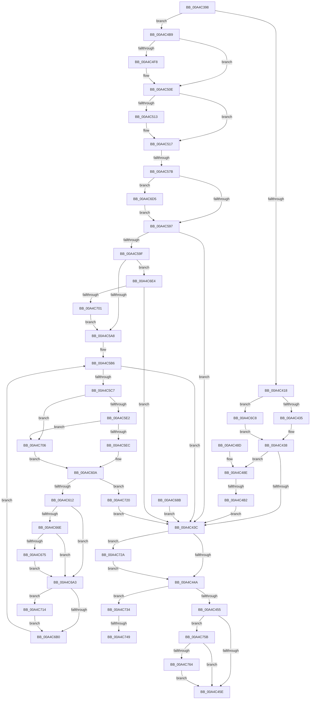

# PopBootStatGet

- RVA: `0x00A4C398`–`0x00A4C773` (길이 `987` bytes)
- VA: `0x0000000140A4C398`
- 실행 섹션: `PAGE`
- PDB 이름 있음: `예`; PDB Function 태그: `예`
- unwind 정보 RVA: `0x000B03E4`
- 디코드: `224`개 명령, `987/987` bytes 표시
- 미해석 바이트: `0` (있으면 어셈블리에 `.byte`로 보존)

> 이 문서는 커널 이미지의 기계어와 PDB 기호를 분석해 생성했습니다. 4번과 5번은 함수 원형과 자료형을 바이너리 사용 방식에서 추정한 C 해석이며 원본 소스 복구 결과는 아닙니다.

## 1. Dependencies

- 직접 호출 지점: **14**; 고유 호출 대상: **13**
- 직접 호출자로 확인된 함수: **1**
- RIP 상대 이미지 참조: **8**

### Outgoing calls
- `0x00A4C46B` → [_security_check_cookie](../../text/6A/_security_check_cookie_function_006AC640.md) (function, `0x006AC640`)
- `0x00A4C49C` → [ExAllocatePool2](../../poolcode/B8/ExAllocatePool2_function_00B820F0.md) (function, `0x00B820F0`)
- `0x00A4C4E4` → [KeAbPreAcquire](../../text/21/KeAbPreAcquire_function_00210230.md) (function, `0x00210230`)
- `0x00A4C509` → [ExfAcquirePushLockExclusiveEx](../../text/20/ExfAcquirePushLockExclusiveEx_function_0020FC90.md) (function, `0x0020FC90`)
- `0x00A4C563` → [RtlpAcquireBootStatusLock](../../text/4B/RtlpAcquireBootStatusLock_function_004B26AC.md) (function, `0x004B26AC`)
- `0x00A4C587` → [RtlpReleaseBootStatusLock](../../text/4C/RtlpReleaseBootStatusLock_function_004C05D4.md) (function, `0x004C05D4`)
- `0x00A4C640` → [memset](../../text/6C/memset_function_006C6C40.md) (function, `0x006C6C40`)
- `0x00A4C663` → [RtlpGetSetBootStatusData](RtlpGetSetBootStatusData_function_00A4CD64.md) (function, `0x00A4CD64`)
- `0x00A4C684` → [memcpy](../../text/6C/memcpy_function_006C6840.md) (function, `0x006C6840`)
- `0x00A4C6DA` → [ExFreePoolWithTag](../../poolcode/B8/ExFreePoolWithTag_function_00B82870.md) (function, `0x00B82870`)
- `0x00A4C6F2` → [PopBootStatAccessCheck](../AC/PopBootStatAccessCheck_function_00AC0814.md) (function, `0x00AC0814`)
- `0x00A4C72A` → [RtlUnlockBootStatusData](RtlUnlockBootStatusData_function_00A4CAF0.md) (function, `0x00A4CAF0`)
- `0x00A4C750` → [ExfTryToWakePushLock](../../text/26/ExfTryToWakePushLock_function_00265DD0.md) (function, `0x00265DD0`)
- `0x00A4C769` → [ExFreePoolWithTag](../../poolcode/B8/ExFreePoolWithTag_function_00B82870.md) (function, `0x00B82870`)

### Direct callers
- [PopPowerInformationInternal](../A8/PopPowerInformationInternal_function_00A8B7C0.md) at `0x00A8C471`

### Static image references
- `0x00A4C3B2` → RVA `0x00E0A740` (`.data`; read)
- `0x00A4C4DD` → RVA `0x00F084F0` (`.data`; read)
- `0x00A4C4EC` → RVA `0x00F084F0` (`.data`; read/write)
- `0x00A4C568` → RVA `0x00F05C44` (`.data`; read/write)
- `0x00A4C56E` → RVA `0x00F05C20` (`.data`; read)
- `0x00A4C57B` → RVA `0x00F05C28` (`.data`; read)
- `0x00A4C5EF` → RVA `0x0001BBA0` (`.rdata`; read)
- `0x00A4C612` → RVA `0x00E678F0` (`.data`; read)

## 2. Other-region calls and transfers

- 다른 실행 섹션으로 향하는 call: **11**
  - `0x00A4C46B` → [_security_check_cookie](../../text/6A/_security_check_cookie_function_006AC640.md) (`PAGE` → `.text`)
  - `0x00A4C49C` → [ExAllocatePool2](../../poolcode/B8/ExAllocatePool2_function_00B820F0.md) (`PAGE` → `POOLCODE`)
  - `0x00A4C4E4` → [KeAbPreAcquire](../../text/21/KeAbPreAcquire_function_00210230.md) (`PAGE` → `.text`)
  - `0x00A4C509` → [ExfAcquirePushLockExclusiveEx](../../text/20/ExfAcquirePushLockExclusiveEx_function_0020FC90.md) (`PAGE` → `.text`)
  - `0x00A4C563` → [RtlpAcquireBootStatusLock](../../text/4B/RtlpAcquireBootStatusLock_function_004B26AC.md) (`PAGE` → `.text`)
  - `0x00A4C587` → [RtlpReleaseBootStatusLock](../../text/4C/RtlpReleaseBootStatusLock_function_004C05D4.md) (`PAGE` → `.text`)
  - `0x00A4C640` → [memset](../../text/6C/memset_function_006C6C40.md) (`PAGE` → `.text`)
  - `0x00A4C684` → [memcpy](../../text/6C/memcpy_function_006C6840.md) (`PAGE` → `.text`)
  - `0x00A4C6DA` → [ExFreePoolWithTag](../../poolcode/B8/ExFreePoolWithTag_function_00B82870.md) (`PAGE` → `POOLCODE`)
  - `0x00A4C750` → [ExfTryToWakePushLock](../../text/26/ExfTryToWakePushLock_function_00265DD0.md) (`PAGE` → `.text`)
  - `0x00A4C769` → [ExFreePoolWithTag](../../poolcode/B8/ExFreePoolWithTag_function_00B82870.md) (`PAGE` → `POOLCODE`)
- call이 아닌 외부 분기/꼬리 이동: **4**
  - `0x00A4C4AC` → [sub_00B3B9F4](../B3/Unknown_function_00B3B9F4.md) (`tail-transfer`)
  - `0x00A4C575` → [sub_00B3B9F4 + 0x9A](../B3/Unknown_function_00B3B9F4.md) (`tail-transfer`)
  - `0x00A4C743` → [sub_00B3B9F4 + 0x16E](../B3/Unknown_function_00B3B9F4.md) (`tail-transfer`)
  - `0x00A4C756` → [sub_00B3B9F4 + 0x16E](../B3/Unknown_function_00B3B9F4.md) (`tail-transfer`)

## 3. Assembly (complete function range)

```asm
00A4C398  48 89 5C 24 18                  mov qword ptr [rsp + 0x18], rbx
00A4C39D  48 89 74 24 20                  mov qword ptr [rsp + 0x20], rsi
00A4C3A2  57                              push rdi
00A4C3A3  41 54                           push r12
00A4C3A5  41 55                           push r13
00A4C3A7  41 56                           push r14
00A4C3A9  41 57                           push r15
00A4C3AB  48 81 EC D0 01 00 00            sub rsp, 0x1d0
00A4C3B2  48 8B 05 87 E3 3B 00            mov rax, qword ptr [rip + 0x3be387]
00A4C3B9  48 33 C4                        xor rax, rsp
00A4C3BC  48 89 84 24 C0 01 00 00         mov qword ptr [rsp + 0x1c0], rax
00A4C3C4  48 89 94 24 90 00 00 00         mov qword ptr [rsp + 0x90], rdx
00A4C3CC  4C 8B E9                        mov r13, rcx
00A4C3CF  48 89 8C 24 88 00 00 00         mov qword ptr [rsp + 0x88], rcx
00A4C3D7  45 33 F6                        xor r14d, r14d
00A4C3DA  44 89 74 24 34                  mov dword ptr [rsp + 0x34], r14d
00A4C3DF  44 89 74 24 48                  mov dword ptr [rsp + 0x48], r14d
00A4C3E4  45 8B FE                        mov r15d, r14d
00A4C3E7  4C 89 74 24 40                  mov qword ptr [rsp + 0x40], r14
00A4C3EC  44 88 74 24 33                  mov byte ptr [rsp + 0x33], r14b
00A4C3F1  65 48 8B 04 25 88 01 00 00      mov rax, qword ptr gs:[0x188]
00A4C3FA  44 8A A0 32 02 00 00            mov r12b, byte ptr [rax + 0x232]
00A4C401  44 88 64 24 32                  mov byte ptr [rsp + 0x32], r12b
00A4C406  44 88 64 24 31                  mov byte ptr [rsp + 0x31], r12b
00A4C40B  48 83 CB FF                     or rbx, 0xffffffffffffffff
00A4C40F  45 84 E4                        test r12b, r12b
00A4C412  0F 84 A1 00 00 00               je 0x140a4c4b9
00A4C418  8B 49 08                        mov ecx, dword ptr [rcx + 8]
00A4C41B  8D 43 19                        lea eax, [rbx + 0x19]
00A4C41E  48 F7 E1                        mul rcx
00A4C421  48 89 94 24 80 00 00 00         mov qword ptr [rsp + 0x80], rdx
00A4C429  48 8B F0                        mov rsi, rax
00A4C42C  48 85 D2                        test rdx, rdx
00A4C42F  0F 85 93 02 00 00               jne 0x140a4c6c8
00A4C435  41 8B FE                        mov edi, r14d
00A4C438  85 FF                           test edi, edi
00A4C43A  79 52                           jns 0x140a4c48e
00A4C43C  48 8B 4C 24 40                  mov rcx, qword ptr [rsp + 0x40]
00A4C441  48 85 C9                        test rcx, rcx
00A4C444  0F 85 E0 02 00 00               jne 0x140a4c72a
00A4C44A  44 38 74 24 33                  cmp byte ptr [rsp + 0x33], r14b
00A4C44F  0F 85 DF 02 00 00               jne 0x140a4c734
00A4C455  45 84 E4                        test r12b, r12b
00A4C458  0F 85 FD 02 00 00               jne 0x140a4c75b
00A4C45E  8B C7                           mov eax, edi
00A4C460  48 8B 8C 24 C0 01 00 00         mov rcx, qword ptr [rsp + 0x1c0]
00A4C468  48 33 CC                        xor rcx, rsp
00A4C46B  E8 D0 01 C6 FF                  call 0x1406ac640
00A4C470  4C 8D 9C 24 D0 01 00 00         lea r11, [rsp + 0x1d0]
00A4C478  49 8B 5B 40                     mov rbx, qword ptr [r11 + 0x40]
00A4C47C  49 8B 73 48                     mov rsi, qword ptr [r11 + 0x48]
00A4C480  49 8B E3                        mov rsp, r11
00A4C483  41 5F                           pop r15
00A4C485  41 5E                           pop r14
00A4C487  41 5D                           pop r13
00A4C489  41 5C                           pop r12
00A4C48B  5F                              pop rdi
00A4C48C  C3                              ret
00A4C48D  CC                              int3
00A4C48E  41 B8 4D 65 6D 20               mov r8d, 0x206d654d
00A4C494  48 8B D6                        mov rdx, rsi
00A4C497  B9 00 01 00 00                  mov ecx, 0x100
00A4C49C  E8 4F 5C 13 00                  call 0x140b820f0
00A4C4A1  4C 8B F8                        mov r15, rax
00A4C4A4  48 89 44 24 58                  mov qword ptr [rsp + 0x58], rax
00A4C4A9  48 85 C0                        test rax, rax
00A4C4AC  0F 85 42 F5 0E 00               jne 0x140b3b9f4
00A4C4B2  BF 9A 00 00 C0                  mov edi, 0xc000009a
00A4C4B7  EB 83                           jmp 0x140a4c43c
00A4C4B9  4C 8B 79 10                     mov r15, qword ptr [rcx + 0x10]
00A4C4BD  4C 89 7C 24 58                  mov qword ptr [rsp + 0x58], r15
00A4C4C2  C6 44 24 33 01                  mov byte ptr [rsp + 0x33], 1
00A4C4C7  65 48 8B 04 25 88 01 00 00      mov rax, qword ptr gs:[0x188]
00A4C4D0  66 01 98 E4 01 00 00            add word ptr [rax + 0x1e4], bx
00A4C4D7  90                              nop
00A4C4D8  45 33 C0                        xor r8d, r8d
00A4C4DB  33 D2                           xor edx, edx
00A4C4DD  48 8D 0D 0C C0 4B 00            lea rcx, [rip + 0x4bc00c]
00A4C4E4  E8 47 3D 7C FF                  call 0x140210230
00A4C4E9  48 8B F8                        mov rdi, rax
00A4C4EC  F0 48 0F BA 2D FA BF 4B 00 00   lock bts qword ptr [rip + 0x4bbffa], 0
00A4C4F6  73 16                           jae 0x140a4c50e
00A4C4F8  4C 8D 05 F1 BF 4B 00            lea r8, [rip + 0x4bbff1]
00A4C4FF  48 8B D0                        mov rdx, rax
00A4C502  48 8D 0D E7 BF 4B 00            lea rcx, [rip + 0x4bbfe7]
00A4C509  E8 82 37 7C FF                  call 0x14020fc90
00A4C50E  48 85 FF                        test rdi, rdi
00A4C511  74 04                           je 0x140a4c517
00A4C513  C6 47 0A 01                     mov byte ptr [rdi + 0xa], 1
00A4C517  33 C0                           xor eax, eax
00A4C519  0F 57 C0                        xorps xmm0, xmm0
00A4C51C  0F 11 84 24 98 00 00 00         movups xmmword ptr [rsp + 0x98], xmm0
00A4C524  0F 11 84 24 A8 00 00 00         movups xmmword ptr [rsp + 0xa8], xmm0
00A4C52C  48 89 84 24 B8 00 00 00         mov qword ptr [rsp + 0xb8], rax
00A4C534  89 84 24 C0 00 00 00            mov dword ptr [rsp + 0xc0], eax
00A4C53B  0F 11 84 24 C8 00 00 00         movups xmmword ptr [rsp + 0xc8], xmm0
00A4C543  4C 89 74 24 50                  mov qword ptr [rsp + 0x50], r14
00A4C548  0F 57 C9                        xorps xmm1, xmm1
00A4C54B  0F 11 8C 24 D8 00 00 00         movups xmmword ptr [rsp + 0xd8], xmm1
00A4C553  49 8B F6                        mov rsi, r14
00A4C556  4C 89 74 24 60                  mov qword ptr [rsp + 0x60], r14
00A4C55B  44 88 74 24 30                  mov byte ptr [rsp + 0x30], r14b
00A4C560  41 8B FE                        mov edi, r14d
00A4C563  E8 44 61 A6 FF                  call 0x1404b26ac
00A4C568  FF 05 D6 96 4B 00               inc dword ptr [rip + 0x4b96d6]
00A4C56E  44 38 35 AB 96 4B 00            cmp byte ptr [rip + 0x4b96ab], r14b
00A4C575  0F 84 13 F5 0E 00               je 0x140b3ba8e
00A4C57B  48 8B 05 A6 96 4B 00            mov rax, qword ptr [rip + 0x4b96a6]
00A4C582  48 89 44 24 40                  mov qword ptr [rsp + 0x40], rax
00A4C587  E8 48 40 A7 FF                  call 0x1404c05d4
00A4C58C  44 38 74 24 30                  cmp byte ptr [rsp + 0x30], r14b
00A4C591  0F 85 3E 01 00 00               jne 0x140a4c6d5
00A4C597  85 FF                           test edi, edi
00A4C599  0F 88 9D FE FF FF               js 0x140a4c43c
00A4C59F  45 84 E4                        test r12b, r12b
00A4C5A2  0F 85 3C 01 00 00               jne 0x140a4c6e4
00A4C5A8  45 8B EE                        mov r13d, r14d
00A4C5AB  44 89 74 24 38                  mov dword ptr [rsp + 0x38], r14d
00A4C5B0  41 8B C6                        mov eax, r14d
00A4C5B3  41 8B CE                        mov ecx, r14d
00A4C5B6  48 8B 94 24 88 00 00 00         mov rdx, qword ptr [rsp + 0x88]
00A4C5BE  3B 42 08                        cmp eax, dword ptr [rdx + 8]
00A4C5C1  0F 83 75 FE FF FF               jae 0x140a4c43c
00A4C5C7  8B C1                           mov eax, ecx
00A4C5C9  48 8D 0C 40                     lea rcx, [rax + rax*2]
00A4C5CD  4D 8D 24 CF                     lea r12, [r15 + rcx*8]
00A4C5D1  4C 89 64 24 68                  mov qword ptr [rsp + 0x68], r12
00A4C5D6  49 63 04 24                     movsxd rax, dword ptr [r12]
00A4C5DA  85 C0                           test eax, eax
00A4C5DC  0F 88 24 01 00 00               js 0x140a4c706
00A4C5E2  48 83 F8 13                     cmp rax, 0x13
00A4C5E6  0F 83 1A 01 00 00               jae 0x140a4c706
00A4C5EC  0F AE E8                        lfence
00A4C5EF  48 8D 0D AA F5 5C FF            lea rcx, [rip - 0xa30a56]
00A4C5F6  8B 04 C1                        mov eax, dword ptr [rcx + rax*8]
00A4C5F9  89 44 24 48                     mov dword ptr [rsp + 0x48], eax
00A4C5FD  41 8B FE                        mov edi, r14d
00A4C600  4C 8B 64 24 68                  mov r12, qword ptr [rsp + 0x68]
00A4C605  44 8B 6C 24 38                  mov r13d, dword ptr [rsp + 0x38]
00A4C60A  85 FF                           test edi, edi
00A4C60C  0F 88 0E 01 00 00               js 0x140a4c720
00A4C612  48 8D 0D D7 B2 41 00            lea rcx, [rip + 0x41b2d7]
00A4C619  48 03 C1                        add rax, rcx
00A4C61C  48 89 44 24 70                  mov qword ptr [rsp + 0x70], rax
00A4C621  41 8B 7C 24 10                  mov edi, dword ptr [r12 + 0x10]
00A4C626  44 88 74 24 3C                  mov byte ptr [rsp + 0x3c], r14b
00A4C62B  44 89 74 24 78                  mov dword ptr [rsp + 0x78], r14d
00A4C630  33 D2                           xor edx, edx
00A4C632  41 B8 C8 00 00 00               mov r8d, 0xc8
00A4C638  48 8D 8C 24 F0 00 00 00         lea rcx, [rsp + 0xf0]
00A4C640  E8 FB A5 C7 FF                  call 0x1406c6c40
00A4C645  48 8D 44 24 34                  lea rax, [rsp + 0x34]
00A4C64A  48 89 44 24 28                  mov qword ptr [rsp + 0x28], rax
00A4C64F  89 7C 24 20                     mov dword ptr [rsp + 0x20], edi
00A4C653  4C 8B 4C 24 70                  mov r9, qword ptr [rsp + 0x70]
00A4C658  45 8B 04 24                     mov r8d, dword ptr [r12]
00A4C65C  B2 01                           mov dl, 1
00A4C65E  48 8B 4C 24 40                  mov rcx, qword ptr [rsp + 0x40]
00A4C663  E8 FC 06 00 00                  call 0x140a4cd64
00A4C668  8B F8                           mov edi, eax
00A4C66A  85 C0                           test eax, eax
00A4C66C  78 35                           js 0x140a4c6a3
00A4C66E  44 39 74 24 34                  cmp dword ptr [rsp + 0x34], r14d
00A4C673  76 2E                           jbe 0x140a4c6a3
00A4C675  44 8B 44 24 34                  mov r8d, dword ptr [rsp + 0x34]
00A4C67A  48 8B 54 24 70                  mov rdx, qword ptr [rsp + 0x70]
00A4C67F  49 8B 4C 24 08                  mov rcx, qword ptr [r12 + 8]
00A4C684  E8 B7 A1 C7 FF                  call 0x1406c6840
00A4C689  EB 18                           jmp 0x140a4c6a3
00A4C68B  8B F8                           mov edi, eax
00A4C68D  45 33 F6                        xor r14d, r14d
00A4C690  48 83 CB FF                     or rbx, 0xffffffffffffffff
00A4C694  4C 8B 7C 24 58                  mov r15, qword ptr [rsp + 0x58]
00A4C699  44 8A 64 24 31                  mov r12b, byte ptr [rsp + 0x31]
00A4C69E  E9 99 FD FF FF                  jmp 0x140a4c43c
00A4C6A3  48 8B 94 24 90 00 00 00         mov rdx, qword ptr [rsp + 0x90]
00A4C6AB  48 85 D2                        test rdx, rdx
00A4C6AE  75 64                           jne 0x140a4c714
00A4C6B0  41 FF C5                        inc r13d
00A4C6B3  41 8B C5                        mov eax, r13d
00A4C6B6  44 89 6C 24 38                  mov dword ptr [rsp + 0x38], r13d
00A4C6BB  41 8B CD                        mov ecx, r13d
00A4C6BE  44 8A 64 24 32                  mov r12b, byte ptr [rsp + 0x32]
00A4C6C3  E9 EE FE FF FF                  jmp 0x140a4c5b6
00A4C6C8  48 8B F3                        mov rsi, rbx
00A4C6CB  BF 95 00 00 C0                  mov edi, 0xc0000095
00A4C6D0  E9 63 FD FF FF                  jmp 0x140a4c438
00A4C6D5  33 D2                           xor edx, edx
00A4C6D7  48 8B CE                        mov rcx, rsi
00A4C6DA  E8 91 61 13 00                  call 0x140b82870
00A4C6DF  E9 B3 FE FF FF                  jmp 0x140a4c597
00A4C6E4  41 B8 01 00 00 00               mov r8d, 1
00A4C6EA  41 8A D4                        mov dl, r12b
00A4C6ED  48 8B 4C 24 40                  mov rcx, qword ptr [rsp + 0x40]
00A4C6F2  E8 1D 41 07 00                  call 0x140ac0814
00A4C6F7  8B F8                           mov edi, eax
00A4C6F9  85 C0                           test eax, eax
00A4C6FB  0F 88 3B FD FF FF               js 0x140a4c43c
00A4C701  E9 A2 FE FF FF                  jmp 0x140a4c5a8
00A4C706  BF 0D 00 00 C0                  mov edi, 0xc000000d
00A4C70B  8B 44 24 48                     mov eax, dword ptr [rsp + 0x48]
00A4C70F  E9 F6 FE FF FF                  jmp 0x140a4c60a
00A4C714  41 8B CD                        mov ecx, r13d
00A4C717  8B 44 24 34                     mov eax, dword ptr [rsp + 0x34]
00A4C71B  89 04 8A                        mov dword ptr [rdx + rcx*4], eax
00A4C71E  EB 90                           jmp 0x140a4c6b0
00A4C720  44 8A 64 24 32                  mov r12b, byte ptr [rsp + 0x32]
00A4C725  E9 12 FD FF FF                  jmp 0x140a4c43c
00A4C72A  E8 C1 03 00 00                  call 0x140a4caf0
00A4C72F  E9 16 FD FF FF                  jmp 0x140a4c44a
00A4C734  F0 48 0F C1 1D B3 BD 4B 00      lock xadd qword ptr [rip + 0x4bbdb3], rbx
00A4C73D  80 E3 06                        and bl, 6
00A4C740  80 FB 02                        cmp bl, 2
00A4C743  0F 85 19 F4 0E 00               jne 0x140b3bb62
00A4C749  48 8D 0D A0 BD 4B 00            lea rcx, [rip + 0x4bbda0]
00A4C750  E8 7B 96 81 FF                  call 0x140265dd0
00A4C755  90                              nop
00A4C756  E9 07 F4 0E 00                  jmp 0x140b3bb62
00A4C75B  4D 85 FF                        test r15, r15
00A4C75E  0F 84 FA FC FF FF               je 0x140a4c45e
00A4C764  33 D2                           xor edx, edx
00A4C766  49 8B CF                        mov rcx, r15
00A4C769  E8 02 61 13 00                  call 0x140b82870
00A4C76E  E9 EB FC FF FF                  jmp 0x140a4c45e
```

## 4. C-style interpretation (structured pseudocode)

```c
__int64 __fastcall PopBootStatGet(__int64 a1, __int64 a2)
{
    __int64 result;
    __int64 v_r13;
    __int64 v_r14;
    __int64 v_rbx;
    __int64 v_rsp;
    unsigned __int64 v_stack_m108;
    unsigned int v_stack_m110;
    unsigned __int64 v_stack_m118;
    unsigned __int64 v_stack_m128;
    unsigned __int64 v_stack_m138;
    unsigned __int64 v_stack_m140;
    unsigned __int64 v_stack_m148;
    unsigned int v_stack_m158;
    unsigned __int64 v_stack_m160;
    unsigned __int64 v_stack_m168;
    unsigned __int64 v_stack_m170;
    unsigned __int64 v_stack_m178;
    unsigned __int64 v_stack_m180;
    unsigned int v_stack_m188;
    unsigned __int64 v_stack_m190;
    unsigned __int8 v_stack_m194;
    unsigned int v_stack_m198;
    unsigned __int64 v_stack_m19C;
    unsigned __int8 v_stack_m19D;
    unsigned __int8 v_stack_m19E;
    unsigned __int8 v_stack_m19F;
    unsigned __int8 v_stack_m1A0;
    unsigned __int64 v_stack_m1A8;
    unsigned int v_stack_m1B0;
    unsigned __int64 v_stack_m1B8;
    unsigned int v_stack_m1C4;
    unsigned __int8 v_stack_m1C5;
    unsigned __int8 v_stack_m1C6;
    unsigned __int8 v_stack_m1C7;
    unsigned __int64 v_stack_m28;
    unsigned __int64 v_stack_m38;
    unsigned __int64 v_stack_mE0;
    unsigned __int64 v_stack_mF8;
    unsigned __int64 v_stack_p18;
    unsigned __int64 v_stack_p20;

    v_stack_p18 = v_rbx;
    v_stack_p20 = v_rsi;
    v_rsp = (v_rsp) - (464);
    result = (*(unsigned __int64 *)(v_rip + 3924871)) ^ (v_rsp);
    v_stack_m38 = result;
    v_stack_m168 = a2;
    v_stack_m170 = a1;
    v_r14 = 0;
    v_stack_m1C4 = 0;
    v_stack_m1B0 = 0;
    v_stack_m1B8 = 0;
    v_stack_m1C5 = 0;
    v_stack_m1C6 = (unsigned __int8)(*(unsigned __int8 *)(*(unsigned __int64 *)(gs_base + (0 + 392)) + 562));
    v_stack_m1C7 = (unsigned __int8)(*(unsigned __int8 *)(*(unsigned __int64 *)(gs_base + (0 + 392)) + 562));
    v_rbx = (v_rbx) | (-1);
    if ((unsigned __int8)(*(unsigned __int8 *)(*(unsigned __int64 *)(gs_base + (0 + 392)) + 562)) == 0) goto loc_00A4C4B9;
    v_stack_m178 = a2;
    if (a2 != 0) goto loc_00A4C6C8;
loc_00A4C438:
    if (!sign_flag) goto loc_00A4C48E;
loc_00A4C43C:
    if (v_stack_m1B8 != 0) goto loc_00A4C72A;
loc_00A4C44A:
    if (v_stack_m1C5 != 0) goto loc_00A4C734;
    if ((unsigned __int8)(*(unsigned __int8 *)(*(unsigned __int64 *)(gs_base + (0 + 392)) + 562)) != 0) goto loc_00A4C75B;
loc_00A4C45E:
    a1 = (v_stack_m38) ^ (v_rsp);
    result = _security_check_cookie(a1, a2, a3, a4);
    return result;
loc_00A4C48E:
    result = ExAllocatePool2(256, *(unsigned __int64 *)(v_stack_m28 + 72), (unsigned int)(0x206D654DULL), a4);
    v_stack_m178 = result;
    goto loc_00A4C43C;
loc_00A4C4B9:
    v_stack_m178 = *(unsigned __int64 *)(256 + 16);
    v_stack_m19D = 1;
    a3 = 0;
    a2 = 0;
    result = KeAbPreAcquire(v_rip + 4964364, a2, a3, a4);
    if (!(condition_is_above_or_equal)) {
        a3 = v_rip + 4964337;
        a2 = result;
        a1 = v_rip + 4964327;
        result = ExfAcquirePushLockExclusiveEx(a1, a2, a3, a4);
    }
    if (result != 0) {
        *(unsigned __int8 *)(result + 10) = 1;
    }
    result = 0;
    v_stack_m138 = v_xmm0;
    v_stack_m128 = v_xmm0;
    v_stack_m118 = 0;
    v_stack_m110 = 0;
    v_stack_m108 = v_xmm0;
    v_stack_m180 = 0;
    v_stack_mF8 = v_xmm1;
    v_stack_m170 = 0;
    v_stack_m1A0 = 0;
    result = RtlpAcquireBootStatusLock(a1, a2, a3, a4);
    v_stack_m190 = *(unsigned __int64 *)(v_rip + 4953766);
    result = RtlpReleaseBootStatusLock(a1, a2, a3, a4);
    if (v_stack_m1A0 != 0) goto loc_00A4C6D5;
loc_00A4C597:
    if (sign_flag) goto loc_00A4C43C;
    if ((unsigned __int8)(*(unsigned __int8 *)(*(unsigned __int64 *)(gs_base + (0 + 392)) + 562)) != 0) goto loc_00A4C6E4;
loc_00A4C5A8:
    v_stack_m198 = 0;
loc_00A4C5B6:
    if (0 >= (*(unsigned int *)(v_stack_m148 + 8))) goto loc_00A4C43C;
    v_stack_m168 = *(unsigned __int64 *)(256 + 16) + 0 + 0 * 2 * 8;
    if (sign_flag) goto loc_00A4C706;
    if (((int)(*(unsigned int *)(*(unsigned __int64 *)(256 + 16) + 0 + 0 * 2 * 8))) >= 19) goto loc_00A4C706;
    v_stack_m188 = (unsigned int)((unsigned int)(*(unsigned int *)(v_rip - 10685014 + (int)(*(unsigned int *)(*(unsigned __int64 *)(256 + 16) + 0 + 0 * 2 * 8)) * 8)));
loc_00A4C60A:
    if (sign_flag) goto loc_00A4C720;
    result = ((unsigned int)(*(unsigned int *)(v_rip - 10685014 + (int)(*(unsigned int *)(*(unsigned __int64 *)(256 + 16) + 0 + 0 * 2 * 8)) * 8))) + (v_rip + 4305623);
    v_stack_m160 = result;
    v_stack_m194 = 0;
    v_stack_m158 = 0;
    a2 = 0;
    result = memset(v_stack_mE0, a2, 200, a4);
    v_stack_m1A8 = v_stack_m19C;
    v_stack_m1B0 = (unsigned int)((unsigned int)(*(unsigned int *)(v_stack_m168 + 16)));
    result = RtlpGetSetBootStatusData(v_stack_m190, 1, (unsigned int)(*(unsigned int *)(v_stack_m168)), v_stack_m160);
    if (sign_flag) goto loc_00A4C6A3;
    if (v_stack_m19C <= 0) goto loc_00A4C6A3;
    result = memcpy(*(unsigned __int64 *)(v_stack_m168 + 8), v_stack_m160, (unsigned int)(v_stack_m19C), v_stack_m160);
    goto loc_00A4C6A3;
loc_00A4C6A3:
    if (v_stack_m140 != 0) goto loc_00A4C714;
loc_00A4C6B0:
    v_r13 = (unsigned int)(((unsigned int)(v_stack_m198)) + 1);
    v_stack_m198 = (unsigned int)(v_r13);
    goto loc_00A4C5B6;
loc_00A4C6C8:
    goto loc_00A4C438;
loc_00A4C6D5:
    a2 = 0;
    result = ExFreePoolWithTag(*(unsigned __int64 *)(v_stack_m28 + 64), a2, (unsigned int)(v_stack_m19C), v_stack_m160);
    goto loc_00A4C597;
loc_00A4C6E4:
    result = PopBootStatAccessCheck(v_stack_m190, (unsigned __int8)(v_stack_m19E), 1, v_stack_m160);
    if (sign_flag) goto loc_00A4C43C;
    goto loc_00A4C5A8;
loc_00A4C706:
    goto loc_00A4C60A;
loc_00A4C714:
    *(unsigned int *)((unsigned __int8)(v_stack_m19E) + (unsigned int)((unsigned int)(v_r13)) * 4) = (unsigned int)((unsigned int)(v_stack_m19C));
    goto loc_00A4C6B0;
loc_00A4C720:
    goto loc_00A4C43C;
loc_00A4C72A:
    result = RtlUnlockBootStatusData((unsigned int)((unsigned int)(v_r13)), (unsigned __int8)(v_stack_m19E), 1, v_stack_m160);
    goto loc_00A4C44A;
loc_00A4C734:
    v_rbx = (unsigned __int8)((*(unsigned __int64 *)(v_stack_m28 + 64)) & (6));
    result = ExfTryToWakePushLock(v_rip + 4963744, (unsigned __int8)(v_stack_m19E), 1, v_stack_m160);
loc_00A4C75B:
    if (*(unsigned __int64 *)(256 + 16) == 0) goto loc_00A4C45E;
    a2 = 0;
    result = ExFreePoolWithTag(*(unsigned __int64 *)(256 + 16), a2, 1, v_stack_m160);
    goto loc_00A4C45E;
}
```

## 5. (Beta) C Style

```c
int64_t PopBootStatGet(void *Arg1, int64_t Arg2)
{
    uint8_t *arg1 = (uint8_t *)Arg1;

    int64_t result;
    int64_t local_r13;
    int64_t local_r14;
    int64_t local_rbx;
    int64_t local_rsp;
    uint64_t v_stack_m108;
    uint32_t v_stack_m110;
    uint64_t v_stack_m118;
    uint64_t v_stack_m128;
    uint64_t v_stack_m138;
    uint64_t v_stack_m140;
    uint64_t v_stack_m148;
    uint32_t v_stack_m158;
    uint64_t v_stack_m160;
    uint64_t v_stack_m168;
    uint64_t v_stack_m170;
    uint64_t v_stack_m178;
    uint64_t v_stack_m180;
    uint32_t v_stack_m188;
    uint64_t v_stack_m190;
    uint8_t v_stack_m194;
    uint32_t v_stack_m198;
    uint64_t v_stack_m19C;
    uint8_t v_stack_m19D;
    uint8_t v_stack_m19E;
    uint8_t v_stack_m19F;
    uint8_t v_stack_m1A0;
    uint64_t v_stack_m1A8;
    uint32_t v_stack_m1B0;
    uint64_t v_stack_m1B8;
    uint32_t v_stack_m1C4;
    uint8_t v_stack_m1C5;
    uint8_t v_stack_m1C6;
    uint8_t v_stack_m1C7;
    uint64_t v_stack_m28;
    uint64_t v_stack_m38;
    uint64_t v_stack_mE0;
    uint64_t v_stack_mF8;
    uint64_t v_stack_p18;
    uint64_t v_stack_p20;

    v_stack_p18 = local_rbx;
    v_stack_p20 = local_rsi;
    local_rsp = (local_rsp) - (464);
    result = (*(uint64_t *)(v_rip + 0x3BE387)) ^ (local_rsp);
    v_stack_m38 = result;
    v_stack_m168 = Arg2;
    v_stack_m170 = Arg1;
    local_r14 = 0;
    v_stack_m1C4 = 0;
    v_stack_m1B0 = 0;
    v_stack_m1B8 = 0;
    v_stack_m1C5 = 0;
    v_stack_m1C6 = (uint8_t)(*(uint8_t *)(*(uint64_t *)(gs_base + (0 + 0x188)) + 0x232));
    v_stack_m1C7 = (uint8_t)(*(uint8_t *)(*(uint64_t *)(gs_base + (0 + 0x188)) + 0x232));
    local_rbx = (local_rbx) | (-1);
    if ((uint8_t)(*(uint8_t *)(*(uint64_t *)(gs_base + (0 + 0x188)) + 0x232)) == 0) goto loc_00A4C4B9;
    v_stack_m178 = Arg2;
    if (Arg2 != 0) goto loc_00A4C6C8;
loc_00A4C438:
    if (!sign_flag) goto loc_00A4C48E;
loc_00A4C43C:
    if (v_stack_m1B8 != 0) goto loc_00A4C72A;
loc_00A4C44A:
    if (v_stack_m1C5 != 0) goto loc_00A4C734;
    if ((uint8_t)(*(uint8_t *)(*(uint64_t *)(gs_base + (0 + 0x188)) + 0x232)) != 0) goto loc_00A4C75B;
loc_00A4C45E:
    Arg1 = (v_stack_m38) ^ (local_rsp);
    result = _security_check_cookie(Arg1, Arg2, a3, a4);
    return result;
loc_00A4C48E:
    result = ExAllocatePool2(256, *(uint64_t *)(v_stack_m28 + 0x48), (uint32_t)(0x206D654DULL), a4);
    v_stack_m178 = result;
    goto loc_00A4C43C;
loc_00A4C4B9:
    v_stack_m178 = *(uint64_t *)(256 + 0x10);
    v_stack_m19D = 1;
    a3 = 0;
    Arg2 = 0;
    result = KeAbPreAcquire(v_rip + 4964364, Arg2, a3, a4);
    if (!(condition_is_above_or_equal)) {
        a3 = v_rip + 4964337;
        Arg2 = result;
        Arg1 = v_rip + 4964327;
        result = ExfAcquirePushLockExclusiveEx(Arg1, Arg2, a3, a4);
    }
    if (result != 0) {
        *(uint8_t *)(result + 0xA) = 1;
    }
    result = 0;
    v_stack_m138 = v_xmm0;
    v_stack_m128 = v_xmm0;
    v_stack_m118 = 0;
    v_stack_m110 = 0;
    v_stack_m108 = v_xmm0;
    v_stack_m180 = 0;
    v_stack_mF8 = v_xmm1;
    v_stack_m170 = 0;
    v_stack_m1A0 = 0;
    result = RtlpAcquireBootStatusLock(Arg1, Arg2, a3, a4);
    v_stack_m190 = *(uint64_t *)(v_rip + 0x4B96A6);
    result = RtlpReleaseBootStatusLock(Arg1, Arg2, a3, a4);
    if (v_stack_m1A0 != 0) goto loc_00A4C6D5;
loc_00A4C597:
    if (sign_flag) goto loc_00A4C43C;
    if ((uint8_t)(*(uint8_t *)(*(uint64_t *)(gs_base + (0 + 0x188)) + 0x232)) != 0) goto loc_00A4C6E4;
loc_00A4C5A8:
    v_stack_m198 = 0;
loc_00A4C5B6:
    if (0 >= (*(uint32_t *)(v_stack_m148 + 0x8))) goto loc_00A4C43C;
    v_stack_m168 = *(uint64_t *)(256 + 0x10) + 0 + 0 * 2 * 8;
    if (sign_flag) goto loc_00A4C706;
    if (((int32_t)(*(uint32_t *)(*(uint64_t *)(256 + 0x10) + 0x0 + 0x0 * 2 * 8))) >= 19) goto loc_00A4C706;
    v_stack_m188 = (uint32_t)((uint32_t)(*(uint32_t *)(v_rip - 0xA30A56 + (int32_t)(*(uint32_t *)(*(uint64_t *)(256 + 0x10) + 0x0 + 0x0 * 2 * 8)) * 8)));
loc_00A4C60A:
    if (sign_flag) goto loc_00A4C720;
    result = ((uint32_t)(*(uint32_t *)(v_rip - 0xA30A56 + (int32_t)(*(uint32_t *)(*(uint64_t *)(256 + 0x10) + 0x0 + 0x0 * 2 * 8)) * 8))) + (v_rip + 4305623);
    v_stack_m160 = result;
    v_stack_m194 = 0;
    v_stack_m158 = 0;
    Arg2 = 0;
    result = memset(v_stack_mE0, Arg2, 200, a4);
    v_stack_m1A8 = v_stack_m19C;
    v_stack_m1B0 = (uint32_t)((uint32_t)(*(uint32_t *)(v_stack_m168 + 0x10)));
    result = RtlpGetSetBootStatusData(v_stack_m190, 1, (uint32_t)(*(uint32_t *)(v_stack_m168)), v_stack_m160);
    if (sign_flag) goto loc_00A4C6A3;
    if (v_stack_m19C <= 0) goto loc_00A4C6A3;
    result = memcpy(*(uint64_t *)(v_stack_m168 + 0x8), v_stack_m160, (uint32_t)(v_stack_m19C), v_stack_m160);
    goto loc_00A4C6A3;
loc_00A4C6A3:
    if (v_stack_m140 != 0) goto loc_00A4C714;
loc_00A4C6B0:
    local_r13 = (uint32_t)(((uint32_t)(v_stack_m198)) + 1);
    v_stack_m198 = (uint32_t)(local_r13);
    goto loc_00A4C5B6;
loc_00A4C6C8:
    goto loc_00A4C438;
loc_00A4C6D5:
    Arg2 = 0;
    result = ExFreePoolWithTag(*(uint64_t *)(v_stack_m28 + 0x40), Arg2, (uint32_t)(v_stack_m19C), v_stack_m160);
    goto loc_00A4C597;
loc_00A4C6E4:
    result = PopBootStatAccessCheck(v_stack_m190, (uint8_t)(v_stack_m19E), 1, v_stack_m160);
    if (sign_flag) goto loc_00A4C43C;
    goto loc_00A4C5A8;
loc_00A4C706:
    goto loc_00A4C60A;
loc_00A4C714:
    *(uint32_t *)((uint8_t)(v_stack_m19E) + (uint32_t)((uint32_t)(local_r13)) * 4) = (uint32_t)((uint32_t)(v_stack_m19C));
    goto loc_00A4C6B0;
loc_00A4C720:
    goto loc_00A4C43C;
loc_00A4C72A:
    result = RtlUnlockBootStatusData((uint32_t)((uint32_t)(local_r13)), (uint8_t)(v_stack_m19E), 1, v_stack_m160);
    goto loc_00A4C44A;
loc_00A4C734:
    local_rbx = (uint8_t)((*(uint64_t *)(v_stack_m28 + 0x40)) & (6));
    result = ExfTryToWakePushLock(v_rip + 4963744, (uint8_t)(v_stack_m19E), 1, v_stack_m160);
loc_00A4C75B:
    if (*(uint64_t *)(256 + 0x10) == 0) goto loc_00A4C45E;
    Arg2 = 0;
    result = ExFreePoolWithTag(*(uint64_t *)(256 + 0x10), Arg2, 1, v_stack_m160);
    goto loc_00A4C45E;
}
```

### 관측된 메모리 오프셋

구조체 형식이 확인되지 않은 접근은 인자 기준의 오프셋으로만 기록했습니다.

| 기준 인자 | 오프셋 표현 | 폭 (bit) | 접근 |
|---|---:|---:|---|
| `Arg1` | `+ 0x8` | `32` | `R` |
| `Arg1` | `+ 0x10` | `64` | `R` |

## 6. Execution-region graph

[열기: 2D/3D 그래프와 함수 탐색 컨트롤 패널](../../../control-panel.html?section=page&rva=0x00A4C398&view=graph)

- 2D 그래프는 위에서 아래로 흐르고, 3D 그래프는 빈 공간을 드래그해 회전합니다. Shift+드래그는 이동, 휠은 확대·축소, 함수 노드 선택은 대상 보고서 이동입니다.

### Static fallback


