# PopBootStatSet

- RVA: `0x00A4C77C`–`0x00A4CADB` (길이 `863` bytes)
- VA: `0x0000000140A4C77C`
- 실행 섹션: `PAGE`
- PDB 이름 있음: `예`; PDB Function 태그: `예`
- unwind 정보 RVA: `0x000B0440`
- 디코드: `201`개 명령, `863/863` bytes 표시
- 미해석 바이트: `0` (있으면 어셈블리에 `.byte`로 보존)

> 이 문서는 커널 이미지의 기계어와 PDB 기호를 분석해 생성했습니다. 4번과 5번은 함수 원형과 자료형을 바이너리 사용 방식에서 추정한 C 해석이며 원본 소스 복구 결과는 아닙니다.

## 1. Dependencies

- 직접 호출 지점: **14**; 고유 호출 대상: **13**
- 직접 호출자로 확인된 함수: **1**
- RIP 상대 이미지 참조: **7**

### Outgoing calls
- `0x00A4C806` → [KeAbPreAcquire](../../text/21/KeAbPreAcquire_function_00210230.md) (function, `0x00210230`)
- `0x00A4C82B` → [ExfAcquirePushLockExclusiveEx](../../text/20/ExfAcquirePushLockExclusiveEx_function_0020FC90.md) (function, `0x0020FC90`)
- `0x00A4C883` → [RtlpAcquireBootStatusLock](../../text/4B/RtlpAcquireBootStatusLock_function_004B26AC.md) (function, `0x004B26AC`)
- `0x00A4C8A7` → [RtlpReleaseBootStatusLock](../../text/4C/RtlpReleaseBootStatusLock_function_004C05D4.md) (function, `0x004C05D4`)
- `0x00A4C943` → [memcpy](../../text/6C/memcpy_function_006C6840.md) (function, `0x006C6840`)
- `0x00A4C97F` → [RtlGetSetBootStatusData](RtlGetSetBootStatusData_function_00A4CBE0.md) (function, `0x00A4CBE0`)
- `0x00A4C9D3` → [RtlUnlockBootStatusData](RtlUnlockBootStatusData_function_00A4CAF0.md) (function, `0x00A4CAF0`)
- `0x00A4C9F7` → [KeAbPostRelease](../../text/2E/KeAbPostRelease_function_002E1600.md) (function, `0x002E1600`)
- `0x00A4C9FC` → [KeLeaveCriticalRegion](../../text/25/KeLeaveCriticalRegion_function_0025D8B0.md) (function, `0x0025D8B0`)
- `0x00A4CA26` → [ExfTryToWakePushLock](../../text/26/ExfTryToWakePushLock_function_00265DD0.md) (function, `0x00265DD0`)
- `0x00A4CA49` → [ExAllocatePool2](../../poolcode/B8/ExAllocatePool2_function_00B820F0.md) (function, `0x00B820F0`)
- `0x00A4CA6E` → [ExFreePoolWithTag](../../poolcode/B8/ExFreePoolWithTag_function_00B82870.md) (function, `0x00B82870`)
- `0x00A4CA86` → [PopBootStatAccessCheck](../AC/PopBootStatAccessCheck_function_00AC0814.md) (function, `0x00AC0814`)
- `0x00A4CAD1` → [ExFreePoolWithTag](../../poolcode/B8/ExFreePoolWithTag_function_00B82870.md) (function, `0x00B82870`)

### Direct callers
- [PopPowerInformationInternal](../A8/PopPowerInformationInternal_function_00A8B7C0.md) at `0x00A8C489`

### Static image references
- `0x00A4C7FF` → RVA `0x00F084F0` (`.data`; read)
- `0x00A4C80E` → RVA `0x00F084F0` (`.data`; read/write)
- `0x00A4C888` → RVA `0x00F05C44` (`.data`; read/write)
- `0x00A4C88E` → RVA `0x00F05C20` (`.data`; read)
- `0x00A4C89B` → RVA `0x00F05C28` (`.data`; read)
- `0x00A4C8CE` → RVA `0x0001BBA0` (`.rdata`; read)
- `0x00A4C92E` → RVA `0x00E678F0` (`.data`; read)

## 2. Other-region calls and transfers

- 다른 실행 섹션으로 향하는 call: **11**
  - `0x00A4C806` → [KeAbPreAcquire](../../text/21/KeAbPreAcquire_function_00210230.md) (`PAGE` → `.text`)
  - `0x00A4C82B` → [ExfAcquirePushLockExclusiveEx](../../text/20/ExfAcquirePushLockExclusiveEx_function_0020FC90.md) (`PAGE` → `.text`)
  - `0x00A4C883` → [RtlpAcquireBootStatusLock](../../text/4B/RtlpAcquireBootStatusLock_function_004B26AC.md) (`PAGE` → `.text`)
  - `0x00A4C8A7` → [RtlpReleaseBootStatusLock](../../text/4C/RtlpReleaseBootStatusLock_function_004C05D4.md) (`PAGE` → `.text`)
  - `0x00A4C943` → [memcpy](../../text/6C/memcpy_function_006C6840.md) (`PAGE` → `.text`)
  - `0x00A4C9F7` → [KeAbPostRelease](../../text/2E/KeAbPostRelease_function_002E1600.md) (`PAGE` → `.text`)
  - `0x00A4C9FC` → [KeLeaveCriticalRegion](../../text/25/KeLeaveCriticalRegion_function_0025D8B0.md) (`PAGE` → `.text`)
  - `0x00A4CA26` → [ExfTryToWakePushLock](../../text/26/ExfTryToWakePushLock_function_00265DD0.md) (`PAGE` → `.text`)
  - `0x00A4CA49` → [ExAllocatePool2](../../poolcode/B8/ExAllocatePool2_function_00B820F0.md) (`PAGE` → `POOLCODE`)
  - `0x00A4CA6E` → [ExFreePoolWithTag](../../poolcode/B8/ExFreePoolWithTag_function_00B82870.md) (`PAGE` → `POOLCODE`)
  - `0x00A4CAD1` → [ExFreePoolWithTag](../../poolcode/B8/ExFreePoolWithTag_function_00B82870.md) (`PAGE` → `POOLCODE`)
- call이 아닌 외부 분기/꼬리 이동: **2**
  - `0x00A4C895` → [sub_00B3BB7A + 0xA2](../B3/Unknown_function_00B3BB7A.md) (`tail-transfer`)
  - `0x00A4CA59` → [sub_00B3BB7A](../B3/Unknown_function_00B3BB7A.md) (`tail-transfer`)

## 3. Assembly (complete function range)

```asm
00A4C77C  48 89 54 24 10                  mov qword ptr [rsp + 0x10], rdx
00A4C781  48 89 4C 24 08                  mov qword ptr [rsp + 8], rcx
00A4C786  53                              push rbx
00A4C787  56                              push rsi
00A4C788  41 54                           push r12
00A4C78A  41 55                           push r13
00A4C78C  41 56                           push r14
00A4C78E  41 57                           push r15
00A4C790  48 81 EC D8 00 00 00            sub rsp, 0xd8
00A4C797  4C 8B E1                        mov r12, rcx
00A4C79A  83 64 24 4C 00                  and dword ptr [rsp + 0x4c], 0
00A4C79F  83 64 24 48 00                  and dword ptr [rsp + 0x48], 0
00A4C7A4  33 C0                           xor eax, eax
00A4C7A6  89 44 24 38                     mov dword ptr [rsp + 0x38], eax
00A4C7AA  45 33 F6                        xor r14d, r14d
00A4C7AD  48 21 44 24 40                  and qword ptr [rsp + 0x40], rax
00A4C7B2  88 44 24 30                     mov byte ptr [rsp + 0x30], al
00A4C7B6  65 48 8B 04 25 88 01 00 00      mov rax, qword ptr gs:[0x188]
00A4C7BF  44 8A A8 32 02 00 00            mov r13b, byte ptr [rax + 0x232]
00A4C7C6  44 88 AC 24 28 01 00 00         mov byte ptr [rsp + 0x128], r13b
00A4C7CE  45 84 ED                        test r13b, r13b
00A4C7D1  0F 85 D0 01 00 00               jne 0x140a4c9a7
00A4C7D7  4C 8B 71 10                     mov r14, qword ptr [rcx + 0x10]
00A4C7DB  4C 89 74 24 58                  mov qword ptr [rsp + 0x58], r14
00A4C7E0  48 83 CB FF                     or rbx, 0xffffffffffffffff
00A4C7E4  C6 44 24 30 01                  mov byte ptr [rsp + 0x30], 1
00A4C7E9  65 48 8B 04 25 88 01 00 00      mov rax, qword ptr gs:[0x188]
00A4C7F2  66 01 98 E4 01 00 00            add word ptr [rax + 0x1e4], bx
00A4C7F9  90                              nop
00A4C7FA  45 33 C0                        xor r8d, r8d
00A4C7FD  33 D2                           xor edx, edx
00A4C7FF  48 8D 0D EA BC 4B 00            lea rcx, [rip + 0x4bbcea]
00A4C806  E8 25 3A 7C FF                  call 0x140210230
00A4C80B  48 8B F0                        mov rsi, rax
00A4C80E  F0 48 0F BA 2D D8 BC 4B 00 00   lock bts qword ptr [rip + 0x4bbcd8], 0
00A4C818  73 16                           jae 0x140a4c830
00A4C81A  4C 8D 05 CF BC 4B 00            lea r8, [rip + 0x4bbccf]
00A4C821  48 8B D0                        mov rdx, rax
00A4C824  48 8D 0D C5 BC 4B 00            lea rcx, [rip + 0x4bbcc5]
00A4C82B  E8 60 34 7C FF                  call 0x14020fc90
00A4C830  48 85 F6                        test rsi, rsi
00A4C833  74 04                           je 0x140a4c839
00A4C835  C6 46 0A 01                     mov byte ptr [rsi + 0xa], 1
00A4C839  33 C0                           xor eax, eax
00A4C83B  0F 57 C0                        xorps xmm0, xmm0
00A4C83E  0F 11 44 24 78                  movups xmmword ptr [rsp + 0x78], xmm0
00A4C843  0F 11 84 24 88 00 00 00         movups xmmword ptr [rsp + 0x88], xmm0
00A4C84B  48 89 84 24 98 00 00 00         mov qword ptr [rsp + 0x98], rax
00A4C853  89 84 24 A0 00 00 00            mov dword ptr [rsp + 0xa0], eax
00A4C85A  0F 11 84 24 A8 00 00 00         movups xmmword ptr [rsp + 0xa8], xmm0
00A4C862  48 21 44 24 50                  and qword ptr [rsp + 0x50], rax
00A4C867  0F 57 C9                        xorps xmm1, xmm1
00A4C86A  0F 11 8C 24 B8 00 00 00         movups xmmword ptr [rsp + 0xb8], xmm1
00A4C872  45 33 FF                        xor r15d, r15d
00A4C875  4C 89 7C 24 60                  mov qword ptr [rsp + 0x60], r15
00A4C87A  88 84 24 20 01 00 00            mov byte ptr [rsp + 0x120], al
00A4C881  33 F6                           xor esi, esi
00A4C883  E8 24 5E A6 FF                  call 0x1404b26ac
00A4C888  FF 05 B6 93 4B 00               inc dword ptr [rip + 0x4b93b6]
00A4C88E  40 38 35 8B 93 4B 00            cmp byte ptr [rip + 0x4b938b], sil
00A4C895  0F 84 81 F3 0E 00               je 0x140b3bc1c
00A4C89B  48 8B 05 86 93 4B 00            mov rax, qword ptr [rip + 0x4b9386]
00A4C8A2  48 89 44 24 40                  mov qword ptr [rsp + 0x40], rax
00A4C8A7  E8 28 3D A7 FF                  call 0x1404c05d4
00A4C8AC  80 BC 24 20 01 00 00 00         cmp byte ptr [rsp + 0x120], 0
00A4C8B4  0F 85 AF 01 00 00               jne 0x140a4ca69
00A4C8BA  85 F6                           test esi, esi
00A4C8BC  0F 88 07 01 00 00               js 0x140a4c9c9
00A4C8C2  45 84 ED                        test r13b, r13b
00A4C8C5  0F 85 AD 01 00 00               jne 0x140a4ca78
00A4C8CB  45 33 FF                        xor r15d, r15d
00A4C8CE  48 8D 15 CB F2 5C FF            lea rdx, [rip - 0xa30d35]
00A4C8D5  44 89 7C 24 34                  mov dword ptr [rsp + 0x34], r15d
00A4C8DA  45 3B 7C 24 08                  cmp r15d, dword ptr [r12 + 8]
00A4C8DF  0F 83 E4 00 00 00               jae 0x140a4c9c9
00A4C8E5  4B 8D 04 7F                     lea rax, [r15 + r15*2]
00A4C8E9  4D 8D 24 C6                     lea r12, [r14 + rax*8]
00A4C8ED  4C 89 64 24 70                  mov qword ptr [rsp + 0x70], r12
00A4C8F2  49 63 04 24                     movsxd rax, dword ptr [r12]
00A4C8F6  85 C0                           test eax, eax
00A4C8F8  0F 88 9C 01 00 00               js 0x140a4ca9a
00A4C8FE  48 83 F8 13                     cmp rax, 0x13
00A4C902  0F 83 92 01 00 00               jae 0x140a4ca9a
00A4C908  8B 0C C2                        mov ecx, dword ptr [rdx + rax*8]
00A4C90B  89 4C 24 48                     mov dword ptr [rsp + 0x48], ecx
00A4C90F  8B 44 C2 04                     mov eax, dword ptr [rdx + rax*8 + 4]
00A4C913  89 44 24 38                     mov dword ptr [rsp + 0x38], eax
00A4C917  33 F6                           xor esi, esi
00A4C919  85 F6                           test esi, esi
00A4C91B  0F 88 A8 00 00 00               js 0x140a4c9c9
00A4C921  41 39 44 24 10                  cmp dword ptr [r12 + 0x10], eax
00A4C926  0F 82 80 01 00 00               jb 0x140a4caac
00A4C92C  8B F1                           mov esi, ecx
00A4C92E  48 8D 0D BB AF 41 00            lea rcx, [rip + 0x41afbb]
00A4C935  48 03 F1                        add rsi, rcx
00A4C938  44 8B C0                        mov r8d, eax
00A4C93B  49 8B 54 24 08                  mov rdx, qword ptr [r12 + 8]
00A4C940  48 8B CE                        mov rcx, rsi
00A4C943  E8 F8 9E C7 FF                  call 0x1406c6840
00A4C948  EB 15                           jmp 0x140a4c95f
00A4C94A  8B F0                           mov esi, eax
00A4C94C  48 83 CB FF                     or rbx, 0xffffffffffffffff
00A4C950  4C 8B 74 24 58                  mov r14, qword ptr [rsp + 0x58]
00A4C955  44 8A AC 24 28 01 00 00         mov r13b, byte ptr [rsp + 0x128]
00A4C95D  EB 6A                           jmp 0x140a4c9c9
00A4C95F  48 8D 44 24 4C                  lea rax, [rsp + 0x4c]
00A4C964  48 89 44 24 28                  mov qword ptr [rsp + 0x28], rax
00A4C969  8B 44 24 38                     mov eax, dword ptr [rsp + 0x38]
00A4C96D  89 44 24 20                     mov dword ptr [rsp + 0x20], eax
00A4C971  4C 8B CE                        mov r9, rsi
00A4C974  45 8B 04 24                     mov r8d, dword ptr [r12]
00A4C978  33 D2                           xor edx, edx
00A4C97A  48 8B 4C 24 40                  mov rcx, qword ptr [rsp + 0x40]
00A4C97F  E8 5C 02 00 00                  call 0x140a4cbe0
00A4C984  8B F0                           mov esi, eax
00A4C986  48 8B 94 24 18 01 00 00         mov rdx, qword ptr [rsp + 0x118]
00A4C98E  48 85 D2                        test rdx, rdx
00A4C991  0F 85 1F 01 00 00               jne 0x140a4cab6
00A4C997  41 FF C7                        inc r15d
00A4C99A  4C 8B A4 24 10 01 00 00         mov r12, qword ptr [rsp + 0x110]
00A4C9A2  E9 27 FF FF FF                  jmp 0x140a4c8ce
00A4C9A7  8B 49 08                        mov ecx, dword ptr [rcx + 8]
00A4C9AA  B8 18 00 00 00                  mov eax, 0x18
00A4C9AF  48 F7 E1                        mul rcx
00A4C9B2  48 89 54 24 68                  mov qword ptr [rsp + 0x68], rdx
00A4C9B7  4C 8B F8                        mov r15, rax
00A4C9BA  48 85 D2                        test rdx, rdx
00A4C9BD  75 6E                           jne 0x140a4ca2d
00A4C9BF  33 F6                           xor esi, esi
00A4C9C1  48 83 CB FF                     or rbx, 0xffffffffffffffff
00A4C9C5  85 F6                           test esi, esi
00A4C9C7  79 72                           jns 0x140a4ca3b
00A4C9C9  48 8B 4C 24 40                  mov rcx, qword ptr [rsp + 0x40]
00A4C9CE  48 85 C9                        test rcx, rcx
00A4C9D1  74 05                           je 0x140a4c9d8
00A4C9D3  E8 18 01 00 00                  call 0x140a4caf0
00A4C9D8  80 7C 24 30 00                  cmp byte ptr [rsp + 0x30], 0
00A4C9DD  74 22                           je 0x140a4ca01
00A4C9DF  F0 48 0F C1 1D 08 BB 4B 00      lock xadd qword ptr [rip + 0x4bbb08], rbx
00A4C9E8  80 E3 06                        and bl, 6
00A4C9EB  80 FB 02                        cmp bl, 2
00A4C9EE  74 2F                           je 0x140a4ca1f
00A4C9F0  48 8D 0D F9 BA 4B 00            lea rcx, [rip + 0x4bbaf9]
00A4C9F7  E8 04 4C 89 FF                  call 0x1402e1600
00A4C9FC  E8 AF 0E 81 FF                  call 0x14025d8b0
00A4CA01  45 84 ED                        test r13b, r13b
00A4CA04  0F 85 B9 00 00 00               jne 0x140a4cac3
00A4CA0A  8B C6                           mov eax, esi
00A4CA0C  48 81 C4 D8 00 00 00            add rsp, 0xd8
00A4CA13  41 5F                           pop r15
00A4CA15  41 5E                           pop r14
00A4CA17  41 5D                           pop r13
00A4CA19  41 5C                           pop r12
00A4CA1B  5E                              pop rsi
00A4CA1C  5B                              pop rbx
00A4CA1D  C3                              ret
00A4CA1E  CC                              int3
00A4CA1F  48 8D 0D CA BA 4B 00            lea rcx, [rip + 0x4bbaca]
00A4CA26  E8 A5 93 81 FF                  call 0x140265dd0
00A4CA2B  EB C3                           jmp 0x140a4c9f0
00A4CA2D  48 83 CB FF                     or rbx, 0xffffffffffffffff
00A4CA31  4C 8B FB                        mov r15, rbx
00A4CA34  BE 95 00 00 C0                  mov esi, 0xc0000095
00A4CA39  EB 8A                           jmp 0x140a4c9c5
00A4CA3B  41 B8 4D 65 6D 20               mov r8d, 0x206d654d
00A4CA41  49 8B D7                        mov rdx, r15
00A4CA44  B9 00 01 00 00                  mov ecx, 0x100
00A4CA49  E8 A2 56 13 00                  call 0x140b820f0
00A4CA4E  4C 8B F0                        mov r14, rax
00A4CA51  48 89 44 24 58                  mov qword ptr [rsp + 0x58], rax
00A4CA56  48 85 C0                        test rax, rax
00A4CA59  0F 85 1B F1 0E 00               jne 0x140b3bb7a
00A4CA5F  BE 9A 00 00 C0                  mov esi, 0xc000009a
00A4CA64  E9 60 FF FF FF                  jmp 0x140a4c9c9
00A4CA69  33 D2                           xor edx, edx
00A4CA6B  49 8B CF                        mov rcx, r15
00A4CA6E  E8 FD 5D 13 00                  call 0x140b82870
00A4CA73  E9 42 FE FF FF                  jmp 0x140a4c8ba
00A4CA78  41 B8 02 00 00 00               mov r8d, 2
00A4CA7E  41 8A D5                        mov dl, r13b
00A4CA81  48 8B 4C 24 40                  mov rcx, qword ptr [rsp + 0x40]
00A4CA86  E8 89 3D 07 00                  call 0x140ac0814
00A4CA8B  8B F0                           mov esi, eax
00A4CA8D  85 C0                           test eax, eax
00A4CA8F  0F 88 34 FF FF FF               js 0x140a4c9c9
00A4CA95  E9 31 FE FF FF                  jmp 0x140a4c8cb
00A4CA9A  BE 0D 00 00 C0                  mov esi, 0xc000000d
00A4CA9F  8B 44 24 38                     mov eax, dword ptr [rsp + 0x38]
00A4CAA3  8B 4C 24 48                     mov ecx, dword ptr [rsp + 0x48]
00A4CAA7  E9 6D FE FF FF                  jmp 0x140a4c919
00A4CAAC  BE 0D 00 00 C0                  mov esi, 0xc000000d
00A4CAB1  E9 13 FF FF FF                  jmp 0x140a4c9c9
00A4CAB6  8B 44 24 4C                     mov eax, dword ptr [rsp + 0x4c]
00A4CABA  42 89 04 BA                     mov dword ptr [rdx + r15*4], eax
00A4CABE  E9 D4 FE FF FF                  jmp 0x140a4c997
00A4CAC3  4D 85 F6                        test r14, r14
00A4CAC6  0F 84 3E FF FF FF               je 0x140a4ca0a
00A4CACC  33 D2                           xor edx, edx
00A4CACE  49 8B CE                        mov rcx, r14
00A4CAD1  E8 9A 5D 13 00                  call 0x140b82870
00A4CAD6  E9 2F FF FF FF                  jmp 0x140a4ca0a
```

## 4. C-style interpretation (structured pseudocode)

```c
__int64 __fastcall PopBootStatSet(__int64 a1, __int64 a2, int a3)
{
    __int64 result;
    __int64 v_r14;
    __int64 v_r15;
    __int64 v_rbx;
    __int64 v_rsi;
    __int64 v_rsp;
    unsigned __int64 v_stack_m50;
    unsigned __int64 v_stack_m60;
    unsigned int v_stack_m68;
    unsigned __int64 v_stack_m70;
    unsigned __int64 v_stack_m80;
    unsigned __int64 v_stack_m90;
    unsigned __int64 v_stack_m98;
    unsigned __int64 v_stack_mA0;
    unsigned __int64 v_stack_mA8;
    unsigned __int64 v_stack_mB0;
    unsigned __int64 v_stack_mB8;
    unsigned int v_stack_mBC;
    unsigned int v_stack_mC0;
    unsigned __int64 v_stack_mC8;
    unsigned int v_stack_mD0;
    unsigned int v_stack_mD4;
    unsigned __int8 v_stack_mD8;
    unsigned __int64 v_stack_mE0;
    unsigned int v_stack_mE8;
    unsigned __int64 v_stack_p10;
    unsigned __int8 v_stack_p18;
    unsigned __int8 v_stack_p20;
    unsigned int v_stack_p38;
    unsigned __int64 v_stack_p40;
    unsigned int v_stack_p48;
    unsigned int v_stack_p4C;
    unsigned __int64 v_stack_p58;
    unsigned __int64 v_stack_p8;

    v_stack_p10 = a2;
    v_stack_p8 = a1;
    v_rsp = (v_rsp) - (216);
    result = 0;
    v_stack_mD0 = 0;
    v_r14 = 0;
    v_stack_mD8 = 0;
    v_stack_p20 = (unsigned __int8)(*(unsigned __int8 *)(*(unsigned __int64 *)(gs_base + (0 + 392)) + 562));
    if ((unsigned __int8)(*(unsigned __int8 *)(*(unsigned __int64 *)(gs_base + (0 + 392)) + 562)) != 0) goto loc_00A4C9A7;
    v_stack_mB0 = *(unsigned __int64 *)(a1 + 16);
    v_rbx = (v_rbx) | (-1);
    v_stack_mD8 = 1;
    a3 = 0;
    a2 = 0;
    result = KeAbPreAcquire(v_rip + 4963562, a2, a3, a4);
    if (!(condition_is_above_or_equal)) {
        a3 = v_rip + 4963535;
        a2 = result;
        a1 = v_rip + 4963525;
        result = ExfAcquirePushLockExclusiveEx(a1, a2, a3, a4);
    }
    if (result != 0) {
        *(unsigned __int8 *)(result + 10) = 1;
    }
    result = 0;
    v_stack_m90 = v_xmm0;
    v_stack_m80 = v_xmm0;
    v_stack_m70 = 0;
    v_stack_m68 = 0;
    v_stack_m60 = v_xmm0;
    v_stack_m50 = v_xmm1;
    v_r15 = 0;
    v_stack_mA8 = 0;
    v_stack_p18 = 0;
    v_rsi = 0;
    result = RtlpAcquireBootStatusLock(a1, a2, a3, a4);
    v_stack_mC8 = *(unsigned __int64 *)(v_rip + 4952966);
    result = RtlpReleaseBootStatusLock(a1, a2, a3, a4);
    if (v_stack_p18 != 0) goto loc_00A4CA69;
loc_00A4C8BA:
    if (sign_flag) goto loc_00A4C9C9;
    if ((unsigned __int8)(*(unsigned __int8 *)(*(unsigned __int64 *)(gs_base + (0 + 392)) + 562)) != 0) goto loc_00A4CA78;
loc_00A4C8CB:
    v_r15 = 0;
loc_00A4C8CE:
    v_stack_mD4 = 0;
    if (0 >= (*(unsigned int *)(a1 + 8))) goto loc_00A4C9C9;
    v_stack_m98 = *(unsigned __int64 *)(a1 + 16) + v_r15 + v_r15 * 2 * 8;
    if (sign_flag) goto loc_00A4CA9A;
    if (((int)(*(unsigned int *)(*(unsigned __int64 *)(a1 + 16) + v_r15 + v_r15 * 2 * 8))) >= 19) goto loc_00A4CA9A;
    v_stack_mC0 = (unsigned int)((unsigned int)(*(unsigned int *)(v_rip - 10685749 + (int)(*(unsigned int *)(*(unsigned __int64 *)(a1 + 16) + v_r15 + v_r15 * 2 * 8)) * 8)));
    v_stack_mD0 = (unsigned int)((unsigned int)(*(unsigned int *)(v_rip - 10685749 + (int)(*(unsigned int *)(*(unsigned __int64 *)(a1 + 16) + v_r15 + v_r15 * 2 * 8)) * 8 + 4)));
    v_rsi = 0;
loc_00A4C919:
    if (sign_flag) goto loc_00A4C9C9;
    if ((*(unsigned int *)(*(unsigned __int64 *)(a1 + 16) + v_r15 + v_r15 * 2 * 8 + 16)) < ((unsigned int)((unsigned int)(*(unsigned int *)(v_rip - 10685749 + (int)(*(unsigned int *)(*(unsigned __int64 *)(a1 + 16) + v_r15 + v_r15 * 2 * 8)) * 8 + 4))))) goto loc_00A4CAAC;
    v_rsi = ((unsigned int)((unsigned int)((unsigned int)(*(unsigned int *)(v_rip - 10685749 + (int)(*(unsigned int *)(*(unsigned __int64 *)(a1 + 16) + v_r15 + v_r15 * 2 * 8)) * 8))))) + (v_rip + 4304827);
    result = memcpy(v_rsi, *(unsigned __int64 *)(*(unsigned __int64 *)(a1 + 16) + v_r15 + v_r15 * 2 * 8 + 8), (unsigned int)((unsigned int)((unsigned int)(*(unsigned int *)(v_rip - 10685749 + (int)(*(unsigned int *)(*(unsigned __int64 *)(a1 + 16) + v_r15 + v_r15 * 2 * 8)) * 8 + 4)))), a4);
    goto loc_00A4C95F;
loc_00A4C95F:
    v_stack_mE0 = v_stack_mBC;
    v_stack_mE8 = (unsigned int)((unsigned int)(v_stack_mD0));
    a2 = 0;
    result = RtlGetSetBootStatusData(v_stack_mC8, a2, (unsigned int)(*(unsigned int *)(*(unsigned __int64 *)(a1 + 16) + v_r15 + v_r15 * 2 * 8)), v_rsi);
    if (v_stack_p10 != 0) goto loc_00A4CAB6;
loc_00A4C997:
    v_r15 = (unsigned int)((v_r15) + 1);
    goto loc_00A4C8CE;
loc_00A4C9A7:
    v_stack_mA0 = v_stack_p10;
    if (v_stack_p10 != 0) goto loc_00A4CA2D;
    v_rsi = 0;
    v_rbx = (v_rbx) | (-1);
loc_00A4C9C5:
    if (!sign_flag) goto loc_00A4CA3B;
loc_00A4C9C9:
    result = 24;
    if (v_stack_mC8 != 0) {
        result = RtlUnlockBootStatusData(v_stack_mC8, v_stack_p10, (unsigned int)(*(unsigned int *)(*(unsigned __int64 *)(a1 + 16) + v_r15 + v_r15 * 2 * 8)), v_rsi);
    }
    if (v_stack_mD8 == 0) goto loc_00A4CA01;
    v_rbx = (unsigned __int8)((v_rbx) & (6));
    if (((unsigned __int8)(v_rbx)) == 2) goto loc_00A4CA1F;
loc_00A4C9F0:
    result = KeAbPostRelease(v_rip + 4963065, v_stack_p10, (unsigned int)(*(unsigned int *)(*(unsigned __int64 *)(a1 + 16) + v_r15 + v_r15 * 2 * 8)), v_rsi);
    result = KeLeaveCriticalRegion(v_rip + 4963065, v_stack_p10, (unsigned int)(*(unsigned int *)(*(unsigned __int64 *)(a1 + 16) + v_r15 + v_r15 * 2 * 8)), v_rsi);
loc_00A4CA01:
    if ((unsigned __int8)(*(unsigned __int8 *)(*(unsigned __int64 *)(gs_base + (0 + 392)) + 562)) != 0) goto loc_00A4CAC3;
loc_00A4CA0A:
    v_rsp = (v_rsp) + (216);
    return 0;
loc_00A4CA1F:
    result = ExfTryToWakePushLock(v_rip + 4963018, v_stack_p10, (unsigned int)(*(unsigned int *)(*(unsigned __int64 *)(a1 + 16) + v_r15 + v_r15 * 2 * 8)), v_rsi);
    goto loc_00A4C9F0;
loc_00A4CA2D:
    v_rbx = (v_rbx) | (-1);
    goto loc_00A4C9C5;
loc_00A4CA3B:
    result = ExAllocatePool2(256, v_rbx, (unsigned int)(0x206D654DULL), v_rsi);
    v_stack_p58 = result;
    goto loc_00A4C9C9;
loc_00A4CA69:
    a2 = 0;
    result = ExFreePoolWithTag(v_rbx, a2, (unsigned int)(0x206D654DULL), v_rsi);
    goto loc_00A4C8BA;
loc_00A4CA78:
    result = PopBootStatAccessCheck(v_stack_p40, (unsigned __int8)(*(unsigned __int8 *)(*(unsigned __int64 *)(gs_base + (0 + 392)) + 562)), 2, v_rsi);
    if (sign_flag) goto loc_00A4C9C9;
    goto loc_00A4C8CB;
loc_00A4CA9A:
    goto loc_00A4C919;
loc_00A4CAAC:
    goto loc_00A4C9C9;
loc_00A4CAB6:
    *(unsigned int *)((unsigned __int8)(*(unsigned __int8 *)(*(unsigned __int64 *)(gs_base + (0 + 392)) + 562)) + v_rbx * 4) = (unsigned int)((unsigned int)(v_stack_p4C));
    goto loc_00A4C997;
loc_00A4CAC3:
    if (result == 0) goto loc_00A4CA0A;
    a2 = 0;
    result = ExFreePoolWithTag(result, a2, 2, v_rsi);
    goto loc_00A4CA0A;
}
```

## 5. (Beta) C Style

```c
int64_t PopBootStatSet(void *Arg1, int64_t Arg2, int32_t Arg3)
{
    uint8_t *arg1 = (uint8_t *)Arg1;

    int64_t result;
    int64_t local_r14;
    int64_t local_r15;
    int64_t local_rbx;
    int64_t local_rsi;
    int64_t local_rsp;
    uint64_t v_stack_m50;
    uint64_t v_stack_m60;
    uint32_t v_stack_m68;
    uint64_t v_stack_m70;
    uint64_t v_stack_m80;
    uint64_t v_stack_m90;
    uint64_t v_stack_m98;
    uint64_t v_stack_mA0;
    uint64_t v_stack_mA8;
    uint64_t v_stack_mB0;
    uint64_t v_stack_mB8;
    uint32_t v_stack_mBC;
    uint32_t v_stack_mC0;
    uint64_t v_stack_mC8;
    uint32_t v_stack_mD0;
    uint32_t v_stack_mD4;
    uint8_t v_stack_mD8;
    uint64_t v_stack_mE0;
    uint32_t v_stack_mE8;
    uint64_t v_stack_p10;
    uint8_t v_stack_p18;
    uint8_t v_stack_p20;
    uint32_t v_stack_p38;
    uint64_t v_stack_p40;
    uint32_t v_stack_p48;
    uint32_t v_stack_p4C;
    uint64_t v_stack_p58;
    uint64_t v_stack_p8;

    v_stack_p10 = Arg2;
    v_stack_p8 = Arg1;
    local_rsp = (local_rsp) - (216);
    result = 0;
    v_stack_mD0 = 0;
    local_r14 = 0;
    v_stack_mD8 = 0;
    v_stack_p20 = (uint8_t)(*(uint8_t *)(*(uint64_t *)(gs_base + (0 + 0x188)) + 0x232));
    if ((uint8_t)(*(uint8_t *)(*(uint64_t *)(gs_base + (0 + 0x188)) + 0x232)) != 0) goto loc_00A4C9A7;
    v_stack_mB0 = *(uint64_t *)(arg1 + 0x10);
    local_rbx = (local_rbx) | (-1);
    v_stack_mD8 = 1;
    Arg3 = 0;
    Arg2 = 0;
    result = KeAbPreAcquire(v_rip + 4963562, Arg2, Arg3, a4);
    if (!(condition_is_above_or_equal)) {
        Arg3 = v_rip + 4963535;
        Arg2 = result;
        Arg1 = v_rip + 4963525;
        result = ExfAcquirePushLockExclusiveEx(Arg1, Arg2, Arg3, a4);
    }
    if (result != 0) {
        *(uint8_t *)(result + 0xA) = 1;
    }
    result = 0;
    v_stack_m90 = v_xmm0;
    v_stack_m80 = v_xmm0;
    v_stack_m70 = 0;
    v_stack_m68 = 0;
    v_stack_m60 = v_xmm0;
    v_stack_m50 = v_xmm1;
    local_r15 = 0;
    v_stack_mA8 = 0;
    v_stack_p18 = 0;
    local_rsi = 0;
    result = RtlpAcquireBootStatusLock(Arg1, Arg2, Arg3, a4);
    v_stack_mC8 = *(uint64_t *)(v_rip + 0x4B9386);
    result = RtlpReleaseBootStatusLock(Arg1, Arg2, Arg3, a4);
    if (v_stack_p18 != 0) goto loc_00A4CA69;
loc_00A4C8BA:
    if (sign_flag) goto loc_00A4C9C9;
    if ((uint8_t)(*(uint8_t *)(*(uint64_t *)(gs_base + (0 + 0x188)) + 0x232)) != 0) goto loc_00A4CA78;
loc_00A4C8CB:
    local_r15 = 0;
loc_00A4C8CE:
    v_stack_mD4 = 0;
    if (0 >= (*(uint32_t *)(arg1 + 0x8))) goto loc_00A4C9C9;
    v_stack_m98 = *(uint64_t *)(arg1 + 0x10) + local_r15 + local_r15 * 2 * 8;
    if (sign_flag) goto loc_00A4CA9A;
    if (((int32_t)(*(uint32_t *)(*(uint64_t *)(arg1 + 0x10) + local_r15 + local_r15 * 2 * 8))) >= 19) goto loc_00A4CA9A;
    v_stack_mC0 = (uint32_t)((uint32_t)(*(uint32_t *)(v_rip - 0xA30D35 + (int32_t)(*(uint32_t *)(*(uint64_t *)(arg1 + 0x10) + local_r15 + local_r15 * 2 * 8)) * 8)));
    v_stack_mD0 = (uint32_t)((uint32_t)(*(uint32_t *)(v_rip - 0xA30D35 + (int32_t)(*(uint32_t *)(*(uint64_t *)(arg1 + 0x10) + local_r15 + local_r15 * 2 * 8)) * 8 + 0x4)));
    local_rsi = 0;
loc_00A4C919:
    if (sign_flag) goto loc_00A4C9C9;
    if ((*(uint32_t *)(*(uint64_t *)(arg1 + 0x10) + local_r15 + local_r15 * 2 * 8 + 0x10)) < ((uint32_t)((uint32_t)(*(uint32_t *)(v_rip - 0xA30D35 + (int32_t)(*(uint32_t *)(*(uint64_t *)(arg1 + 0x10) + local_r15 + local_r15 * 2 * 8)) * 8 + 0x4))))) goto loc_00A4CAAC;
    local_rsi = ((uint32_t)((uint32_t)((uint32_t)(*(uint32_t *)(v_rip - 0xA30D35 + (int32_t)(*(uint32_t *)(*(uint64_t *)(arg1 + 0x10) + local_r15 + local_r15 * 2 * 8)) * 8))))) + (v_rip + 4304827);
    result = memcpy(local_rsi, *(uint64_t *)(*(uint64_t *)(arg1 + 0x10) + local_r15 + local_r15 * 2 * 8 + 0x8), (uint32_t)((uint32_t)((uint32_t)(*(uint32_t *)(v_rip - 0xA30D35 + (int32_t)(*(uint32_t *)(*(uint64_t *)(arg1 + 0x10) + local_r15 + local_r15 * 2 * 8)) * 8 + 0x4)))), a4);
    goto loc_00A4C95F;
loc_00A4C95F:
    v_stack_mE0 = v_stack_mBC;
    v_stack_mE8 = (uint32_t)((uint32_t)(v_stack_mD0));
    Arg2 = 0;
    result = RtlGetSetBootStatusData(v_stack_mC8, Arg2, (uint32_t)(*(uint32_t *)(*(uint64_t *)(arg1 + 0x10) + local_r15 + local_r15 * 2 * 8)), local_rsi);
    if (v_stack_p10 != 0) goto loc_00A4CAB6;
loc_00A4C997:
    local_r15 = (uint32_t)((local_r15) + 1);
    goto loc_00A4C8CE;
loc_00A4C9A7:
    v_stack_mA0 = v_stack_p10;
    if (v_stack_p10 != 0) goto loc_00A4CA2D;
    local_rsi = 0;
    local_rbx = (local_rbx) | (-1);
loc_00A4C9C5:
    if (!sign_flag) goto loc_00A4CA3B;
loc_00A4C9C9:
    result = 24;
    if (v_stack_mC8 != 0) {
        result = RtlUnlockBootStatusData(v_stack_mC8, v_stack_p10, (uint32_t)(*(uint32_t *)(*(uint64_t *)(arg1 + 0x10) + local_r15 + local_r15 * 2 * 8)), local_rsi);
    }
    if (v_stack_mD8 == 0) goto loc_00A4CA01;
    local_rbx = (uint8_t)((local_rbx) & (6));
    if (((uint8_t)(local_rbx)) == 2) goto loc_00A4CA1F;
loc_00A4C9F0:
    result = KeAbPostRelease(v_rip + 4963065, v_stack_p10, (uint32_t)(*(uint32_t *)(*(uint64_t *)(arg1 + 0x10) + local_r15 + local_r15 * 2 * 8)), local_rsi);
    result = KeLeaveCriticalRegion(v_rip + 4963065, v_stack_p10, (uint32_t)(*(uint32_t *)(*(uint64_t *)(arg1 + 0x10) + local_r15 + local_r15 * 2 * 8)), local_rsi);
loc_00A4CA01:
    if ((uint8_t)(*(uint8_t *)(*(uint64_t *)(gs_base + (0 + 0x188)) + 0x232)) != 0) goto loc_00A4CAC3;
loc_00A4CA0A:
    local_rsp = (local_rsp) + (216);
    return 0;
loc_00A4CA1F:
    result = ExfTryToWakePushLock(v_rip + 4963018, v_stack_p10, (uint32_t)(*(uint32_t *)(*(uint64_t *)(arg1 + 0x10) + local_r15 + local_r15 * 2 * 8)), local_rsi);
    goto loc_00A4C9F0;
loc_00A4CA2D:
    local_rbx = (local_rbx) | (-1);
    goto loc_00A4C9C5;
loc_00A4CA3B:
    result = ExAllocatePool2(256, local_rbx, (uint32_t)(0x206D654DULL), local_rsi);
    v_stack_p58 = result;
    goto loc_00A4C9C9;
loc_00A4CA69:
    Arg2 = 0;
    result = ExFreePoolWithTag(local_rbx, Arg2, (uint32_t)(0x206D654DULL), local_rsi);
    goto loc_00A4C8BA;
loc_00A4CA78:
    result = PopBootStatAccessCheck(v_stack_p40, (uint8_t)(*(uint8_t *)(*(uint64_t *)(gs_base + (0 + 0x188)) + 0x232)), 2, local_rsi);
    if (sign_flag) goto loc_00A4C9C9;
    goto loc_00A4C8CB;
loc_00A4CA9A:
    goto loc_00A4C919;
loc_00A4CAAC:
    goto loc_00A4C9C9;
loc_00A4CAB6:
    *(uint32_t *)((uint8_t)(*(uint8_t *)(*(uint64_t *)(gs_base + (0 + 0x188)) + 0x232)) + local_rbx * 4) = (uint32_t)((uint32_t)(v_stack_p4C));
    goto loc_00A4C997;
loc_00A4CAC3:
    if (result == 0) goto loc_00A4CA0A;
    Arg2 = 0;
    result = ExFreePoolWithTag(result, Arg2, 2, local_rsi);
    goto loc_00A4CA0A;
}
```

### 관측된 메모리 오프셋

구조체 형식이 확인되지 않은 접근은 인자 기준의 오프셋으로만 기록했습니다.

| 기준 인자 | 오프셋 표현 | 폭 (bit) | 접근 |
|---|---:|---:|---|
| `Arg1` | `+ 0x8` | `32` | `R` |
| `Arg1` | `+ 0x10` | `64` | `R` |

## 6. Execution-region graph

[열기: 2D/3D 그래프와 함수 탐색 컨트롤 패널](../../../control-panel.html?section=page&rva=0x00A4C77C&view=graph)

- 2D 그래프는 위에서 아래로 흐르고, 3D 그래프는 빈 공간을 드래그해 회전합니다. Shift+드래그는 이동, 휠은 확대·축소, 함수 노드 선택은 대상 보고서 이동입니다.

### Static fallback

```mermaid
flowchart TD
  bb_00A4C77C[BB_00A4C77C]
  bb_00A4C7D7[BB_00A4C7D7]
  bb_00A4C81A[BB_00A4C81A]
  bb_00A4C830[BB_00A4C830]
  bb_00A4C835[BB_00A4C835]
  bb_00A4C839[BB_00A4C839]
  bb_00A4C89B[BB_00A4C89B]
  bb_00A4C8BA[BB_00A4C8BA]
  bb_00A4C8C2[BB_00A4C8C2]
  bb_00A4C8CB[BB_00A4C8CB]
  bb_00A4C8CE[BB_00A4C8CE]
  bb_00A4C8E5[BB_00A4C8E5]
  bb_00A4C8FE[BB_00A4C8FE]
  bb_00A4C908[BB_00A4C908]
  bb_00A4C919[BB_00A4C919]
  bb_00A4C921[BB_00A4C921]
  bb_00A4C92C[BB_00A4C92C]
  bb_00A4C94A[BB_00A4C94A]
  bb_00A4C95F[BB_00A4C95F]
  bb_00A4C997[BB_00A4C997]
  bb_00A4C9A7[BB_00A4C9A7]
  bb_00A4C9BF[BB_00A4C9BF]
  bb_00A4C9C5[BB_00A4C9C5]
  bb_00A4C9C9[BB_00A4C9C9]
  bb_00A4C9D3[BB_00A4C9D3]
  bb_00A4C9D8[BB_00A4C9D8]
  bb_00A4C9DF[BB_00A4C9DF]
  bb_00A4C9F0[BB_00A4C9F0]
  bb_00A4CA01[BB_00A4CA01]
  bb_00A4CA0A[BB_00A4CA0A]
  bb_00A4CA1E[BB_00A4CA1E]
  bb_00A4CA1F[BB_00A4CA1F]
  bb_00A4CA2D[BB_00A4CA2D]
  bb_00A4CA3B[BB_00A4CA3B]
  bb_00A4CA5F[BB_00A4CA5F]
  bb_00A4CA69[BB_00A4CA69]
  bb_00A4CA78[BB_00A4CA78]
  bb_00A4CA95[BB_00A4CA95]
  bb_00A4CA9A[BB_00A4CA9A]
  bb_00A4CAAC[BB_00A4CAAC]
  bb_00A4CAB6[BB_00A4CAB6]
  bb_00A4CAC3[BB_00A4CAC3]
  bb_00A4CACC[BB_00A4CACC]
  bb_00A4C77C -->|branch| bb_00A4C9A7
  bb_00A4C77C -->|fallthrough| bb_00A4C7D7
  bb_00A4C7D7 -->|branch| bb_00A4C830
  bb_00A4C7D7 -->|fallthrough| bb_00A4C81A
  bb_00A4C81A -->|flow| bb_00A4C830
  bb_00A4C830 -->|branch| bb_00A4C839
  bb_00A4C830 -->|fallthrough| bb_00A4C835
  bb_00A4C835 -->|flow| bb_00A4C839
  bb_00A4C839 -->|fallthrough| bb_00A4C89B
  bb_00A4C89B -->|branch| bb_00A4CA69
  bb_00A4C89B -->|fallthrough| bb_00A4C8BA
  bb_00A4C8BA -->|branch| bb_00A4C9C9
  bb_00A4C8BA -->|fallthrough| bb_00A4C8C2
  bb_00A4C8C2 -->|branch| bb_00A4CA78
  bb_00A4C8C2 -->|fallthrough| bb_00A4C8CB
  bb_00A4C8CB -->|flow| bb_00A4C8CE
  bb_00A4C8CE -->|branch| bb_00A4C9C9
  bb_00A4C8CE -->|fallthrough| bb_00A4C8E5
  bb_00A4C8E5 -->|branch| bb_00A4CA9A
  bb_00A4C8E5 -->|fallthrough| bb_00A4C8FE
  bb_00A4C8FE -->|branch| bb_00A4CA9A
  bb_00A4C8FE -->|fallthrough| bb_00A4C908
  bb_00A4C908 -->|flow| bb_00A4C919
  bb_00A4C919 -->|branch| bb_00A4C9C9
  bb_00A4C919 -->|fallthrough| bb_00A4C921
  bb_00A4C921 -->|branch| bb_00A4CAAC
  bb_00A4C921 -->|fallthrough| bb_00A4C92C
  bb_00A4C92C -->|branch| bb_00A4C95F
  bb_00A4C94A -->|branch| bb_00A4C9C9
  bb_00A4C95F -->|branch| bb_00A4CAB6
  bb_00A4C95F -->|fallthrough| bb_00A4C997
  bb_00A4C997 -->|branch| bb_00A4C8CE
  bb_00A4C9A7 -->|branch| bb_00A4CA2D
  bb_00A4C9A7 -->|fallthrough| bb_00A4C9BF
  bb_00A4C9BF -->|flow| bb_00A4C9C5
  bb_00A4C9C5 -->|branch| bb_00A4CA3B
  bb_00A4C9C5 -->|fallthrough| bb_00A4C9C9
  bb_00A4C9C9 -->|branch| bb_00A4C9D8
  bb_00A4C9C9 -->|fallthrough| bb_00A4C9D3
  bb_00A4C9D3 -->|flow| bb_00A4C9D8
  bb_00A4C9D8 -->|branch| bb_00A4CA01
  bb_00A4C9D8 -->|fallthrough| bb_00A4C9DF
  bb_00A4C9DF -->|branch| bb_00A4CA1F
  bb_00A4C9DF -->|fallthrough| bb_00A4C9F0
  bb_00A4C9F0 -->|flow| bb_00A4CA01
  bb_00A4CA01 -->|branch| bb_00A4CAC3
  bb_00A4CA01 -->|fallthrough| bb_00A4CA0A
  bb_00A4CA1E -->|flow| bb_00A4CA1F
  bb_00A4CA1F -->|branch| bb_00A4C9F0
  bb_00A4CA2D -->|branch| bb_00A4C9C5
  bb_00A4CA3B -->|fallthrough| bb_00A4CA5F
  bb_00A4CA5F -->|branch| bb_00A4C9C9
  bb_00A4CA69 -->|branch| bb_00A4C8BA
  bb_00A4CA78 -->|branch| bb_00A4C9C9
  bb_00A4CA78 -->|fallthrough| bb_00A4CA95
  bb_00A4CA95 -->|branch| bb_00A4C8CB
  bb_00A4CA9A -->|branch| bb_00A4C919
  bb_00A4CAAC -->|branch| bb_00A4C9C9
  bb_00A4CAB6 -->|branch| bb_00A4C997
  bb_00A4CAC3 -->|branch| bb_00A4CA0A
  bb_00A4CAC3 -->|fallthrough| bb_00A4CACC
  bb_00A4CACC -->|branch| bb_00A4CA0A
```


