# PopCheckThermalPolicy

- RVA: `0x00A4E6C8`–`0x00A4E963` (길이 `667` bytes)
- VA: `0x0000000140A4E6C8`
- 실행 섹션: `PAGE`
- PDB 이름 있음: `예`; PDB Function 태그: `예`
- unwind 정보 RVA: `0x000B064C`
- 디코드: `165`개 명령, `667/667` bytes 표시
- 미해석 바이트: `0` (있으면 어셈블리에 `.byte`로 보존)

> 이 문서는 커널 이미지의 기계어와 PDB 기호를 분석해 생성했습니다. 4번과 5번은 함수 원형과 자료형을 바이너리 사용 방식에서 추정한 C 해석이며 원본 소스 복구 결과는 아닙니다.

## 1. Dependencies

- 직접 호출 지점: **3**; 고유 호출 대상: **3**
- 직접 호출자로 확인된 함수: **1**
- RIP 상대 이미지 참조: **2**

### Outgoing calls
- `0x00A4E6F5` → [IoGetDeviceAttachmentBaseRefWithTag](../../text/27/IoGetDeviceAttachmentBaseRefWithTag_function_00272788.md) (function, `0x00272788`)
- `0x00A4E870` → [ObfDereferenceObjectWithTag](../../text/2F/ObfDereferenceObjectWithTag_function_002F78E0.md) (function, `0x002F78E0`)
- `0x00A4E8DC` → [PopPrintEx](../../text/48/PopPrintEx_function_0048EF24.md) (function, `0x0048EF24`)

### Direct callers
- [PopThermalWorker](PopThermalWorker_function_00A4E200.md) at `0x00A4E409`

### Static image references
- `0x00A4E706` → RVA `0x00AFCAD0` (` ?? ::NNGAKEGL::`string'`; read)
- `0x00A4E8CC` → RVA `0x00B01FD0` (` ?? ::NNGAKEGL::`string'`; read)

## 2. Other-region calls and transfers

- 다른 실행 섹션으로 향하는 call: **3**
  - `0x00A4E6F5` → [IoGetDeviceAttachmentBaseRefWithTag](../../text/27/IoGetDeviceAttachmentBaseRefWithTag_function_00272788.md) (`PAGE` → `.text`)
  - `0x00A4E870` → [ObfDereferenceObjectWithTag](../../text/2F/ObfDereferenceObjectWithTag_function_002F78E0.md) (`PAGE` → `.text`)
  - `0x00A4E8DC` → [PopPrintEx](../../text/48/PopPrintEx_function_0048EF24.md) (`PAGE` → `.text`)
- call이 아닌 외부 분기/꼬리 이동: **1**
  - `0x00A4E929` → [sub_00B3C018](../B3/Unknown_function_00B3C018.md) (`tail-transfer`)

## 3. Assembly (complete function range)

```asm
00A4E6C8  48 89 5C 24 08                  mov qword ptr [rsp + 8], rbx
00A4E6CD  48 89 6C 24 10                  mov qword ptr [rsp + 0x10], rbp
00A4E6D2  48 89 74 24 18                  mov qword ptr [rsp + 0x18], rsi
00A4E6D7  57                              push rdi
00A4E6D8  41 56                           push r14
00A4E6DA  41 57                           push r15
00A4E6DC  48 83 EC 30                     sub rsp, 0x30
00A4E6E0  48 8B EA                        mov rbp, rdx
00A4E6E3  48 8B D9                        mov rbx, rcx
00A4E6E6  48 8B 49 30                     mov rcx, qword ptr [rcx + 0x30]
00A4E6EA  BA 50 6F 54 6D                  mov edx, 0x6d546f50
00A4E6EF  4D 8B F1                        mov r14, r9
00A4E6F2  4D 8B F8                        mov r15, r8
00A4E6F5  E8 8E 40 82 FF                  call 0x140272788
00A4E6FA  48 8B F0                        mov rsi, rax
00A4E6FD  48 85 C0                        test rax, rax
00A4E700  0F 85 89 01 00 00               jne 0x140a4e88f
00A4E706  4C 8D 05 C3 E3 0A 00            lea r8, [rip + 0xae3c3]
00A4E70D  8B 83 C8 00 00 00               mov eax, dword ptr [rbx + 0xc8]
00A4E713  48 8D BB 80 00 00 00            lea rdi, [rbx + 0x80]
00A4E71A  48 69 C8 40 42 0F 00            imul rcx, rax, 0xf4240
00A4E721  8B 83 8C 00 00 00               mov eax, dword ptr [rbx + 0x8c]
00A4E727  48 89 8B E8 00 00 00            mov qword ptr [rbx + 0xe8], rcx
00A4E72E  85 C0                           test eax, eax
00A4E730  0F 85 88 01 00 00               jne 0x140a4e8be
00A4E736  32 C0                           xor al, al
00A4E738  88 83 D2 00 00 00               mov byte ptr [rbx + 0xd2], al
00A4E73E  8B 83 BC 00 00 00               mov eax, dword ptr [rbx + 0xbc]
00A4E744  85 C0                           test eax, eax
00A4E746  0F 85 63 01 00 00               jne 0x140a4e8af
00A4E74C  32 C0                           xor al, al
00A4E74E  88 83 D1 00 00 00               mov byte ptr [rbx + 0xd1], al
00A4E754  8B 8B 88 00 00 00               mov ecx, dword ptr [rbx + 0x88]
00A4E75A  85 C9                           test ecx, ecx
00A4E75C  0F 85 BF 01 00 00               jne 0x140a4e921
00A4E762  0F B6 93 90 00 00 00            movzx edx, byte ptr [rbx + 0x90]
00A4E769  33 C9                           xor ecx, ecx
00A4E76B  85 D2                           test edx, edx
00A4E76D  0F 85 8E 01 00 00               jne 0x140a4e901
00A4E773  8B 43 68                        mov eax, dword ptr [rbx + 0x68]
00A4E776  89 8B DC 00 00 00               mov dword ptr [rbx + 0xdc], ecx
00A4E77C  48 8B CD                        mov rcx, rbp
00A4E77F  48 2B 4B 60                     sub rcx, qword ptr [rbx + 0x60]
00A4E783  48 3B C8                        cmp rcx, rax
00A4E786  0F 82 CB 00 00 00               jb 0x140a4e857
00A4E78C  83 7B 50 64                     cmp dword ptr [rbx + 0x50], 0x64
00A4E790  44 8B 93 80 00 00 00            mov r10d, dword ptr [rbx + 0x80]
00A4E797  8B 8B 84 00 00 00               mov ecx, dword ptr [rbx + 0x84]
00A4E79D  0F 85 45 01 00 00               jne 0x140a4e8e8
00A4E7A3  85 C9                           test ecx, ecx
00A4E7A5  0F 84 44 01 00 00               je 0x140a4e8ef
00A4E7AB  8B D1                           mov edx, ecx
00A4E7AD  44 3B D1                        cmp r10d, ecx
00A4E7B0  0F 82 39 01 00 00               jb 0x140a4e8ef
00A4E7B6  F6 43 41 01                     test byte ptr [rbx + 0x41], 1
00A4E7BA  0F 84 83 01 00 00               je 0x140a4e943
00A4E7C0  8B D1                           mov edx, ecx
00A4E7C2  44 8B 4B 4C                     mov r9d, dword ptr [rbx + 0x4c]
00A4E7C6  45 8B C2                        mov r8d, r10d
00A4E7C9  44 2B 43 6C                     sub r8d, dword ptr [rbx + 0x6c]
00A4E7CD  41 8B CA                        mov ecx, r10d
00A4E7D0  2B CA                           sub ecx, edx
00A4E7D2  41 8B D0                        mov edx, r8d
00A4E7D5  0F AF 53 74                     imul edx, dword ptr [rbx + 0x74]
00A4E7D9  0F AF 4B 78                     imul ecx, dword ptr [rbx + 0x78]
00A4E7DD  03 D1                           add edx, ecx
00A4E7DF  41 89 16                        mov dword ptr [r14], edx
00A4E7E2  8B C2                           mov eax, edx
00A4E7E4  45 85 C0                        test r8d, r8d
00A4E7E7  0F 85 68 01 00 00               jne 0x140a4e955
00A4E7ED  44 2B C8                        sub r9d, eax
00A4E7F0  B8 E8 03 00 00                  mov eax, 0x3e8
00A4E7F5  44 3B C8                        cmp r9d, eax
00A4E7F8  44 0F 4F C8                     cmovg r9d, eax
00A4E7FC  8B 83 C0 00 00 00               mov eax, dword ptr [rbx + 0xc0]
00A4E802  33 D2                           xor edx, edx
00A4E804  45 85 C9                        test r9d, r9d
00A4E807  41 0F 49 D1                     cmovns edx, r9d
00A4E80B  8D 0C 80                        lea ecx, [rax + rax*4]
00A4E80E  03 C9                           add ecx, ecx
00A4E810  B8 67 66 66 66                  mov eax, 0x66666667
00A4E815  3B D1                           cmp edx, ecx
00A4E817  0F 4D CA                        cmovge ecx, edx
00A4E81A  89 4B 4C                        mov dword ptr [rbx + 0x4c], ecx
00A4E81D  83 C1 05                        add ecx, 5
00A4E820  F7 E9                           imul ecx
00A4E822  C1 FA 02                        sar edx, 2
00A4E825  8B C2                           mov eax, edx
00A4E827  C1 E8 1F                        shr eax, 0x1f
00A4E82A  03 D0                           add edx, eax
00A4E82C  3B 93 C4 00 00 00               cmp edx, dword ptr [rbx + 0xc4]
00A4E832  89 93 D8 00 00 00               mov dword ptr [rbx + 0xd8], edx
00A4E838  0F 92 C0                        setb al
00A4E83B  88 83 E0 00 00 00               mov byte ptr [rbx + 0xe0], al
00A4E841  B0 01                           mov al, 1
00A4E843  44 89 53 6C                     mov dword ptr [rbx + 0x6c], r10d
00A4E847  48 89 6B 60                     mov qword ptr [rbx + 0x60], rbp
00A4E84B  C7 83 D4 00 00 00 01 00 00 00   mov dword ptr [rbx + 0xd4], 1
00A4E855  EB 09                           jmp 0x140a4e860
00A4E857  41 83 26 00                     and dword ptr [r14], 0
00A4E85B  8A 43 41                        mov al, byte ptr [rbx + 0x41]
00A4E85E  24 01                           and al, 1
00A4E860  41 88 07                        mov byte ptr [r15], al
00A4E863  48 85 F6                        test rsi, rsi
00A4E866  74 0D                           je 0x140a4e875
00A4E868  BA 50 6F 54 6D                  mov edx, 0x6d546f50
00A4E86D  48 8B CE                        mov rcx, rsi
00A4E870  E8 6B 90 8A FF                  call 0x1402f78e0
00A4E875  48 8B 5C 24 50                  mov rbx, qword ptr [rsp + 0x50]
00A4E87A  48 8B 6C 24 58                  mov rbp, qword ptr [rsp + 0x58]
00A4E87F  48 8B 74 24 60                  mov rsi, qword ptr [rsp + 0x60]
00A4E884  48 83 C4 30                     add rsp, 0x30
00A4E888  41 5F                           pop r15
00A4E88A  41 5E                           pop r14
00A4E88C  5F                              pop rdi
00A4E88D  C3                              ret
00A4E88E  CC                              int3
00A4E88F  4C 8B 88 38 01 00 00            mov r9, qword ptr [rax + 0x138]
00A4E896  49 8B 49 28                     mov rcx, qword ptr [r9 + 0x28]
00A4E89A  48 85 C9                        test rcx, rcx
00A4E89D  0F 84 63 FE FF FF               je 0x140a4e706
00A4E8A3  4C 8B 81 88 00 00 00            mov r8, qword ptr [rcx + 0x88]
00A4E8AA  E9 5E FE FF FF                  jmp 0x140a4e70d
00A4E8AF  39 07                           cmp dword ptr [rdi], eax
00A4E8B1  0F 82 95 FE FF FF               jb 0x140a4e74c
00A4E8B7  B0 01                           mov al, 1
00A4E8B9  E9 90 FE FF FF                  jmp 0x140a4e74e
00A4E8BE  8B 0F                           mov ecx, dword ptr [rdi]
00A4E8C0  3B C8                           cmp ecx, eax
00A4E8C2  0F 82 6E FE FF FF               jb 0x140a4e736
00A4E8C8  89 44 24 28                     mov dword ptr [rsp + 0x28], eax
00A4E8CC  48 8D 15 FD 36 0B 00            lea rdx, [rip + 0xb36fd]
00A4E8D3  89 4C 24 20                     mov dword ptr [rsp + 0x20], ecx
00A4E8D7  4C 8B CB                        mov r9, rbx
00A4E8DA  33 C9                           xor ecx, ecx
00A4E8DC  E8 43 06 A4 FF                  call 0x14048ef24
00A4E8E1  B0 01                           mov al, 1
00A4E8E3  E9 50 FE FF FF                  jmp 0x140a4e738
00A4E8E8  8B D1                           mov edx, ecx
00A4E8EA  E9 C7 FE FF FF                  jmp 0x140a4e7b6
00A4E8EF  41 83 26 00                     and dword ptr [r14], 0
00A4E8F3  83 A3 D4 00 00 00 00            and dword ptr [rbx + 0xd4], 0
00A4E8FA  32 C0                           xor al, al
00A4E8FC  E9 5F FF FF FF                  jmp 0x140a4e860
00A4E901  44 8B 83 80 00 00 00            mov r8d, dword ptr [rbx + 0x80]
00A4E908  44 3B 84 8B 94 00 00 00         cmp r8d, dword ptr [rbx + rcx*4 + 0x94]
00A4E910  0F 83 5D FE FF FF               jae 0x140a4e773
00A4E916  FF C1                           inc ecx
00A4E918  3B CA                           cmp ecx, edx
00A4E91A  72 EC                           jb 0x140a4e908
00A4E91C  E9 52 FE FF FF                  jmp 0x140a4e773
00A4E921  8A 83 D3 00 00 00               mov al, byte ptr [rbx + 0xd3]
00A4E927  39 0F                           cmp dword ptr [rdi], ecx
00A4E929  0F 82 E9 D6 0E 00               jb 0x140b3c018
00A4E92F  84 C0                           test al, al
00A4E931  0F 85 2B FE FF FF               jne 0x140a4e762
00A4E937  C6 83 D3 00 00 00 01            mov byte ptr [rbx + 0xd3], 1
00A4E93E  E9 1F FE FF FF                  jmp 0x140a4e762
00A4E943  69 43 7C 10 27 00 00            imul eax, dword ptr [rbx + 0x7c], 0x2710
00A4E94A  89 53 6C                        mov dword ptr [rbx + 0x6c], edx
00A4E94D  89 43 68                        mov dword ptr [rbx + 0x68], eax
00A4E950  E9 6D FE FF FF                  jmp 0x140a4e7c2
00A4E955  41 33 D0                        xor edx, r8d
00A4E958  0F 8C 92 FE FF FF               jl 0x140a4e7f0
00A4E95E  E9 8A FE FF FF                  jmp 0x140a4e7ed
```

## 4. C-style interpretation (structured pseudocode)

```c
__int64 __fastcall PopCheckThermalPolicy(__int64 a1, __int64 a2, __int64 a3, __int64 a4)
{
    __int64 result;
    __int64 v_rsp;
    unsigned __int64 v_stack_p10;
    unsigned __int64 v_stack_p18;
    unsigned int v_stack_p20;
    unsigned int v_stack_p28;
    unsigned __int64 v_stack_p8;

    v_stack_p8 = v_rbx;
    v_stack_p10 = v_rbp;
    v_stack_p18 = v_rsi;
    v_rsp = (v_rsp) - (48);
    result = IoGetDeviceAttachmentBaseRefWithTag(*(unsigned __int64 *)(a1 + 48), (unsigned int)(0x6D546F50ULL), a3, a4);
    if (result != 0) goto loc_00A4E88F;
loc_00A4E706:
loc_00A4E70D:
    a1 = (*(unsigned __int64 *)(a1 + 48)) * ((unsigned int)(*(unsigned int *)(a1 + 200)));
    *(unsigned __int64 *)(a1 + 232) = a1;
    if ((unsigned int)((unsigned int)(*(unsigned int *)(a1 + 140))) != 0) goto loc_00A4E8BE;
loc_00A4E736:
    result = 0;
loc_00A4E738:
    *(unsigned __int8 *)(a1 + 210) = 0;
    if ((unsigned int)((unsigned int)(*(unsigned int *)(a1 + 188))) != 0) goto loc_00A4E8AF;
loc_00A4E74C:
    result = 0;
loc_00A4E74E:
    *(unsigned __int8 *)(a1 + 209) = 0;
    if ((unsigned int)((unsigned int)(*(unsigned int *)(a1 + 136))) != 0) goto loc_00A4E921;
loc_00A4E762:
    a1 = 0;
    if ((unsigned int)(*(unsigned __int8 *)(a1 + 144)) != 0) goto loc_00A4E901;
loc_00A4E773:
    *(unsigned int *)(a1 + 220) = 0;
    a1 = (a2) - (*(unsigned __int64 *)(a1 + 96));
    if (a1 < ((unsigned int)(*(unsigned int *)(a1 + 104)))) goto loc_00A4E857;
    if ((*(unsigned int *)(a1 + 80)) != 100) goto loc_00A4E8E8;
    if ((unsigned int)((unsigned int)(*(unsigned int *)(a1 + 132))) == 0) goto loc_00A4E8EF;
    if (((unsigned int)((unsigned int)(*(unsigned int *)(a1 + 128)))) < ((unsigned int)((unsigned int)(*(unsigned int *)(a1 + 132))))) goto loc_00A4E8EF;
loc_00A4E7B6:
    if (((*(unsigned __int8 *)(a1 + 65)) & (1)) == 0) goto loc_00A4E943;
loc_00A4E7C2:
    a3 = (unsigned int)(((unsigned int)((unsigned int)((unsigned int)(*(unsigned int *)(a1 + 128))))) - (*(unsigned int *)(a1 + 108)));
    a1 = (unsigned int)(((unsigned int)((unsigned int)((unsigned int)(*(unsigned int *)(a1 + 128))))) - ((unsigned int)((unsigned int)((unsigned int)((unsigned int)(*(unsigned int *)(a1 + 132)))))));
    a2 = (unsigned int)(((unsigned int)((unsigned int)(a3))) * (*(unsigned int *)(a1 + 116)));
    a1 = (unsigned int)((a1) * (*(unsigned int *)(a1 + 120)));
    a2 = (unsigned int)((a2) + ((unsigned int)(a1)));
    *(unsigned int *)(a4) = (unsigned int)(a2);
    if ((unsigned int)(a3) != 0) goto loc_00A4E955;
loc_00A4E7ED:
    a4 = (unsigned int)(((unsigned int)(*(unsigned int *)(a1 + 76))) - ((unsigned int)((unsigned int)((unsigned int)(a2)))));
loc_00A4E7F0:
    if (((unsigned int)(a4)) > 1000) { a4 = 1000; }
    a2 = 0;
    if (!sign_flag) { a2 = (unsigned int)(a4); }
    a1 = (unsigned int)(((unsigned int)(*(unsigned int *)(a1 + 192)) + (unsigned int)(*(unsigned int *)(a1 + 192)) * 4) + ((unsigned int)((unsigned int)(*(unsigned int *)(a1 + 192)) + (unsigned int)(*(unsigned int *)(a1 + 192)) * 4)));
    if (((unsigned int)(a2)) >= ((unsigned int)(a1))) { a1 = (unsigned int)(a2); }
    *(unsigned int *)(a1 + 76) = (unsigned int)(a1);
    a1 = (unsigned int)((a1) + (5));
    a2 = (unsigned int)((a2) >> (2));
    result = (unsigned int)(((unsigned int)((unsigned int)(a2))) >> (31));
    a2 = (unsigned int)((a2) + ((unsigned int)(result)));
    *(unsigned int *)(a1 + 216) = (unsigned int)(a2);
    result = (((unsigned int)(a2)) < (*(unsigned int *)(a1 + 196))) ? 1 : 0;
    *(unsigned __int8 *)(a1 + 224) = (unsigned __int8)(result);
    *(unsigned int *)(a1 + 108) = (unsigned int)((unsigned int)(*(unsigned int *)(a1 + 128)));
    *(unsigned __int64 *)(a1 + 96) = a2;
    *(unsigned int *)(a1 + 212) = 1;
    goto loc_00A4E860;
loc_00A4E857:
    result = (unsigned __int8)((*(unsigned __int8 *)(a1 + 65)) & (1));
loc_00A4E860:
    *(unsigned __int8 *)(a3) = (unsigned __int8)(result);
    if (result != 0) {
        a2 = 0x6D546F50ULL;
        a1 = result;
        result = ObfDereferenceObjectWithTag(a1, a2, a3, a4);
    }
    v_rsp = (v_rsp) + (48);
    return result;
loc_00A4E88F:
    if (*(unsigned __int64 *)(*(unsigned __int64 *)(result + 312) + 40) == 0) goto loc_00A4E706;
    goto loc_00A4E70D;
loc_00A4E8AF:
    if ((*(unsigned int *)(a1 + 128)) < ((unsigned int)(result))) goto loc_00A4E74C;
    goto loc_00A4E74E;
loc_00A4E8BE:
    if (((unsigned int)((unsigned int)(*(unsigned int *)(a1 + 128)))) < 1) goto loc_00A4E736;
    v_stack_p28 = 1;
    v_stack_p20 = (unsigned int)((unsigned int)(*(unsigned int *)(a1 + 128)));
    a1 = 0;
    result = PopPrintEx(a1, v_rip + 734973, *(unsigned __int64 *)(*(unsigned __int64 *)(*(unsigned __int64 *)(result + 312) + 40) + 136), v_stack_p8);
    goto loc_00A4E738;
loc_00A4E8E8:
    goto loc_00A4E7B6;
loc_00A4E8EF:
    result = 0;
    goto loc_00A4E860;
loc_00A4E901:
loc_00A4E908:
    if (((unsigned int)((unsigned int)(*(unsigned int *)(v_stack_p8 + 128)))) >= (*(unsigned int *)(v_stack_p8 + a1 * 4 + 148))) goto loc_00A4E773;
    a1 = (unsigned int)((a1) + 1);
    if (((unsigned int)(a1)) < 0) goto loc_00A4E908;
    goto loc_00A4E773;
loc_00A4E921:
    if ((unsigned __int8)(*(unsigned __int8 *)(v_stack_p8 + 211)) != 0) goto loc_00A4E762;
    *(unsigned __int8 *)(v_stack_p8 + 211) = 1;
    goto loc_00A4E762;
loc_00A4E943:
    result = (unsigned int)((*(unsigned __int8 *)(v_stack_p8 + 211)) * (*(unsigned int *)(v_stack_p8 + 124)));
    *(unsigned int *)(v_stack_p8 + 108) = 0;
    *(unsigned int *)(v_stack_p8 + 104) = (unsigned int)(result);
    goto loc_00A4E7C2;
loc_00A4E955:
    a2 = (unsigned int)((0) ^ ((unsigned int)((unsigned int)(*(unsigned int *)(v_stack_p8 + 128)))));
    if (condition_is_less) goto loc_00A4E7F0;
    goto loc_00A4E7ED;
}
```

## 5. (Beta) C Style

```c
int64_t PopCheckThermalPolicy(void *Arg1, int64_t Arg2, void *Arg3, void *Arg4)
{
    uint8_t *arg1 = (uint8_t *)Arg1;
    uint8_t *arg3 = (uint8_t *)Arg3;
    uint8_t *arg4 = (uint8_t *)Arg4;

    int64_t result;
    int64_t local_rsp;
    uint64_t v_stack_p10;
    uint64_t v_stack_p18;
    uint32_t v_stack_p20;
    uint32_t v_stack_p28;
    uint64_t v_stack_p8;

    v_stack_p8 = local_rbx;
    v_stack_p10 = local_rbp;
    v_stack_p18 = local_rsi;
    local_rsp = (local_rsp) - (48);
    result = IoGetDeviceAttachmentBaseRefWithTag(*(uint64_t *)(arg1 + 0x30), (uint32_t)(0x6D546F50ULL), Arg3, Arg4);
    if (result != 0) goto loc_00A4E88F;
loc_00A4E706:
loc_00A4E70D:
    Arg1 = (*(uint64_t *)(arg1 + 0x30)) * ((uint32_t)(*(uint32_t *)(arg1 + 0xC8)));
    *(void **)(arg1 + 0xE8) = Arg1;
    if ((uint32_t)((uint32_t)(*(uint32_t *)(arg1 + 0x8C))) != 0) goto loc_00A4E8BE;
loc_00A4E736:
    result = 0;
loc_00A4E738:
    *(uint8_t *)(arg1 + 0xD2) = 0;
    if ((uint32_t)((uint32_t)(*(uint32_t *)(arg1 + 0xBC))) != 0) goto loc_00A4E8AF;
loc_00A4E74C:
    result = 0;
loc_00A4E74E:
    *(uint8_t *)(arg1 + 0xD1) = 0;
    if ((uint32_t)((uint32_t)(*(uint32_t *)(arg1 + 0x88))) != 0) goto loc_00A4E921;
loc_00A4E762:
    Arg1 = 0;
    if ((uint32_t)(*(uint8_t *)(arg1 + 0x90)) != 0) goto loc_00A4E901;
loc_00A4E773:
    *(uint32_t *)(arg1 + 0xDC) = 0;
    Arg1 = (Arg2) - (*(uint64_t *)(arg1 + 0x60));
    if (Arg1 < ((uint32_t)(*(uint32_t *)(arg1 + 0x68)))) goto loc_00A4E857;
    if ((*(uint32_t *)(arg1 + 0x50)) != 100) goto loc_00A4E8E8;
    if ((uint32_t)((uint32_t)(*(uint32_t *)(arg1 + 0x84))) == 0) goto loc_00A4E8EF;
    if (((uint32_t)((uint32_t)(*(uint32_t *)(arg1 + 0x80)))) < ((uint32_t)((uint32_t)(*(uint32_t *)(arg1 + 0x84))))) goto loc_00A4E8EF;
loc_00A4E7B6:
    if (((*(uint8_t *)(arg1 + 0x41)) & (1)) == 0) goto loc_00A4E943;
loc_00A4E7C2:
    Arg3 = (uint32_t)(((uint32_t)((uint32_t)((uint32_t)(*(uint32_t *)(arg1 + 0x80))))) - (*(uint32_t *)(arg1 + 0x6C)));
    Arg1 = (uint32_t)(((uint32_t)((uint32_t)((uint32_t)(*(uint32_t *)(arg1 + 0x80))))) - ((uint32_t)((uint32_t)((uint32_t)((uint32_t)(*(uint32_t *)(arg1 + 0x84)))))));
    Arg2 = (uint32_t)(((uint32_t)((uint32_t)(Arg3))) * (*(uint32_t *)(arg1 + 0x74)));
    Arg1 = (uint32_t)((Arg1) * (*(uint32_t *)(arg1 + 0x78)));
    Arg2 = (uint32_t)((Arg2) + ((uint32_t)(Arg1)));
    *(uint32_t *)(arg4) = (uint32_t)(Arg2);
    if ((uint32_t)(Arg3) != 0) goto loc_00A4E955;
loc_00A4E7ED:
    Arg4 = (uint32_t)(((uint32_t)(*(uint32_t *)(arg1 + 0x4C))) - ((uint32_t)((uint32_t)((uint32_t)(Arg2)))));
loc_00A4E7F0:
    if (((uint32_t)(Arg4)) > 1000) { Arg4 = 1000; }
    Arg2 = 0;
    if (!sign_flag) { Arg2 = (uint32_t)(Arg4); }
    Arg1 = (uint32_t)(((uint32_t)(*(uint32_t *)(arg1 + 0xC0)) + (uint32_t)(*(uint32_t *)(arg1 + 0xC0)) * 4) + ((uint32_t)((uint32_t)(*(uint32_t *)(arg1 + 0xC0)) + (uint32_t)(*(uint32_t *)(arg1 + 0xC0)) * 4)));
    if (((uint32_t)(Arg2)) >= ((uint32_t)(Arg1))) { Arg1 = (uint32_t)(Arg2); }
    *(uint32_t *)(arg1 + 0x4C) = (uint32_t)(Arg1);
    Arg1 = (uint32_t)((Arg1) + (5));
    Arg2 = (uint32_t)((Arg2) >> (2));
    result = (uint32_t)(((uint32_t)((uint32_t)(Arg2))) >> (31));
    Arg2 = (uint32_t)((Arg2) + ((uint32_t)(result)));
    *(uint32_t *)(arg1 + 0xD8) = (uint32_t)(Arg2);
    result = (((uint32_t)(Arg2)) < (*(uint32_t *)(arg1 + 0xC4))) ? 1 : 0;
    *(uint8_t *)(arg1 + 0xE0) = (uint8_t)(result);
    *(uint32_t *)(arg1 + 0x6C) = (uint32_t)((uint32_t)(*(uint32_t *)(arg1 + 0x80)));
    *(uint64_t *)(arg1 + 0x60) = Arg2;
    *(uint32_t *)(arg1 + 0xD4) = 1;
    goto loc_00A4E860;
loc_00A4E857:
    result = (uint8_t)((*(uint8_t *)(arg1 + 0x41)) & (1));
loc_00A4E860:
    *(uint8_t *)(arg3) = (uint8_t)(result);
    if (result != 0) {
        Arg2 = 0x6D546F50ULL;
        Arg1 = result;
        result = ObfDereferenceObjectWithTag(Arg1, Arg2, Arg3, Arg4);
    }
    local_rsp = (local_rsp) + (48);
    return result;
loc_00A4E88F:
    if (*(uint64_t *)(*(uint64_t *)(result + 0x138) + 0x28) == 0) goto loc_00A4E706;
    goto loc_00A4E70D;
loc_00A4E8AF:
    if ((*(uint32_t *)(arg1 + 0x80)) < ((uint32_t)(result))) goto loc_00A4E74C;
    goto loc_00A4E74E;
loc_00A4E8BE:
    if (((uint32_t)((uint32_t)(*(uint32_t *)(arg1 + 0x80)))) < 1) goto loc_00A4E736;
    v_stack_p28 = 1;
    v_stack_p20 = (uint32_t)((uint32_t)(*(uint32_t *)(arg1 + 0x80)));
    Arg1 = 0;
    result = PopPrintEx(Arg1, v_rip + 734973, *(uint64_t *)(*(uint64_t *)(*(uint64_t *)(result + 0x138) + 0x28) + 0x88), v_stack_p8);
    goto loc_00A4E738;
loc_00A4E8E8:
    goto loc_00A4E7B6;
loc_00A4E8EF:
    result = 0;
    goto loc_00A4E860;
loc_00A4E901:
loc_00A4E908:
    if (((uint32_t)((uint32_t)(*(uint32_t *)(v_stack_p8 + 0x80)))) >= (*(uint32_t *)(v_stack_p8 + arg1 * 4 + 0x94))) goto loc_00A4E773;
    Arg1 = (uint32_t)((Arg1) + 1);
    if (((uint32_t)(Arg1)) < 0) goto loc_00A4E908;
    goto loc_00A4E773;
loc_00A4E921:
    if ((uint8_t)(*(uint8_t *)(v_stack_p8 + 0xD3)) != 0) goto loc_00A4E762;
    *(uint8_t *)(v_stack_p8 + 0xD3) = 1;
    goto loc_00A4E762;
loc_00A4E943:
    result = (uint32_t)((*(uint8_t *)(v_stack_p8 + 0xD3)) * (*(uint32_t *)(v_stack_p8 + 0x7C)));
    *(uint32_t *)(v_stack_p8 + 0x6C) = 0;
    *(uint32_t *)(v_stack_p8 + 0x68) = (uint32_t)(result);
    goto loc_00A4E7C2;
loc_00A4E955:
    Arg2 = (uint32_t)((0) ^ ((uint32_t)((uint32_t)(*(uint32_t *)(v_stack_p8 + 0x80)))));
    if (condition_is_less) goto loc_00A4E7F0;
    goto loc_00A4E7ED;
}
```

### 관측된 메모리 오프셋

구조체 형식이 확인되지 않은 접근은 인자 기준의 오프셋으로만 기록했습니다.

| 기준 인자 | 오프셋 표현 | 폭 (bit) | 접근 |
|---|---:|---:|---|
| `Arg1` | `+ 0x0` | `32` | `R` |
| `Arg1` | `+ 0x30` | `64` | `R` |
| `Arg1` | `+ 0x41` | `8` | `R` |
| `Arg1` | `+ 0x4C` | `32` | `R` |
| `Arg1` | `+ 0x4C` | `32` | `W` |
| `Arg1` | `+ 0x50` | `32` | `R` |
| `Arg1` | `+ 0x60` | `64` | `R` |
| `Arg1` | `+ 0x60` | `64` | `W` |
| `Arg1` | `+ 0x68` | `32` | `R` |
| `Arg1` | `+ 0x68` | `32` | `W` |
| `Arg1` | `+ 0x6C` | `32` | `R` |
| `Arg1` | `+ 0x6C` | `32` | `W` |
| `Arg1` | `+ 0x74` | `32` | `R` |
| `Arg1` | `+ 0x78` | `32` | `R` |
| `Arg1` | `+ 0x7C` | `32` | `R` |
| `Arg1` | `+ 0x80` | `32` | `R` |
| `Arg1` | `+ 0x80` | `64` | `R` |
| `Arg1` | `+ 0x84` | `32` | `R` |
| `Arg1` | `+ 0x88` | `32` | `R` |
| `Arg1` | `+ 0x8C` | `32` | `R` |
| `Arg1` | `+ 0x90` | `8` | `R` |
| `Arg1` | `+ 0x94 + rcx*4` | `32` | `R` |
| `Arg1` | `+ 0xBC` | `32` | `R` |
| `Arg1` | `+ 0xC0` | `32` | `R` |
| `Arg1` | `+ 0xC4` | `32` | `R` |
| `Arg1` | `+ 0xC8` | `32` | `R` |
| `Arg1` | `+ 0xD1` | `8` | `W` |
| `Arg1` | `+ 0xD2` | `8` | `W` |
| `Arg1` | `+ 0xD3` | `8` | `R` |
| `Arg1` | `+ 0xD3` | `8` | `W` |
| `Arg1` | `+ 0xD4` | `32` | `R/W` |
| `Arg1` | `+ 0xD4` | `32` | `W` |

추가 오프셋 7개는 표에서 생략했습니다.

## 6. Execution-region graph

[열기: 2D/3D 그래프와 함수 탐색 컨트롤 패널](../../../control-panel.html?section=page&rva=0x00A4E6C8&view=graph)

- 2D 그래프는 위에서 아래로 흐르고, 3D 그래프는 빈 공간을 드래그해 회전합니다. Shift+드래그는 이동, 휠은 확대·축소, 함수 노드 선택은 대상 보고서 이동입니다.

### Static fallback

```mermaid
flowchart TD
  bb_00A4E6C8[BB_00A4E6C8]
  bb_00A4E706[BB_00A4E706]
  bb_00A4E70D[BB_00A4E70D]
  bb_00A4E736[BB_00A4E736]
  bb_00A4E738[BB_00A4E738]
  bb_00A4E74C[BB_00A4E74C]
  bb_00A4E74E[BB_00A4E74E]
  bb_00A4E762[BB_00A4E762]
  bb_00A4E773[BB_00A4E773]
  bb_00A4E78C[BB_00A4E78C]
  bb_00A4E7A3[BB_00A4E7A3]
  bb_00A4E7AB[BB_00A4E7AB]
  bb_00A4E7B6[BB_00A4E7B6]
  bb_00A4E7C0[BB_00A4E7C0]
  bb_00A4E7C2[BB_00A4E7C2]
  bb_00A4E7ED[BB_00A4E7ED]
  bb_00A4E7F0[BB_00A4E7F0]
  bb_00A4E857[BB_00A4E857]
  bb_00A4E860[BB_00A4E860]
  bb_00A4E868[BB_00A4E868]
  bb_00A4E875[BB_00A4E875]
  bb_00A4E88E[BB_00A4E88E]
  bb_00A4E88F[BB_00A4E88F]
  bb_00A4E8A3[BB_00A4E8A3]
  bb_00A4E8AF[BB_00A4E8AF]
  bb_00A4E8B7[BB_00A4E8B7]
  bb_00A4E8BE[BB_00A4E8BE]
  bb_00A4E8C8[BB_00A4E8C8]
  bb_00A4E8E8[BB_00A4E8E8]
  bb_00A4E8EF[BB_00A4E8EF]
  bb_00A4E901[BB_00A4E901]
  bb_00A4E908[BB_00A4E908]
  bb_00A4E916[BB_00A4E916]
  bb_00A4E91C[BB_00A4E91C]
  bb_00A4E921[BB_00A4E921]
  bb_00A4E92F[BB_00A4E92F]
  bb_00A4E937[BB_00A4E937]
  bb_00A4E943[BB_00A4E943]
  bb_00A4E955[BB_00A4E955]
  bb_00A4E95E[BB_00A4E95E]
  bb_00A4E6C8 -->|branch| bb_00A4E88F
  bb_00A4E6C8 -->|fallthrough| bb_00A4E706
  bb_00A4E706 -->|flow| bb_00A4E70D
  bb_00A4E70D -->|branch| bb_00A4E8BE
  bb_00A4E70D -->|fallthrough| bb_00A4E736
  bb_00A4E736 -->|flow| bb_00A4E738
  bb_00A4E738 -->|branch| bb_00A4E8AF
  bb_00A4E738 -->|fallthrough| bb_00A4E74C
  bb_00A4E74C -->|flow| bb_00A4E74E
  bb_00A4E74E -->|branch| bb_00A4E921
  bb_00A4E74E -->|fallthrough| bb_00A4E762
  bb_00A4E762 -->|branch| bb_00A4E901
  bb_00A4E762 -->|fallthrough| bb_00A4E773
  bb_00A4E773 -->|branch| bb_00A4E857
  bb_00A4E773 -->|fallthrough| bb_00A4E78C
  bb_00A4E78C -->|branch| bb_00A4E8E8
  bb_00A4E78C -->|fallthrough| bb_00A4E7A3
  bb_00A4E7A3 -->|branch| bb_00A4E8EF
  bb_00A4E7A3 -->|fallthrough| bb_00A4E7AB
  bb_00A4E7AB -->|branch| bb_00A4E8EF
  bb_00A4E7AB -->|fallthrough| bb_00A4E7B6
  bb_00A4E7B6 -->|branch| bb_00A4E943
  bb_00A4E7B6 -->|fallthrough| bb_00A4E7C0
  bb_00A4E7C0 -->|flow| bb_00A4E7C2
  bb_00A4E7C2 -->|branch| bb_00A4E955
  bb_00A4E7C2 -->|fallthrough| bb_00A4E7ED
  bb_00A4E7ED -->|flow| bb_00A4E7F0
  bb_00A4E7F0 -->|branch| bb_00A4E860
  bb_00A4E857 -->|flow| bb_00A4E860
  bb_00A4E860 -->|branch| bb_00A4E875
  bb_00A4E860 -->|fallthrough| bb_00A4E868
  bb_00A4E868 -->|flow| bb_00A4E875
  bb_00A4E88E -->|flow| bb_00A4E88F
  bb_00A4E88F -->|branch| bb_00A4E706
  bb_00A4E88F -->|fallthrough| bb_00A4E8A3
  bb_00A4E8A3 -->|branch| bb_00A4E70D
  bb_00A4E8AF -->|branch| bb_00A4E74C
  bb_00A4E8AF -->|fallthrough| bb_00A4E8B7
  bb_00A4E8B7 -->|branch| bb_00A4E74E
  bb_00A4E8BE -->|branch| bb_00A4E736
  bb_00A4E8BE -->|fallthrough| bb_00A4E8C8
  bb_00A4E8C8 -->|branch| bb_00A4E738
  bb_00A4E8E8 -->|branch| bb_00A4E7B6
  bb_00A4E8EF -->|branch| bb_00A4E860
  bb_00A4E901 -->|flow| bb_00A4E908
  bb_00A4E908 -->|branch| bb_00A4E773
  bb_00A4E908 -->|fallthrough| bb_00A4E916
  bb_00A4E916 -->|branch| bb_00A4E908
  bb_00A4E916 -->|fallthrough| bb_00A4E91C
  bb_00A4E91C -->|branch| bb_00A4E773
  bb_00A4E921 -->|fallthrough| bb_00A4E92F
  bb_00A4E92F -->|branch| bb_00A4E762
  bb_00A4E92F -->|fallthrough| bb_00A4E937
  bb_00A4E937 -->|branch| bb_00A4E762
  bb_00A4E943 -->|branch| bb_00A4E7C2
  bb_00A4E955 -->|branch| bb_00A4E7F0
  bb_00A4E955 -->|fallthrough| bb_00A4E95E
  bb_00A4E95E -->|branch| bb_00A4E7ED
```


