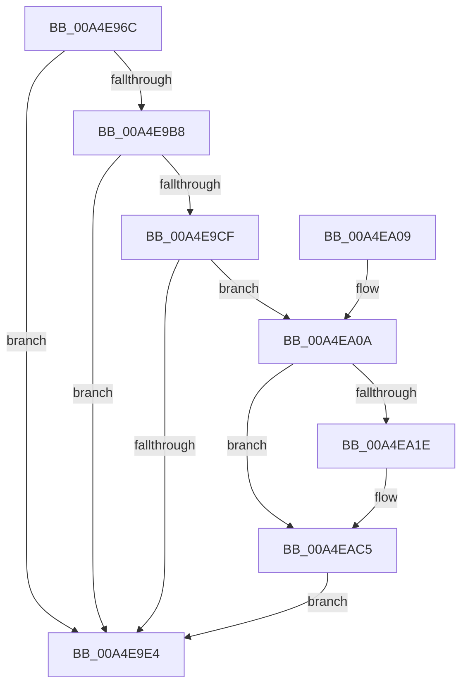

# PopDiagTraceThermalCoolingMode

- RVA: `0x00A4E96C`–`0x00A4EAD7` (길이 `363` bytes)
- VA: `0x0000000140A4E96C`
- 실행 섹션: `PAGE`
- PDB 이름 있음: `예`; PDB Function 태그: `아니요`
- unwind 정보 RVA: `0x000B0678`
- 디코드: `86`개 명령, `363/363` bytes 표시
- 미해석 바이트: `0` (있으면 어셈블리에 `.byte`로 보존)

> 이 문서는 커널 이미지의 기계어와 PDB 기호를 분석해 생성했습니다. 4번과 5번은 함수 원형과 자료형을 바이너리 사용 방식에서 추정한 C 해석이며 원본 소스 복구 결과는 아닙니다.

## 1. Dependencies

- 직접 호출 지점: **6**; 고유 호출 대상: **6**
- 직접 호출자로 확인된 함수: **1**
- RIP 상대 이미지 참조: **6**

### Outgoing calls
- `0x00A4E9C6` → [EtwEventEnabled](../../text/39/EtwEventEnabled_function_00392450.md) (function, `0x00392450`)
- `0x00A4E9D7` → [IoGetDeviceAttachmentBaseRefWithTag](../../text/27/IoGetDeviceAttachmentBaseRefWithTag_function_00272788.md) (function, `0x00272788`)
- `0x00A4E9EB` → [_security_check_cookie](../../text/6A/_security_check_cookie_function_006AC640.md) (function, `0x006AC640`)
- `0x00A4EA6C` → [RtlInitUnicodeString](../../text/42/RtlInitUnicodeString_function_0042A780.md) (function, `0x0042A780`)
- `0x00A4EAC0` → [EtwWrite](../../text/41/EtwWrite_function_0041C720.md) (function, `0x0041C720`)
- `0x00A4EACD` → [ObfDereferenceObjectWithTag](../../text/2F/ObfDereferenceObjectWithTag_function_002F78E0.md) (function, `0x002F78E0`)

### Direct callers
- [PopThermalWorker](PopThermalWorker_function_00A4E200.md) at `0x00A4E4A4`

### Static image references
- `0x00A4E987` → RVA `0x00E0A740` (`.data`; read)
- `0x00A4E99B` → RVA `0x00E67858` (`.data`; read)
- `0x00A4E9B8` → RVA `0x00F0B408` (`.data`; read)
- `0x00A4E9BF` → RVA `0x0001A650` (`.rdata`; read)
- `0x00A4EA52` → RVA `0x00B02060` (` ?? ::NNGAKEGL::`string'`; read)
- `0x00A4EA5D` → RVA `0x00B02070` (` ?? ::NNGAKEGL::`string'`; read)

## 2. Other-region calls and transfers

- 다른 실행 섹션으로 향하는 call: **6**
  - `0x00A4E9C6` → [EtwEventEnabled](../../text/39/EtwEventEnabled_function_00392450.md) (`PAGE` → `.text`)
  - `0x00A4E9D7` → [IoGetDeviceAttachmentBaseRefWithTag](../../text/27/IoGetDeviceAttachmentBaseRefWithTag_function_00272788.md) (`PAGE` → `.text`)
  - `0x00A4E9EB` → [_security_check_cookie](../../text/6A/_security_check_cookie_function_006AC640.md) (`PAGE` → `.text`)
  - `0x00A4EA6C` → [RtlInitUnicodeString](../../text/42/RtlInitUnicodeString_function_0042A780.md) (`PAGE` → `.text`)
  - `0x00A4EAC0` → [EtwWrite](../../text/41/EtwWrite_function_0041C720.md) (`PAGE` → `.text`)
  - `0x00A4EACD` → [ObfDereferenceObjectWithTag](../../text/2F/ObfDereferenceObjectWithTag_function_002F78E0.md) (`PAGE` → `.text`)
- 별도 외부 분기/꼬리 이동을 확인하지 못했습니다.

## 3. Assembly (complete function range)

```asm
00A4E96C  48 8B C4                        mov rax, rsp
00A4E96F  48 89 58 10                     mov qword ptr [rax + 0x10], rbx
00A4E973  48 89 78 18                     mov qword ptr [rax + 0x18], rdi
00A4E977  4C 89 70 20                     mov qword ptr [rax + 0x20], r14
00A4E97B  55                              push rbp
00A4E97C  48 8D 68 A1                     lea rbp, [rax - 0x5f]
00A4E980  48 81 EC A0 00 00 00            sub rsp, 0xa0
00A4E987  48 8B 05 B2 BD 3B 00            mov rax, qword ptr [rip + 0x3bbdb2]
00A4E98E  48 33 C4                        xor rax, rsp
00A4E991  48 89 45 47                     mov qword ptr [rbp + 0x47], rax
00A4E995  45 33 F6                        xor r14d, r14d
00A4E998  0F 57 C0                        xorps xmm0, xmm0
00A4E99B  44 38 35 B6 8E 41 00            cmp byte ptr [rip + 0x418eb6], r14b
00A4E9A2  0F B7 FA                        movzx edi, dx
00A4E9A5  48 8B D9                        mov rbx, rcx
00A4E9A8  66 44 89 75 EB                  mov word ptr [rbp - 0x15], r14w
00A4E9AD  0F 11 45 EF                     movups xmmword ptr [rbp - 0x11], xmm0
00A4E9B1  66 44 89 75 E7                  mov word ptr [rbp - 0x19], r14w
00A4E9B6  74 2C                           je 0x140a4e9e4
00A4E9B8  48 8B 0D 49 CA 4B 00            mov rcx, qword ptr [rip + 0x4bca49]
00A4E9BF  48 8D 15 8A BC 5C FF            lea rdx, [rip - 0xa34376]
00A4E9C6  E8 85 3A 94 FF                  call 0x140392450
00A4E9CB  84 C0                           test al, al
00A4E9CD  74 15                           je 0x140a4e9e4
00A4E9CF  BA 50 6F 44 67                  mov edx, 0x67446f50
00A4E9D4  48 8B CB                        mov rcx, rbx
00A4E9D7  E8 AC 3D 82 FF                  call 0x140272788
00A4E9DC  48 8B D8                        mov rbx, rax
00A4E9DF  48 85 C0                        test rax, rax
00A4E9E2  75 26                           jne 0x140a4ea0a
00A4E9E4  48 8B 4D 47                     mov rcx, qword ptr [rbp + 0x47]
00A4E9E8  48 33 CC                        xor rcx, rsp
00A4E9EB  E8 50 DC C5 FF                  call 0x1406ac640
00A4E9F0  4C 8D 9C 24 A0 00 00 00         lea r11, [rsp + 0xa0]
00A4E9F8  49 8B 5B 18                     mov rbx, qword ptr [r11 + 0x18]
00A4E9FC  49 8B 7B 20                     mov rdi, qword ptr [r11 + 0x20]
00A4EA00  4D 8B 73 28                     mov r14, qword ptr [r11 + 0x28]
00A4EA04  49 8B E3                        mov rsp, r11
00A4EA07  5D                              pop rbp
00A4EA08  C3                              ret
00A4EA09  CC                              int3
00A4EA0A  48 8B 88 38 01 00 00            mov rcx, qword ptr [rax + 0x138]
00A4EA11  48 8B 41 28                     mov rax, qword ptr [rcx + 0x28]
00A4EA15  48 85 C0                        test rax, rax
00A4EA18  0F 84 A7 00 00 00               je 0x140a4eac5
00A4EA1E  0F B7 88 80 00 00 00            movzx ecx, word ptr [rax + 0x80]
00A4EA25  66 D1 E9                        shr cx, 1
00A4EA28  0F B7 D1                        movzx edx, cx
00A4EA2B  48 8D 4D E7                     lea rcx, [rbp - 0x19]
00A4EA2F  66 89 55 E7                     mov word ptr [rbp - 0x19], dx
00A4EA33  03 D2                           add edx, edx
00A4EA35  48 89 4D 07                     mov qword ptr [rbp + 7], rcx
00A4EA39  66 85 FF                        test di, di
00A4EA3C  48 C7 45 0F 02 00 00 00         mov qword ptr [rbp + 0xf], 2
00A4EA44  48 8D 4D EF                     lea rcx, [rbp - 0x11]
00A4EA48  48 8B 80 88 00 00 00            mov rax, qword ptr [rax + 0x88]
00A4EA4F  89 55 1F                        mov dword ptr [rbp + 0x1f], edx
00A4EA52  48 8D 15 07 36 0B 00            lea rdx, [rip + 0xb3607]
00A4EA59  48 89 45 17                     mov qword ptr [rbp + 0x17], rax
00A4EA5D  48 8D 05 0C 36 0B 00            lea rax, [rip + 0xb360c]
00A4EA64  48 0F 45 D0                     cmovne rdx, rax
00A4EA68  44 89 75 23                     mov dword ptr [rbp + 0x23], r14d
00A4EA6C  E8 0F BD 9D FF                  call 0x14042a780
00A4EA71  0F B7 45 EF                     movzx eax, word ptr [rbp - 0x11]
00A4EA75  48 8D 15 D4 BB 5C FF            lea rdx, [rip - 0xa3442c]
00A4EA7C  66 D1 E8                        shr ax, 1
00A4EA7F  41 B9 04 00 00 00               mov r9d, 4
00A4EA85  0F B7 C8                        movzx ecx, ax
00A4EA88  45 33 C0                        xor r8d, r8d
00A4EA8B  66 89 4D EB                     mov word ptr [rbp - 0x15], cx
00A4EA8F  48 8D 45 EB                     lea rax, [rbp - 0x15]
00A4EA93  48 89 45 27                     mov qword ptr [rbp + 0x27], rax
00A4EA97  03 C9                           add ecx, ecx
00A4EA99  48 8B 45 F7                     mov rax, qword ptr [rbp - 9]
00A4EA9D  48 89 45 37                     mov qword ptr [rbp + 0x37], rax
00A4EAA1  48 8D 45 07                     lea rax, [rbp + 7]
00A4EAA5  89 4D 3F                        mov dword ptr [rbp + 0x3f], ecx
00A4EAA8  48 8B 0D 59 C9 4B 00            mov rcx, qword ptr [rip + 0x4bc959]
00A4EAAF  48 89 44 24 20                  mov qword ptr [rsp + 0x20], rax
00A4EAB4  48 C7 45 2F 02 00 00 00         mov qword ptr [rbp + 0x2f], 2
00A4EABC  44 89 75 43                     mov dword ptr [rbp + 0x43], r14d
00A4EAC0  E8 5B DC 9C FF                  call 0x14041c720
00A4EAC5  BA 50 6F 44 67                  mov edx, 0x67446f50
00A4EACA  48 8B CB                        mov rcx, rbx
00A4EACD  E8 0E 8E 8A FF                  call 0x1402f78e0
00A4EAD2  E9 0D FF FF FF                  jmp 0x140a4e9e4
```

## 4. C-style interpretation (structured pseudocode)

```c
__int64 __fastcall PopDiagTraceThermalCoolingMode(__int64 a1, unsigned __int16 a2, int a3)
{
    __int64 result;
    __int64 v_r14;
    __int64 v_rsp;
    unsigned __int64 v_stack_m8;
    unsigned __int64 v_stack_m80;

    *(unsigned __int64 *)(v_rsp + 16) = v_rbx;
    *(unsigned __int64 *)(v_rsp + 24) = v_rdi;
    *(unsigned __int64 *)(v_rsp + 32) = v_r14;
    v_rsp = (v_rsp) - (160);
    result = (*(unsigned __int64 *)(v_rip + 3915186)) ^ (v_rsp);
    *(unsigned __int64 *)(v_rsp - 95 + 71) = result;
    v_r14 = 0;
    *(unsigned __int16 *)(v_rsp - 95 - 21) = 0;
    *(unsigned __int64 *)(v_rsp - 95 - 17) = v_xmm0;
    *(unsigned __int16 *)(v_rsp - 95 - 25) = 0;
    if ((*(unsigned __int8 *)(v_rip + 4296374)) == 0) goto loc_00A4E9E4;
    result = EtwEventEnabled(*(unsigned __int64 *)(v_rip + 4966985), v_rip - 10699638, a3, a4);
    if ((unsigned __int8)(result) == 0) goto loc_00A4E9E4;
    result = IoGetDeviceAttachmentBaseRefWithTag(a1, (unsigned int)(0x67446F50ULL), a3, a4);
    if (result != 0) goto loc_00A4EA0A;
loc_00A4E9E4:
    a1 = (*(unsigned __int64 *)(v_rsp - 95 + 71)) ^ (v_rsp);
    result = _security_check_cookie(a1, (unsigned int)(0x67446F50ULL), a3, a4);
    return result;
loc_00A4EA0A:
    result = *(unsigned __int64 *)(*(unsigned __int64 *)(result + 312) + 40);
    if (*(unsigned __int64 *)(*(unsigned __int64 *)(result + 312) + 40) != 0) {
        a1 = *(unsigned __int16 *)(*(unsigned __int64 *)(*(unsigned __int64 *)(result + 312) + 40) + 128);
        a1 = (unsigned __int16)((a1) >> (1));
        a2 = (unsigned __int16)(a1);
        a1 = v_rsp - 95 - 25;
        *(unsigned __int16 *)(v_rsp - 95 - 25) = a2;
        a2 = (unsigned int)((a2) + (a2));
        *(unsigned __int64 *)(v_rsp - 95 + 7) = a1;
        *(unsigned __int64 *)(v_rsp - 95 + 15) = 2;
        a1 = v_rsp - 95 - 17;
        result = *(unsigned __int64 *)(*(unsigned __int64 *)(*(unsigned __int64 *)(result + 312) + 40) + 136);
        *(unsigned int *)(v_rsp - 95 + 31) = a2;
        a2 = v_rip + 734727;
        *(unsigned __int64 *)(v_rsp - 95 + 23) = result;
        result = v_rip + 734732;
        if ((unsigned __int16)(*(unsigned __int64 *)(v_stack_m8 + 32)) != 0) { a2 = result; }
        *(unsigned int *)(v_rsp - 95 + 35) = (unsigned int)(*(unsigned __int64 *)(v_stack_m8 + 40));
        result = RtlInitUnicodeString(a1, a2, a3, a4);
        result = *(unsigned __int16 *)(v_rsp - 95 - 17);
        a2 = v_rip - 10699820;
        result = (unsigned __int16)((result) >> (1));
        a4 = 4;
        a1 = (unsigned __int16)(result);
        a3 = 0;
        *(unsigned __int16 *)(v_rsp - 95 - 21) = (unsigned __int16)(a1);
        result = v_rsp - 95 - 21;
        *(unsigned __int64 *)(v_rsp - 95 + 39) = result;
        a1 = (unsigned int)((a1) + ((unsigned int)(a1)));
        result = *(unsigned __int64 *)(v_rsp - 95 - 9);
        *(unsigned __int64 *)(v_rsp - 95 + 55) = result;
        result = v_rsp - 95 + 7;
        *(unsigned int *)(v_rsp - 95 + 63) = (unsigned int)(a1);
        a1 = *(unsigned __int64 *)(v_rip + 4966745);
        v_stack_m80 = result;
        *(unsigned __int64 *)(v_rsp - 95 + 47) = 2;
        *(unsigned int *)(v_rsp - 95 + 67) = (unsigned int)(*(unsigned __int64 *)(v_stack_m8 + 40));
        result = EtwWrite(a1, a2, a3, a4);
    }
    result = ObfDereferenceObjectWithTag(*(unsigned __int64 *)(v_stack_m8 + 24), (unsigned int)(0x67446F50ULL), a3, a4);
    goto loc_00A4E9E4;
}
```

## 5. (Beta) C Style

```c
int64_t PopDiagTraceThermalCoolingMode(int64_t Arg1, uint16_t Arg2, int32_t Arg3)
{
    int64_t result;
    int64_t local_r14;
    int64_t local_rsp;
    uint64_t v_stack_m8;
    uint64_t v_stack_m80;

    *(uint64_t *)(local_rsp + 0x10) = local_rbx;
    *(uint64_t *)(local_rsp + 0x18) = local_rdi;
    *(uint64_t *)(local_rsp + 0x20) = local_r14;
    local_rsp = (local_rsp) - (160);
    result = (*(uint64_t *)(v_rip + 0x3BBDB2)) ^ (local_rsp);
    *(uint64_t *)(local_rsp - 0x5F + 0x47) = result;
    local_r14 = 0;
    *(uint16_t *)(local_rsp - 0x5F - 0x15) = 0;
    *(uint64_t *)(local_rsp - 0x5F - 0x11) = v_xmm0;
    *(uint16_t *)(local_rsp - 0x5F - 0x19) = 0;
    if ((*(uint8_t *)(v_rip + 0x418EB6)) == 0) goto loc_00A4E9E4;
    result = EtwEventEnabled(*(uint64_t *)(v_rip + 0x4BCA49), v_rip - 10699638, Arg3, a4);
    if ((uint8_t)(result) == 0) goto loc_00A4E9E4;
    result = IoGetDeviceAttachmentBaseRefWithTag(Arg1, (uint32_t)(0x67446F50ULL), Arg3, a4);
    if (result != 0) goto loc_00A4EA0A;
loc_00A4E9E4:
    Arg1 = (*(uint64_t *)(local_rsp - 0x5F + 0x47)) ^ (local_rsp);
    result = _security_check_cookie(Arg1, (uint32_t)(0x67446F50ULL), Arg3, a4);
    return result;
loc_00A4EA0A:
    result = *(uint64_t *)(*(uint64_t *)(result + 0x138) + 0x28);
    if (*(uint64_t *)(*(uint64_t *)(result + 0x138) + 0x28) != 0) {
        Arg1 = *(uint16_t *)(*(uint64_t *)(*(uint64_t *)(result + 0x138) + 0x28) + 0x80);
        Arg1 = (uint16_t)((Arg1) >> (1));
        Arg2 = (uint16_t)(Arg1);
        Arg1 = local_rsp - 95 - 25;
        *(uint16_t *)(local_rsp - 0x5F - 0x19) = Arg2;
        Arg2 = (uint32_t)((Arg2) + (Arg2));
        *(uint64_t *)(local_rsp - 0x5F + 0x7) = Arg1;
        *(uint64_t *)(local_rsp - 0x5F + 0xF) = 2;
        Arg1 = local_rsp - 95 - 17;
        result = *(uint64_t *)(*(uint64_t *)(*(uint64_t *)(result + 0x138) + 0x28) + 0x88);
        *(uint32_t *)(local_rsp - 0x5F + 0x1F) = Arg2;
        Arg2 = v_rip + 734727;
        *(uint64_t *)(local_rsp - 0x5F + 0x17) = result;
        result = v_rip + 734732;
        if ((uint16_t)(*(uint64_t *)(v_stack_m8 + 0x20)) != 0) { Arg2 = result; }
        *(uint32_t *)(local_rsp - 0x5F + 0x23) = (uint32_t)(*(uint64_t *)(v_stack_m8 + 0x28));
        result = RtlInitUnicodeString(Arg1, Arg2, Arg3, a4);
        result = *(uint16_t *)(local_rsp - 0x5F - 0x11);
        Arg2 = v_rip - 10699820;
        result = (uint16_t)((result) >> (1));
        a4 = 4;
        Arg1 = (uint16_t)(result);
        Arg3 = 0;
        *(uint16_t *)(local_rsp - 0x5F - 0x15) = (uint16_t)(Arg1);
        result = local_rsp - 95 - 21;
        *(uint64_t *)(local_rsp - 0x5F + 0x27) = result;
        Arg1 = (uint32_t)((Arg1) + ((uint32_t)(Arg1)));
        result = *(uint64_t *)(local_rsp - 0x5F - 0x9);
        *(uint64_t *)(local_rsp - 0x5F + 0x37) = result;
        result = local_rsp - 95 + 7;
        *(uint32_t *)(local_rsp - 0x5F + 0x3F) = (uint32_t)(Arg1);
        Arg1 = *(uint64_t *)(v_rip + 0x4BC959);
        v_stack_m80 = result;
        *(uint64_t *)(local_rsp - 0x5F + 0x2F) = 2;
        *(uint32_t *)(local_rsp - 0x5F + 0x43) = (uint32_t)(*(uint64_t *)(v_stack_m8 + 0x28));
        result = EtwWrite(Arg1, Arg2, Arg3, a4);
    }
    result = ObfDereferenceObjectWithTag(*(uint64_t *)(v_stack_m8 + 0x18), (uint32_t)(0x67446F50ULL), Arg3, a4);
    goto loc_00A4E9E4;
}
```

## 6. Execution-region graph

[열기: 2D/3D 그래프와 함수 탐색 컨트롤 패널](../../../control-panel.html?section=page&rva=0x00A4E96C&view=graph)

- 2D 그래프는 위에서 아래로 흐르고, 3D 그래프는 빈 공간을 드래그해 회전합니다. Shift+드래그는 이동, 휠은 확대·축소, 함수 노드 선택은 대상 보고서 이동입니다.

### Static fallback


