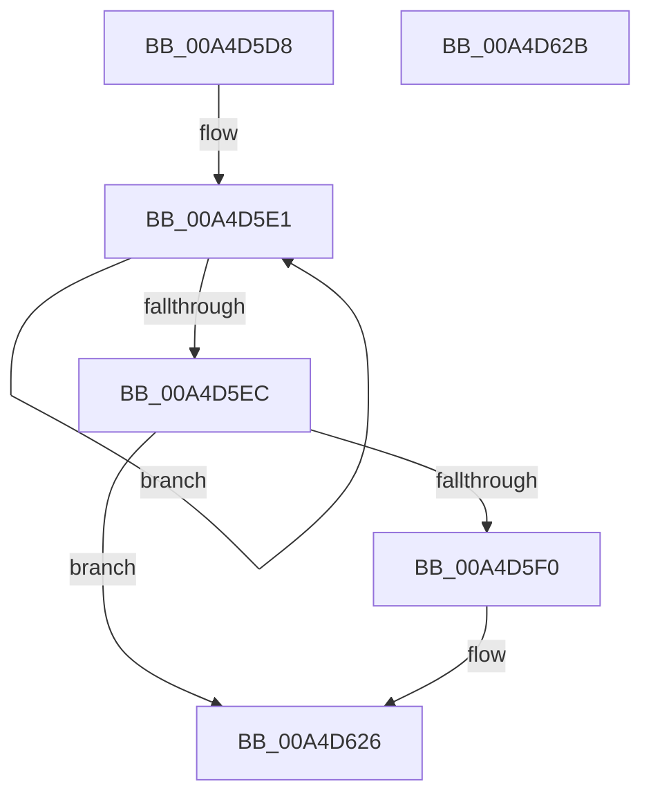

# PopDirectedDripsAcquireTransitionLock

- RVA: `0x00A4D5D8`–`0x00A4D62C` (길이 `84` bytes)
- VA: `0x0000000140A4D5D8`
- 실행 섹션: `PAGE`
- PDB 이름 있음: `예`; PDB Function 태그: `아니요`
- unwind 정보 RVA: `0x0005D2F4`
- 디코드: `21`개 명령, `84/84` bytes 표시
- 미해석 바이트: `0` (있으면 어셈블리에 `.byte`로 보존)

> 이 문서는 커널 이미지의 기계어와 PDB 기호를 분석해 생성했습니다. 4번과 5번은 함수 원형과 자료형을 바이너리 사용 방식에서 추정한 C 해석이며 원본 소스 복구 결과는 아닙니다.

## 1. Dependencies

- 직접 호출 지점: **1**; 고유 호출 대상: **1**
- 직접 호출자로 확인된 함수: **1**
- RIP 상대 이미지 참조: **3**

### Outgoing calls
- `0x00A4D607` → [KeWaitForSingleObject](../../text/20/KeWaitForSingleObject_function_0020E6B0.md) (function, `0x0020E6B0`)

### Direct callers
- [PopDirectedDripsSuspendDevices](PopDirectedDripsSuspendDevices_function_00A4D474.md) at `0x00A4D4D6`

### Static image references
- `0x00A4D5F6` → RVA `0x00F0B900` (`.data`; read)
- `0x00A4D60C` → RVA `0x00F0B7D0` (`.data`; write)
- `0x00A4D61F` → RVA `0x00F0B7D8` (`.data`; write)

## 2. Other-region calls and transfers

- 다른 실행 섹션으로 향하는 call: **1**
  - `0x00A4D607` → [KeWaitForSingleObject](../../text/20/KeWaitForSingleObject_function_0020E6B0.md) (`PAGE` → `.text`)
- 별도 외부 분기/꼬리 이동을 확인하지 못했습니다.

## 3. Assembly (complete function range)

```asm
00A4D5D8  48 83 EC 38                     sub rsp, 0x38
00A4D5DC  0F 0D 09                        prefetchw byte ptr [rcx]
00A4D5DF  8B 01                           mov eax, dword ptr [rcx]
00A4D5E1  8B D0                           mov edx, eax
00A4D5E3  83 CA 40                        or edx, 0x40
00A4D5E6  F0 0F B1 11                     lock cmpxchg dword ptr [rcx], edx
00A4D5EA  75 F5                           jne 0x140a4d5e1
00A4D5EC  A8 40                           test al, 0x40
00A4D5EE  75 36                           jne 0x140a4d626
00A4D5F0  48 83 64 24 20 00               and qword ptr [rsp + 0x20], 0
00A4D5F6  48 8D 0D 03 E3 4B 00            lea rcx, [rip + 0x4be303]
00A4D5FD  45 33 C9                        xor r9d, r9d
00A4D600  45 33 C0                        xor r8d, r8d
00A4D603  41 8D 51 07                     lea edx, [r9 + 7]
00A4D607  E8 A4 10 7C FF                  call 0x14020e6b0
00A4D60C  C7 05 BA E1 4B 00 07 00 00 00   mov dword ptr [rip + 0x4be1ba], 7
00A4D616  65 48 8B 04 25 88 01 00 00      mov rax, qword ptr gs:[0x188]
00A4D61F  48 89 05 B2 E1 4B 00            mov qword ptr [rip + 0x4be1b2], rax
00A4D626  48 83 C4 38                     add rsp, 0x38
00A4D62A  C3                              ret
00A4D62B  CC                              int3
```

## 4. C-style interpretation (structured pseudocode)

```c
__int64 __fastcall PopDirectedDripsAcquireTransitionLock(__int64 a1, __int64 a2, int a3, int a4)
{
    __int64 result;
    __int64 v_rsp;
    unsigned __int64 v_stack_m18;

    v_rsp = (v_rsp) - (56);
loc_00A4D5E1:
    a2 = (unsigned int)(((unsigned int)((unsigned int)((unsigned int)(*(unsigned int *)(a1))))) | (64));
    if (condition_is_not_equal) goto loc_00A4D5E1;
    result = (unsigned int)(*(unsigned int *)(a1));
    if ((((unsigned __int8)((unsigned int)(*(unsigned int *)(a1)))) & (64)) == 0) {
        a1 = v_rip + 4973315;
        a4 = 0;
        a3 = 0;
        a2 = a4 + 7;
        result = KeWaitForSingleObject(a1, a2, a3, a4);
        *(unsigned int *)(v_rip + 4972986) = 7;
        result = *(unsigned __int64 *)(gs_base + (0 + 392));
        *(unsigned __int64 *)(v_rip + 4972978) = result;
    }
    v_rsp = (v_rsp) + (56);
    return result;
}
```

## 5. (Beta) C Style

```c
int64_t PopDirectedDripsAcquireTransitionLock(void *Arg1, int64_t Arg2, int32_t Arg3, int32_t Arg4)
{
    uint8_t *arg1 = (uint8_t *)Arg1;

    int64_t result;
    int64_t local_rsp;
    uint64_t v_stack_m18;

    local_rsp = (local_rsp) - (56);
loc_00A4D5E1:
    Arg2 = (uint32_t)(((uint32_t)((uint32_t)((uint32_t)(*(uint32_t *)(arg1))))) | (64));
    if (condition_is_not_equal) goto loc_00A4D5E1;
    result = (uint32_t)(*(uint32_t *)(arg1));
    if ((((uint8_t)((uint32_t)(*(uint32_t *)(arg1)))) & (64)) == 0) {
        Arg1 = v_rip + 4973315;
        Arg4 = 0;
        Arg3 = 0;
        Arg2 = Arg4 + 7;
        result = KeWaitForSingleObject(Arg1, Arg2, Arg3, Arg4);
        *(uint32_t *)(v_rip + 0x4BE1BA) = 7;
        result = *(uint64_t *)(gs_base + (0 + 0x188));
        *(uint64_t *)(v_rip + 0x4BE1B2) = result;
    }
    local_rsp = (local_rsp) + (56);
    return result;
}
```

### 관측된 메모리 오프셋

구조체 형식이 확인되지 않은 접근은 인자 기준의 오프셋으로만 기록했습니다.

| 기준 인자 | 오프셋 표현 | 폭 (bit) | 접근 |
|---|---:|---:|---|
| `Arg1` | `+ 0x0` | `8` | `R` |
| `Arg1` | `+ 0x0` | `32` | `R` |

## 6. Execution-region graph

[열기: 2D/3D 그래프와 함수 탐색 컨트롤 패널](../../../control-panel.html?section=page&rva=0x00A4D5D8&view=graph)

- 2D 그래프는 위에서 아래로 흐르고, 3D 그래프는 빈 공간을 드래그해 회전합니다. Shift+드래그는 이동, 휠은 확대·축소, 함수 노드 선택은 대상 보고서 이동입니다.

### Static fallback


