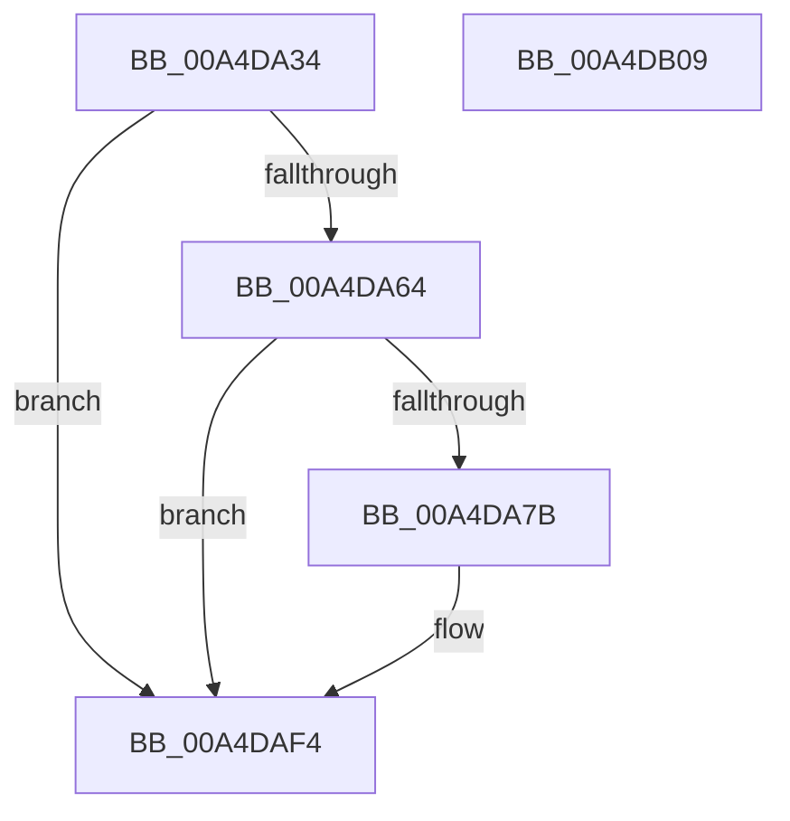

# PopDirectedDripsDiagTraceDisengageReasonChange

- RVA: `0x00A4DA34`–`0x00A4DB0A` (길이 `214` bytes)
- VA: `0x0000000140A4DA34`
- 실행 섹션: `PAGE`
- PDB 이름 있음: `예`; PDB Function 태그: `아니요`
- unwind 정보 RVA: `0x000B05B8`
- 디코드: `52`개 명령, `214/214` bytes 표시
- 미해석 바이트: `0` (있으면 어셈블리에 `.byte`로 보존)

> 이 문서는 커널 이미지의 기계어와 PDB 기호를 분석해 생성했습니다. 4번과 5번은 함수 원형과 자료형을 바이너리 사용 방식에서 추정한 C 해석이며 원본 소스 복구 결과는 아닙니다.

## 1. Dependencies

- 직접 호출 지점: **3**; 고유 호출 대상: **3**
- 직접 호출자로 확인된 함수: **1**
- RIP 상대 이미지 참조: **4**

### Outgoing calls
- `0x00A4DA72` → [EtwEventEnabled](../../text/39/EtwEventEnabled_function_00392450.md) (function, `0x00392450`)
- `0x00A4DAEF` → [EtwWrite](../../text/41/EtwWrite_function_0041C720.md) (function, `0x0041C720`)
- `0x00A4DAFB` → [_security_check_cookie](../../text/6A/_security_check_cookie_function_006AC640.md) (function, `0x006AC640`)

### Direct callers
- [PopDirectedDripsRefreshDisengageState](PopDirectedDripsRefreshDisengageState_function_00A4D9B0.md) at `0x00A4D9EB`

### Static image references
- `0x00A4DA49` → RVA `0x00E0A740` (`.data`; read)
- `0x00A4DA57` → RVA `0x00E67858` (`.data`; read)
- `0x00A4DA64` → RVA `0x00F0B408` (`.data`; read)
- `0x00A4DA6B` → RVA `0x0001A630` (`.rdata`; read)

## 2. Other-region calls and transfers

- 다른 실행 섹션으로 향하는 call: **3**
  - `0x00A4DA72` → [EtwEventEnabled](../../text/39/EtwEventEnabled_function_00392450.md) (`PAGE` → `.text`)
  - `0x00A4DAEF` → [EtwWrite](../../text/41/EtwWrite_function_0041C720.md) (`PAGE` → `.text`)
  - `0x00A4DAFB` → [_security_check_cookie](../../text/6A/_security_check_cookie_function_006AC640.md) (`PAGE` → `.text`)
- 별도 외부 분기/꼬리 이동을 확인하지 못했습니다.

## 3. Assembly (complete function range)

```asm
00A4DA34  89 54 24 10                     mov dword ptr [rsp + 0x10], edx
00A4DA38  89 4C 24 08                     mov dword ptr [rsp + 8], ecx
00A4DA3C  55                              push rbp
00A4DA3D  48 8D 6C 24 A9                  lea rbp, [rsp - 0x57]
00A4DA42  48 81 EC 90 00 00 00            sub rsp, 0x90
00A4DA49  48 8B 05 F0 CC 3B 00            mov rax, qword ptr [rip + 0x3bccf0]
00A4DA50  48 33 C4                        xor rax, rsp
00A4DA53  48 89 45 47                     mov qword ptr [rbp + 0x47], rax
00A4DA57  80 3D FA 9D 41 00 00            cmp byte ptr [rip + 0x419dfa], 0
00A4DA5E  0F 84 90 00 00 00               je 0x140a4daf4
00A4DA64  48 8B 0D 9D D9 4B 00            mov rcx, qword ptr [rip + 0x4bd99d]
00A4DA6B  48 8D 15 BE CB 5C FF            lea rdx, [rip - 0xa33442]
00A4DA72  E8 D9 49 94 FF                  call 0x140392450
00A4DA77  84 C0                           test al, al
00A4DA79  74 79                           je 0x140a4daf4
00A4DA7B  8B 4D 67                        mov ecx, dword ptr [rbp + 0x67]
00A4DA7E  48 8D 15 AB CB 5C FF            lea rdx, [rip - 0xa33455]
00A4DA85  33 4D 6F                        xor ecx, dword ptr [rbp + 0x6f]
00A4DA88  41 B9 04 00 00 00               mov r9d, 4
00A4DA8E  83 65 13 00                     and dword ptr [rbp + 0x13], 0
00A4DA92  8B C1                           mov eax, ecx
00A4DA94  23 45 67                        and eax, dword ptr [rbp + 0x67]
00A4DA97  45 33 C0                        xor r8d, r8d
00A4DA9A  23 4D 6F                        and ecx, dword ptr [rbp + 0x6f]
00A4DA9D  83 65 23 00                     and dword ptr [rbp + 0x23], 0
00A4DAA1  83 65 33 00                     and dword ptr [rbp + 0x33], 0
00A4DAA5  83 65 43 00                     and dword ptr [rbp + 0x43], 0
00A4DAA9  89 45 FB                        mov dword ptr [rbp - 5], eax
00A4DAAC  48 8D 45 67                     lea rax, [rbp + 0x67]
00A4DAB0  48 89 45 07                     mov qword ptr [rbp + 7], rax
00A4DAB4  48 8D 45 6F                     lea rax, [rbp + 0x6f]
00A4DAB8  48 89 45 17                     mov qword ptr [rbp + 0x17], rax
00A4DABC  48 8D 45 F7                     lea rax, [rbp - 9]
00A4DAC0  48 89 45 27                     mov qword ptr [rbp + 0x27], rax
00A4DAC4  48 8D 45 FB                     lea rax, [rbp - 5]
00A4DAC8  48 89 45 37                     mov qword ptr [rbp + 0x37], rax
00A4DACC  48 8D 45 07                     lea rax, [rbp + 7]
00A4DAD0  89 4D F7                        mov dword ptr [rbp - 9], ecx
00A4DAD3  48 8B 0D 2E D9 4B 00            mov rcx, qword ptr [rip + 0x4bd92e]
00A4DADA  48 89 44 24 20                  mov qword ptr [rsp + 0x20], rax
00A4DADF  44 89 4D 0F                     mov dword ptr [rbp + 0xf], r9d
00A4DAE3  44 89 4D 1F                     mov dword ptr [rbp + 0x1f], r9d
00A4DAE7  44 89 4D 2F                     mov dword ptr [rbp + 0x2f], r9d
00A4DAEB  44 89 4D 3F                     mov dword ptr [rbp + 0x3f], r9d
00A4DAEF  E8 2C EC 9C FF                  call 0x14041c720
00A4DAF4  48 8B 4D 47                     mov rcx, qword ptr [rbp + 0x47]
00A4DAF8  48 33 CC                        xor rcx, rsp
00A4DAFB  E8 40 EB C5 FF                  call 0x1406ac640
00A4DB00  48 81 C4 90 00 00 00            add rsp, 0x90
00A4DB07  5D                              pop rbp
00A4DB08  C3                              ret
00A4DB09  CC                              int3
```

## 4. C-style interpretation (structured pseudocode)

```c
__int64 __fastcall PopDirectedDripsDiagTraceDisengageReasonChange(int a1, int a2, int a3)
{
    __int64 result;
    __int64 v_rsp;
    unsigned __int64 v_stack_m18;
    unsigned int v_stack_m1C;
    unsigned int v_stack_m20;
    unsigned __int64 v_stack_m28;
    unsigned int v_stack_m2C;
    unsigned int v_stack_m30;
    unsigned __int64 v_stack_m38;
    unsigned int v_stack_m3C;
    unsigned int v_stack_m40;
    unsigned __int64 v_stack_m48;
    unsigned int v_stack_m4C;
    unsigned int v_stack_m50;
    unsigned __int64 v_stack_m58;
    unsigned __int64 v_stack_m5F;
    unsigned int v_stack_m64;
    unsigned __int64 v_stack_m68;
    unsigned __int64 v_stack_m78;
    unsigned int v_stack_p10;
    unsigned int v_stack_p8;

    v_stack_p10 = a2;
    v_stack_p8 = a1;
    v_rsp = (v_rsp) - (144);
    result = (*(unsigned __int64 *)(v_rip + 3919088)) ^ (v_rsp);
    v_stack_m18 = result;
    if ((*(unsigned __int8 *)(v_rip + 4300282)) == 0) goto loc_00A4DAF4;
    result = EtwEventEnabled(*(unsigned __int64 *)(v_rip + 4970909), v_rip - 10695746, a3, a4);
    if ((unsigned __int8)(result) != 0) {
        a1 = v_stack_p8;
        a2 = v_rip - 10695765;
        a1 = (unsigned int)((a1) ^ (v_stack_p10));
        a4 = 4;
        result = a1;
        result = (unsigned int)((result) & (v_stack_p8));
        a3 = 0;
        a1 = (unsigned int)((a1) & (v_stack_p10));
        v_stack_m64 = (unsigned int)(result);
        result = v_stack_p8;
        v_stack_m58 = result;
        result = v_stack_p10;
        v_stack_m48 = result;
        result = v_stack_m68;
        v_stack_m38 = result;
        result = v_stack_m64;
        v_stack_m28 = result;
        result = v_stack_m58;
        v_stack_m68 = a1;
        a1 = *(unsigned __int64 *)(v_rip + 4970798);
        v_stack_m78 = result;
        v_stack_m50 = (unsigned int)(a4);
        v_stack_m40 = (unsigned int)(a4);
        v_stack_m30 = (unsigned int)(a4);
        v_stack_m20 = (unsigned int)(a4);
        result = EtwWrite(a1, a2, a3, a4);
    }
    a1 = (v_stack_m18) ^ (v_rsp);
    result = _security_check_cookie(a1, a2, a3, a4);
    v_rsp = (v_rsp) + (144);
    return result;
}
```

## 5. (Beta) C Style

```c
int64_t PopDirectedDripsDiagTraceDisengageReasonChange(int32_t Arg1, int32_t Arg2, int32_t Arg3)
{
    int64_t result;
    int64_t local_rsp;
    uint64_t v_stack_m18;
    uint32_t v_stack_m1C;
    uint32_t v_stack_m20;
    uint64_t v_stack_m28;
    uint32_t v_stack_m2C;
    uint32_t v_stack_m30;
    uint64_t v_stack_m38;
    uint32_t v_stack_m3C;
    uint32_t v_stack_m40;
    uint64_t v_stack_m48;
    uint32_t v_stack_m4C;
    uint32_t v_stack_m50;
    uint64_t v_stack_m58;
    uint64_t v_stack_m5F;
    uint32_t v_stack_m64;
    uint64_t v_stack_m68;
    uint64_t v_stack_m78;
    uint32_t v_stack_p10;
    uint32_t v_stack_p8;

    v_stack_p10 = Arg2;
    v_stack_p8 = Arg1;
    local_rsp = (local_rsp) - (144);
    result = (*(uint64_t *)(v_rip + 0x3BCCF0)) ^ (local_rsp);
    v_stack_m18 = result;
    if ((*(uint8_t *)(v_rip + 0x419DFA)) == 0) goto loc_00A4DAF4;
    result = EtwEventEnabled(*(uint64_t *)(v_rip + 0x4BD99D), v_rip - 10695746, Arg3, a4);
    if ((uint8_t)(result) != 0) {
        Arg1 = v_stack_p8;
        Arg2 = v_rip - 10695765;
        Arg1 = (uint32_t)((Arg1) ^ (v_stack_p10));
        a4 = 4;
        result = Arg1;
        result = (uint32_t)((result) & (v_stack_p8));
        Arg3 = 0;
        Arg1 = (uint32_t)((Arg1) & (v_stack_p10));
        v_stack_m64 = (uint32_t)(result);
        result = v_stack_p8;
        v_stack_m58 = result;
        result = v_stack_p10;
        v_stack_m48 = result;
        result = v_stack_m68;
        v_stack_m38 = result;
        result = v_stack_m64;
        v_stack_m28 = result;
        result = v_stack_m58;
        v_stack_m68 = Arg1;
        Arg1 = *(uint64_t *)(v_rip + 0x4BD92E);
        v_stack_m78 = result;
        v_stack_m50 = (uint32_t)(a4);
        v_stack_m40 = (uint32_t)(a4);
        v_stack_m30 = (uint32_t)(a4);
        v_stack_m20 = (uint32_t)(a4);
        result = EtwWrite(Arg1, Arg2, Arg3, a4);
    }
    Arg1 = (v_stack_m18) ^ (local_rsp);
    result = _security_check_cookie(Arg1, Arg2, Arg3, a4);
    local_rsp = (local_rsp) + (144);
    return result;
}
```

## 6. Execution-region graph

[열기: 2D/3D 그래프와 함수 탐색 컨트롤 패널](../../../control-panel.html?section=page&rva=0x00A4DA34&view=graph)

- 2D 그래프는 위에서 아래로 흐르고, 3D 그래프는 빈 공간을 드래그해 회전합니다. Shift+드래그는 이동, 휠은 확대·축소, 함수 노드 선택은 대상 보고서 이동입니다.

### Static fallback


