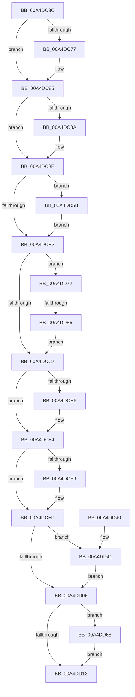

# PopDirectedDripsHandleResiliencyNotification

- RVA: `0x00A4DC3C`–`0x00A4DD92` (길이 `342` bytes)
- VA: `0x0000000140A4DC3C`
- 실행 섹션: `PAGE`
- PDB 이름 있음: `예`; PDB Function 태그: `예`
- unwind 정보 RVA: `0x000A4CF0`
- 디코드: `87`개 명령, `342/342` bytes 표시
- 미해석 바이트: `0` (있으면 어셈블리에 `.byte`로 보존)

> 이 문서는 커널 이미지의 기계어와 PDB 기호를 분석해 생성했습니다. 4번과 5번은 함수 원형과 자료형을 바이너리 사용 방식에서 추정한 C 해석이며 원본 소스 복구 결과는 아닙니다.

## 1. Dependencies

- 직접 호출 지점: **12**; 고유 호출 대상: **8**
- 직접 호출자로 확인된 함수: **1**
- RIP 상대 이미지 참조: **0**

### Outgoing calls
- `0x00A4DC67` → [KeAbPreAcquire](../../text/21/KeAbPreAcquire_function_00210230.md) (function, `0x00210230`)
- `0x00A4DC80` → [ExfAcquirePushLockExclusiveEx](../../text/20/ExfAcquirePushLockExclusiveEx_function_0020FC90.md) (function, `0x0020FC90`)
- `0x00A4DCB5` → [KeAbPostRelease](../../text/2E/KeAbPostRelease_function_002E1600.md) (function, `0x002E1600`)
- `0x00A4DCD6` → [KeAbPreAcquire](../../text/21/KeAbPreAcquire_function_00210230.md) (function, `0x00210230`)
- `0x00A4DCEF` → [ExfAcquirePushLockExclusiveEx](../../text/20/ExfAcquirePushLockExclusiveEx_function_0020FC90.md) (function, `0x0020FC90`)
- `0x00A4DD16` → [KeAbPostRelease](../../text/2E/KeAbPostRelease_function_002E1600.md) (function, `0x002E1600`)
- `0x00A4DD20` → [PopDeepSleepClearDisengageReason](../../text/39/PopDeepSleepClearDisengageReason_function_0039010C.md) (function, `0x0039010C`)
- `0x00A4DD54` → [PopQueueWorkItem](../../text/4A/PopQueueWorkItem_function_004A20F8.md) (function, `0x004A20F8`)
- `0x00A4DD5E` → [ExfTryToWakePushLock](../../text/26/ExfTryToWakePushLock_function_00265DD0.md) (function, `0x00265DD0`)
- `0x00A4DD6B` → [ExfTryToWakePushLock](../../text/26/ExfTryToWakePushLock_function_00265DD0.md) (function, `0x00265DD0`)
- `0x00A4DD75` → [PopDirectedDripsDiagPnpActionQueueAccountingUpdate](../../text/4A/PopDirectedDripsDiagPnpActionQueueAccountingUpdate_function_004A7EEC.md) (function, `0x004A7EEC`)
- `0x00A4DD88` → [PopDirectedDripsResumeDevices](PopDirectedDripsResumeDevices_function_00A4DB10.md) (function, `0x00A4DB10`)

### Direct callers
- [PopDirectedDripsWorkerRoutine](../75/PopDirectedDripsWorkerRoutine_function_00757DF0.md) at `0x00757EB2`

### Static image references
- 디코드된 RIP-relative 메모리 참조가 없습니다.

## 2. Other-region calls and transfers

- 다른 실행 섹션으로 향하는 call: **11**
  - `0x00A4DC67` → [KeAbPreAcquire](../../text/21/KeAbPreAcquire_function_00210230.md) (`PAGE` → `.text`)
  - `0x00A4DC80` → [ExfAcquirePushLockExclusiveEx](../../text/20/ExfAcquirePushLockExclusiveEx_function_0020FC90.md) (`PAGE` → `.text`)
  - `0x00A4DCB5` → [KeAbPostRelease](../../text/2E/KeAbPostRelease_function_002E1600.md) (`PAGE` → `.text`)
  - `0x00A4DCD6` → [KeAbPreAcquire](../../text/21/KeAbPreAcquire_function_00210230.md) (`PAGE` → `.text`)
  - `0x00A4DCEF` → [ExfAcquirePushLockExclusiveEx](../../text/20/ExfAcquirePushLockExclusiveEx_function_0020FC90.md) (`PAGE` → `.text`)
  - `0x00A4DD16` → [KeAbPostRelease](../../text/2E/KeAbPostRelease_function_002E1600.md) (`PAGE` → `.text`)
  - `0x00A4DD20` → [PopDeepSleepClearDisengageReason](../../text/39/PopDeepSleepClearDisengageReason_function_0039010C.md) (`PAGE` → `.text`)
  - `0x00A4DD54` → [PopQueueWorkItem](../../text/4A/PopQueueWorkItem_function_004A20F8.md) (`PAGE` → `.text`)
  - `0x00A4DD5E` → [ExfTryToWakePushLock](../../text/26/ExfTryToWakePushLock_function_00265DD0.md) (`PAGE` → `.text`)
  - `0x00A4DD6B` → [ExfTryToWakePushLock](../../text/26/ExfTryToWakePushLock_function_00265DD0.md) (`PAGE` → `.text`)
  - `0x00A4DD75` → [PopDirectedDripsDiagPnpActionQueueAccountingUpdate](../../text/4A/PopDirectedDripsDiagPnpActionQueueAccountingUpdate_function_004A7EEC.md) (`PAGE` → `.text`)
- call이 아닌 외부 분기/꼬리 이동: **1**
  - `0x00A4DD80` → [sub_00B3BE0C](../B3/Unknown_function_00B3BE0C.md) (`tail-transfer`)

## 3. Assembly (complete function range)

```asm
00A4DC3C  48 8B C4                        mov rax, rsp
00A4DC3F  48 89 58 08                     mov qword ptr [rax + 8], rbx
00A4DC43  48 89 68 10                     mov qword ptr [rax + 0x10], rbp
00A4DC47  48 89 70 18                     mov qword ptr [rax + 0x18], rsi
00A4DC4B  48 89 78 20                     mov qword ptr [rax + 0x20], rdi
00A4DC4F  41 56                           push r14
00A4DC51  48 83 EC 20                     sub rsp, 0x20
00A4DC55  48 8D B9 A0 00 00 00            lea rdi, [rcx + 0xa0]
00A4DC5C  48 8B F1                        mov rsi, rcx
00A4DC5F  48 8B CF                        mov rcx, rdi
00A4DC62  45 33 C0                        xor r8d, r8d
00A4DC65  33 D2                           xor edx, edx
00A4DC67  E8 C4 25 7C FF                  call 0x140210230
00A4DC6C  F0 48 0F BA 2F 00               lock bts qword ptr [rdi], 0
00A4DC72  48 8B D8                        mov rbx, rax
00A4DC75  73 0E                           jae 0x140a4dc85
00A4DC77  4C 8B C7                        mov r8, rdi
00A4DC7A  48 8B D0                        mov rdx, rax
00A4DC7D  48 8B CF                        mov rcx, rdi
00A4DC80  E8 0B 20 7C FF                  call 0x14020fc90
00A4DC85  48 85 DB                        test rbx, rbx
00A4DC88  74 04                           je 0x140a4dc8e
00A4DC8A  C6 43 0A 01                     mov byte ptr [rbx + 0xa], 1
00A4DC8E  40 8A AE A9 00 00 00            mov bpl, byte ptr [rsi + 0xa9]
00A4DC95  48 83 CB FF                     or rbx, 0xffffffffffffffff
00A4DC99  44 8B B6 AC 00 00 00            mov r14d, dword ptr [rsi + 0xac]
00A4DCA0  48 8B C3                        mov rax, rbx
00A4DCA3  F0 48 0F C1 07                  lock xadd qword ptr [rdi], rax
00A4DCA8  24 06                           and al, 6
00A4DCAA  3C 02                           cmp al, 2
00A4DCAC  0F 84 A9 00 00 00               je 0x140a4dd5b
00A4DCB2  48 8B CF                        mov rcx, rdi
00A4DCB5  E8 46 39 89 FF                  call 0x1402e1600
00A4DCBA  40 38 AE A8 00 00 00            cmp byte ptr [rsi + 0xa8], bpl
00A4DCC1  0F 85 AB 00 00 00               jne 0x140a4dd72
00A4DCC7  45 33 C0                        xor r8d, r8d
00A4DCCA  40 88 AE A8 00 00 00            mov byte ptr [rsi + 0xa8], bpl
00A4DCD1  33 D2                           xor edx, edx
00A4DCD3  48 8B CF                        mov rcx, rdi
00A4DCD6  E8 55 25 7C FF                  call 0x140210230
00A4DCDB  F0 48 0F BA 2F 00               lock bts qword ptr [rdi], 0
00A4DCE1  48 8B E8                        mov rbp, rax
00A4DCE4  73 0E                           jae 0x140a4dcf4
00A4DCE6  4C 8B C7                        mov r8, rdi
00A4DCE9  48 8B D0                        mov rdx, rax
00A4DCEC  48 8B CF                        mov rcx, rdi
00A4DCEF  E8 9C 1F 7C FF                  call 0x14020fc90
00A4DCF4  48 85 ED                        test rbp, rbp
00A4DCF7  74 04                           je 0x140a4dcfd
00A4DCF9  C6 45 0A 01                     mov byte ptr [rbp + 0xa], 1
00A4DCFD  44 39 B6 AC 00 00 00            cmp dword ptr [rsi + 0xac], r14d
00A4DD04  74 3B                           je 0x140a4dd41
00A4DD06  F0 48 0F C1 1F                  lock xadd qword ptr [rdi], rbx
00A4DD0B  80 E3 06                        and bl, 6
00A4DD0E  80 FB 02                        cmp bl, 2
00A4DD11  74 55                           je 0x140a4dd68
00A4DD13  48 8B CF                        mov rcx, rdi
00A4DD16  E8 E5 38 89 FF                  call 0x1402e1600
00A4DD1B  B9 08 00 00 00                  mov ecx, 8
00A4DD20  E8 E7 23 94 FF                  call 0x14039010c
00A4DD25  48 8B 5C 24 30                  mov rbx, qword ptr [rsp + 0x30]
00A4DD2A  48 8B 6C 24 38                  mov rbp, qword ptr [rsp + 0x38]
00A4DD2F  48 8B 74 24 40                  mov rsi, qword ptr [rsp + 0x40]
00A4DD34  48 8B 7C 24 48                  mov rdi, qword ptr [rsp + 0x48]
00A4DD39  48 83 C4 20                     add rsp, 0x20
00A4DD3D  41 5E                           pop r14
00A4DD3F  C3                              ret
00A4DD40  CC                              int3
00A4DD41  48 8D 8E B8 00 00 00            lea rcx, [rsi + 0xb8]
00A4DD48  C6 86 B0 00 00 00 01            mov byte ptr [rsi + 0xb0], 1
00A4DD4F  BA 01 00 00 00                  mov edx, 1
00A4DD54  E8 9F 43 A5 FF                  call 0x1404a20f8
00A4DD59  EB AB                           jmp 0x140a4dd06
00A4DD5B  48 8B CF                        mov rcx, rdi
00A4DD5E  E8 6D 80 81 FF                  call 0x140265dd0
00A4DD63  E9 4A FF FF FF                  jmp 0x140a4dcb2
00A4DD68  48 8B CF                        mov rcx, rdi
00A4DD6B  E8 60 80 81 FF                  call 0x140265dd0
00A4DD70  EB A1                           jmp 0x140a4dd13
00A4DD72  40 8A D5                        mov dl, bpl
00A4DD75  E8 72 A1 A5 FF                  call 0x1404a7eec
00A4DD7A  48 8B CE                        mov rcx, rsi
00A4DD7D  40 84 ED                        test bpl, bpl
00A4DD80  0F 85 86 E0 0E 00               jne 0x140b3be0c
00A4DD86  33 D2                           xor edx, edx
00A4DD88  E8 83 FD FF FF                  call 0x140a4db10
00A4DD8D  E9 35 FF FF FF                  jmp 0x140a4dcc7
```

## 4. C-style interpretation (structured pseudocode)

```c
__int64 __fastcall PopDirectedDripsHandleResiliencyNotification(__int64 a1, int a2, int a3)
{
    __int64 result;
    __int64 v_rbx;
    __int64 v_rsp;
    unsigned __int64 v_stack_p10;
    unsigned __int64 v_stack_p18;
    unsigned __int64 v_stack_p20;
    unsigned __int64 v_stack_p8;

    *(unsigned __int64 *)(v_rsp + 8) = v_rbx;
    *(unsigned __int64 *)(v_rsp + 16) = v_rbp;
    *(unsigned __int64 *)(v_rsp + 24) = v_rsi;
    *(unsigned __int64 *)(v_rsp + 32) = v_rdi;
    v_rsp = (v_rsp) - (32);
    a3 = 0;
    a2 = 0;
    result = KeAbPreAcquire(a1 + 160, a2, a3, a4);
    if (!(condition_is_above_or_equal)) {
        a3 = a1 + 160;
        a2 = result;
        a1 = a1 + 160;
        result = ExfAcquirePushLockExclusiveEx(a1, a2, a3, a4);
    }
    if (result != 0) {
        *(unsigned __int8 *)(result + 10) = 1;
    }
    v_rbx = (result) | (-1);
    result = (unsigned __int8)((v_rbx) & (6));
    if (((unsigned __int8)(result)) == 2) goto loc_00A4DD5B;
loc_00A4DCB2:
    result = KeAbPostRelease(a1 + 160, a2, a3, a4);
    if ((*(unsigned __int8 *)(a1 + 168)) != ((unsigned __int8)(*(unsigned __int8 *)(a1 + 169)))) goto loc_00A4DD72;
loc_00A4DCC7:
    a3 = 0;
    *(unsigned __int8 *)(a1 + 168) = (unsigned __int8)(*(unsigned __int8 *)(a1 + 169));
    a2 = 0;
    result = KeAbPreAcquire(a1 + 160, a2, a3, a4);
    if (!(condition_is_above_or_equal)) {
        a3 = a1 + 160;
        a2 = result;
        a1 = a1 + 160;
        result = ExfAcquirePushLockExclusiveEx(a1, a2, a3, a4);
    }
    if (result != 0) {
        *(unsigned __int8 *)(result + 10) = 1;
    }
    if ((*(unsigned int *)(a1 + 172)) == ((unsigned int)((unsigned int)(*(unsigned int *)(a1 + 172))))) goto loc_00A4DD41;
loc_00A4DD06:
    v_rbx = (unsigned __int8)((v_rbx) & (6));
    if (((unsigned __int8)(v_rbx)) == 2) goto loc_00A4DD68;
loc_00A4DD13:
    result = KeAbPostRelease(a1 + 160, a2, a3, a4);
    result = PopDeepSleepClearDisengageReason(8, a2, a3, a4);
    v_rsp = (v_rsp) + (32);
    return result;
loc_00A4DD41:
    *(unsigned __int8 *)(v_stack_p18 + 176) = 1;
    result = PopQueueWorkItem(v_stack_p18 + 184, 1, a3, a4);
    goto loc_00A4DD06;
loc_00A4DD5B:
    result = ExfTryToWakePushLock(v_stack_p20, 1, a3, a4);
    goto loc_00A4DCB2;
loc_00A4DD68:
    result = ExfTryToWakePushLock(v_stack_p20, 1, a3, a4);
    goto loc_00A4DD13;
loc_00A4DD72:
    result = PopDirectedDripsDiagPnpActionQueueAccountingUpdate(v_stack_p20, (unsigned __int8)(v_stack_p10), a3, a4);
    a2 = 0;
    result = PopDirectedDripsResumeDevices(v_stack_p18, a2, a3, a4);
    goto loc_00A4DCC7;
}
```

## 5. (Beta) C Style

```c
int64_t PopDirectedDripsHandleResiliencyNotification(void *Arg1, int32_t Arg2, int32_t Arg3)
{
    uint8_t *arg1 = (uint8_t *)Arg1;

    int64_t result;
    int64_t local_rbx;
    int64_t local_rsp;
    uint64_t v_stack_p10;
    uint64_t v_stack_p18;
    uint64_t v_stack_p20;
    uint64_t v_stack_p8;

    *(uint64_t *)(local_rsp + 0x8) = local_rbx;
    *(uint64_t *)(local_rsp + 0x10) = local_rbp;
    *(uint64_t *)(local_rsp + 0x18) = local_rsi;
    *(uint64_t *)(local_rsp + 0x20) = local_rdi;
    local_rsp = (local_rsp) - (32);
    Arg3 = 0;
    Arg2 = 0;
    result = KeAbPreAcquire(Arg1 + 160, Arg2, Arg3, a4);
    if (!(condition_is_above_or_equal)) {
        Arg3 = Arg1 + 160;
        Arg2 = result;
        Arg1 = Arg1 + 160;
        result = ExfAcquirePushLockExclusiveEx(Arg1, Arg2, Arg3, a4);
    }
    if (result != 0) {
        *(uint8_t *)(result + 0xA) = 1;
    }
    local_rbx = (result) | (-1);
    result = (uint8_t)((local_rbx) & (6));
    if (((uint8_t)(result)) == 2) goto loc_00A4DD5B;
loc_00A4DCB2:
    result = KeAbPostRelease(Arg1 + 160, Arg2, Arg3, a4);
    if ((*(uint8_t *)(arg1 + 0xA8)) != ((uint8_t)(*(uint8_t *)(arg1 + 0xA9)))) goto loc_00A4DD72;
loc_00A4DCC7:
    Arg3 = 0;
    *(uint8_t *)(arg1 + 0xA8) = (uint8_t)(*(uint8_t *)(arg1 + 0xA9));
    Arg2 = 0;
    result = KeAbPreAcquire(Arg1 + 160, Arg2, Arg3, a4);
    if (!(condition_is_above_or_equal)) {
        Arg3 = Arg1 + 160;
        Arg2 = result;
        Arg1 = Arg1 + 160;
        result = ExfAcquirePushLockExclusiveEx(Arg1, Arg2, Arg3, a4);
    }
    if (result != 0) {
        *(uint8_t *)(result + 0xA) = 1;
    }
    if ((*(uint32_t *)(arg1 + 0xAC)) == ((uint32_t)((uint32_t)(*(uint32_t *)(arg1 + 0xAC))))) goto loc_00A4DD41;
loc_00A4DD06:
    local_rbx = (uint8_t)((local_rbx) & (6));
    if (((uint8_t)(local_rbx)) == 2) goto loc_00A4DD68;
loc_00A4DD13:
    result = KeAbPostRelease(Arg1 + 160, Arg2, Arg3, a4);
    result = PopDeepSleepClearDisengageReason(8, Arg2, Arg3, a4);
    local_rsp = (local_rsp) + (32);
    return result;
loc_00A4DD41:
    *(uint8_t *)(v_stack_p18 + 0xB0) = 1;
    result = PopQueueWorkItem(v_stack_p18 + 184, 1, Arg3, a4);
    goto loc_00A4DD06;
loc_00A4DD5B:
    result = ExfTryToWakePushLock(v_stack_p20, 1, Arg3, a4);
    goto loc_00A4DCB2;
loc_00A4DD68:
    result = ExfTryToWakePushLock(v_stack_p20, 1, Arg3, a4);
    goto loc_00A4DD13;
loc_00A4DD72:
    result = PopDirectedDripsDiagPnpActionQueueAccountingUpdate(v_stack_p20, (uint8_t)(v_stack_p10), Arg3, a4);
    Arg2 = 0;
    result = PopDirectedDripsResumeDevices(v_stack_p18, Arg2, Arg3, a4);
    goto loc_00A4DCC7;
}
```

### 관측된 메모리 오프셋

구조체 형식이 확인되지 않은 접근은 인자 기준의 오프셋으로만 기록했습니다.

| 기준 인자 | 오프셋 표현 | 폭 (bit) | 접근 |
|---|---:|---:|---|
| `Arg1` | `+ 0x0` | `64` | `R/W` |
| `Arg1` | `+ 0xA0` | `64` | `R` |
| `Arg1` | `+ 0xA8` | `8` | `R` |
| `Arg1` | `+ 0xA8` | `8` | `W` |
| `Arg1` | `+ 0xA9` | `8` | `R` |
| `Arg1` | `+ 0xAC` | `32` | `R` |
| `Arg1` | `+ 0xB0` | `8` | `W` |
| `Arg1` | `+ 0xB8` | `64` | `R` |

## 6. Execution-region graph

[열기: 2D/3D 그래프와 함수 탐색 컨트롤 패널](../../../control-panel.html?section=page&rva=0x00A4DC3C&view=graph)

- 2D 그래프는 위에서 아래로 흐르고, 3D 그래프는 빈 공간을 드래그해 회전합니다. Shift+드래그는 이동, 휠은 확대·축소, 함수 노드 선택은 대상 보고서 이동입니다.

### Static fallback


