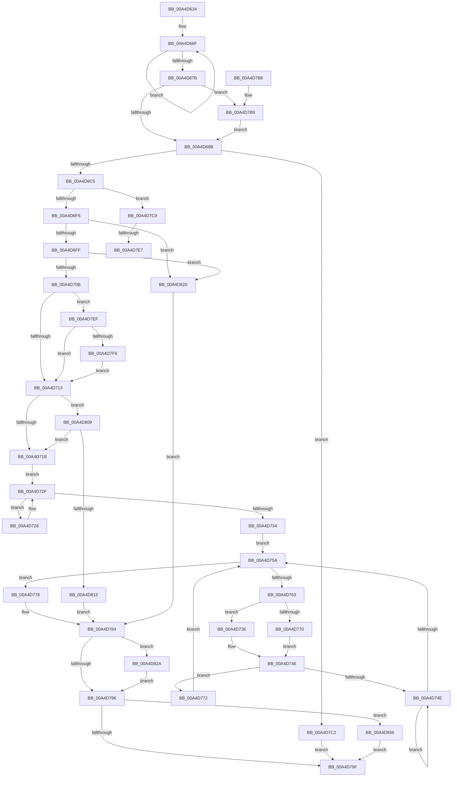

# PopDirectedDripsInitializeBroadcast

- RVA: `0x00A4D634`–`0x00A4D858` (길이 `548` bytes)
- VA: `0x0000000140A4D634`
- 실행 섹션: `PAGE`
- PDB 이름 있음: `예`; PDB Function 태그: `예`
- unwind 정보 RVA: `0x000B058C`
- 디코드: `141`개 명령, `548/548` bytes 표시
- 미해석 바이트: `0` (있으면 어셈블리에 `.byte`로 보존)

> 이 문서는 커널 이미지의 기계어와 PDB 기호를 분석해 생성했습니다. 4번과 5번은 함수 원형과 자료형을 바이너리 사용 방식에서 추정한 C 해석이며 원본 소스 복구 결과는 아닙니다.

## 1. Dependencies

- 직접 호출 지점: **11**; 고유 호출 대상: **10**
- 직접 호출자로 확인된 함수: **1**
- RIP 상대 이미지 참조: **3**

### Outgoing calls
- `0x00A4D6C7` → [IoControlPnpDeviceActionQueue](../../text/4A/IoControlPnpDeviceActionQueue_function_004A42D4.md) (function, `0x004A42D4`)
- `0x00A4D6CC` → [PopDirectedDripsInitializeDeviceTree](PopDirectedDripsInitializeDeviceTree_function_00A4D860.md) (function, `0x00A4D860`)
- `0x00A4D6D6` → [PopFxBuildDirectedDripsCandidateDeviceList](../../text/49/PopFxBuildDirectedDripsCandidateDeviceList_function_00499288.md) (function, `0x00499288`)
- `0x00A4D736` → [PopDirectedDripsDiagTraceTransition](../77/PopDirectedDripsDiagTraceTransition_function_007714CC.md) (function, `0x007714CC`)
- `0x00A4D77D` → [PoInitializeBroadcast](PoInitializeBroadcast_function_00A4DD98.md) (function, `0x00A4DD98`)
- `0x00A4D789` → [PopFxDestroyDirectedDripsCandidateDeviceList](../../text/4D/PopFxDestroyDirectedDripsCandidateDeviceList_function_004D2D98.md) (function, `0x004D2D98`)
- `0x00A4D7D8` → [PopDirectedDripsBuildBroadcastTreePartial](../77/PopDirectedDripsBuildBroadcastTreePartial_function_00771B90.md) (function, `0x00771B90`)
- `0x00A4D82C` → [IoControlPnpDeviceActionQueue](../../text/4A/IoControlPnpDeviceActionQueue_function_004A42D4.md) (function, `0x004A42D4`)
- `0x00A4D836` → [PopAcquirePolicyLock](../../pagelk/B7/PopAcquirePolicyLock_function_00B783C0.md) (function, `0x00B783C0`)
- `0x00A4D849` → [PopPowerAggregatorHandleIntent](../91/PopPowerAggregatorHandleIntent_function_00914670.md) (function, `0x00914670`)
- `0x00A4D84E` → [PopReleasePolicyLock](../../pagelk/B7/PopReleasePolicyLock_function_00B78410.md) (function, `0x00B78410`)

### Direct callers
- [PopDirectedDripsSuspendDevices](PopDirectedDripsSuspendDevices_function_00A4D474.md) at `0x00A4D50C`

### Static image references
- `0x00A4D659` → RVA `0x00F0EAF0` (`.data`; read)
- `0x00A4D662` → RVA `0x00F0EAC0` (`.data`; read)
- `0x00A4D71B` → RVA `0x00F8C438` (`.data`; read)

## 2. Other-region calls and transfers

- 다른 실행 섹션으로 향하는 call: **6**
  - `0x00A4D6C7` → [IoControlPnpDeviceActionQueue](../../text/4A/IoControlPnpDeviceActionQueue_function_004A42D4.md) (`PAGE` → `.text`)
  - `0x00A4D6D6` → [PopFxBuildDirectedDripsCandidateDeviceList](../../text/49/PopFxBuildDirectedDripsCandidateDeviceList_function_00499288.md) (`PAGE` → `.text`)
  - `0x00A4D789` → [PopFxDestroyDirectedDripsCandidateDeviceList](../../text/4D/PopFxDestroyDirectedDripsCandidateDeviceList_function_004D2D98.md) (`PAGE` → `.text`)
  - `0x00A4D82C` → [IoControlPnpDeviceActionQueue](../../text/4A/IoControlPnpDeviceActionQueue_function_004A42D4.md) (`PAGE` → `.text`)
  - `0x00A4D836` → [PopAcquirePolicyLock](../../pagelk/B7/PopAcquirePolicyLock_function_00B783C0.md) (`PAGE` → `PAGELK`)
  - `0x00A4D84E` → [PopReleasePolicyLock](../../pagelk/B7/PopReleasePolicyLock_function_00B78410.md) (`PAGE` → `PAGELK`)
- call이 아닌 외부 분기/꼬리 이동: **2**
  - `0x00A4D7E1` → [sub_00B3BDF8](../B3/Unknown_function_00B3BDF8.md) (`tail-transfer`)
  - `0x00A4D7EA` → [sub_00B3BDF8 + 0xB](../B3/Unknown_function_00B3BDF8.md) (`tail-transfer`)

## 3. Assembly (complete function range)

```asm
00A4D634  48 89 5C 24 10                  mov qword ptr [rsp + 0x10], rbx
00A4D639  48 89 6C 24 18                  mov qword ptr [rsp + 0x18], rbp
00A4D63E  56                              push rsi
00A4D63F  57                              push rdi
00A4D640  41 54                           push r12
00A4D642  41 56                           push r14
00A4D644  41 57                           push r15
00A4D646  48 83 EC 30                     sub rsp, 0x30
00A4D64A  0F 57 C0                        xorps xmm0, xmm0
00A4D64D  48 8B F1                        mov rsi, rcx
00A4D650  0F 11 44 24 20                  movups xmmword ptr [rsp + 0x20], xmm0
00A4D655  F0 83 09 00                     lock or dword ptr [rcx], 0
00A4D659  8B 0D 91 14 4C 00               mov ecx, dword ptr [rip + 0x4c1491]
00A4D65F  40 32 ED                        xor bpl, bpl
00A4D662  0F 0D 0D 57 14 4C 00            prefetchw byte ptr [rip + 0x4c1457]
00A4D669  8B 05 51 14 4C 00               mov eax, dword ptr [rip + 0x4c1451]
00A4D66F  8B D0                           mov edx, eax
00A4D671  F0 0F B1 15 47 14 4C 00         lock cmpxchg dword ptr [rip + 0x4c1447], edx
00A4D679  75 F4                           jne 0x140a4d66f
00A4D67B  44 8B C1                        mov r8d, ecx
00A4D67E  41 83 E0 01                     and r8d, 1
00A4D682  F6 C1 02                        test cl, 2
00A4D685  0F 85 2E 01 00 00               jne 0x140a4d7b9
00A4D68B  8B C8                           mov ecx, eax
00A4D68D  8B D0                           mov edx, eax
00A4D68F  C1 E9 0A                        shr ecx, 0xa
00A4D692  83 E1 01                        and ecx, 1
00A4D695  C1 EA 0C                        shr edx, 0xc
00A4D698  83 E2 01                        and edx, 1
00A4D69B  44 8B F9                        mov r15d, ecx
00A4D69E  41 83 CF 02                     or r15d, 2
00A4D6A2  44 8B E2                        mov r12d, edx
00A4D6A5  0F BA E0 0B                     bt eax, 0xb
00A4D6A9  44 0F 43 F9                     cmovae r15d, ecx
00A4D6AD  41 83 CC 02                     or r12d, 2
00A4D6B1  0F BA E0 0D                     bt eax, 0xd
00A4D6B5  44 0F 43 E2                     cmovae r12d, edx
00A4D6B9  45 23 E0                        and r12d, r8d
00A4D6BC  45 0B E7                        or r12d, r15d
00A4D6BF  0F 84 FD 00 00 00               je 0x140a4d7c2
00A4D6C5  B1 01                           mov cl, 1
00A4D6C7  E8 08 6C A5 FF                  call 0x1404a42d4
00A4D6CC  E8 8F 01 00 00                  call 0x140a4d860
00A4D6D1  48 8D 4C 24 20                  lea rcx, [rsp + 0x20]
00A4D6D6  E8 AD BB A4 FF                  call 0x140499288
00A4D6DB  48 8B 7C 24 20                  mov rdi, qword ptr [rsp + 0x20]
00A4D6E0  45 33 F6                        xor r14d, r14d
00A4D6E3  44 21 74 24 60                  and dword ptr [rsp + 0x60], r14d
00A4D6E8  48 8D 44 24 20                  lea rax, [rsp + 0x20]
00A4D6ED  48 3B F8                        cmp rdi, rax
00A4D6F0  0F 85 D3 00 00 00               jne 0x140a4d7c9
00A4D6F6  45 85 F6                        test r14d, r14d
00A4D6F9  0F 84 21 01 00 00               je 0x140a4d820
00A4D6FF  8B 44 24 60                     mov eax, dword ptr [rsp + 0x60]
00A4D703  85 C0                           test eax, eax
00A4D705  0F 84 15 01 00 00               je 0x140a4d820
00A4D70B  A8 01                           test al, 1
00A4D70D  0F 85 DC 00 00 00               jne 0x140a4d7ef
00A4D713  A8 02                           test al, 2
00A4D715  0F 85 EE 00 00 00               jne 0x140a4d809
00A4D71B  48 8B 0D 16 ED 53 00            mov rcx, qword ptr [rip + 0x53ed16]
00A4D722  48 8B 41 08                     mov rax, qword ptr [rcx + 8]
00A4D726  EB 07                           jmp 0x140a4d72f
00A4D728  48 8B C8                        mov rcx, rax
00A4D72B  48 8B 40 08                     mov rax, qword ptr [rax + 8]
00A4D72F  48 85 C0                        test rax, rax
00A4D732  75 F4                           jne 0x140a4d728
00A4D734  EB 24                           jmp 0x140a4d75a
00A4D736  E8 91 3D D2 FF                  call 0x1407714cc
00A4D73B  F0 81 89 28 01 00 00 00 01 00 00  lock or dword ptr [rcx + 0x128], 0x100
00A4D746  48 8B 01                        mov rax, qword ptr [rcx]
00A4D749  48 85 C0                        test rax, rax
00A4D74C  74 24                           je 0x140a4d772
00A4D74E  48 8B C8                        mov rcx, rax
00A4D751  48 8B 40 08                     mov rax, qword ptr [rax + 8]
00A4D755  48 85 C0                        test rax, rax
00A4D758  75 F4                           jne 0x140a4d74e
00A4D75A  48 3B 0D D7 EC 53 00            cmp rcx, qword ptr [rip + 0x53ecd7]
00A4D761  74 15                           je 0x140a4d778
00A4D763  8B 81 F8 02 00 00               mov eax, dword ptr [rcx + 0x2f8]
00A4D769  A9 00 00 03 00                  test eax, 0x30000
00A4D76E  75 C6                           jne 0x140a4d736
00A4D770  EB D4                           jmp 0x140a4d746
00A4D772  48 8B 49 10                     mov rcx, qword ptr [rcx + 0x10]
00A4D776  EB E2                           jmp 0x140a4d75a
00A4D778  B9 01 00 00 00                  mov ecx, 1
00A4D77D  E8 16 06 00 00                  call 0x140a4dd98
00A4D782  8B D8                           mov ebx, eax
00A4D784  48 8D 4C 24 20                  lea rcx, [rsp + 0x20]
00A4D789  E8 0A 56 A8 FF                  call 0x1404d2d98
00A4D78E  85 DB                           test ebx, ebx
00A4D790  0F 88 94 00 00 00               js 0x140a4d82a
00A4D796  40 84 ED                        test bpl, bpl
00A4D799  0F 85 97 00 00 00               jne 0x140a4d836
00A4D79F  48 8B 6C 24 70                  mov rbp, qword ptr [rsp + 0x70]
00A4D7A4  8B C3                           mov eax, ebx
00A4D7A6  48 8B 5C 24 68                  mov rbx, qword ptr [rsp + 0x68]
00A4D7AB  48 83 C4 30                     add rsp, 0x30
00A4D7AF  41 5F                           pop r15
00A4D7B1  41 5E                           pop r14
00A4D7B3  41 5C                           pop r12
00A4D7B5  5F                              pop rdi
00A4D7B6  5E                              pop rsi
00A4D7B7  C3                              ret
00A4D7B8  CC                              int3
00A4D7B9  41 83 C8 02                     or r8d, 2
00A4D7BD  E9 C9 FE FF FF                  jmp 0x140a4d68b
00A4D7C2  BB 01 00 00 C0                  mov ebx, 0xc0000001
00A4D7C7  EB D6                           jmp 0x140a4d79f
00A4D7C9  48 8B 8F A0 FC FF FF            mov rcx, qword ptr [rdi - 0x360]
00A4D7D0  4C 8D 44 24 60                  lea r8, [rsp + 0x60]
00A4D7D5  41 8B D4                        mov edx, r12d
00A4D7D8  E8 B3 43 D2 FF                  call 0x140771b90
00A4D7DD  8B D8                           mov ebx, eax
00A4D7DF  85 C0                           test eax, eax
00A4D7E1  0F 88 11 E6 0E 00               js 0x140b3bdf8
00A4D7E7  41 FF C6                        inc r14d
00A4D7EA  E9 14 E6 0E 00                  jmp 0x140b3be03
00A4D7EF  41 F6 C7 01                     test r15b, 1
00A4D7F3  0F 85 1A FF FF FF               jne 0x140a4d713
00A4D7F9  F0 81 0E 00 04 00 00            lock or dword ptr [rsi], 0x400
00A4D800  8B 44 24 60                     mov eax, dword ptr [rsp + 0x60]
00A4D804  E9 0A FF FF FF                  jmp 0x140a4d713
00A4D809  41 F6 C7 02                     test r15b, 2
00A4D80D  0F 85 08 FF FF FF               jne 0x140a4d71b
00A4D813  40 B5 01                        mov bpl, 1
00A4D816  BB 2D 02 00 C0                  mov ebx, 0xc000022d
00A4D81B  E9 64 FF FF FF                  jmp 0x140a4d784
00A4D820  BB 01 00 00 C0                  mov ebx, 0xc0000001
00A4D825  E9 5A FF FF FF                  jmp 0x140a4d784
00A4D82A  33 C9                           xor ecx, ecx
00A4D82C  E8 A3 6A A5 FF                  call 0x1404a42d4
00A4D831  E9 60 FF FF FF                  jmp 0x140a4d796
00A4D836  E8 85 AB 12 00                  call 0x140b783c0
00A4D83B  33 D2                           xor edx, edx
00A4D83D  41 B9 2A 00 00 00               mov r9d, 0x2a
00A4D843  45 33 C0                        xor r8d, r8d
00A4D846  8D 4A 04                        lea ecx, [rdx + 4]
00A4D849  E8 22 6E EC FF                  call 0x140914670
00A4D84E  E8 BD AB 12 00                  call 0x140b78410
00A4D853  E9 47 FF FF FF                  jmp 0x140a4d79f
```

## 4. C-style interpretation (structured pseudocode)

```c
__int64 __fastcall PopDirectedDripsInitializeBroadcast(__int64 a1)
{
    __int64 result;
    __int64 v_r12;
    __int64 v_r14;
    __int64 v_r15;
    __int64 v_rbp;
    __int64 v_rsp;
    unsigned __int64 v_stack_m38;
    unsigned __int64 v_stack_p10;
    unsigned __int64 v_stack_p18;
    unsigned __int64 v_stack_p60;
    unsigned int v_stack_p8;

    v_stack_p10 = v_rbx;
    v_stack_p18 = v_rbp;
    v_rsp = (v_rsp) - (48);
    v_stack_m38 = v_xmm0;
    v_rbp = 0;
loc_00A4D66F:
    if (condition_is_not_equal) goto loc_00A4D66F;
    a3 = (unsigned int)(((unsigned int)((unsigned int)((unsigned int)(*(unsigned int *)(v_rip + 4986001))))) & (1));
    if ((((unsigned __int8)((unsigned int)(*(unsigned int *)(v_rip + 4986001)))) & (2)) != 0) goto loc_00A4D7B9;
loc_00A4D68B:
    a1 = (unsigned int)(((unsigned int)((unsigned int)((unsigned int)(*(unsigned int *)(v_rip + 4985937))))) >> (10));
    a1 = (unsigned int)((a1) & (1));
    a2 = (unsigned int)(((unsigned int)((unsigned int)((unsigned int)(*(unsigned int *)(v_rip + 4985937))))) >> (12));
    a2 = (unsigned int)((a2) & (1));
    v_r15 = (unsigned int)(((unsigned int)((unsigned int)(a1))) | (2));
    if (condition_is_above_or_equal) { v_r15 = (unsigned int)(a1); }
    v_r12 = (unsigned int)(((unsigned int)((unsigned int)(a2))) | (2));
    if (condition_is_above_or_equal) { v_r12 = (unsigned int)(a2); }
    v_r12 = (unsigned int)((v_r12) & ((unsigned int)(a3)));
    v_r12 = (unsigned int)((v_r12) | ((unsigned int)(v_r15)));
    if (condition_is_equal) goto loc_00A4D7C2;
    result = IoControlPnpDeviceActionQueue(1, a2, a3, a4);
    result = PopDirectedDripsInitializeDeviceTree(1, a2, a3, a4);
    result = PopFxBuildDirectedDripsCandidateDeviceList(v_stack_m38, a2, a3, a4);
    v_r14 = 0;
    if (v_stack_m38 != v_stack_m38) goto loc_00A4D7C9;
    if (0 == 0) goto loc_00A4D820;
    if ((unsigned int)((unsigned int)(v_stack_p8)) == 0) goto loc_00A4D820;
    if ((((unsigned __int8)((unsigned int)(v_stack_p8))) & (1)) != 0) goto loc_00A4D7EF;
loc_00A4D713:
    if ((((unsigned __int8)((unsigned int)(v_stack_p8))) & (2)) != 0) goto loc_00A4D809;
loc_00A4D71B:
    goto loc_00A4D72F;
loc_00A4D728:
loc_00A4D72F:
    if (*(unsigned __int64 *)(*(unsigned __int64 *)(*(unsigned __int64 *)(v_rip + 5500182) + 8) + 8) != 0) goto loc_00A4D728;
    goto loc_00A4D75A;
loc_00A4D736:
    result = PopDirectedDripsDiagTraceTransition(*(unsigned __int64 *)(*(unsigned __int64 *)(v_rip + 5500182) + 8), a2, a3, a4);
loc_00A4D746:
    if (*(unsigned __int64 *)(*(unsigned __int64 *)(*(unsigned __int64 *)(v_rip + 5500182) + 8)) == 0) goto loc_00A4D772;
loc_00A4D74E:
    if (*(unsigned __int64 *)(*(unsigned __int64 *)(*(unsigned __int64 *)(*(unsigned __int64 *)(v_rip + 5500182) + 8)) + 8) != 0) goto loc_00A4D74E;
loc_00A4D75A:
    if ((*(unsigned __int64 *)(*(unsigned __int64 *)(*(unsigned __int64 *)(v_rip + 5500182) + 8))) == (*(unsigned __int64 *)(v_rip + 5500119))) goto loc_00A4D778;
    if ((((unsigned int)((unsigned int)(*(unsigned int *)(*(unsigned __int64 *)(*(unsigned __int64 *)(*(unsigned __int64 *)(v_rip + 5500182) + 8)) + 760)))) & (0x30000ULL)) != 0) goto loc_00A4D736;
    goto loc_00A4D746;
loc_00A4D772:
    goto loc_00A4D75A;
loc_00A4D778:
    result = PoInitializeBroadcast(1, a2, a3, a4);
loc_00A4D784:
    result = PopFxDestroyDirectedDripsCandidateDeviceList(v_stack_m38, a2, a3, a4);
    if (sign_flag) goto loc_00A4D82A;
loc_00A4D796:
    if (0 != 0) goto loc_00A4D836;
loc_00A4D79F:
    v_rsp = (v_rsp) + (48);
    return (unsigned int)((unsigned int)((unsigned int)((unsigned int)(result))));
loc_00A4D7B9:
    a3 = (unsigned int)((a3) | (2));
    goto loc_00A4D68B;
loc_00A4D7C2:
    goto loc_00A4D79F;
loc_00A4D7C9:
    result = PopDirectedDripsBuildBroadcastTreePartial(*(unsigned __int64 *)(v_stack_m38 - 864), (unsigned int)((unsigned int)(v_r12)), v_stack_p60, a4);
    v_r14 = (unsigned int)((v_r14) + 1);
loc_00A4D7EF:
    if ((((unsigned __int8)(v_r15)) & (1)) != 0) goto loc_00A4D713;
    goto loc_00A4D713;
loc_00A4D809:
    if ((((unsigned __int8)(v_r15)) & (2)) != 0) goto loc_00A4D71B;
    goto loc_00A4D784;
loc_00A4D820:
    goto loc_00A4D784;
loc_00A4D82A:
    a1 = 0;
    result = IoControlPnpDeviceActionQueue(a1, (unsigned int)((unsigned int)(v_r12)), v_stack_p60, a4);
    goto loc_00A4D796;
loc_00A4D836:
    result = PopAcquirePolicyLock(a1, (unsigned int)((unsigned int)(v_r12)), v_stack_p60, a4);
    a2 = 0;
    a3 = 0;
    result = PopPowerAggregatorHandleIntent(a2 + 4, a2, a3, 42);
    result = PopReleasePolicyLock(a2 + 4, a2, a3, 42);
    goto loc_00A4D79F;
}
```

## 5. (Beta) C Style

```c
int64_t PopDirectedDripsInitializeBroadcast(void *Arg1)
{
    uint8_t *arg1 = (uint8_t *)Arg1;

    int64_t result;
    int64_t local_r12;
    int64_t local_r14;
    int64_t local_r15;
    int64_t local_rbp;
    int64_t local_rsp;
    uint64_t v_stack_m38;
    uint64_t v_stack_p10;
    uint64_t v_stack_p18;
    uint64_t v_stack_p60;
    uint32_t v_stack_p8;

    v_stack_p10 = local_rbx;
    v_stack_p18 = local_rbp;
    local_rsp = (local_rsp) - (48);
    v_stack_m38 = v_xmm0;
    local_rbp = 0;
loc_00A4D66F:
    if (condition_is_not_equal) goto loc_00A4D66F;
    a3 = (uint32_t)(((uint32_t)((uint32_t)((uint32_t)(*(uint32_t *)(v_rip + 0x4C1491))))) & (1));
    if ((((uint8_t)((uint32_t)(*(uint32_t *)(v_rip + 0x4C1491)))) & (2)) != 0) goto loc_00A4D7B9;
loc_00A4D68B:
    Arg1 = (uint32_t)(((uint32_t)((uint32_t)((uint32_t)(*(uint32_t *)(v_rip + 0x4C1451))))) >> (10));
    Arg1 = (uint32_t)((Arg1) & (1));
    a2 = (uint32_t)(((uint32_t)((uint32_t)((uint32_t)(*(uint32_t *)(v_rip + 0x4C1451))))) >> (12));
    a2 = (uint32_t)((a2) & (1));
    local_r15 = (uint32_t)(((uint32_t)((uint32_t)(Arg1))) | (2));
    if (condition_is_above_or_equal) { local_r15 = (uint32_t)(Arg1); }
    local_r12 = (uint32_t)(((uint32_t)((uint32_t)(a2))) | (2));
    if (condition_is_above_or_equal) { local_r12 = (uint32_t)(a2); }
    local_r12 = (uint32_t)((local_r12) & ((uint32_t)(a3)));
    local_r12 = (uint32_t)((local_r12) | ((uint32_t)(local_r15)));
    if (condition_is_equal) goto loc_00A4D7C2;
    result = IoControlPnpDeviceActionQueue(1, a2, a3, a4);
    result = PopDirectedDripsInitializeDeviceTree(1, a2, a3, a4);
    result = PopFxBuildDirectedDripsCandidateDeviceList(v_stack_m38, a2, a3, a4);
    local_r14 = 0;
    if (v_stack_m38 != v_stack_m38) goto loc_00A4D7C9;
    if (0 == 0) goto loc_00A4D820;
    if ((uint32_t)((uint32_t)(v_stack_p8)) == 0) goto loc_00A4D820;
    if ((((uint8_t)((uint32_t)(v_stack_p8))) & (1)) != 0) goto loc_00A4D7EF;
loc_00A4D713:
    if ((((uint8_t)((uint32_t)(v_stack_p8))) & (2)) != 0) goto loc_00A4D809;
loc_00A4D71B:
    goto loc_00A4D72F;
loc_00A4D728:
loc_00A4D72F:
    if (*(uint64_t *)(*(uint64_t *)(*(uint64_t *)(v_rip + 0x53ED16) + 0x8) + 0x8) != 0) goto loc_00A4D728;
    goto loc_00A4D75A;
loc_00A4D736:
    result = PopDirectedDripsDiagTraceTransition(*(uint64_t *)(*(uint64_t *)(v_rip + 0x53ED16) + 0x8), a2, a3, a4);
loc_00A4D746:
    if (*(uint64_t *)(*(uint64_t *)(*(uint64_t *)(v_rip + 0x53ED16) + 0x8)) == 0) goto loc_00A4D772;
loc_00A4D74E:
    if (*(uint64_t *)(*(uint64_t *)(*(uint64_t *)(*(uint64_t *)(v_rip + 0x53ED16) + 0x8)) + 0x8) != 0) goto loc_00A4D74E;
loc_00A4D75A:
    if ((*(uint64_t *)(*(uint64_t *)(*(uint64_t *)(v_rip + 0x53ED16) + 0x8))) == (*(uint64_t *)(v_rip + 0x53ECD7))) goto loc_00A4D778;
    if ((((uint32_t)((uint32_t)(*(uint32_t *)(*(uint64_t *)(*(uint64_t *)(*(uint64_t *)(v_rip + 0x53ED16) + 0x8)) + 0x2F8)))) & (0x30000ULL)) != 0) goto loc_00A4D736;
    goto loc_00A4D746;
loc_00A4D772:
    goto loc_00A4D75A;
loc_00A4D778:
    result = PoInitializeBroadcast(1, a2, a3, a4);
loc_00A4D784:
    result = PopFxDestroyDirectedDripsCandidateDeviceList(v_stack_m38, a2, a3, a4);
    if (sign_flag) goto loc_00A4D82A;
loc_00A4D796:
    if (0 != 0) goto loc_00A4D836;
loc_00A4D79F:
    local_rsp = (local_rsp) + (48);
    return (uint32_t)((uint32_t)((uint32_t)((uint32_t)(result))));
loc_00A4D7B9:
    a3 = (uint32_t)((a3) | (2));
    goto loc_00A4D68B;
loc_00A4D7C2:
    goto loc_00A4D79F;
loc_00A4D7C9:
    result = PopDirectedDripsBuildBroadcastTreePartial(*(uint64_t *)(v_stack_m38 - 0x360), (uint32_t)((uint32_t)(local_r12)), v_stack_p60, a4);
    local_r14 = (uint32_t)((local_r14) + 1);
loc_00A4D7EF:
    if ((((uint8_t)(local_r15)) & (1)) != 0) goto loc_00A4D713;
    goto loc_00A4D713;
loc_00A4D809:
    if ((((uint8_t)(local_r15)) & (2)) != 0) goto loc_00A4D71B;
    goto loc_00A4D784;
loc_00A4D820:
    goto loc_00A4D784;
loc_00A4D82A:
    Arg1 = 0;
    result = IoControlPnpDeviceActionQueue(Arg1, (uint32_t)((uint32_t)(local_r12)), v_stack_p60, a4);
    goto loc_00A4D796;
loc_00A4D836:
    result = PopAcquirePolicyLock(Arg1, (uint32_t)((uint32_t)(local_r12)), v_stack_p60, a4);
    a2 = 0;
    a3 = 0;
    result = PopPowerAggregatorHandleIntent(a2 + 4, a2, a3, 42);
    result = PopReleasePolicyLock(a2 + 4, a2, a3, 42);
    goto loc_00A4D79F;
}
```

### 관측된 메모리 오프셋

구조체 형식이 확인되지 않은 접근은 인자 기준의 오프셋으로만 기록했습니다.

| 기준 인자 | 오프셋 표현 | 폭 (bit) | 접근 |
|---|---:|---:|---|
| `Arg1` | `+ 0x0` | `32` | `R/W` |

## 6. Execution-region graph

[열기: 2D/3D 그래프와 함수 탐색 컨트롤 패널](../../../control-panel.html?section=page&rva=0x00A4D634&view=graph)

- 2D 그래프는 위에서 아래로 흐르고, 3D 그래프는 빈 공간을 드래그해 회전합니다. Shift+드래그는 이동, 휠은 확대·축소, 함수 노드 선택은 대상 보고서 이동입니다.

### Static fallback


