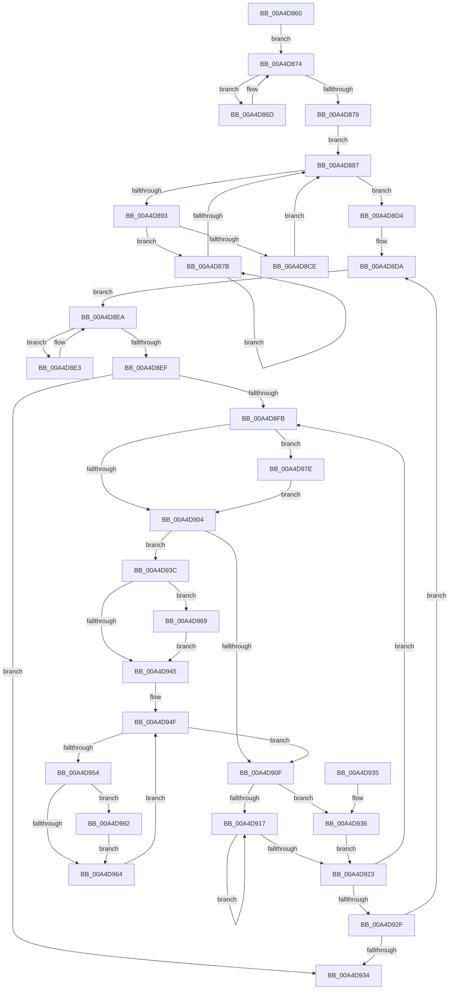

# PopDirectedDripsInitializeDeviceTree

- RVA: `0x00A4D860`–`0x00A4D9A8` (길이 `328` bytes)
- VA: `0x0000000140A4D860`
- 실행 섹션: `PAGE`
- PDB 이름 있음: `예`; PDB Function 태그: `아니요`
- unwind 정보 RVA: `0x000DB714`
- 디코드: `90`개 명령, `328/328` bytes 표시
- 미해석 바이트: `0` (있으면 어셈블리에 `.byte`로 보존)

> 이 문서는 커널 이미지의 기계어와 PDB 기호를 분석해 생성했습니다. 4번과 5번은 함수 원형과 자료형을 바이너리 사용 방식에서 추정한 C 해석이며 원본 소스 복구 결과는 아닙니다.

## 1. Dependencies

- 직접 호출 지점: **0**; 고유 호출 대상: **0**
- 직접 호출자로 확인된 함수: **1**
- RIP 상대 이미지 참조: **1**

### Outgoing calls
- 직접 디코드된 call 명령이 없습니다.

### Direct callers
- [PopDirectedDripsInitializeBroadcast](PopDirectedDripsInitializeBroadcast_function_00A4D634.md) at `0x00A4D6CC`

### Static image references
- `0x00A4D860` → RVA `0x00F8C438` (`.data`; read)

## 2. Other-region calls and transfers

- 다른 실행 섹션으로 향하는 call: **0**
- 별도 외부 분기/꼬리 이동을 확인하지 못했습니다.

## 3. Assembly (complete function range)

```asm
00A4D860  48 8B 15 D1 EB 53 00            mov rdx, qword ptr [rip + 0x53ebd1]
00A4D867  48 8B 42 08                     mov rax, qword ptr [rdx + 8]
00A4D86B  EB 07                           jmp 0x140a4d874
00A4D86D  48 8B D0                        mov rdx, rax
00A4D870  48 8B 40 08                     mov rax, qword ptr [rax + 8]
00A4D874  48 85 C0                        test rax, rax
00A4D877  75 F4                           jne 0x140a4d86d
00A4D879  EB 0C                           jmp 0x140a4d887
00A4D87B  48 8B D0                        mov rdx, rax
00A4D87E  48 8B 40 08                     mov rax, qword ptr [rax + 8]
00A4D882  48 85 C0                        test rax, rax
00A4D885  75 F4                           jne 0x140a4d87b
00A4D887  48 8B 05 AA EB 53 00            mov rax, qword ptr [rip + 0x53ebaa]
00A4D88E  48 3B D0                        cmp rdx, rax
00A4D891  74 41                           je 0x140a4d8d4
00A4D893  F0 81 A2 28 01 00 00 FF FE FF FF  lock and dword ptr [rdx + 0x128], 0xfffffeff
00A4D89E  48 8D 8A D8 02 00 00            lea rcx, [rdx + 0x2d8]
00A4D8A5  48 89 49 08                     mov qword ptr [rcx + 8], rcx
00A4D8A9  48 8D 41 10                     lea rax, [rcx + 0x10]
00A4D8AD  48 89 09                        mov qword ptr [rcx], rcx
00A4D8B0  48 89 40 08                     mov qword ptr [rax + 8], rax
00A4D8B4  48 89 00                        mov qword ptr [rax], rax
00A4D8B7  8B 41 20                        mov eax, dword ptr [rcx + 0x20]
00A4D8BA  83 61 24 00                     and dword ptr [rcx + 0x24], 0
00A4D8BE  25 FF FF F0 FF                  and eax, 0xfff0ffff
00A4D8C3  89 41 20                        mov dword ptr [rcx + 0x20], eax
00A4D8C6  48 8B 02                        mov rax, qword ptr [rdx]
00A4D8C9  48 85 C0                        test rax, rax
00A4D8CC  75 AD                           jne 0x140a4d87b
00A4D8CE  48 8B 52 10                     mov rdx, qword ptr [rdx + 0x10]
00A4D8D2  EB B3                           jmp 0x140a4d887
00A4D8D4  41 BB 00 00 08 00               mov r11d, 0x80000
00A4D8DA  48 8B 48 08                     mov rcx, qword ptr [rax + 8]
00A4D8DE  45 32 D2                        xor r10b, r10b
00A4D8E1  EB 07                           jmp 0x140a4d8ea
00A4D8E3  48 8B C1                        mov rax, rcx
00A4D8E6  48 8B 49 08                     mov rcx, qword ptr [rcx + 8]
00A4D8EA  48 85 C9                        test rcx, rcx
00A4D8ED  75 F4                           jne 0x140a4d8e3
00A4D8EF  48 3B 05 42 EB 53 00            cmp rax, qword ptr [rip + 0x53eb42]
00A4D8F6  48 8B D0                        mov rdx, rax
00A4D8F9  74 39                           je 0x140a4d934
00A4D8FB  83 BA 00 03 00 00 00            cmp dword ptr [rdx + 0x300], 0
00A4D902  75 7A                           jne 0x140a4d97e
00A4D904  8B 82 F8 02 00 00               mov eax, dword ptr [rdx + 0x2f8]
00A4D90A  41 85 C3                        test r11d, eax
00A4D90D  75 2D                           jne 0x140a4d93c
00A4D90F  48 8B 02                        mov rax, qword ptr [rdx]
00A4D912  48 85 C0                        test rax, rax
00A4D915  74 1F                           je 0x140a4d936
00A4D917  48 8B D0                        mov rdx, rax
00A4D91A  48 8B 40 08                     mov rax, qword ptr [rax + 8]
00A4D91E  48 85 C0                        test rax, rax
00A4D921  75 F4                           jne 0x140a4d917
00A4D923  48 8B 05 0E EB 53 00            mov rax, qword ptr [rip + 0x53eb0e]
00A4D92A  48 3B D0                        cmp rdx, rax
00A4D92D  75 CC                           jne 0x140a4d8fb
00A4D92F  45 84 D2                        test r10b, r10b
00A4D932  75 A6                           jne 0x140a4d8da
00A4D934  C3                              ret
00A4D935  CC                              int3
00A4D936  48 8B 52 10                     mov rdx, qword ptr [rdx + 0x10]
00A4D93A  EB E7                           jmp 0x140a4d923
00A4D93C  48 8B 4A 10                     mov rcx, qword ptr [rdx + 0x10]
00A4D940  48 85 C9                        test rcx, rcx
00A4D943  75 24                           jne 0x140a4d969
00A4D945  4C 8D 82 C0 00 00 00            lea r8, [rdx + 0xc0]
00A4D94C  49 8B 08                        mov rcx, qword ptr [r8]
00A4D94F  49 3B C8                        cmp rcx, r8
00A4D952  74 BB                           je 0x140a4d90f
00A4D954  4C 8B 49 28                     mov r9, qword ptr [rcx + 0x28]
00A4D958  41 8B 81 58 02 00 00            mov eax, dword ptr [r9 + 0x258]
00A4D95F  41 85 C3                        test r11d, eax
00A4D962  74 2E                           je 0x140a4d992
00A4D964  48 8B 09                        mov rcx, qword ptr [rcx]
00A4D967  EB E6                           jmp 0x140a4d94f
00A4D969  8B 89 F8 02 00 00               mov ecx, dword ptr [rcx + 0x2f8]
00A4D96F  48 8B 42 10                     mov rax, qword ptr [rdx + 0x10]
00A4D973  41 0B CB                        or ecx, r11d
00A4D976  89 88 F8 02 00 00               mov dword ptr [rax + 0x2f8], ecx
00A4D97C  EB C7                           jmp 0x140a4d945
00A4D97E  8B 82 F8 02 00 00               mov eax, dword ptr [rdx + 0x2f8]
00A4D984  41 0B C3                        or eax, r11d
00A4D987  89 82 F8 02 00 00               mov dword ptr [rdx + 0x2f8], eax
00A4D98D  E9 72 FF FF FF                  jmp 0x140a4d904
00A4D992  41 8B 81 58 02 00 00            mov eax, dword ptr [r9 + 0x258]
00A4D999  41 B2 01                        mov r10b, 1
00A4D99C  41 0B C3                        or eax, r11d
00A4D99F  41 89 81 58 02 00 00            mov dword ptr [r9 + 0x258], eax
00A4D9A6  EB BC                           jmp 0x140a4d964
```

## 4. C-style interpretation (structured pseudocode)

```c
__int64 __fastcall PopDirectedDripsInitializeDeviceTree(void)
{
    __int64 result;
    __int64 v_r10;

    goto loc_00A4D874;
loc_00A4D86D:
loc_00A4D874:
    if (*(unsigned __int64 *)(*(unsigned __int64 *)(*(unsigned __int64 *)(v_rip + 5499857) + 8) + 8) != 0) goto loc_00A4D86D;
    goto loc_00A4D887;
loc_00A4D87B:
    if (*(unsigned __int64 *)(*(unsigned __int64 *)(*(unsigned __int64 *)(*(unsigned __int64 *)(v_rip + 5499857) + 8) + 8) + 8) != 0) goto loc_00A4D87B;
loc_00A4D887:
    if ((*(unsigned __int64 *)(*(unsigned __int64 *)(*(unsigned __int64 *)(v_rip + 5499857) + 8) + 8)) == (*(unsigned __int64 *)(v_rip + 5499818))) goto loc_00A4D8D4;
    *(unsigned __int64 *)(*(unsigned __int64 *)(*(unsigned __int64 *)(*(unsigned __int64 *)(v_rip + 5499857) + 8) + 8) + 728 + 8) = *(unsigned __int64 *)(*(unsigned __int64 *)(*(unsigned __int64 *)(v_rip + 5499857) + 8) + 8) + 728;
    *(unsigned __int64 *)(*(unsigned __int64 *)(*(unsigned __int64 *)(*(unsigned __int64 *)(v_rip + 5499857) + 8) + 8) + 728) = *(unsigned __int64 *)(*(unsigned __int64 *)(*(unsigned __int64 *)(v_rip + 5499857) + 8) + 8) + 728;
    *(unsigned __int64 *)(*(unsigned __int64 *)(*(unsigned __int64 *)(*(unsigned __int64 *)(v_rip + 5499857) + 8) + 8) + 728 + 16 + 8) = *(unsigned __int64 *)(*(unsigned __int64 *)(*(unsigned __int64 *)(v_rip + 5499857) + 8) + 8) + 728 + 16;
    *(unsigned __int64 *)(*(unsigned __int64 *)(*(unsigned __int64 *)(*(unsigned __int64 *)(v_rip + 5499857) + 8) + 8) + 728 + 16) = *(unsigned __int64 *)(*(unsigned __int64 *)(*(unsigned __int64 *)(v_rip + 5499857) + 8) + 8) + 728 + 16;
    result = (unsigned int)(((unsigned int)(*(unsigned int *)(*(unsigned __int64 *)(*(unsigned __int64 *)(*(unsigned __int64 *)(v_rip + 5499857) + 8) + 8) + 728 + 32))) & (0xFFF0FFFFULL));
    *(unsigned int *)(*(unsigned __int64 *)(*(unsigned __int64 *)(*(unsigned __int64 *)(v_rip + 5499857) + 8) + 8) + 728 + 32) = (unsigned int)(result);
    if (*(unsigned __int64 *)(*(unsigned __int64 *)(*(unsigned __int64 *)(*(unsigned __int64 *)(v_rip + 5499857) + 8) + 8)) != 0) goto loc_00A4D87B;
    goto loc_00A4D887;
loc_00A4D8D4:
loc_00A4D8DA:
    v_r10 = 0;
    goto loc_00A4D8EA;
loc_00A4D8E3:
loc_00A4D8EA:
    if (*(unsigned __int64 *)(*(unsigned __int64 *)(*(unsigned __int64 *)(*(unsigned __int64 *)(*(unsigned __int64 *)(*(unsigned __int64 *)(v_rip + 5499857) + 8) + 8)) + 8) + 8) != 0) goto loc_00A4D8E3;
    if ((*(unsigned __int64 *)(*(unsigned __int64 *)(*(unsigned __int64 *)(*(unsigned __int64 *)(*(unsigned __int64 *)(v_rip + 5499857) + 8) + 8)) + 8)) == (*(unsigned __int64 *)(v_rip + 5499714))) goto loc_00A4D934;
loc_00A4D8FB:
    if ((*(unsigned int *)(*(unsigned __int64 *)(*(unsigned __int64 *)(*(unsigned __int64 *)(*(unsigned __int64 *)(*(unsigned __int64 *)(v_rip + 5499857) + 8) + 8)) + 8) + 768)) != 0) goto loc_00A4D97E;
loc_00A4D904:
    if ((((unsigned int)((unsigned int)(0x80000ULL))) & ((unsigned int)((unsigned int)(*(unsigned int *)(*(unsigned __int64 *)(*(unsigned __int64 *)(*(unsigned __int64 *)(*(unsigned __int64 *)(*(unsigned __int64 *)(v_rip + 5499857) + 8) + 8)) + 8) + 760))))) != 0) goto loc_00A4D93C;
loc_00A4D90F:
    if (*(unsigned __int64 *)(*(unsigned __int64 *)(*(unsigned __int64 *)(*(unsigned __int64 *)(*(unsigned __int64 *)(*(unsigned __int64 *)(v_rip + 5499857) + 8) + 8)) + 8)) == 0) goto loc_00A4D936;
loc_00A4D917:
    if (*(unsigned __int64 *)(*(unsigned __int64 *)(*(unsigned __int64 *)(*(unsigned __int64 *)(*(unsigned __int64 *)(*(unsigned __int64 *)(*(unsigned __int64 *)(v_rip + 5499857) + 8) + 8)) + 8)) + 8) != 0) goto loc_00A4D917;
loc_00A4D923:
    if ((*(unsigned __int64 *)(*(unsigned __int64 *)(*(unsigned __int64 *)(*(unsigned __int64 *)(*(unsigned __int64 *)(*(unsigned __int64 *)(v_rip + 5499857) + 8) + 8)) + 8))) != (*(unsigned __int64 *)(v_rip + 5499662))) goto loc_00A4D8FB;
    if (0 != 0) goto loc_00A4D8DA;
loc_00A4D934:
    return *(unsigned __int64 *)(v_rip + 5499662);
loc_00A4D936:
    goto loc_00A4D923;
loc_00A4D93C:
    if (*(unsigned __int64 *)(*(unsigned __int64 *)(*(unsigned __int64 *)(*(unsigned __int64 *)(*(unsigned __int64 *)(*(unsigned __int64 *)(*(unsigned __int64 *)(*(unsigned __int64 *)(v_rip + 5499857) + 8) + 8)) + 8)) + 16) + 16) != 0) goto loc_00A4D969;
loc_00A4D945:
loc_00A4D94F:
    if ((*(unsigned __int64 *)(*(unsigned __int64 *)(*(unsigned __int64 *)(*(unsigned __int64 *)(*(unsigned __int64 *)(*(unsigned __int64 *)(*(unsigned __int64 *)(*(unsigned __int64 *)(v_rip + 5499857) + 8) + 8)) + 8)) + 16) + 192)) == (*(unsigned __int64 *)(*(unsigned __int64 *)(*(unsigned __int64 *)(*(unsigned __int64 *)(*(unsigned __int64 *)(*(unsigned __int64 *)(*(unsigned __int64 *)(v_rip + 5499857) + 8) + 8)) + 8)) + 16) + 192)) goto loc_00A4D90F;
    if ((((unsigned int)((unsigned int)(0x80000ULL))) & ((unsigned int)((unsigned int)(*(unsigned int *)(*(unsigned __int64 *)(*(unsigned __int64 *)(*(unsigned __int64 *)(*(unsigned __int64 *)(*(unsigned __int64 *)(*(unsigned __int64 *)(*(unsigned __int64 *)(*(unsigned __int64 *)(*(unsigned __int64 *)(v_rip + 5499857) + 8) + 8)) + 8)) + 16) + 192) + 40) + 600))))) == 0) goto loc_00A4D992;
loc_00A4D964:
    goto loc_00A4D94F;
loc_00A4D969:
    a1 = (unsigned int)(((unsigned int)(*(unsigned int *)(*(unsigned __int64 *)(*(unsigned __int64 *)(*(unsigned __int64 *)(*(unsigned __int64 *)(*(unsigned __int64 *)(*(unsigned __int64 *)(*(unsigned __int64 *)(*(unsigned __int64 *)(*(unsigned __int64 *)(v_rip + 5499857) + 8) + 8)) + 8)) + 16) + 192)) + 760))) | ((unsigned int)((unsigned int)(0x80000ULL))));
    *(unsigned int *)(*(unsigned __int64 *)(*(unsigned __int64 *)(*(unsigned __int64 *)(*(unsigned __int64 *)(*(unsigned __int64 *)(*(unsigned __int64 *)(*(unsigned __int64 *)(*(unsigned __int64 *)(v_rip + 5499857) + 8) + 8)) + 8)) + 16) + 16) + 760) = (unsigned int)(a1);
    goto loc_00A4D945;
loc_00A4D97E:
    result = (unsigned int)(((unsigned int)(*(unsigned int *)(*(unsigned __int64 *)(*(unsigned __int64 *)(*(unsigned __int64 *)(*(unsigned __int64 *)(*(unsigned __int64 *)(*(unsigned __int64 *)(*(unsigned __int64 *)(v_rip + 5499857) + 8) + 8)) + 8)) + 16) + 760))) | ((unsigned int)((unsigned int)(0x80000ULL))));
    *(unsigned int *)(*(unsigned __int64 *)(*(unsigned __int64 *)(*(unsigned __int64 *)(*(unsigned __int64 *)(*(unsigned __int64 *)(*(unsigned __int64 *)(*(unsigned __int64 *)(v_rip + 5499857) + 8) + 8)) + 8)) + 16) + 760) = (unsigned int)(result);
    goto loc_00A4D904;
loc_00A4D992:
    result = (unsigned int)(((unsigned int)(*(unsigned int *)(*(unsigned __int64 *)(*(unsigned __int64 *)(*(unsigned __int64 *)(*(unsigned __int64 *)(*(unsigned __int64 *)(*(unsigned __int64 *)(*(unsigned __int64 *)(*(unsigned __int64 *)(*(unsigned __int64 *)(v_rip + 5499857) + 8) + 8)) + 8)) + 16) + 192) + 40) + 600))) | ((unsigned int)((unsigned int)(0x80000ULL))));
    *(unsigned int *)(*(unsigned __int64 *)(*(unsigned __int64 *)(*(unsigned __int64 *)(*(unsigned __int64 *)(*(unsigned __int64 *)(*(unsigned __int64 *)(*(unsigned __int64 *)(*(unsigned __int64 *)(*(unsigned __int64 *)(v_rip + 5499857) + 8) + 8)) + 8)) + 16) + 192) + 40) + 600) = (unsigned int)(result);
    goto loc_00A4D964;
}
```

## 5. (Beta) C Style

```c
void PopDirectedDripsInitializeDeviceTree(void)
{
    int64_t result;
    int64_t local_r10;

    goto loc_00A4D874;
loc_00A4D86D:
loc_00A4D874:
    if (*(uint64_t *)(*(uint64_t *)(*(uint64_t *)(v_rip + 0x53EBD1) + 0x8) + 0x8) != 0) goto loc_00A4D86D;
    goto loc_00A4D887;
loc_00A4D87B:
    if (*(uint64_t *)(*(uint64_t *)(*(uint64_t *)(*(uint64_t *)(v_rip + 0x53EBD1) + 0x8) + 0x8) + 0x8) != 0) goto loc_00A4D87B;
loc_00A4D887:
    if ((*(uint64_t *)(*(uint64_t *)(*(uint64_t *)(v_rip + 0x53EBD1) + 0x8) + 0x8)) == (*(uint64_t *)(v_rip + 0x53EBAA))) goto loc_00A4D8D4;
    *(uint64_t *)(*(uint64_t *)(*(uint64_t *)(*(uint64_t *)(v_rip + 0x53EBD1) + 0x8) + 0x8) + 0x2D8 + 0x8) = *(uint64_t *)(*(uint64_t *)(*(uint64_t *)(v_rip + 0x53EBD1) + 0x8) + 0x8) + 728;
    *(uint64_t *)(*(uint64_t *)(*(uint64_t *)(*(uint64_t *)(v_rip + 0x53EBD1) + 0x8) + 0x8) + 0x2D8) = *(uint64_t *)(*(uint64_t *)(*(uint64_t *)(v_rip + 0x53EBD1) + 0x8) + 0x8) + 728;
    *(uint64_t *)(*(uint64_t *)(*(uint64_t *)(*(uint64_t *)(v_rip + 0x53EBD1) + 0x8) + 0x8) + 0x2D8 + 0x10 + 0x8) = *(uint64_t *)(*(uint64_t *)(*(uint64_t *)(v_rip + 0x53EBD1) + 0x8) + 0x8) + 728 + 16;
    *(uint64_t *)(*(uint64_t *)(*(uint64_t *)(*(uint64_t *)(v_rip + 0x53EBD1) + 0x8) + 0x8) + 0x2D8 + 0x10) = *(uint64_t *)(*(uint64_t *)(*(uint64_t *)(v_rip + 0x53EBD1) + 0x8) + 0x8) + 728 + 16;
    result = (uint32_t)(((uint32_t)(*(uint32_t *)(*(uint64_t *)(*(uint64_t *)(*(uint64_t *)(v_rip + 0x53EBD1) + 0x8) + 0x8) + 0x2D8 + 0x20))) & (0xFFF0FFFFULL));
    *(uint32_t *)(*(uint64_t *)(*(uint64_t *)(*(uint64_t *)(v_rip + 0x53EBD1) + 0x8) + 0x8) + 0x2D8 + 0x20) = (uint32_t)(result);
    if (*(uint64_t *)(*(uint64_t *)(*(uint64_t *)(*(uint64_t *)(v_rip + 0x53EBD1) + 0x8) + 0x8)) != 0) goto loc_00A4D87B;
    goto loc_00A4D887;
loc_00A4D8D4:
loc_00A4D8DA:
    local_r10 = 0;
    goto loc_00A4D8EA;
loc_00A4D8E3:
loc_00A4D8EA:
    if (*(uint64_t *)(*(uint64_t *)(*(uint64_t *)(*(uint64_t *)(*(uint64_t *)(*(uint64_t *)(v_rip + 0x53EBD1) + 0x8) + 0x8)) + 0x8) + 0x8) != 0) goto loc_00A4D8E3;
    if ((*(uint64_t *)(*(uint64_t *)(*(uint64_t *)(*(uint64_t *)(*(uint64_t *)(v_rip + 0x53EBD1) + 0x8) + 0x8)) + 0x8)) == (*(uint64_t *)(v_rip + 0x53EB42))) goto loc_00A4D934;
loc_00A4D8FB:
    if ((*(uint32_t *)(*(uint64_t *)(*(uint64_t *)(*(uint64_t *)(*(uint64_t *)(*(uint64_t *)(v_rip + 0x53EBD1) + 0x8) + 0x8)) + 0x8) + 0x300)) != 0) goto loc_00A4D97E;
loc_00A4D904:
    if ((((uint32_t)((uint32_t)(0x80000ULL))) & ((uint32_t)((uint32_t)(*(uint32_t *)(*(uint64_t *)(*(uint64_t *)(*(uint64_t *)(*(uint64_t *)(*(uint64_t *)(v_rip + 0x53EBD1) + 0x8) + 0x8)) + 0x8) + 0x2F8))))) != 0) goto loc_00A4D93C;
loc_00A4D90F:
    if (*(uint64_t *)(*(uint64_t *)(*(uint64_t *)(*(uint64_t *)(*(uint64_t *)(*(uint64_t *)(v_rip + 0x53EBD1) + 0x8) + 0x8)) + 0x8)) == 0) goto loc_00A4D936;
loc_00A4D917:
    if (*(uint64_t *)(*(uint64_t *)(*(uint64_t *)(*(uint64_t *)(*(uint64_t *)(*(uint64_t *)(*(uint64_t *)(v_rip + 0x53EBD1) + 0x8) + 0x8)) + 0x8)) + 0x8) != 0) goto loc_00A4D917;
loc_00A4D923:
    if ((*(uint64_t *)(*(uint64_t *)(*(uint64_t *)(*(uint64_t *)(*(uint64_t *)(*(uint64_t *)(v_rip + 0x53EBD1) + 0x8) + 0x8)) + 0x8))) != (*(uint64_t *)(v_rip + 0x53EB0E))) goto loc_00A4D8FB;
    if (0 != 0) goto loc_00A4D8DA;
loc_00A4D934:
    return *(uint64_t *)(v_rip + 0x53EB0E);
loc_00A4D936:
    goto loc_00A4D923;
loc_00A4D93C:
    if (*(uint64_t *)(*(uint64_t *)(*(uint64_t *)(*(uint64_t *)(*(uint64_t *)(*(uint64_t *)(*(uint64_t *)(*(uint64_t *)(v_rip + 0x53EBD1) + 0x8) + 0x8)) + 0x8)) + 0x10) + 0x10) != 0) goto loc_00A4D969;
loc_00A4D945:
loc_00A4D94F:
    if ((*(uint64_t *)(*(uint64_t *)(*(uint64_t *)(*(uint64_t *)(*(uint64_t *)(*(uint64_t *)(*(uint64_t *)(*(uint64_t *)(v_rip + 0x53EBD1) + 0x8) + 0x8)) + 0x8)) + 0x10) + 0xC0)) == (*(uint64_t *)(*(uint64_t *)(*(uint64_t *)(*(uint64_t *)(*(uint64_t *)(*(uint64_t *)(*(uint64_t *)(v_rip + 0x53EBD1) + 0x8) + 0x8)) + 0x8)) + 0x10) + 192)) goto loc_00A4D90F;
    if ((((uint32_t)((uint32_t)(0x80000ULL))) & ((uint32_t)((uint32_t)(*(uint32_t *)(*(uint64_t *)(*(uint64_t *)(*(uint64_t *)(*(uint64_t *)(*(uint64_t *)(*(uint64_t *)(*(uint64_t *)(*(uint64_t *)(*(uint64_t *)(v_rip + 0x53EBD1) + 0x8) + 0x8)) + 0x8)) + 0x10) + 0xC0) + 0x28) + 0x258))))) == 0) goto loc_00A4D992;
loc_00A4D964:
    goto loc_00A4D94F;
loc_00A4D969:
    a1 = (uint32_t)(((uint32_t)(*(uint32_t *)(*(uint64_t *)(*(uint64_t *)(*(uint64_t *)(*(uint64_t *)(*(uint64_t *)(*(uint64_t *)(*(uint64_t *)(*(uint64_t *)(*(uint64_t *)(v_rip + 0x53EBD1) + 0x8) + 0x8)) + 0x8)) + 0x10) + 0xC0)) + 0x2F8))) | ((uint32_t)((uint32_t)(0x80000ULL))));
    *(uint32_t *)(*(uint64_t *)(*(uint64_t *)(*(uint64_t *)(*(uint64_t *)(*(uint64_t *)(*(uint64_t *)(*(uint64_t *)(*(uint64_t *)(v_rip + 0x53EBD1) + 0x8) + 0x8)) + 0x8)) + 0x10) + 0x10) + 0x2F8) = (uint32_t)(a1);
    goto loc_00A4D945;
loc_00A4D97E:
    result = (uint32_t)(((uint32_t)(*(uint32_t *)(*(uint64_t *)(*(uint64_t *)(*(uint64_t *)(*(uint64_t *)(*(uint64_t *)(*(uint64_t *)(*(uint64_t *)(v_rip + 0x53EBD1) + 0x8) + 0x8)) + 0x8)) + 0x10) + 0x2F8))) | ((uint32_t)((uint32_t)(0x80000ULL))));
    *(uint32_t *)(*(uint64_t *)(*(uint64_t *)(*(uint64_t *)(*(uint64_t *)(*(uint64_t *)(*(uint64_t *)(*(uint64_t *)(v_rip + 0x53EBD1) + 0x8) + 0x8)) + 0x8)) + 0x10) + 0x2F8) = (uint32_t)(result);
    goto loc_00A4D904;
loc_00A4D992:
    result = (uint32_t)(((uint32_t)(*(uint32_t *)(*(uint64_t *)(*(uint64_t *)(*(uint64_t *)(*(uint64_t *)(*(uint64_t *)(*(uint64_t *)(*(uint64_t *)(*(uint64_t *)(*(uint64_t *)(v_rip + 0x53EBD1) + 0x8) + 0x8)) + 0x8)) + 0x10) + 0xC0) + 0x28) + 0x258))) | ((uint32_t)((uint32_t)(0x80000ULL))));
    *(uint32_t *)(*(uint64_t *)(*(uint64_t *)(*(uint64_t *)(*(uint64_t *)(*(uint64_t *)(*(uint64_t *)(*(uint64_t *)(*(uint64_t *)(*(uint64_t *)(v_rip + 0x53EBD1) + 0x8) + 0x8)) + 0x8)) + 0x10) + 0xC0) + 0x28) + 0x258) = (uint32_t)(result);
    goto loc_00A4D964;
}
```

## 6. Execution-region graph

[열기: 2D/3D 그래프와 함수 탐색 컨트롤 패널](../../../control-panel.html?section=page&rva=0x00A4D860&view=graph)

- 2D 그래프는 위에서 아래로 흐르고, 3D 그래프는 빈 공간을 드래그해 회전합니다. Shift+드래그는 이동, 휠은 확대·축소, 함수 노드 선택은 대상 보고서 이동입니다.

### Static fallback


