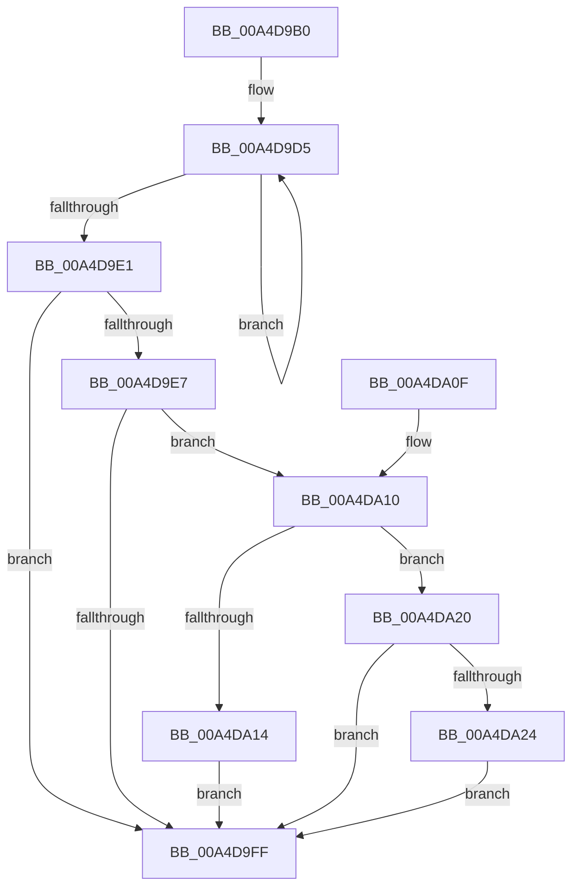

# PopDirectedDripsRefreshDisengageState

- RVA: `0x00A4D9B0`–`0x00A4DA2E` (길이 `126` bytes)
- VA: `0x0000000140A4D9B0`
- 실행 섹션: `PAGE`
- PDB 이름 있음: `예`; PDB Function 태그: `아니요`
- unwind 정보 RVA: `0x00088CDC`
- 디코드: `37`개 명령, `126/126` bytes 표시
- 미해석 바이트: `0` (있으면 어셈블리에 `.byte`로 보존)

> 이 문서는 커널 이미지의 기계어와 PDB 기호를 분석해 생성했습니다. 4번과 5번은 함수 원형과 자료형을 바이너리 사용 방식에서 추정한 C 해석이며 원본 소스 복구 결과는 아닙니다.

## 1. Dependencies

- 직접 호출 지점: **3**; 고유 호출 대상: **3**
- 직접 호출자로 확인된 함수: **1**
- RIP 상대 이미지 참조: **0**

### Outgoing calls
- `0x00A4D9EB` → [PopDirectedDripsDiagTraceDisengageReasonChange](PopDirectedDripsDiagTraceDisengageReasonChange_function_00A4DA34.md) (function, `0x00A4DA34`)
- `0x00A4DA19` → [PopDirectedDripsResumeDevices](PopDirectedDripsResumeDevices_function_00A4DB10.md) (function, `0x00A4DB10`)
- `0x00A4DA27` → [PopDirectedDripsSuspendDevices](PopDirectedDripsSuspendDevices_function_00A4D474.md) (function, `0x00A4D474`)

### Direct callers
- [PopDirectedDripsWorkerRoutine](../75/PopDirectedDripsWorkerRoutine_function_00757DF0.md) at `0x00757EBC`

### Static image references
- 디코드된 RIP-relative 메모리 참조가 없습니다.

## 2. Other-region calls and transfers

- 다른 실행 섹션으로 향하는 call: **0**
- 별도 외부 분기/꼬리 이동을 확인하지 못했습니다.

## 3. Assembly (complete function range)

```asm
00A4D9B0  48 89 5C 24 08                  mov qword ptr [rsp + 8], rbx
00A4D9B5  48 89 74 24 10                  mov qword ptr [rsp + 0x10], rsi
00A4D9BA  57                              push rdi
00A4D9BB  48 83 EC 20                     sub rsp, 0x20
00A4D9BF  8B B1 94 00 00 00               mov esi, dword ptr [rcx + 0x94]
00A4D9C5  48 8B D9                        mov rbx, rcx
00A4D9C8  0F 0D 89 98 00 00 00            prefetchw byte ptr [rcx + 0x98]
00A4D9CF  8B 81 98 00 00 00               mov eax, dword ptr [rcx + 0x98]
00A4D9D5  8B D0                           mov edx, eax
00A4D9D7  F0 0F B1 91 98 00 00 00         lock cmpxchg dword ptr [rcx + 0x98], edx
00A4D9DF  75 F4                           jne 0x140a4d9d5
00A4D9E1  8B F8                           mov edi, eax
00A4D9E3  3B F0                           cmp esi, eax
00A4D9E5  74 18                           je 0x140a4d9ff
00A4D9E7  8B D0                           mov edx, eax
00A4D9E9  8B CE                           mov ecx, esi
00A4D9EB  E8 44 00 00 00                  call 0x140a4da34
00A4D9F0  80 BB A8 00 00 00 00            cmp byte ptr [rbx + 0xa8], 0
00A4D9F7  89 BB 94 00 00 00               mov dword ptr [rbx + 0x94], edi
00A4D9FD  75 11                           jne 0x140a4da10
00A4D9FF  48 8B 5C 24 30                  mov rbx, qword ptr [rsp + 0x30]
00A4DA04  48 8B 74 24 38                  mov rsi, qword ptr [rsp + 0x38]
00A4DA09  48 83 C4 20                     add rsp, 0x20
00A4DA0D  5F                              pop rdi
00A4DA0E  C3                              ret
00A4DA0F  CC                              int3
00A4DA10  85 F6                           test esi, esi
00A4DA12  75 0C                           jne 0x140a4da20
00A4DA14  33 D2                           xor edx, edx
00A4DA16  48 8B CB                        mov rcx, rbx
00A4DA19  E8 F2 00 00 00                  call 0x140a4db10
00A4DA1E  EB DF                           jmp 0x140a4d9ff
00A4DA20  85 FF                           test edi, edi
00A4DA22  75 DB                           jne 0x140a4d9ff
00A4DA24  48 8B CB                        mov rcx, rbx
00A4DA27  E8 48 FA FF FF                  call 0x140a4d474
00A4DA2C  EB D1                           jmp 0x140a4d9ff
```

## 4. C-style interpretation (structured pseudocode)

```c
__int64 __fastcall PopDirectedDripsRefreshDisengageState(__int64 a1)
{
    __int64 result;
    __int64 v_rsp;
    unsigned __int64 v_stack_p10;
    unsigned __int64 v_stack_p8;

    v_stack_p8 = v_rbx;
    v_stack_p10 = v_rsi;
    v_rsp = (v_rsp) - (32);
loc_00A4D9D5:
    if (condition_is_not_equal) goto loc_00A4D9D5;
    if (((unsigned int)((unsigned int)(*(unsigned int *)(a1 + 148)))) == ((unsigned int)((unsigned int)(*(unsigned int *)(a1 + 152))))) goto loc_00A4D9FF;
    result = PopDirectedDripsDiagTraceDisengageReasonChange((unsigned int)((unsigned int)((unsigned int)(*(unsigned int *)(a1 + 148)))), (unsigned int)((unsigned int)((unsigned int)(*(unsigned int *)(a1 + 152)))), a3, a4);
    *(unsigned int *)(a1 + 148) = (unsigned int)((unsigned int)((unsigned int)((unsigned int)(*(unsigned int *)(a1 + 152)))));
    if ((*(unsigned __int8 *)(a1 + 168)) != 0) goto loc_00A4DA10;
loc_00A4D9FF:
    v_rsp = (v_rsp) + (32);
    return result;
loc_00A4DA10:
    if ((unsigned int)(v_stack_p10) != 0) goto loc_00A4DA20;
    a2 = 0;
    result = PopDirectedDripsResumeDevices(v_stack_p8, a2, a3, a4);
    goto loc_00A4D9FF;
loc_00A4DA20:
    if ((unsigned int)((unsigned int)((unsigned int)((unsigned int)(*(unsigned int *)(a1 + 152))))) != 0) goto loc_00A4D9FF;
    result = PopDirectedDripsSuspendDevices(v_stack_p8, a2, a3, a4);
    goto loc_00A4D9FF;
}
```

## 5. (Beta) C Style

```c
int64_t PopDirectedDripsRefreshDisengageState(void *Arg1)
{
    uint8_t *arg1 = (uint8_t *)Arg1;

    int64_t result;
    int64_t local_rsp;
    uint64_t v_stack_p10;
    uint64_t v_stack_p8;

    v_stack_p8 = local_rbx;
    v_stack_p10 = local_rsi;
    local_rsp = (local_rsp) - (32);
loc_00A4D9D5:
    if (condition_is_not_equal) goto loc_00A4D9D5;
    if (((uint32_t)((uint32_t)(*(uint32_t *)(arg1 + 0x94)))) == ((uint32_t)((uint32_t)(*(uint32_t *)(arg1 + 0x98))))) goto loc_00A4D9FF;
    result = PopDirectedDripsDiagTraceDisengageReasonChange((uint32_t)((uint32_t)((uint32_t)(*(uint32_t *)(arg1 + 0x94)))), (uint32_t)((uint32_t)((uint32_t)(*(uint32_t *)(arg1 + 0x98)))), a3, a4);
    *(uint32_t *)(arg1 + 0x94) = (uint32_t)((uint32_t)((uint32_t)((uint32_t)(*(uint32_t *)(arg1 + 0x98)))));
    if ((*(uint8_t *)(arg1 + 0xA8)) != 0) goto loc_00A4DA10;
loc_00A4D9FF:
    local_rsp = (local_rsp) + (32);
    return result;
loc_00A4DA10:
    if ((uint32_t)(v_stack_p10) != 0) goto loc_00A4DA20;
    a2 = 0;
    result = PopDirectedDripsResumeDevices(v_stack_p8, a2, a3, a4);
    goto loc_00A4D9FF;
loc_00A4DA20:
    if ((uint32_t)((uint32_t)((uint32_t)((uint32_t)(*(uint32_t *)(arg1 + 0x98))))) != 0) goto loc_00A4D9FF;
    result = PopDirectedDripsSuspendDevices(v_stack_p8, a2, a3, a4);
    goto loc_00A4D9FF;
}
```

### 관측된 메모리 오프셋

구조체 형식이 확인되지 않은 접근은 인자 기준의 오프셋으로만 기록했습니다.

| 기준 인자 | 오프셋 표현 | 폭 (bit) | 접근 |
|---|---:|---:|---|
| `Arg1` | `+ 0x94` | `32` | `R` |
| `Arg1` | `+ 0x94` | `32` | `W` |
| `Arg1` | `+ 0x98` | `8` | `R` |
| `Arg1` | `+ 0x98` | `32` | `R` |
| `Arg1` | `+ 0xA8` | `8` | `R` |

## 6. Execution-region graph

[열기: 2D/3D 그래프와 함수 탐색 컨트롤 패널](../../../control-panel.html?section=page&rva=0x00A4D9B0&view=graph)

- 2D 그래프는 위에서 아래로 흐르고, 3D 그래프는 빈 공간을 드래그해 회전합니다. Shift+드래그는 이동, 휠은 확대·축소, 함수 노드 선택은 대상 보고서 이동입니다.

### Static fallback


