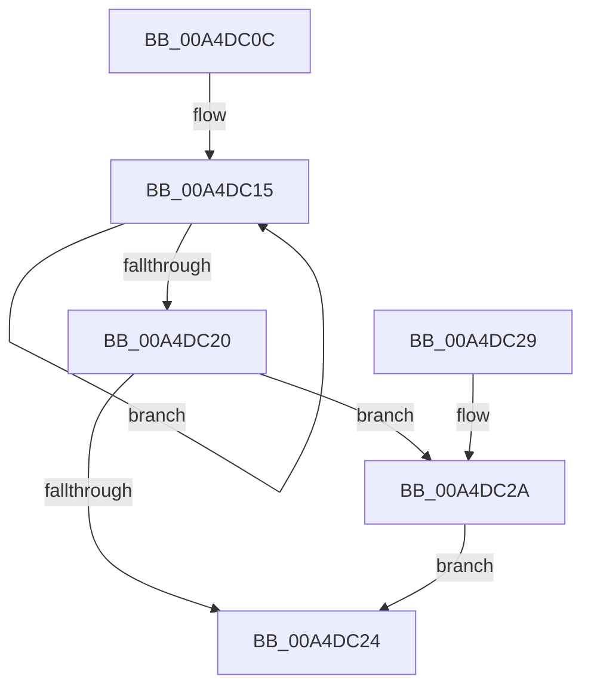

# PopDirectedDripsReleaseTransitionLock

- RVA: `0x00A4DC0C`–`0x00A4DC36` (길이 `42` bytes)
- VA: `0x0000000140A4DC0C`
- 실행 섹션: `PAGE`
- PDB 이름 있음: `예`; PDB Function 태그: `아니요`
- unwind 정보 RVA: `0x00090138`
- 디코드: `15`개 명령, `42/42` bytes 표시
- 미해석 바이트: `0` (있으면 어셈블리에 `.byte`로 보존)

> 이 문서는 커널 이미지의 기계어와 PDB 기호를 분석해 생성했습니다. 4번과 5번은 함수 원형과 자료형을 바이너리 사용 방식에서 추정한 C 해석이며 원본 소스 복구 결과는 아닙니다.

## 1. Dependencies

- 직접 호출 지점: **1**; 고유 호출 대상: **1**
- 직접 호출자로 확인된 함수: **2**
- RIP 상대 이미지 참조: **0**

### Outgoing calls
- `0x00A4DC2F` → [PopReleaseTransitionLock](../AB/PopReleaseTransitionLock_function_00ABDABC.md) (function, `0x00ABDABC`)

### Direct callers
- [PopDirectedDripsSuspendDevices](PopDirectedDripsSuspendDevices_function_00A4D474.md) at `0x00A4D540`
- [PopDirectedDripsResumeDevices](PopDirectedDripsResumeDevices_function_00A4DB10.md) at `0x00A4DB6E`

### Static image references
- 디코드된 RIP-relative 메모리 참조가 없습니다.

## 2. Other-region calls and transfers

- 다른 실행 섹션으로 향하는 call: **0**
- 별도 외부 분기/꼬리 이동을 확인하지 못했습니다.

## 3. Assembly (complete function range)

```asm
00A4DC0C  48 83 EC 28                     sub rsp, 0x28
00A4DC10  0F 0D 09                        prefetchw byte ptr [rcx]
00A4DC13  8B 01                           mov eax, dword ptr [rcx]
00A4DC15  8B D0                           mov edx, eax
00A4DC17  83 E2 BF                        and edx, 0xffffffbf
00A4DC1A  F0 0F B1 11                     lock cmpxchg dword ptr [rcx], edx
00A4DC1E  75 F5                           jne 0x140a4dc15
00A4DC20  A8 40                           test al, 0x40
00A4DC22  75 06                           jne 0x140a4dc2a
00A4DC24  48 83 C4 28                     add rsp, 0x28
00A4DC28  C3                              ret
00A4DC29  CC                              int3
00A4DC2A  B9 07 00 00 00                  mov ecx, 7
00A4DC2F  E8 88 FE 06 00                  call 0x140abdabc
00A4DC34  EB EE                           jmp 0x140a4dc24
```

## 4. C-style interpretation (structured pseudocode)

```c
__int64 __fastcall PopDirectedDripsReleaseTransitionLock(__int64 a1)
{
    __int64 result;
    __int64 v_rsp;

    v_rsp = (v_rsp) - (40);
loc_00A4DC15:
    a2 = (unsigned int)(((unsigned int)((unsigned int)((unsigned int)(*(unsigned int *)(a1))))) & (0xFFFFFFBFULL));
    if (condition_is_not_equal) goto loc_00A4DC15;
    if ((((unsigned __int8)((unsigned int)(*(unsigned int *)(a1)))) & (64)) != 0) goto loc_00A4DC2A;
loc_00A4DC24:
    v_rsp = (v_rsp) + (40);
    return (unsigned int)(*(unsigned int *)(a1));
loc_00A4DC2A:
    result = PopReleaseTransitionLock(7, a2, a3, a4);
    goto loc_00A4DC24;
}
```

## 5. (Beta) C Style

```c
int64_t PopDirectedDripsReleaseTransitionLock(void *Arg1)
{
    uint8_t *arg1 = (uint8_t *)Arg1;

    int64_t result;
    int64_t local_rsp;

    local_rsp = (local_rsp) - (40);
loc_00A4DC15:
    a2 = (uint32_t)(((uint32_t)((uint32_t)((uint32_t)(*(uint32_t *)(arg1))))) & (0xFFFFFFBFULL));
    if (condition_is_not_equal) goto loc_00A4DC15;
    if ((((uint8_t)((uint32_t)(*(uint32_t *)(arg1)))) & (64)) != 0) goto loc_00A4DC2A;
loc_00A4DC24:
    local_rsp = (local_rsp) + (40);
    return (uint32_t)(*(uint32_t *)(arg1));
loc_00A4DC2A:
    result = PopReleaseTransitionLock(7, a2, a3, a4);
    goto loc_00A4DC24;
}
```

### 관측된 메모리 오프셋

구조체 형식이 확인되지 않은 접근은 인자 기준의 오프셋으로만 기록했습니다.

| 기준 인자 | 오프셋 표현 | 폭 (bit) | 접근 |
|---|---:|---:|---|
| `Arg1` | `+ 0x0` | `8` | `R` |
| `Arg1` | `+ 0x0` | `32` | `R` |

## 6. Execution-region graph

[열기: 2D/3D 그래프와 함수 탐색 컨트롤 패널](../../../control-panel.html?section=page&rva=0x00A4DC0C&view=graph)

- 2D 그래프는 위에서 아래로 흐르고, 3D 그래프는 빈 공간을 드래그해 회전합니다. Shift+드래그는 이동, 휠은 확대·축소, 함수 노드 선택은 대상 보고서 이동입니다.

### Static fallback


