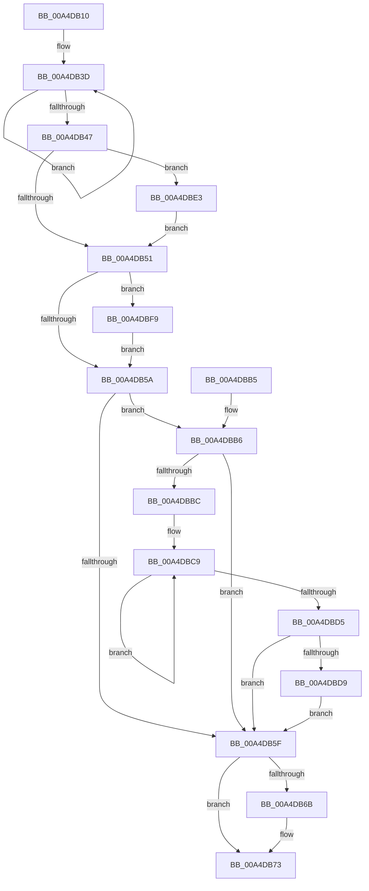

# PopDirectedDripsResumeDevices

- RVA: `0x00A4DB10`–`0x00A4DC03` (길이 `243` bytes)
- VA: `0x0000000140A4DB10`
- 실행 섹션: `PAGE`
- PDB 이름 있음: `예`; PDB Function 태그: `아니요`
- unwind 정보 RVA: `0x000B05D0`
- 디코드: `61`개 명령, `243/243` bytes 표시
- 미해석 바이트: `0` (있으면 어셈블리에 `.byte`로 보존)

> 이 문서는 커널 이미지의 기계어와 PDB 기호를 분석해 생성했습니다. 4번과 5번은 함수 원형과 자료형을 바이너리 사용 방식에서 추정한 C 해석이며 원본 소스 복구 결과는 아닙니다.

## 1. Dependencies

- 직접 호출 지점: **5**; 고유 호출 대상: **5**
- 직접 호출자로 확인된 함수: **3**
- RIP 상대 이미지 참조: **1**

### Outgoing calls
- `0x00A4DB6E` → [PopDirectedDripsReleaseTransitionLock](PopDirectedDripsReleaseTransitionLock_function_00A4DC0C.md) (function, `0x00A4DC0C`)
- `0x00A4DB9B` → [PopDirectedDripsDiagTraceNotifyDevices](../../text/4A/PopDirectedDripsDiagTraceNotifyDevices_function_004A70AC.md) (function, `0x004A70AC`)
- `0x00A4DBD9` → [PopFxClearDirectedDripsCandidateDeviceList](../../text/49/PopFxClearDirectedDripsCandidateDeviceList_function_004988EC.md) (function, `0x004988EC`)
- `0x00A4DBEB` → [PoBroadcastSystemState](../../pagelk/B7/PoBroadcastSystemState_function_00B761B0.md) (function, `0x00B761B0`)
- `0x00A4DBF9` → [PopDirectedDripsDestroyBroadcast](../AA/PopDirectedDripsDestroyBroadcast_function_00AA3C60.md) (function, `0x00AA3C60`)

### Direct callers
- [PopDirectedDripsWorkerRoutine](../75/PopDirectedDripsWorkerRoutine_function_00757DF0.md) at `0x00757EA0`
- [PopDirectedDripsRefreshDisengageState](PopDirectedDripsRefreshDisengageState_function_00A4D9B0.md) at `0x00A4DA19`
- [PopDirectedDripsHandleResiliencyNotification](PopDirectedDripsHandleResiliencyNotification_function_00A4DC3C.md) at `0x00A4DD88`

### Static image references
- `0x00A4DBBC` → RVA `0x00F07288` (`.data`; read)

## 2. Other-region calls and transfers

- 다른 실행 섹션으로 향하는 call: **3**
  - `0x00A4DB9B` → [PopDirectedDripsDiagTraceNotifyDevices](../../text/4A/PopDirectedDripsDiagTraceNotifyDevices_function_004A70AC.md) (`PAGE` → `.text`)
  - `0x00A4DBD9` → [PopFxClearDirectedDripsCandidateDeviceList](../../text/49/PopFxClearDirectedDripsCandidateDeviceList_function_004988EC.md) (`PAGE` → `.text`)
  - `0x00A4DBEB` → [PoBroadcastSystemState](../../pagelk/B7/PoBroadcastSystemState_function_00B761B0.md) (`PAGE` → `PAGELK`)
- 별도 외부 분기/꼬리 이동을 확인하지 못했습니다.

## 3. Assembly (complete function range)

```asm
00A4DB10  48 89 5C 24 08                  mov qword ptr [rsp + 8], rbx
00A4DB15  48 89 6C 24 10                  mov qword ptr [rsp + 0x10], rbp
00A4DB1A  48 89 74 24 18                  mov qword ptr [rsp + 0x18], rsi
00A4DB1F  57                              push rdi
00A4DB20  48 83 EC 20                     sub rsp, 0x20
00A4DB24  48 BD 08 00 00 00 80 F7 FF FF   movabs rbp, 0xfffff78000000008
00A4DB2E  40 8A F2                        mov sil, dl
00A4DB31  48 8B D9                        mov rbx, rcx
00A4DB34  48 8B 6D 00                     mov rbp, qword ptr [rbp]
00A4DB38  0F 0D 09                        prefetchw byte ptr [rcx]
00A4DB3B  8B 01                           mov eax, dword ptr [rcx]
00A4DB3D  44 8B C0                        mov r8d, eax
00A4DB40  F0 44 0F B1 01                  lock cmpxchg dword ptr [rcx], r8d
00A4DB45  75 F6                           jne 0x140a4db3d
00A4DB47  8B F8                           mov edi, eax
00A4DB49  A8 10                           test al, 0x10
00A4DB4B  0F 85 92 00 00 00               jne 0x140a4dbe3
00A4DB51  40 84 FF                        test dil, dil
00A4DB54  0F 88 9F 00 00 00               js 0x140a4dbf9
00A4DB5A  40 84 F6                        test sil, sil
00A4DB5D  74 57                           je 0x140a4dbb6
00A4DB5F  F0 81 23 6F FF FF FF            lock and dword ptr [rbx], 0xffffff6f
00A4DB66  40 84 F6                        test sil, sil
00A4DB69  75 08                           jne 0x140a4db73
00A4DB6B  48 8B CB                        mov rcx, rbx
00A4DB6E  E8 99 00 00 00                  call 0x140a4dc0c
00A4DB73  48 A1 08 00 00 00 80 F7 FF FF   movabs rax, qword ptr [0xfffff78000000008]
00A4DB7D  48 8B C8                        mov rcx, rax
00A4DB80  48 B8 BD 42 7A E5 D5 94 BF D6   movabs rax, 0xd6bf94d5e57a42bd
00A4DB8A  48 2B CD                        sub rcx, rbp
00A4DB8D  48 F7 E1                        mul rcx
00A4DB90  33 C9                           xor ecx, ecx
00A4DB92  48 C1 EA 17                     shr rdx, 0x17
00A4DB96  4C 8B C2                        mov r8, rdx
00A4DB99  33 D2                           xor edx, edx
00A4DB9B  E8 0C 95 A5 FF                  call 0x1404a70ac
00A4DBA0  48 8B 5C 24 30                  mov rbx, qword ptr [rsp + 0x30]
00A4DBA5  48 8B 6C 24 38                  mov rbp, qword ptr [rsp + 0x38]
00A4DBAA  48 8B 74 24 40                  mov rsi, qword ptr [rsp + 0x40]
00A4DBAF  48 83 C4 20                     add rsp, 0x20
00A4DBB3  5F                              pop rdi
00A4DBB4  C3                              ret
00A4DBB5  CC                              int3
00A4DBB6  0F BA E7 09                     bt edi, 9
00A4DBBA  72 A3                           jb 0x140a4db5f
00A4DBBC  0F 0D 0D C5 96 4B 00            prefetchw byte ptr [rip + 0x4b96c5]
00A4DBC3  8B 05 BF 96 4B 00               mov eax, dword ptr [rip + 0x4b96bf]
00A4DBC9  8B C8                           mov ecx, eax
00A4DBCB  F0 0F B1 0D B5 96 4B 00         lock cmpxchg dword ptr [rip + 0x4b96b5], ecx
00A4DBD3  75 F4                           jne 0x140a4dbc9
00A4DBD5  85 C0                           test eax, eax
00A4DBD7  75 86                           jne 0x140a4db5f
00A4DBD9  E8 0E AD A4 FF                  call 0x1404988ec
00A4DBDE  E9 7C FF FF FF                  jmp 0x140a4db5f
00A4DBE3  C6 41 55 01                     mov byte ptr [rcx + 0x55], 1
00A4DBE7  48 83 C1 3C                     add rcx, 0x3c
00A4DBEB  E8 C0 85 12 00                  call 0x140b761b0
00A4DBF0  F0 83 0B 20                     lock or dword ptr [rbx], 0x20
00A4DBF4  E9 58 FF FF FF                  jmp 0x140a4db51
00A4DBF9  E8 62 60 05 00                  call 0x140aa3c60
00A4DBFE  E9 57 FF FF FF                  jmp 0x140a4db5a
```

## 4. C-style interpretation (structured pseudocode)

```c
__int64 __fastcall PopDirectedDripsResumeDevices(__int64 a1, __int64 a2)
{
    __int64 result;
    __int64 v_rsp;
    unsigned __int64 v_stack_p10;
    unsigned __int64 v_stack_p18;
    unsigned __int64 v_stack_p8;

    v_stack_p8 = v_rbx;
    v_stack_p10 = v_rbp;
    v_stack_p18 = v_rsi;
    v_rsp = (v_rsp) - (32);
loc_00A4DB3D:
    if (condition_is_not_equal) goto loc_00A4DB3D;
    if ((((unsigned __int8)((unsigned int)(*(unsigned int *)(a1)))) & (16)) != 0) goto loc_00A4DBE3;
loc_00A4DB51:
    if (sign_flag) goto loc_00A4DBF9;
loc_00A4DB5A:
    if ((unsigned __int8)((unsigned __int8)(a2)) == 0) goto loc_00A4DBB6;
loc_00A4DB5F:
    result = (unsigned int)(*(unsigned int *)(a1));
    if ((unsigned __int8)((unsigned __int8)(a2)) == 0) {
        a1 = a1;
        result = PopDirectedDripsReleaseTransitionLock(a1, a2, (unsigned int)((unsigned int)((unsigned int)(*(unsigned int *)(a1)))), a4);
    }
    a1 = (result) - (*(unsigned __int64 *)(v_rbp));
    a1 = 0;
    a2 = (a2) >> (23);
    a2 = 0;
    result = PopDirectedDripsDiagTraceNotifyDevices(a1, a2, a2, a4);
    v_rsp = (v_rsp) + (32);
    return result;
loc_00A4DBB6:
    if (condition_is_below) goto loc_00A4DB5F;
loc_00A4DBC9:
    if (condition_is_not_equal) goto loc_00A4DBC9;
    if ((unsigned int)((unsigned int)(*(unsigned int *)(v_rip + 4953791))) != 0) goto loc_00A4DB5F;
    result = PopFxClearDirectedDripsCandidateDeviceList((unsigned int)((unsigned int)((unsigned int)(*(unsigned int *)(v_rip + 4953791)))), a2, a2, a4);
    goto loc_00A4DB5F;
loc_00A4DBE3:
    *(unsigned __int8 *)((unsigned int)((unsigned int)((unsigned int)(*(unsigned int *)(v_rip + 4953791)))) + 85) = 1;
    a1 = ((unsigned int)((unsigned int)((unsigned int)(*(unsigned int *)(v_rip + 4953791))))) + (60);
    result = PoBroadcastSystemState(a1, a2, a2, a4);
    goto loc_00A4DB51;
loc_00A4DBF9:
    result = PopDirectedDripsDestroyBroadcast(a1, a2, a2, a4);
    goto loc_00A4DB5A;
}
```

## 5. (Beta) C Style

```c
int64_t PopDirectedDripsResumeDevices(void *Arg1, int64_t Arg2)
{
    uint8_t *arg1 = (uint8_t *)Arg1;

    int64_t result;
    int64_t local_rsp;
    uint64_t v_stack_p10;
    uint64_t v_stack_p18;
    uint64_t v_stack_p8;

    v_stack_p8 = local_rbx;
    v_stack_p10 = local_rbp;
    v_stack_p18 = local_rsi;
    local_rsp = (local_rsp) - (32);
loc_00A4DB3D:
    if (condition_is_not_equal) goto loc_00A4DB3D;
    if ((((uint8_t)((uint32_t)(*(uint32_t *)(arg1)))) & (16)) != 0) goto loc_00A4DBE3;
loc_00A4DB51:
    if (sign_flag) goto loc_00A4DBF9;
loc_00A4DB5A:
    if ((uint8_t)((uint8_t)(Arg2)) == 0) goto loc_00A4DBB6;
loc_00A4DB5F:
    result = (uint32_t)(*(uint32_t *)(arg1));
    if ((uint8_t)((uint8_t)(Arg2)) == 0) {
        Arg1 = Arg1;
        result = PopDirectedDripsReleaseTransitionLock(Arg1, Arg2, (uint32_t)((uint32_t)((uint32_t)(*(uint32_t *)(arg1)))), a4);
    }
    Arg1 = (result) - (*(uint64_t *)(local_rbp));
    Arg1 = 0;
    Arg2 = (Arg2) >> (23);
    Arg2 = 0;
    result = PopDirectedDripsDiagTraceNotifyDevices(Arg1, Arg2, Arg2, a4);
    local_rsp = (local_rsp) + (32);
    return result;
loc_00A4DBB6:
    if (condition_is_below) goto loc_00A4DB5F;
loc_00A4DBC9:
    if (condition_is_not_equal) goto loc_00A4DBC9;
    if ((uint32_t)((uint32_t)(*(uint32_t *)(v_rip + 0x4B96BF))) != 0) goto loc_00A4DB5F;
    result = PopFxClearDirectedDripsCandidateDeviceList((uint32_t)((uint32_t)((uint32_t)(*(uint32_t *)(v_rip + 0x4B96BF)))), Arg2, Arg2, a4);
    goto loc_00A4DB5F;
loc_00A4DBE3:
    *(uint8_t *)((uint32_t)((uint32_t)((uint32_t)(*(uint32_t *)(v_rip + 0x4B96BF)))) + 0x55) = 1;
    Arg1 = ((uint32_t)((uint32_t)((uint32_t)(*(uint32_t *)(v_rip + 0x4B96BF))))) + (60);
    result = PoBroadcastSystemState(Arg1, Arg2, Arg2, a4);
    goto loc_00A4DB51;
loc_00A4DBF9:
    result = PopDirectedDripsDestroyBroadcast(Arg1, Arg2, Arg2, a4);
    goto loc_00A4DB5A;
}
```

### 관측된 메모리 오프셋

구조체 형식이 확인되지 않은 접근은 인자 기준의 오프셋으로만 기록했습니다.

| 기준 인자 | 오프셋 표현 | 폭 (bit) | 접근 |
|---|---:|---:|---|
| `Arg1` | `+ 0x0` | `8` | `R` |
| `Arg1` | `+ 0x0` | `32` | `R` |
| `Arg1` | `+ 0x0` | `32` | `R/W` |
| `Arg1` | `+ 0x55` | `8` | `W` |

## 6. Execution-region graph

[열기: 2D/3D 그래프와 함수 탐색 컨트롤 패널](../../../control-panel.html?section=page&rva=0x00A4DB10&view=graph)

- 2D 그래프는 위에서 아래로 흐르고, 3D 그래프는 빈 공간을 드래그해 회전합니다. Shift+드래그는 이동, 휠은 확대·축소, 함수 노드 선택은 대상 보고서 이동입니다.

### Static fallback


