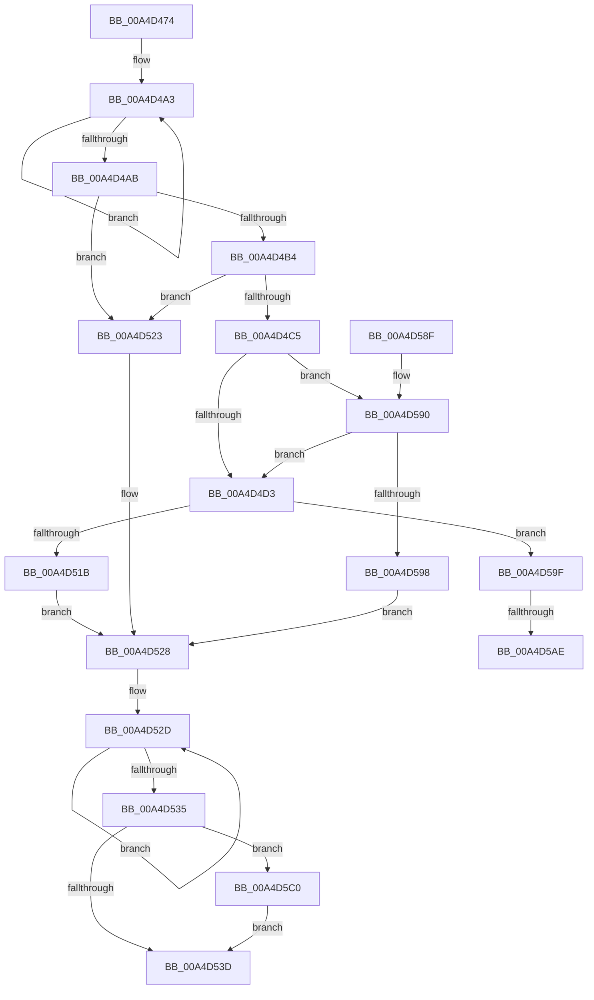

# PopDirectedDripsSuspendDevices

- RVA: `0x00A4D474`–`0x00A4D5D1` (길이 `349` bytes)
- VA: `0x0000000140A4D474`
- 실행 섹션: `PAGE`
- PDB 이름 있음: `예`; PDB Function 태그: `예`
- unwind 정보 RVA: `0x0009083C`
- 디코드: `89`개 명령, `349/349` bytes 표시
- 미해석 바이트: `0` (있으면 어셈블리에 `.byte`로 보존)

> 이 문서는 커널 이미지의 기계어와 PDB 기호를 분석해 생성했습니다. 4번과 5번은 함수 원형과 자료형을 바이너리 사용 방식에서 추정한 C 해석이며 원본 소스 복구 결과는 아닙니다.

## 1. Dependencies

- 직접 호출 지점: **6**; 고유 호출 대상: **6**
- 직접 호출자로 확인된 함수: **3**
- RIP 상대 이미지 참조: **0**

### Outgoing calls
- `0x00A4D4D6` → [PopDirectedDripsAcquireTransitionLock](PopDirectedDripsAcquireTransitionLock_function_00A4D5D8.md) (function, `0x00A4D5D8`)
- `0x00A4D50C` → [PopDirectedDripsInitializeBroadcast](PopDirectedDripsInitializeBroadcast_function_00A4D634.md) (function, `0x00A4D634`)
- `0x00A4D540` → [PopDirectedDripsReleaseTransitionLock](PopDirectedDripsReleaseTransitionLock_function_00A4DC0C.md) (function, `0x00A4DC0C`)
- `0x00A4D56D` → [PopDirectedDripsDiagTraceNotifyDevices](../../text/4A/PopDirectedDripsDiagTraceNotifyDevices_function_004A70AC.md) (function, `0x004A70AC`)
- `0x00A4D5B5` → [PoBroadcastSystemState](../../pagelk/B7/PoBroadcastSystemState_function_00B761B0.md) (function, `0x00B761B0`)
- `0x00A4D5C0` → [PopDirectedDripsDestroyBroadcast](../AA/PopDirectedDripsDestroyBroadcast_function_00AA3C60.md) (function, `0x00AA3C60`)

### Direct callers
- [PopDirectedDripsWorkerRoutine](../75/PopDirectedDripsWorkerRoutine_function_00757DF0.md) at `0x00757EA8`
- [PopDirectedDripsRefreshDisengageState](PopDirectedDripsRefreshDisengageState_function_00A4D9B0.md) at `0x00A4DA27`
- [sub_00B3BE0C](../B3/Unknown_function_00B3BE0C.md) at `0x00B3BE0C`

### Static image references
- 디코드된 RIP-relative 메모리 참조가 없습니다.

## 2. Other-region calls and transfers

- 다른 실행 섹션으로 향하는 call: **2**
  - `0x00A4D56D` → [PopDirectedDripsDiagTraceNotifyDevices](../../text/4A/PopDirectedDripsDiagTraceNotifyDevices_function_004A70AC.md) (`PAGE` → `.text`)
  - `0x00A4D5B5` → [PoBroadcastSystemState](../../pagelk/B7/PoBroadcastSystemState_function_00B761B0.md) (`PAGE` → `PAGELK`)
- call이 아닌 외부 분기/꼬리 이동: **2**
  - `0x00A4D5A8` → [sub_00B3BDB8](../B3/Unknown_function_00B3BDB8.md) (`tail-transfer`)
  - `0x00A4D5BB` → [sub_00B3BDB8](../B3/Unknown_function_00B3BDB8.md) (`tail-transfer`)

## 3. Assembly (complete function range)

```asm
00A4D474  48 8B C4                        mov rax, rsp
00A4D477  48 89 58 08                     mov qword ptr [rax + 8], rbx
00A4D47B  48 89 68 10                     mov qword ptr [rax + 0x10], rbp
00A4D47F  48 89 70 18                     mov qword ptr [rax + 0x18], rsi
00A4D483  48 89 78 20                     mov qword ptr [rax + 0x20], rdi
00A4D487  41 56                           push r14
00A4D489  48 83 EC 20                     sub rsp, 0x20
00A4D48D  48 BD 08 00 00 00 80 F7 FF FF   movabs rbp, 0xfffff78000000008
00A4D497  48 8B D9                        mov rbx, rcx
00A4D49A  48 8B 6D 00                     mov rbp, qword ptr [rbp]
00A4D49E  0F 0D 09                        prefetchw byte ptr [rcx]
00A4D4A1  8B 01                           mov eax, dword ptr [rcx]
00A4D4A3  8B D0                           mov edx, eax
00A4D4A5  F0 0F B1 11                     lock cmpxchg dword ptr [rcx], edx
00A4D4A9  75 F8                           jne 0x140a4d4a3
00A4D4AB  83 B9 94 00 00 00 00            cmp dword ptr [rcx + 0x94], 0
00A4D4B2  75 6F                           jne 0x140a4d523
00A4D4B4  A9 00 30 00 00                  test eax, 0x3000
00A4D4B9  0F 95 C2                        setne dl
00A4D4BC  A8 10                           test al, 0x10
00A4D4BE  0F 94 C1                        sete cl
00A4D4C1  84 D1                           test cl, dl
00A4D4C3  74 5E                           je 0x140a4d523
00A4D4C5  8B F0                           mov esi, eax
00A4D4C7  81 E6 00 08 00 00               and esi, 0x800
00A4D4CD  0F 85 BD 00 00 00               jne 0x140a4d590
00A4D4D3  48 8B CB                        mov rcx, rbx
00A4D4D6  E8 FD 00 00 00                  call 0x140a4d5d8
00A4D4DB  83 63 54 00                     and dword ptr [rbx + 0x54], 0
00A4D4DF  4C 8D 73 3C                     lea r14, [rbx + 0x3c]
00A4D4E3  B8 05 00 00 00                  mov eax, 5
00A4D4E8  41 C7 06 01 00 00 00            mov dword ptr [r14], 1
00A4D4EF  89 43 40                        mov dword ptr [rbx + 0x40], eax
00A4D4F2  48 8B CB                        mov rcx, rbx
00A4D4F5  89 43 44                        mov dword ptr [rbx + 0x44], eax
00A4D4F8  8B 43 38                        mov eax, dword ptr [rbx + 0x38]
00A4D4FB  89 43 50                        mov dword ptr [rbx + 0x50], eax
00A4D4FE  C7 43 48 01 00 00 00            mov dword ptr [rbx + 0x48], 1
00A4D505  C7 43 4C 02 00 00 00            mov dword ptr [rbx + 0x4c], 2
00A4D50C  E8 23 01 00 00                  call 0x140a4d634
00A4D511  8B F8                           mov edi, eax
00A4D513  85 C0                           test eax, eax
00A4D515  0F 89 84 00 00 00               jns 0x140a4d59f
00A4D51B  89 83 8C 00 00 00               mov dword ptr [rbx + 0x8c], eax
00A4D521  EB 05                           jmp 0x140a4d528
00A4D523  BF 01 00 00 C0                  mov edi, 0xc0000001
00A4D528  0F 0D 0B                        prefetchw byte ptr [rbx]
00A4D52B  8B 03                           mov eax, dword ptr [rbx]
00A4D52D  8B C8                           mov ecx, eax
00A4D52F  F0 0F B1 0B                     lock cmpxchg dword ptr [rbx], ecx
00A4D533  75 F8                           jne 0x140a4d52d
00A4D535  84 C0                           test al, al
00A4D537  0F 88 83 00 00 00               js 0x140a4d5c0
00A4D53D  48 8B CB                        mov rcx, rbx
00A4D540  E8 C7 06 00 00                  call 0x140a4dc0c
00A4D545  48 A1 08 00 00 00 80 F7 FF FF   movabs rax, qword ptr [0xfffff78000000008]
00A4D54F  B1 01                           mov cl, 1
00A4D551  48 8B D0                        mov rdx, rax
00A4D554  48 B8 BD 42 7A E5 D5 94 BF D6   movabs rax, 0xd6bf94d5e57a42bd
00A4D55E  48 2B D5                        sub rdx, rbp
00A4D561  48 F7 E2                        mul rdx
00A4D564  48 C1 EA 17                     shr rdx, 0x17
00A4D568  4C 8B C2                        mov r8, rdx
00A4D56B  8B D7                           mov edx, edi
00A4D56D  E8 3A 9B A5 FF                  call 0x1404a70ac
00A4D572  48 8B 5C 24 30                  mov rbx, qword ptr [rsp + 0x30]
00A4D577  8B C7                           mov eax, edi
00A4D579  48 8B 7C 24 48                  mov rdi, qword ptr [rsp + 0x48]
00A4D57E  48 8B 6C 24 38                  mov rbp, qword ptr [rsp + 0x38]
00A4D583  48 8B 74 24 40                  mov rsi, qword ptr [rsp + 0x40]
00A4D588  48 83 C4 20                     add rsp, 0x20
00A4D58C  41 5E                           pop r14
00A4D58E  C3                              ret
00A4D58F  CC                              int3
00A4D590  A8 08                           test al, 8
00A4D592  0F 85 3B FF FF FF               jne 0x140a4d4d3
00A4D598  BF 20 01 00 C0                  mov edi, 0xc0000120
00A4D59D  EB 89                           jmp 0x140a4d528
00A4D59F  F0 81 0B 80 00 00 00            lock or dword ptr [rbx], 0x80
00A4D5A6  85 F6                           test esi, esi
00A4D5A8  0F 84 0A E8 0E 00               je 0x140b3bdb8
00A4D5AE  49 8B CE                        mov rcx, r14
00A4D5B1  C6 43 56 03                     mov byte ptr [rbx + 0x56], 3
00A4D5B5  E8 F6 8B 12 00                  call 0x140b761b0
00A4D5BA  90                              nop
00A4D5BB  E9 F8 E7 0E 00                  jmp 0x140b3bdb8
00A4D5C0  E8 9B 66 05 00                  call 0x140aa3c60
00A4D5C5  F0 81 23 7F FF FF FF            lock and dword ptr [rbx], 0xffffff7f
00A4D5CC  E9 6C FF FF FF                  jmp 0x140a4d53d
```

## 4. C-style interpretation (structured pseudocode)

```c
__int64 __fastcall PopDirectedDripsSuspendDevices(__int64 a1)
{
    __int64 result;
    __int64 v_rsi;
    __int64 v_rsp;
    unsigned __int64 v_stack_p10;
    unsigned __int64 v_stack_p18;
    unsigned __int64 v_stack_p20;
    unsigned __int64 v_stack_p8;

    *(unsigned __int64 *)(v_rsp + 8) = v_rbx;
    *(unsigned __int64 *)(v_rsp + 16) = v_rbp;
    *(unsigned __int64 *)(v_rsp + 24) = v_rsi;
    *(unsigned __int64 *)(v_rsp + 32) = v_rdi;
    v_rsp = (v_rsp) - (32);
loc_00A4D4A3:
    if (condition_is_not_equal) goto loc_00A4D4A3;
    if ((*(unsigned int *)(a1 + 148)) != 0) goto loc_00A4D523;
    a2 = ((((unsigned int)((unsigned int)(*(unsigned int *)(a1)))) & (0x3000ULL)) != 0) ? 1 : 0;
    a1 = ((((unsigned __int8)((unsigned int)(*(unsigned int *)(a1)))) & (16)) == 0) ? 1 : 0;
    if ((((unsigned __int8)(a1)) & ((unsigned __int8)(a2))) == 0) goto loc_00A4D523;
    v_rsi = (unsigned int)(((unsigned int)((unsigned int)((unsigned int)(*(unsigned int *)(a1))))) & (0x800ULL));
    if (condition_is_not_equal) goto loc_00A4D590;
loc_00A4D4D3:
    result = PopDirectedDripsAcquireTransitionLock(a1, a2, a3, a4);
    *(unsigned int *)(a1 + 60) = 1;
    *(unsigned int *)(a1 + 64) = 5;
    *(unsigned int *)(a1 + 68) = 5;
    *(unsigned int *)(a1 + 80) = (unsigned int)((unsigned int)(*(unsigned int *)(a1 + 56)));
    *(unsigned int *)(a1 + 72) = 1;
    *(unsigned int *)(a1 + 76) = 2;
    result = PopDirectedDripsInitializeBroadcast(a1, a2, a3, a4);
    if (!sign_flag) goto loc_00A4D59F;
    *(unsigned int *)(a1 + 140) = (unsigned int)(result);
    goto loc_00A4D528;
loc_00A4D523:
loc_00A4D528:
loc_00A4D52D:
    if ((unsigned int)(result) != 0) goto loc_00A4D52D;
    if (sign_flag) goto loc_00A4D5C0;
loc_00A4D53D:
    result = PopDirectedDripsReleaseTransitionLock(a1, a2, a3, a4);
    a2 = (result) - (*(unsigned __int64 *)(v_rbp));
    a2 = (a2) >> (23);
    result = PopDirectedDripsDiagTraceNotifyDevices(1, (unsigned int)((unsigned int)((unsigned int)(0xC0000001ULL))), a2, a4);
    v_rsp = (v_rsp) + (32);
    return (unsigned int)((unsigned int)((unsigned int)(0xC0000001ULL)));
loc_00A4D590:
    if ((((unsigned __int8)((unsigned int)((unsigned int)((unsigned int)(0xC0000001ULL))))) & (8)) != 0) goto loc_00A4D4D3;
    goto loc_00A4D528;
loc_00A4D59F:
    *(unsigned __int8 *)(v_stack_p8 + 86) = 3;
    result = PoBroadcastSystemState(a1 + 60, (unsigned int)((unsigned int)((unsigned int)(0xC0000001ULL))), a2, a4);
loc_00A4D5C0:
    result = PopDirectedDripsDestroyBroadcast(a1 + 60, (unsigned int)((unsigned int)((unsigned int)(0xC0000001ULL))), a2, a4);
    goto loc_00A4D53D;
}
```

## 5. (Beta) C Style

```c
int64_t PopDirectedDripsSuspendDevices(void *Arg1)
{
    uint8_t *arg1 = (uint8_t *)Arg1;

    int64_t result;
    int64_t local_rsi;
    int64_t local_rsp;
    uint64_t v_stack_p10;
    uint64_t v_stack_p18;
    uint64_t v_stack_p20;
    uint64_t v_stack_p8;

    *(uint64_t *)(local_rsp + 0x8) = local_rbx;
    *(uint64_t *)(local_rsp + 0x10) = local_rbp;
    *(uint64_t *)(local_rsp + 0x18) = local_rsi;
    *(uint64_t *)(local_rsp + 0x20) = local_rdi;
    local_rsp = (local_rsp) - (32);
loc_00A4D4A3:
    if (condition_is_not_equal) goto loc_00A4D4A3;
    if ((*(uint32_t *)(arg1 + 0x94)) != 0) goto loc_00A4D523;
    a2 = ((((uint32_t)((uint32_t)(*(uint32_t *)(arg1)))) & (0x3000ULL)) != 0) ? 1 : 0;
    Arg1 = ((((uint8_t)((uint32_t)(*(uint32_t *)(arg1)))) & (16)) == 0) ? 1 : 0;
    if ((((uint8_t)(Arg1)) & ((uint8_t)(a2))) == 0) goto loc_00A4D523;
    local_rsi = (uint32_t)(((uint32_t)((uint32_t)((uint32_t)(*(uint32_t *)(arg1))))) & (0x800ULL));
    if (condition_is_not_equal) goto loc_00A4D590;
loc_00A4D4D3:
    result = PopDirectedDripsAcquireTransitionLock(Arg1, a2, a3, a4);
    *(uint32_t *)(arg1 + 0x3C) = 1;
    *(uint32_t *)(arg1 + 0x40) = 5;
    *(uint32_t *)(arg1 + 0x44) = 5;
    *(uint32_t *)(arg1 + 0x50) = (uint32_t)((uint32_t)(*(uint32_t *)(arg1 + 0x38)));
    *(uint32_t *)(arg1 + 0x48) = 1;
    *(uint32_t *)(arg1 + 0x4C) = 2;
    result = PopDirectedDripsInitializeBroadcast(Arg1, a2, a3, a4);
    if (!sign_flag) goto loc_00A4D59F;
    *(uint32_t *)(arg1 + 0x8C) = (uint32_t)(result);
    goto loc_00A4D528;
loc_00A4D523:
loc_00A4D528:
loc_00A4D52D:
    if ((uint32_t)(result) != 0) goto loc_00A4D52D;
    if (sign_flag) goto loc_00A4D5C0;
loc_00A4D53D:
    result = PopDirectedDripsReleaseTransitionLock(Arg1, a2, a3, a4);
    a2 = (result) - (*(uint64_t *)(local_rbp));
    a2 = (a2) >> (23);
    result = PopDirectedDripsDiagTraceNotifyDevices(1, (uint32_t)((uint32_t)((uint32_t)(0xC0000001ULL))), a2, a4);
    local_rsp = (local_rsp) + (32);
    return (uint32_t)((uint32_t)((uint32_t)(0xC0000001ULL)));
loc_00A4D590:
    if ((((uint8_t)((uint32_t)((uint32_t)((uint32_t)(0xC0000001ULL))))) & (8)) != 0) goto loc_00A4D4D3;
    goto loc_00A4D528;
loc_00A4D59F:
    *(uint8_t *)(v_stack_p8 + 0x56) = 3;
    result = PoBroadcastSystemState(Arg1 + 60, (uint32_t)((uint32_t)((uint32_t)(0xC0000001ULL))), a2, a4);
loc_00A4D5C0:
    result = PopDirectedDripsDestroyBroadcast(Arg1 + 60, (uint32_t)((uint32_t)((uint32_t)(0xC0000001ULL))), a2, a4);
    goto loc_00A4D53D;
}
```

### 관측된 메모리 오프셋

구조체 형식이 확인되지 않은 접근은 인자 기준의 오프셋으로만 기록했습니다.

| 기준 인자 | 오프셋 표현 | 폭 (bit) | 접근 |
|---|---:|---:|---|
| `Arg1` | `+ 0x0` | `8` | `R` |
| `Arg1` | `+ 0x0` | `32` | `R` |
| `Arg1` | `+ 0x0` | `32` | `R/W` |
| `Arg1` | `+ 0x0` | `32` | `W` |
| `Arg1` | `+ 0x38` | `32` | `R` |
| `Arg1` | `+ 0x3C` | `64` | `R` |
| `Arg1` | `+ 0x40` | `32` | `W` |
| `Arg1` | `+ 0x44` | `32` | `W` |
| `Arg1` | `+ 0x48` | `32` | `W` |
| `Arg1` | `+ 0x4C` | `32` | `W` |
| `Arg1` | `+ 0x50` | `32` | `W` |
| `Arg1` | `+ 0x54` | `32` | `R/W` |
| `Arg1` | `+ 0x56` | `8` | `W` |
| `Arg1` | `+ 0x8C` | `32` | `W` |
| `Arg1` | `+ 0x94` | `32` | `R` |

## 6. Execution-region graph

[열기: 2D/3D 그래프와 함수 탐색 컨트롤 패널](../../../control-panel.html?section=page&rva=0x00A4D474&view=graph)

- 2D 그래프는 위에서 아래로 흐르고, 3D 그래프는 빈 공간을 드래그해 회전합니다. Shift+드래그는 이동, 휠은 확대·축소, 함수 노드 선택은 대상 보고서 이동입니다.

### Static fallback


