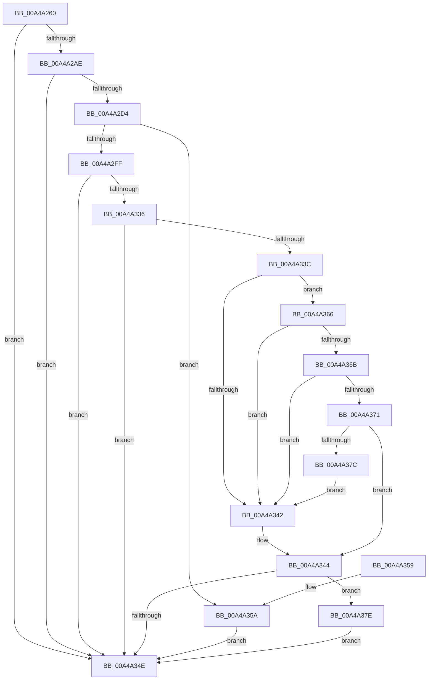

# PopEsInStandbyEvaluate

- RVA: `0x00A4A260`–`0x00A4A392` (길이 `306` bytes)
- VA: `0x0000000140A4A260`
- 실행 섹션: `PAGE`
- PDB 이름 있음: `예`; PDB Function 태그: `아니요`
- unwind 정보 RVA: `0x000AFF74`
- 디코드: `90`개 명령, `306/306` bytes 표시
- 미해석 바이트: `0` (있으면 어셈블리에 `.byte`로 보존)

> 이 문서는 커널 이미지의 기계어와 PDB 기호를 분석해 생성했습니다. 4번과 5번은 함수 원형과 자료형을 바이너리 사용 방식에서 추정한 C 해석이며 원본 소스 복구 결과는 아닙니다.

## 1. Dependencies

- 직접 호출 지점: **9**; 고유 호출 대상: **7**
- 직접 호출자로 확인된 함수: **2**
- RIP 상대 이미지 참조: **6**

### Outgoing calls
- `0x00A4A29F` → [PopGetPowerSettingValue](../../text/49/PopGetPowerSettingValue_function_0049C6CC.md) (function, `0x0049C6CC`)
- `0x00A4A2C9` → [PopGetPowerSettingValue](../../text/49/PopGetPowerSettingValue_function_0049C6CC.md) (function, `0x0049C6CC`)
- `0x00A4A2F2` → [ExpWnfAcquireSubscriptionNameInstance](ExpWnfAcquireSubscriptionNameInstance_function_00A4A51C.md) (function, `0x00A4A51C`)
- `0x00A4A316` → [ExpWnfReadStateData](../90/ExpWnfReadStateData_function_00909C50.md) (function, `0x00909C50`)
- `0x00A4A321` → [ExReleaseRundownProtection](../../text/34/ExReleaseRundownProtection_function_00349E80.md) (function, `0x00349E80`)
- `0x00A4A32D` → [KeLeaveCriticalRegion](../../text/25/KeLeaveCriticalRegion_function_0025D8B0.md) (function, `0x0025D8B0`)
- `0x00A4A35A` → [KeLeaveCriticalRegion](../../text/25/KeLeaveCriticalRegion_function_0025D8B0.md) (function, `0x0025D8B0`)
- `0x00A4A384` → [PopTraceEsBgActivityPolicyUpdate](../76/PopTraceEsBgActivityPolicyUpdate_function_007639E8.md) (function, `0x007639E8`)
- `0x00A4A38B` → [PopEsQueueStateEvaluation](PopEsQueueStateEvaluation_function_00A4A398.md) (function, `0x00A4A398`)

### Direct callers
- [PopEsInStandbyAcDcCallback](../76/PopEsInStandbyAcDcCallback_function_00769830.md) at `0x00769840`
- [PopEsInStandbyLowPowerEpochCallback](PopEsInStandbyLowPowerEpochCallback_function_00A4A230.md) at `0x00A4A240`

### Static image references
- `0x00A4A280` → RVA `0x0001A610` (`.rdata`; read)
- `0x00A4A2BE` → RVA `0x0001C740` (`.rdata`; read)
- `0x00A4A2E0` → RVA `0x00F08428` (`.data`; read)
- `0x00A4A344` → RVA `0x00E67A04` (`.data`; read)
- `0x00A4A371` → RVA `0x00F0C9D8` (`.data`; read)
- `0x00A4A37E` → RVA `0x00E67A04` (`.data`; write)

## 2. Other-region calls and transfers

- 다른 실행 섹션으로 향하는 call: **5**
  - `0x00A4A29F` → [PopGetPowerSettingValue](../../text/49/PopGetPowerSettingValue_function_0049C6CC.md) (`PAGE` → `.text`)
  - `0x00A4A2C9` → [PopGetPowerSettingValue](../../text/49/PopGetPowerSettingValue_function_0049C6CC.md) (`PAGE` → `.text`)
  - `0x00A4A321` → [ExReleaseRundownProtection](../../text/34/ExReleaseRundownProtection_function_00349E80.md) (`PAGE` → `.text`)
  - `0x00A4A32D` → [KeLeaveCriticalRegion](../../text/25/KeLeaveCriticalRegion_function_0025D8B0.md) (`PAGE` → `.text`)
  - `0x00A4A35A` → [KeLeaveCriticalRegion](../../text/25/KeLeaveCriticalRegion_function_0025D8B0.md) (`PAGE` → `.text`)
- 별도 외부 분기/꼬리 이동을 확인하지 못했습니다.

## 3. Assembly (complete function range)

```asm
00A4A260  40 55                           push rbp
00A4A262  53                              push rbx
00A4A263  56                              push rsi
00A4A264  57                              push rdi
00A4A265  48 8B EC                        mov rbp, rsp
00A4A268  48 83 EC 48                     sub rsp, 0x48
00A4A26C  83 65 40 00                     and dword ptr [rbp + 0x40], 0
00A4A270  48 8D 45 30                     lea rax, [rbp + 0x30]
00A4A274  83 65 38 00                     and dword ptr [rbp + 0x38], 0
00A4A278  4C 8D 4D 40                     lea r9, [rbp + 0x40]
00A4A27C  83 65 30 00                     and dword ptr [rbp + 0x30], 0
00A4A280  48 8D 0D 89 03 5D FF            lea rcx, [rip - 0xa2fc77]
00A4A287  BB 04 00 00 00                  mov ebx, 4
00A4A28C  48 89 44 24 28                  mov qword ptr [rsp + 0x28], rax
00A4A291  C6 45 28 00                     mov byte ptr [rbp + 0x28], 0
00A4A295  89 5C 24 20                     mov dword ptr [rsp + 0x20], ebx
00A4A299  8D 7B FF                        lea edi, [rbx - 1]
00A4A29C  44 8B C7                        mov r8d, edi
00A4A29F  E8 28 24 A5 FF                  call 0x14049c6cc
00A4A2A4  8B F0                           mov esi, eax
00A4A2A6  85 C0                           test eax, eax
00A4A2A8  0F 88 A0 00 00 00               js 0x140a4a34e
00A4A2AE  48 8D 45 30                     lea rax, [rbp + 0x30]
00A4A2B2  44 8B C7                        mov r8d, edi
00A4A2B5  48 89 44 24 28                  mov qword ptr [rsp + 0x28], rax
00A4A2BA  4C 8D 4D 38                     lea r9, [rbp + 0x38]
00A4A2BE  48 8D 0D 7B 24 5D FF            lea rcx, [rip - 0xa2db85]
00A4A2C5  89 5C 24 20                     mov dword ptr [rsp + 0x20], ebx
00A4A2C9  E8 FE 23 A5 FF                  call 0x14049c6cc
00A4A2CE  8B F0                           mov esi, eax
00A4A2D0  85 C0                           test eax, eax
00A4A2D2  78 7A                           js 0x140a4a34e
00A4A2D4  65 48 8B 04 25 88 01 00 00      mov rax, qword ptr gs:[0x188]
00A4A2DD  8D 7B FD                        lea edi, [rbx - 3]
00A4A2E0  48 8B 15 41 E1 4B 00            mov rdx, qword ptr [rip + 0x4be141]
00A4A2E7  89 7D 30                        mov dword ptr [rbp + 0x30], edi
00A4A2EA  66 FF 88 E4 01 00 00            dec word ptr [rax + 0x1e4]
00A4A2F1  90                              nop
00A4A2F2  E8 25 02 00 00                  call 0x140a4a51c
00A4A2F7  48 8B F0                        mov rsi, rax
00A4A2FA  48 85 C0                        test rax, rax
00A4A2FD  74 5B                           je 0x140a4a35a
00A4A2FF  48 8D 45 30                     lea rax, [rbp + 0x30]
00A4A303  44 8B CF                        mov r9d, edi
00A4A306  4C 8D 45 28                     lea r8, [rbp + 0x28]
00A4A30A  48 89 44 24 20                  mov qword ptr [rsp + 0x20], rax
00A4A30F  48 8D 55 E8                     lea rdx, [rbp - 0x18]
00A4A313  48 8B CE                        mov rcx, rsi
00A4A316  E8 35 F9 EB FF                  call 0x140909c50
00A4A31B  8B D8                           mov ebx, eax
00A4A31D  48 8D 4E 08                     lea rcx, [rsi + 8]
00A4A321  E8 5A FB 8F FF                  call 0x140349e80
00A4A326  33 F6                           xor esi, esi
00A4A328  85 DB                           test ebx, ebx
00A4A32A  0F 48 F3                        cmovs esi, ebx
00A4A32D  E8 7E 35 81 FF                  call 0x14025d8b0
00A4A332  85 F6                           test esi, esi
00A4A334  78 18                           js 0x140a4a34e
00A4A336  83 7D 30 00                     cmp dword ptr [rbp + 0x30], 0
00A4A33A  74 12                           je 0x140a4a34e
00A4A33C  83 7D 38 00                     cmp dword ptr [rbp + 0x38], 0
00A4A340  75 24                           jne 0x140a4a366
00A4A342  33 FF                           xor edi, edi
00A4A344  8B 0D BA D6 41 00               mov ecx, dword ptr [rip + 0x41d6ba]
00A4A34A  3B CF                           cmp ecx, edi
00A4A34C  75 30                           jne 0x140a4a37e
00A4A34E  8B C6                           mov eax, esi
00A4A350  48 83 C4 48                     add rsp, 0x48
00A4A354  5F                              pop rdi
00A4A355  5E                              pop rsi
00A4A356  5B                              pop rbx
00A4A357  5D                              pop rbp
00A4A358  C3                              ret
00A4A359  CC                              int3
00A4A35A  E8 51 35 81 FF                  call 0x14025d8b0
00A4A35F  BE 34 00 00 C0                  mov esi, 0xc0000034
00A4A364  EB E8                           jmp 0x140a4a34e
00A4A366  39 7D 40                        cmp dword ptr [rbp + 0x40], edi
00A4A369  75 D7                           jne 0x140a4a342
00A4A36B  80 7D 28 00                     cmp byte ptr [rbp + 0x28], 0
00A4A36F  75 D1                           jne 0x140a4a342
00A4A371  8B 05 61 26 4C 00               mov eax, dword ptr [rip + 0x4c2661]
00A4A377  40 84 C7                        test dil, al
00A4A37A  74 C8                           je 0x140a4a344
00A4A37C  EB C4                           jmp 0x140a4a342
00A4A37E  89 3D 80 D6 41 00               mov dword ptr [rip + 0x41d680], edi
00A4A384  E8 5F 96 D1 FF                  call 0x1407639e8
00A4A389  33 C9                           xor ecx, ecx
00A4A38B  E8 08 00 00 00                  call 0x140a4a398
00A4A390  EB BC                           jmp 0x140a4a34e
```

## 4. C-style interpretation (structured pseudocode)

```c
__int64 __fastcall PopEsInStandbyEvaluate(void)
{
    __int64 result;
    __int64 v_rdi;
    __int64 v_rsi;
    __int64 v_rsp;
    unsigned __int64 v_stack_m38;
    unsigned __int64 v_stack_m40;
    unsigned int v_stack_m48;
    unsigned __int64 v_stack_p10;
    unsigned int v_stack_p18;
    unsigned int v_stack_p20;
    unsigned __int8 v_stack_p8;

    v_rsp = (v_rsp) - (72);
    v_stack_m40 = v_stack_p10;
    v_stack_p8 = 0;
    v_stack_m48 = 4;
    result = PopGetPowerSettingValue(v_rip - 10681463, a2, (unsigned int)((unsigned int)(4 - 1)), v_stack_p20);
    if (sign_flag) goto loc_00A4A34E;
    v_stack_m40 = v_stack_p10;
    v_stack_m48 = 4;
    result = PopGetPowerSettingValue(v_rip - 10673029, a2, (unsigned int)((unsigned int)(4 - 1)), v_stack_p18);
    if (sign_flag) goto loc_00A4A34E;
    v_stack_p10 = (unsigned int)(4 - 3);
    result = ExpWnfAcquireSubscriptionNameInstance(v_rip - 10673029, *(unsigned __int64 *)(v_rip + 4972865), (unsigned int)((unsigned int)(4 - 1)), v_stack_p18);
    if (result == 0) goto loc_00A4A35A;
    v_stack_m48 = v_stack_p10;
    result = ExpWnfReadStateData(result, v_stack_m38, v_stack_p8, (unsigned int)((unsigned int)(4 - 3)));
    result = ExReleaseRundownProtection(result + 8, v_stack_m38, v_stack_p8, (unsigned int)((unsigned int)(4 - 3)));
    v_rsi = 0;
    if (sign_flag) { v_rsi = (unsigned int)((unsigned int)((unsigned int)(result))); }
    result = KeLeaveCriticalRegion(result + 8, v_stack_m38, v_stack_p8, (unsigned int)((unsigned int)(4 - 3)));
    if (sign_flag) goto loc_00A4A34E;
    if (v_stack_p10 == 0) goto loc_00A4A34E;
    if (v_stack_p18 != 0) goto loc_00A4A366;
loc_00A4A342:
    v_rdi = 0;
loc_00A4A344:
    if (((unsigned int)((unsigned int)(*(unsigned int *)(v_rip + 4314810)))) != 0) goto loc_00A4A37E;
loc_00A4A34E:
    v_rsp = (v_rsp) + (72);
    return (unsigned int)((unsigned int)(v_rsi));
loc_00A4A35A:
    result = KeLeaveCriticalRegion((unsigned int)(*(unsigned int *)(v_rip + 4314810)), v_stack_m38, v_stack_p8, (unsigned int)((unsigned int)(4 - 3)));
    goto loc_00A4A34E;
loc_00A4A366:
    if (v_stack_p20 != 0) goto loc_00A4A342;
    if (v_stack_p8 != 0) goto loc_00A4A342;
    if (((0) & ((unsigned __int8)((unsigned int)(*(unsigned int *)(v_rip + 4990561))))) == 0) goto loc_00A4A344;
    goto loc_00A4A342;
loc_00A4A37E:
    *(unsigned int *)(v_rip + 4314752) = 0;
    result = PopTraceEsBgActivityPolicyUpdate((unsigned int)(*(unsigned int *)(v_rip + 4314810)), v_stack_m38, v_stack_p8, (unsigned int)((unsigned int)(4 - 3)));
    a1 = 0;
    result = PopEsQueueStateEvaluation(a1, v_stack_m38, v_stack_p8, (unsigned int)((unsigned int)(4 - 3)));
    goto loc_00A4A34E;
}
```

## 5. (Beta) C Style

```c
void PopEsInStandbyEvaluate(void)
{
    int64_t result;
    int64_t local_rdi;
    int64_t local_rsi;
    int64_t local_rsp;
    uint64_t v_stack_m38;
    uint64_t v_stack_m40;
    uint32_t v_stack_m48;
    uint64_t v_stack_p10;
    uint32_t v_stack_p18;
    uint32_t v_stack_p20;
    uint8_t v_stack_p8;

    local_rsp = (local_rsp) - (72);
    v_stack_m40 = v_stack_p10;
    v_stack_p8 = 0;
    v_stack_m48 = 4;
    result = PopGetPowerSettingValue(v_rip - 10681463, a2, (uint32_t)((uint32_t)(4 - 1)), v_stack_p20);
    if (sign_flag) goto loc_00A4A34E;
    v_stack_m40 = v_stack_p10;
    v_stack_m48 = 4;
    result = PopGetPowerSettingValue(v_rip - 10673029, a2, (uint32_t)((uint32_t)(4 - 1)), v_stack_p18);
    if (sign_flag) goto loc_00A4A34E;
    v_stack_p10 = (uint32_t)(4 - 3);
    result = ExpWnfAcquireSubscriptionNameInstance(v_rip - 10673029, *(uint64_t *)(v_rip + 0x4BE141), (uint32_t)((uint32_t)(4 - 1)), v_stack_p18);
    if (result == 0) goto loc_00A4A35A;
    v_stack_m48 = v_stack_p10;
    result = ExpWnfReadStateData(result, v_stack_m38, v_stack_p8, (uint32_t)((uint32_t)(4 - 3)));
    result = ExReleaseRundownProtection(result + 8, v_stack_m38, v_stack_p8, (uint32_t)((uint32_t)(4 - 3)));
    local_rsi = 0;
    if (sign_flag) { local_rsi = (uint32_t)((uint32_t)((uint32_t)(result))); }
    result = KeLeaveCriticalRegion(result + 8, v_stack_m38, v_stack_p8, (uint32_t)((uint32_t)(4 - 3)));
    if (sign_flag) goto loc_00A4A34E;
    if (v_stack_p10 == 0) goto loc_00A4A34E;
    if (v_stack_p18 != 0) goto loc_00A4A366;
loc_00A4A342:
    local_rdi = 0;
loc_00A4A344:
    if (((uint32_t)((uint32_t)(*(uint32_t *)(v_rip + 0x41D6BA)))) != 0) goto loc_00A4A37E;
loc_00A4A34E:
    local_rsp = (local_rsp) + (72);
    return (uint32_t)((uint32_t)(local_rsi));
loc_00A4A35A:
    result = KeLeaveCriticalRegion((uint32_t)(*(uint32_t *)(v_rip + 0x41D6BA)), v_stack_m38, v_stack_p8, (uint32_t)((uint32_t)(4 - 3)));
    goto loc_00A4A34E;
loc_00A4A366:
    if (v_stack_p20 != 0) goto loc_00A4A342;
    if (v_stack_p8 != 0) goto loc_00A4A342;
    if (((0) & ((uint8_t)((uint32_t)(*(uint32_t *)(v_rip + 0x4C2661))))) == 0) goto loc_00A4A344;
    goto loc_00A4A342;
loc_00A4A37E:
    *(uint32_t *)(v_rip + 0x41D680) = 0;
    result = PopTraceEsBgActivityPolicyUpdate((uint32_t)(*(uint32_t *)(v_rip + 0x41D6BA)), v_stack_m38, v_stack_p8, (uint32_t)((uint32_t)(4 - 3)));
    a1 = 0;
    result = PopEsQueueStateEvaluation(a1, v_stack_m38, v_stack_p8, (uint32_t)((uint32_t)(4 - 3)));
    goto loc_00A4A34E;
}
```

## 6. Execution-region graph

[열기: 2D/3D 그래프와 함수 탐색 컨트롤 패널](../../../control-panel.html?section=page&rva=0x00A4A260&view=graph)

- 2D 그래프는 위에서 아래로 흐르고, 3D 그래프는 빈 공간을 드래그해 회전합니다. Shift+드래그는 이동, 휠은 확대·축소, 함수 노드 선택은 대상 보고서 이동입니다.

### Static fallback


