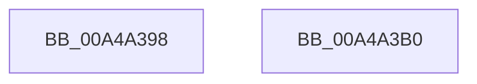

# PopEsQueueStateEvaluation

- RVA: `0x00A4A398`–`0x00A4A3B1` (길이 `25` bytes)
- VA: `0x0000000140A4A398`
- 실행 섹션: `PAGE`
- PDB 이름 있음: `예`; PDB Function 태그: `아니요`
- unwind 정보 RVA: `0x0005C788`
- 디코드: `9`개 명령, `25/25` bytes 표시
- 미해석 바이트: `0` (있으면 어셈블리에 `.byte`로 보존)

> 이 문서는 커널 이미지의 기계어와 PDB 기호를 분석해 생성했습니다. 4번과 5번은 함수 원형과 자료형을 바이너리 사용 방식에서 추정한 C 해석이며 원본 소스 복구 결과는 아닙니다.

## 1. Dependencies

- 직접 호출 지점: **1**; 고유 호출 대상: **1**
- 직접 호출자로 확인된 함수: **4**
- RIP 상대 이미지 참조: **0**

### Outgoing calls
- `0x00A4A3A6` → [PopEsWorkItemSchedule](PopEsWorkItemSchedule_function_00A4A5DC.md) (function, `0x00A4A5DC`)

### Direct callers
- [PopEsPowerSettingPolicyCallback](../76/PopEsPowerSettingPolicyCallback_function_00769870.md) at `0x007698E0`
- [PopEsInStandbyEvaluate](PopEsInStandbyEvaluate_function_00A4A260.md) at `0x00A4A38B`
- [PopPowerInformationInternal](../A8/PopPowerInformationInternal_function_00A8B7C0.md) at `0x00A8C2BB`
- [PopBatteryApplyCompositeState](../AE/PopBatteryApplyCompositeState_function_00AE0CD0.md) at `0x00AE1418`

### Static image references
- 디코드된 RIP-relative 메모리 참조가 없습니다.

## 2. Other-region calls and transfers

- 다른 실행 섹션으로 향하는 call: **0**
- 별도 외부 분기/꼬리 이동을 확인하지 못했습니다.

## 3. Assembly (complete function range)

```asm
00A4A398  48 83 EC 28                     sub rsp, 0x28
00A4A39C  F6 D9                           neg cl
00A4A39E  1B C9                           sbb ecx, ecx
00A4A3A0  83 E1 08                        and ecx, 8
00A4A3A3  83 C1 04                        add ecx, 4
00A4A3A6  E8 31 02 00 00                  call 0x140a4a5dc
00A4A3AB  48 83 C4 28                     add rsp, 0x28
00A4A3AF  C3                              ret
00A4A3B0  CC                              int3
```

## 4. C-style interpretation (structured pseudocode)

```c
__int64 __fastcall PopEsQueueStateEvaluation(unsigned __int8 a1)
{
    __int64 result;
    __int64 v_rsp;

    v_rsp = (v_rsp) - (40);
    a1 = (unsigned __int8)(-(a1));
    a1 = (unsigned int)((a1) & (8));
    a1 = (unsigned int)((a1) + (4));
    result = PopEsWorkItemSchedule(a1, a2, a3, a4);
    v_rsp = (v_rsp) + (40);
    return result;
}
```

## 5. (Beta) C Style

```c
int64_t PopEsQueueStateEvaluation(uint8_t Arg1)
{
    int64_t result;
    int64_t local_rsp;

    local_rsp = (local_rsp) - (40);
    Arg1 = (uint8_t)(-(Arg1));
    Arg1 = (uint32_t)((Arg1) & (8));
    Arg1 = (uint32_t)((Arg1) + (4));
    result = PopEsWorkItemSchedule(Arg1, a2, a3, a4);
    local_rsp = (local_rsp) + (40);
    return result;
}
```

## 6. Execution-region graph

[열기: 2D/3D 그래프와 함수 탐색 컨트롤 패널](../../../control-panel.html?section=page&rva=0x00A4A398&view=graph)

- 2D 그래프는 위에서 아래로 흐르고, 3D 그래프는 빈 공간을 드래그해 회전합니다. Shift+드래그는 이동, 휠은 확대·축소, 함수 노드 선택은 대상 보고서 이동입니다.

### Static fallback


