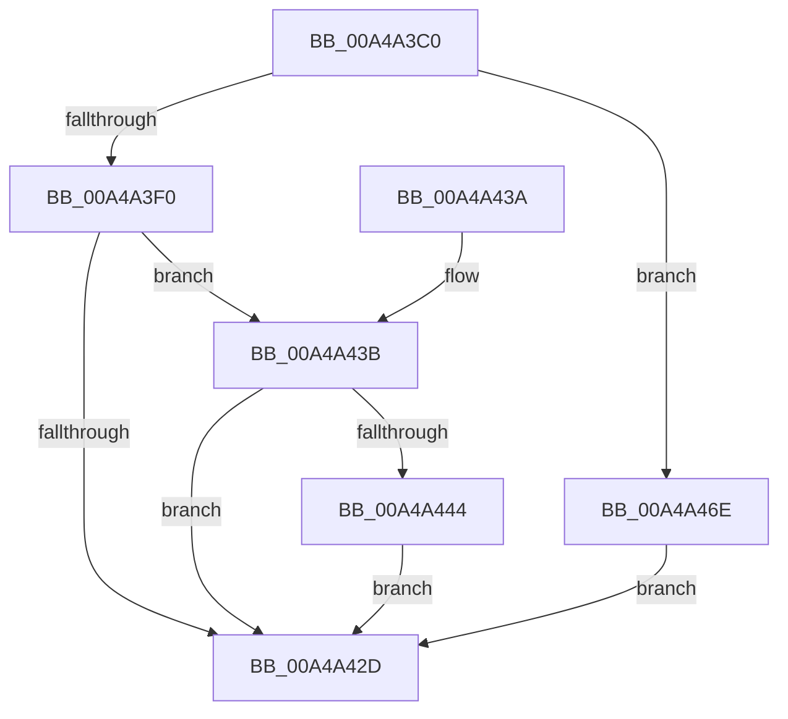

# PopEsWnfSubscriptionOverrideCallback

- RVA: `0x00A4A3C0`–`0x00A4A475` (길이 `181` bytes)
- VA: `0x0000000140A4A3C0`
- 실행 섹션: `PAGE`
- PDB 이름 있음: `예`; PDB Function 태그: `아니요`
- unwind 정보 RVA: `0x000AFF88`
- 디코드: `47`개 명령, `181/181` bytes 표시
- 미해석 바이트: `0` (있으면 어셈블리에 `.byte`로 보존)

> 이 문서는 커널 이미지의 기계어와 PDB 기호를 분석해 생성했습니다. 4번과 5번은 함수 원형과 자료형을 바이너리 사용 방식에서 추정한 C 해석이며 원본 소스 복구 결과는 아닙니다.

## 1. Dependencies

- 직접 호출 지점: **8**; 고유 호출 대상: **7**
- 직접 호출자로 확인된 함수: **0**
- RIP 상대 이미지 참조: **2**

### Outgoing calls
- `0x00A4A3E3` → [ExpWnfAcquireSubscriptionNameInstance](ExpWnfAcquireSubscriptionNameInstance_function_00A4A51C.md) (function, `0x00A4A51C`)
- `0x00A4A40D` → [ExpWnfReadStateData](../90/ExpWnfReadStateData_function_00909C50.md) (function, `0x00909C50`)
- `0x00A4A418` → [ExReleaseRundownProtection](../../text/34/ExReleaseRundownProtection_function_00349E80.md) (function, `0x00349E80`)
- `0x00A4A424` → [KeLeaveCriticalRegion](../../text/25/KeLeaveCriticalRegion_function_0025D8B0.md) (function, `0x0025D8B0`)
- `0x00A4A44B` → [PopAcquireRwLockExclusive](../../text/43/PopAcquireRwLockExclusive_function_00430B44.md) (function, `0x00430B44`)
- `0x00A4A45D` → [PopReleaseRwLock](../../text/2D/PopReleaseRwLock_function_002DFBBC.md) (function, `0x002DFBBC`)
- `0x00A4A467` → [PopEsWorkItemSchedule](PopEsWorkItemSchedule_function_00A4A5DC.md) (function, `0x00A4A5DC`)
- `0x00A4A46E` → [KeLeaveCriticalRegion](../../text/25/KeLeaveCriticalRegion_function_0025D8B0.md) (function, `0x0025D8B0`)

### Direct callers
- 이 함수 시작 RVA로 연결되는 직접 call은 확인되지 않았습니다. 간접 호출은 완전히 역산할 수 없습니다.

### Static image references
- `0x00A4A444` → RVA `0x00F08440` (`.data`; read)
- `0x00A4A457` → RVA `0x00E0B860` (`.data`; write)

## 2. Other-region calls and transfers

- 다른 실행 섹션으로 향하는 call: **5**
  - `0x00A4A418` → [ExReleaseRundownProtection](../../text/34/ExReleaseRundownProtection_function_00349E80.md) (`PAGE` → `.text`)
  - `0x00A4A424` → [KeLeaveCriticalRegion](../../text/25/KeLeaveCriticalRegion_function_0025D8B0.md) (`PAGE` → `.text`)
  - `0x00A4A44B` → [PopAcquireRwLockExclusive](../../text/43/PopAcquireRwLockExclusive_function_00430B44.md) (`PAGE` → `.text`)
  - `0x00A4A45D` → [PopReleaseRwLock](../../text/2D/PopReleaseRwLock_function_002DFBBC.md) (`PAGE` → `.text`)
  - `0x00A4A46E` → [KeLeaveCriticalRegion](../../text/25/KeLeaveCriticalRegion_function_0025D8B0.md) (`PAGE` → `.text`)
- 별도 외부 분기/꼬리 이동을 확인하지 못했습니다.

## 3. Assembly (complete function range)

```asm
00A4A3C0  48 89 5C 24 10                  mov qword ptr [rsp + 0x10], rbx
00A4A3C5  57                              push rdi
00A4A3C6  48 83 EC 40                     sub rsp, 0x40
00A4A3CA  65 48 8B 04 25 88 01 00 00      mov rax, qword ptr gs:[0x188]
00A4A3D3  48 8B D1                        mov rdx, rcx
00A4A3D6  83 64 24 50 00                  and dword ptr [rsp + 0x50], 0
00A4A3DB  66 FF 88 E4 01 00 00            dec word ptr [rax + 0x1e4]
00A4A3E2  90                              nop
00A4A3E3  E8 34 01 00 00                  call 0x140a4a51c
00A4A3E8  48 8B D8                        mov rbx, rax
00A4A3EB  48 85 C0                        test rax, rax
00A4A3EE  74 7E                           je 0x140a4a46e
00A4A3F0  48 8D 44 24 30                  lea rax, [rsp + 0x30]
00A4A3F5  41 B9 04 00 00 00               mov r9d, 4
00A4A3FB  4C 8D 44 24 50                  lea r8, [rsp + 0x50]
00A4A400  48 89 44 24 20                  mov qword ptr [rsp + 0x20], rax
00A4A405  48 8D 54 24 68                  lea rdx, [rsp + 0x68]
00A4A40A  48 8B CB                        mov rcx, rbx
00A4A40D  E8 3E F8 EB FF                  call 0x140909c50
00A4A412  8B F8                           mov edi, eax
00A4A414  48 8D 4B 08                     lea rcx, [rbx + 8]
00A4A418  E8 63 FA 8F FF                  call 0x140349e80
00A4A41D  33 DB                           xor ebx, ebx
00A4A41F  85 FF                           test edi, edi
00A4A421  0F 48 DF                        cmovs ebx, edi
00A4A424  E8 87 34 81 FF                  call 0x14025d8b0
00A4A429  85 DB                           test ebx, ebx
00A4A42B  79 0E                           jns 0x140a4a43b
00A4A42D  48 8B 5C 24 58                  mov rbx, qword ptr [rsp + 0x58]
00A4A432  33 C0                           xor eax, eax
00A4A434  48 83 C4 40                     add rsp, 0x40
00A4A438  5F                              pop rdi
00A4A439  C3                              ret
00A4A43A  CC                              int3
00A4A43B  8B 5C 24 50                     mov ebx, dword ptr [rsp + 0x50]
00A4A43F  83 FB 02                        cmp ebx, 2
00A4A442  77 E9                           ja 0x140a4a42d
00A4A444  48 8D 0D F5 DF 4B 00            lea rcx, [rip + 0x4bdff5]
00A4A44B  E8 F4 66 9E FF                  call 0x140430b44
00A4A450  48 8D 0D E9 DF 4B 00            lea rcx, [rip + 0x4bdfe9]
00A4A457  89 1D 03 14 3C 00               mov dword ptr [rip + 0x3c1403], ebx
00A4A45D  E8 5A 57 89 FF                  call 0x1402dfbbc
00A4A462  B9 02 00 00 00                  mov ecx, 2
00A4A467  E8 70 01 00 00                  call 0x140a4a5dc
00A4A46C  EB BF                           jmp 0x140a4a42d
00A4A46E  E8 3D 34 81 FF                  call 0x14025d8b0
00A4A473  EB B8                           jmp 0x140a4a42d
```

## 4. C-style interpretation (structured pseudocode)

```c
__int64 __fastcall PopEsWnfSubscriptionOverrideCallback(__int64 a1)
{
    __int64 result;
    __int64 v_rbx;
    __int64 v_rsp;
    unsigned __int64 v_stack_m18;
    unsigned __int64 v_stack_m28;
    unsigned __int64 v_stack_p10;
    unsigned __int64 v_stack_p20;
    unsigned int v_stack_p50;
    unsigned int v_stack_p8;

    v_stack_p10 = v_rbx;
    v_rsp = (v_rsp) - (64);
    result = ExpWnfAcquireSubscriptionNameInstance(a1, a1, a3, a4);
    if (result == 0) goto loc_00A4A46E;
    v_stack_m28 = v_stack_m18;
    result = ExpWnfReadStateData(result, v_stack_p20, v_stack_p8, 4);
    result = ExReleaseRundownProtection(result + 8, v_stack_p20, v_stack_p8, 4);
    v_rbx = 0;
    if (sign_flag) { v_rbx = (unsigned int)((unsigned int)((unsigned int)(result))); }
    result = KeLeaveCriticalRegion(result + 8, v_stack_p20, v_stack_p8, 4);
    if (!sign_flag) goto loc_00A4A43B;
loc_00A4A42D:
    result = 0;
    v_rsp = (v_rsp) + (64);
    return result;
loc_00A4A43B:
    if (((unsigned int)((unsigned int)(v_stack_p50))) > 2) goto loc_00A4A42D;
    result = PopAcquireRwLockExclusive(v_rip + 4972533, v_stack_p20, v_stack_p8, 4);
    *(unsigned int *)(v_rip + 3937283) = (unsigned int)((unsigned int)(v_stack_p50));
    result = PopReleaseRwLock(v_rip + 4972521, v_stack_p20, v_stack_p8, 4);
    result = PopEsWorkItemSchedule(2, v_stack_p20, v_stack_p8, 4);
    goto loc_00A4A42D;
loc_00A4A46E:
    result = KeLeaveCriticalRegion(2, v_stack_p20, v_stack_p8, 4);
    goto loc_00A4A42D;
}
```

## 5. (Beta) C Style

```c
int64_t PopEsWnfSubscriptionOverrideCallback(int64_t Arg1)
{
    int64_t result;
    int64_t local_rbx;
    int64_t local_rsp;
    uint64_t v_stack_m18;
    uint64_t v_stack_m28;
    uint64_t v_stack_p10;
    uint64_t v_stack_p20;
    uint32_t v_stack_p50;
    uint32_t v_stack_p8;

    v_stack_p10 = local_rbx;
    local_rsp = (local_rsp) - (64);
    result = ExpWnfAcquireSubscriptionNameInstance(Arg1, Arg1, a3, a4);
    if (result == 0) goto loc_00A4A46E;
    v_stack_m28 = v_stack_m18;
    result = ExpWnfReadStateData(result, v_stack_p20, v_stack_p8, 4);
    result = ExReleaseRundownProtection(result + 8, v_stack_p20, v_stack_p8, 4);
    local_rbx = 0;
    if (sign_flag) { local_rbx = (uint32_t)((uint32_t)((uint32_t)(result))); }
    result = KeLeaveCriticalRegion(result + 8, v_stack_p20, v_stack_p8, 4);
    if (!sign_flag) goto loc_00A4A43B;
loc_00A4A42D:
    result = 0;
    local_rsp = (local_rsp) + (64);
    return result;
loc_00A4A43B:
    if (((uint32_t)((uint32_t)(v_stack_p50))) > 2) goto loc_00A4A42D;
    result = PopAcquireRwLockExclusive(v_rip + 4972533, v_stack_p20, v_stack_p8, 4);
    *(uint32_t *)(v_rip + 0x3C1403) = (uint32_t)((uint32_t)(v_stack_p50));
    result = PopReleaseRwLock(v_rip + 4972521, v_stack_p20, v_stack_p8, 4);
    result = PopEsWorkItemSchedule(2, v_stack_p20, v_stack_p8, 4);
    goto loc_00A4A42D;
loc_00A4A46E:
    result = KeLeaveCriticalRegion(2, v_stack_p20, v_stack_p8, 4);
    goto loc_00A4A42D;
}
```

## 6. Execution-region graph

[열기: 2D/3D 그래프와 함수 탐색 컨트롤 패널](../../../control-panel.html?section=page&rva=0x00A4A3C0&view=graph)

- 2D 그래프는 위에서 아래로 흐르고, 3D 그래프는 빈 공간을 드래그해 회전합니다. Shift+드래그는 이동, 휠은 확대·축소, 함수 노드 선택은 대상 보고서 이동입니다.

### Static fallback


