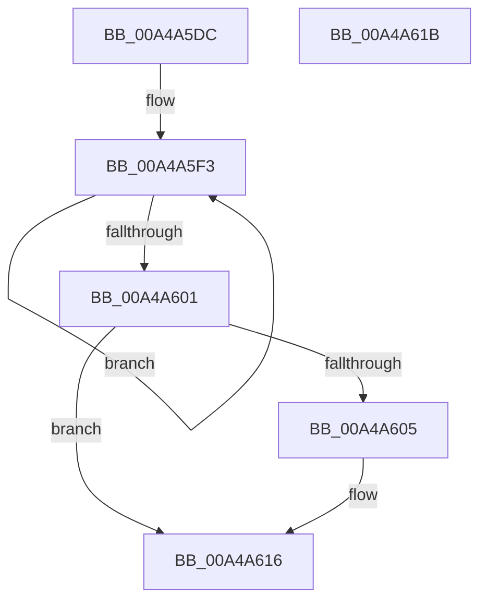

# PopEsWorkItemSchedule

- RVA: `0x00A4A5DC`–`0x00A4A61C` (길이 `64` bytes)
- VA: `0x0000000140A4A5DC`
- 실행 섹션: `PAGE`
- PDB 이름 있음: `예`; PDB Function 태그: `아니요`
- unwind 정보 RVA: `0x0005C788`
- 디코드: `16`개 명령, `64/64` bytes 표시
- 미해석 바이트: `0` (있으면 어셈블리에 `.byte`로 보존)

> 이 문서는 커널 이미지의 기계어와 PDB 기호를 분석해 생성했습니다. 4번과 5번은 함수 원형과 자료형을 바이너리 사용 방식에서 추정한 C 해석이며 원본 소스 복구 결과는 아닙니다.

## 1. Dependencies

- 직접 호출 지점: **1**; 고유 호출 대상: **1**
- 직접 호출자로 확인된 함수: **6**
- RIP 상대 이미지 참조: **2**

### Outgoing calls
- `0x00A4A611` → [ExQueueWorkItem](../../text/2F/ExQueueWorkItem_function_002F9520.md) (function, `0x002F9520`)

### Direct callers
- [PopEsInStandbyAcDcCallback](../76/PopEsInStandbyAcDcCallback_function_00769830.md) at `0x0076984A`
- [PopEsWnfSubscriptionGpAndMdmCallback](../76/PopEsWnfSubscriptionGpAndMdmCallback_function_00769AF0.md) at `0x00769B05`
- [PopEsQueueStateEvaluation](PopEsQueueStateEvaluation_function_00A4A398.md) at `0x00A4A3A6`
- [PopEsWnfSubscriptionOverrideCallback](PopEsWnfSubscriptionOverrideCallback_function_00A4A3C0.md) at `0x00A4A467`
- [PopEsPowerSettingBatteryThresholdCallback](../AC/PopEsPowerSettingBatteryThresholdCallback_function_00AC2800.md) at `0x00AC2853`
- [PopEsInit](../../init/C4/PopEsInit_function_00C42F24.md) at `0x00C42F5B`

### Static image references
- `0x00A4A5E6` → RVA `0x00E679D8` (`.data`; read)
- `0x00A4A60A` → RVA `0x00E679E0` (`.data`; read)

## 2. Other-region calls and transfers

- 다른 실행 섹션으로 향하는 call: **1**
  - `0x00A4A611` → [ExQueueWorkItem](../../text/2F/ExQueueWorkItem_function_002F9520.md) (`PAGE` → `.text`)
- 별도 외부 분기/꼬리 이동을 확인하지 못했습니다.

## 3. Assembly (complete function range)

```asm
00A4A5DC  48 83 EC 28                     sub rsp, 0x28
00A4A5E0  81 C9 00 00 00 80               or ecx, 0x80000000
00A4A5E6  0F 0D 0D EB D3 41 00            prefetchw byte ptr [rip + 0x41d3eb]
00A4A5ED  8B 05 E5 D3 41 00               mov eax, dword ptr [rip + 0x41d3e5]
00A4A5F3  8B D0                           mov edx, eax
00A4A5F5  0B D1                           or edx, ecx
00A4A5F7  F0 0F B1 15 D9 D3 41 00         lock cmpxchg dword ptr [rip + 0x41d3d9], edx
00A4A5FF  75 F2                           jne 0x140a4a5f3
00A4A601  85 C0                           test eax, eax
00A4A603  78 11                           js 0x140a4a616
00A4A605  BA 01 00 00 00                  mov edx, 1
00A4A60A  48 8D 0D CF D3 41 00            lea rcx, [rip + 0x41d3cf]
00A4A611  E8 0A EF 8A FF                  call 0x1402f9520
00A4A616  48 83 C4 28                     add rsp, 0x28
00A4A61A  C3                              ret
00A4A61B  CC                              int3
```

## 4. C-style interpretation (structured pseudocode)

```c
__int64 __fastcall PopEsWorkItemSchedule(int a1)
{
    __int64 result;
    __int64 v_rsp;

    v_rsp = (v_rsp) - (40);
    a1 = (unsigned int)((a1) | (0x80000000ULL));
loc_00A4A5F3:
    a2 = (unsigned int)(((unsigned int)((unsigned int)((unsigned int)(*(unsigned int *)(v_rip + 4314085))))) | (a1));
    if (condition_is_not_equal) goto loc_00A4A5F3;
    result = (unsigned int)(*(unsigned int *)(v_rip + 4314085));
    if (!(sign_flag)) {
        a2 = 1;
        a1 = v_rip + 4314063;
        result = ExQueueWorkItem(a1, a2, a3, a4);
    }
    v_rsp = (v_rsp) + (40);
    return result;
}
```

## 5. (Beta) C Style

```c
int64_t PopEsWorkItemSchedule(int32_t Arg1)
{
    int64_t result;
    int64_t local_rsp;

    local_rsp = (local_rsp) - (40);
    Arg1 = (uint32_t)((Arg1) | (0x80000000ULL));
loc_00A4A5F3:
    a2 = (uint32_t)(((uint32_t)((uint32_t)((uint32_t)(*(uint32_t *)(v_rip + 0x41D3E5))))) | (Arg1));
    if (condition_is_not_equal) goto loc_00A4A5F3;
    result = (uint32_t)(*(uint32_t *)(v_rip + 0x41D3E5));
    if (!(sign_flag)) {
        a2 = 1;
        Arg1 = v_rip + 4314063;
        result = ExQueueWorkItem(Arg1, a2, a3, a4);
    }
    local_rsp = (local_rsp) + (40);
    return result;
}
```

## 6. Execution-region graph

[열기: 2D/3D 그래프와 함수 탐색 컨트롤 패널](../../../control-panel.html?section=page&rva=0x00A4A5DC&view=graph)

- 2D 그래프는 위에서 아래로 흐르고, 3D 그래프는 빈 공간을 드래그해 회전합니다. Shift+드래그는 이동, 휠은 확대·축소, 함수 노드 선택은 대상 보고서 이동입니다.

### Static fallback


