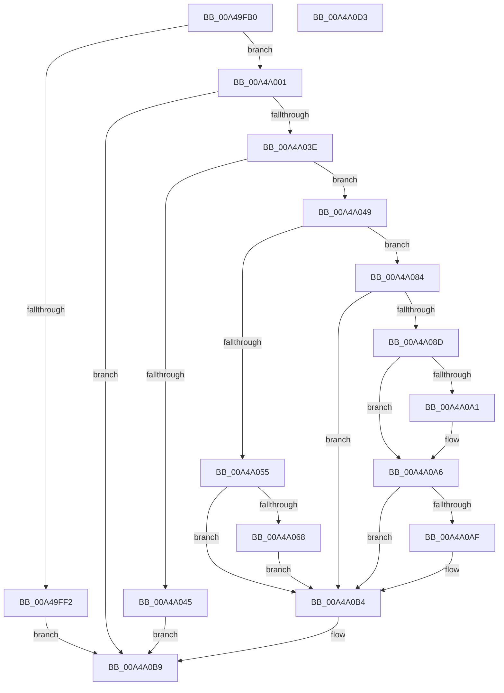

# PopNetWnfLowPowerEpochCallback

- RVA: `0x00A49FB0`–`0x00A4A0D4` (길이 `292` bytes)
- VA: `0x0000000140A49FB0`
- 실행 섹션: `PAGE`
- PDB 이름 있음: `예`; PDB Function 태그: `아니요`
- unwind 정보 RVA: `0x000AFF44`
- 디코드: `73`개 명령, `292/292` bytes 표시
- 미해석 바이트: `0` (있으면 어셈블리에 `.byte`로 보존)

> 이 문서는 커널 이미지의 기계어와 PDB 기호를 분석해 생성했습니다. 4번과 5번은 함수 원형과 자료형을 바이너리 사용 방식에서 추정한 C 해석이며 원본 소스 복구 결과는 아닙니다.

## 1. Dependencies

- 직접 호출 지점: **13**; 고유 호출 대상: **12**
- 직접 호출자로 확인된 함수: **0**
- RIP 상대 이미지 참조: **6**

### Outgoing calls
- `0x00A49FE5` → [ExpWnfAcquireSubscriptionNameInstance](ExpWnfAcquireSubscriptionNameInstance_function_00A4A51C.md) (function, `0x00A4A51C`)
- `0x00A49FF2` → [KeLeaveCriticalRegion](../../text/25/KeLeaveCriticalRegion_function_0025D8B0.md) (function, `0x0025D8B0`)
- `0x00A4A01E` → [ExpWnfReadStateData](../90/ExpWnfReadStateData_function_00909C50.md) (function, `0x00909C50`)
- `0x00A4A029` → [ExReleaseRundownProtection](../../text/34/ExReleaseRundownProtection_function_00349E80.md) (function, `0x00349E80`)
- `0x00A4A035` → [KeLeaveCriticalRegion](../../text/25/KeLeaveCriticalRegion_function_0025D8B0.md) (function, `0x0025D8B0`)
- `0x00A4A049` → [PopAcquirePolicyLock](../../pagelk/B7/PopAcquirePolicyLock_function_00B783C0.md) (function, `0x00B783C0`)
- `0x00A4A05F` → [PopNetIsNetworkRefreshEnabled](../76/PopNetIsNetworkRefreshEnabled_function_00768C88.md) (function, `0x00768C88`)
- `0x00A4A068` → [PopNetGetNextDueRefreshTime](../76/PopNetGetNextDueRefreshTime_function_00768BD4.md) (function, `0x00768BD4`)
- `0x00A4A07D` → [PopNetArmRefreshTimer](../76/PopNetArmRefreshTimer_function_007689D0.md) (function, `0x007689D0`)
- `0x00A4A0A1` → [PopNetDisarmRefreshTimer](../76/PopNetDisarmRefreshTimer_function_00768AD8.md) (function, `0x00768AD8`)
- `0x00A4A0AF` → [PopNetDisengageNetworkRefresh](../76/PopNetDisengageNetworkRefresh_function_00768B88.md) (function, `0x00768B88`)
- `0x00A4A0B4` → [PopReleasePolicyLock](../../pagelk/B7/PopReleasePolicyLock_function_00B78410.md) (function, `0x00B78410`)
- `0x00A4A0C3` → [_security_check_cookie](../../text/6A/_security_check_cookie_function_006AC640.md) (function, `0x006AC640`)

### Direct callers
- 이 함수 시작 RVA로 연결되는 직접 call은 확인되지 않았습니다. 간접 호출은 완전히 역산할 수 없습니다.

### Static image references
- `0x00A49FBA` → RVA `0x00E0A740` (`.data`; read)
- `0x00A4A055` → RVA `0x00F086F8` (`.data`; write)
- `0x00A4A074` → RVA `0x00E678E4` (`.data`; read/write)
- `0x00A4A084` → RVA `0x00F086F8` (`.data`; read)
- `0x00A4A08D` → RVA `0x00F086F8` (`.data`; read/write)
- `0x00A4A0A6` → RVA `0x00F087B0` (`.data`; read)

## 2. Other-region calls and transfers

- 다른 실행 섹션으로 향하는 call: **6**
  - `0x00A49FF2` → [KeLeaveCriticalRegion](../../text/25/KeLeaveCriticalRegion_function_0025D8B0.md) (`PAGE` → `.text`)
  - `0x00A4A029` → [ExReleaseRundownProtection](../../text/34/ExReleaseRundownProtection_function_00349E80.md) (`PAGE` → `.text`)
  - `0x00A4A035` → [KeLeaveCriticalRegion](../../text/25/KeLeaveCriticalRegion_function_0025D8B0.md) (`PAGE` → `.text`)
  - `0x00A4A049` → [PopAcquirePolicyLock](../../pagelk/B7/PopAcquirePolicyLock_function_00B783C0.md) (`PAGE` → `PAGELK`)
  - `0x00A4A0B4` → [PopReleasePolicyLock](../../pagelk/B7/PopReleasePolicyLock_function_00B78410.md) (`PAGE` → `PAGELK`)
  - `0x00A4A0C3` → [_security_check_cookie](../../text/6A/_security_check_cookie_function_006AC640.md) (`PAGE` → `.text`)
- 별도 외부 분기/꼬리 이동을 확인하지 못했습니다.

## 3. Assembly (complete function range)

```asm
00A49FB0  48 89 5C 24 10                  mov qword ptr [rsp + 0x10], rbx
00A49FB5  57                              push rdi
00A49FB6  48 83 EC 50                     sub rsp, 0x50
00A49FBA  48 8B 05 7F 07 3C 00            mov rax, qword ptr [rip + 0x3c077f]
00A49FC1  48 33 C4                        xor rax, rsp
00A49FC4  48 89 44 24 48                  mov qword ptr [rsp + 0x48], rax
00A49FC9  65 48 8B 04 25 88 01 00 00      mov rax, qword ptr gs:[0x188]
00A49FD2  48 8B D1                        mov rdx, rcx
00A49FD5  C7 44 24 30 08 00 00 00         mov dword ptr [rsp + 0x30], 8
00A49FDD  66 FF 88 E4 01 00 00            dec word ptr [rax + 0x1e4]
00A49FE4  90                              nop
00A49FE5  E8 32 05 00 00                  call 0x140a4a51c
00A49FEA  48 8B F8                        mov rdi, rax
00A49FED  48 85 C0                        test rax, rax
00A49FF0  75 0F                           jne 0x140a4a001
00A49FF2  E8 B9 38 81 FF                  call 0x14025d8b0
00A49FF7  BF 34 00 00 C0                  mov edi, 0xc0000034
00A49FFC  E9 B8 00 00 00                  jmp 0x140a4a0b9
00A4A001  48 8D 44 24 30                  lea rax, [rsp + 0x30]
00A4A006  41 B9 08 00 00 00               mov r9d, 8
00A4A00C  4C 8D 44 24 40                  lea r8, [rsp + 0x40]
00A4A011  48 89 44 24 20                  mov qword ptr [rsp + 0x20], rax
00A4A016  48 8D 54 24 38                  lea rdx, [rsp + 0x38]
00A4A01B  48 8B CF                        mov rcx, rdi
00A4A01E  E8 2D FC EB FF                  call 0x140909c50
00A4A023  8B D8                           mov ebx, eax
00A4A025  48 8D 4F 08                     lea rcx, [rdi + 8]
00A4A029  E8 52 FE 8F FF                  call 0x140349e80
00A4A02E  33 FF                           xor edi, edi
00A4A030  85 DB                           test ebx, ebx
00A4A032  0F 48 FB                        cmovs edi, ebx
00A4A035  E8 76 38 81 FF                  call 0x14025d8b0
00A4A03A  85 FF                           test edi, edi
00A4A03C  78 7B                           js 0x140a4a0b9
00A4A03E  83 7C 24 30 08                  cmp dword ptr [rsp + 0x30], 8
00A4A043  73 04                           jae 0x140a4a049
00A4A045  33 FF                           xor edi, edi
00A4A047  EB 70                           jmp 0x140a4a0b9
00A4A049  E8 72 E3 12 00                  call 0x140b783c0
00A4A04E  F6 44 24 40 02                  test byte ptr [rsp + 0x40], 2
00A4A053  74 2F                           je 0x140a4a084
00A4A055  C7 05 99 E6 4B 00 01 00 00 00   mov dword ptr [rip + 0x4be699], 1
00A4A05F  E8 24 EC D1 FF                  call 0x140768c88
00A4A064  84 C0                           test al, al
00A4A066  74 4C                           je 0x140a4a0b4
00A4A068  E8 67 EB D1 FF                  call 0x140768bd4
00A4A06D  B9 01 00 00 00                  mov ecx, 1
00A4A072  B2 01                           mov dl, 1
00A4A074  87 0D 6A D8 41 00               xchg dword ptr [rip + 0x41d86a], ecx
00A4A07A  48 8B C8                        mov rcx, rax
00A4A07D  E8 4E E9 D1 FF                  call 0x1407689d0
00A4A082  EB 30                           jmp 0x140a4a0b4
00A4A084  83 3D 6D E6 4B 00 00            cmp dword ptr [rip + 0x4be66d], 0
00A4A08B  74 27                           je 0x140a4a0b4
00A4A08D  83 25 64 E6 4B 00 00            and dword ptr [rip + 0x4be664], 0
00A4A094  33 C0                           xor eax, eax
00A4A096  87 05 48 D8 41 00               xchg dword ptr [rip + 0x41d848], eax
00A4A09C  83 F8 01                        cmp eax, 1
00A4A09F  75 05                           jne 0x140a4a0a6
00A4A0A1  E8 32 EA D1 FF                  call 0x140768ad8
00A4A0A6  80 3D 03 E7 4B 00 00            cmp byte ptr [rip + 0x4be703], 0
00A4A0AD  74 05                           je 0x140a4a0b4
00A4A0AF  E8 D4 EA D1 FF                  call 0x140768b88
00A4A0B4  E8 57 E3 12 00                  call 0x140b78410
00A4A0B9  8B C7                           mov eax, edi
00A4A0BB  48 8B 4C 24 48                  mov rcx, qword ptr [rsp + 0x48]
00A4A0C0  48 33 CC                        xor rcx, rsp
00A4A0C3  E8 78 25 C6 FF                  call 0x1406ac640
00A4A0C8  48 8B 5C 24 68                  mov rbx, qword ptr [rsp + 0x68]
00A4A0CD  48 83 C4 50                     add rsp, 0x50
00A4A0D1  5F                              pop rdi
00A4A0D2  C3                              ret
00A4A0D3  CC                              int3
```

## 4. C-style interpretation (structured pseudocode)

```c
__int64 __fastcall PopNetWnfLowPowerEpochCallback(__int64 a1)
{
    __int64 result;
    __int64 v_rdi;
    __int64 v_rsp;
    unsigned __int64 v_stack_m10;
    unsigned __int64 v_stack_m18;
    unsigned __int64 v_stack_m20;
    unsigned int v_stack_m28;
    unsigned __int64 v_stack_m38;
    unsigned __int64 v_stack_p10;

    v_stack_p10 = v_rbx;
    v_rsp = (v_rsp) - (80);
    result = (*(unsigned __int64 *)(v_rip + 3934079)) ^ (v_rsp);
    v_stack_m10 = result;
    v_stack_m28 = 8;
    result = ExpWnfAcquireSubscriptionNameInstance(a1, a1, a3, a4);
    if (result != 0) goto loc_00A4A001;
    result = KeLeaveCriticalRegion(a1, a1, a3, a4);
    goto loc_00A4A0B9;
loc_00A4A001:
    v_stack_m38 = v_stack_m28;
    result = ExpWnfReadStateData((unsigned int)(0xC0000034ULL), v_stack_m20, v_stack_m18, 8);
    result = ExReleaseRundownProtection((unsigned int)(0xC0000034ULL) + 8, v_stack_m20, v_stack_m18, 8);
    v_rdi = 0;
    if (sign_flag) { v_rdi = (unsigned int)((unsigned int)((unsigned int)(result))); }
    result = KeLeaveCriticalRegion((unsigned int)(0xC0000034ULL) + 8, v_stack_m20, v_stack_m18, 8);
    if (sign_flag) goto loc_00A4A0B9;
    if (v_stack_m28 >= 8) goto loc_00A4A049;
    v_rdi = 0;
    goto loc_00A4A0B9;
loc_00A4A049:
    result = PopAcquirePolicyLock((unsigned int)(0xC0000034ULL) + 8, v_stack_m20, v_stack_m18, 8);
    if (((v_stack_m18) & (2)) == 0) goto loc_00A4A084;
    *(unsigned int *)(v_rip + 4974233) = 1;
    result = PopNetIsNetworkRefreshEnabled((unsigned int)(0xC0000034ULL) + 8, v_stack_m20, v_stack_m18, 8);
    if ((unsigned __int8)(result) == 0) goto loc_00A4A0B4;
    result = PopNetGetNextDueRefreshTime((unsigned int)(0xC0000034ULL) + 8, v_stack_m20, v_stack_m18, 8);
    result = PopNetArmRefreshTimer(result, 1, v_stack_m18, 8);
    goto loc_00A4A0B4;
loc_00A4A084:
    if ((*(unsigned int *)(v_rip + 4974189)) == 0) goto loc_00A4A0B4;
    result = 0;
    if (0 == 1) {
        result = PopNetDisarmRefreshTimer(result, 1, v_stack_m18, 8);
    }
    if ((*(unsigned __int8 *)(v_rip + 4974339)) != 0) {
        result = PopNetDisengageNetworkRefresh(result, 1, v_stack_m18, 8);
    }
    result = PopReleasePolicyLock(result, 1, v_stack_m18, 8);
loc_00A4A0B9:
    a1 = (v_stack_m10) ^ (v_rsp);
    result = _security_check_cookie(a1, 1, v_stack_m18, 8);
    v_rsp = (v_rsp) + (80);
    return result;
}
```

## 5. (Beta) C Style

```c
int64_t PopNetWnfLowPowerEpochCallback(int64_t Arg1)
{
    int64_t result;
    int64_t local_rdi;
    int64_t local_rsp;
    uint64_t v_stack_m10;
    uint64_t v_stack_m18;
    uint64_t v_stack_m20;
    uint32_t v_stack_m28;
    uint64_t v_stack_m38;
    uint64_t v_stack_p10;

    v_stack_p10 = local_rbx;
    local_rsp = (local_rsp) - (80);
    result = (*(uint64_t *)(v_rip + 0x3C077F)) ^ (local_rsp);
    v_stack_m10 = result;
    v_stack_m28 = 8;
    result = ExpWnfAcquireSubscriptionNameInstance(Arg1, Arg1, a3, a4);
    if (result != 0) goto loc_00A4A001;
    result = KeLeaveCriticalRegion(Arg1, Arg1, a3, a4);
    goto loc_00A4A0B9;
loc_00A4A001:
    v_stack_m38 = v_stack_m28;
    result = ExpWnfReadStateData((uint32_t)(0xC0000034ULL), v_stack_m20, v_stack_m18, 8);
    result = ExReleaseRundownProtection((uint32_t)(0xC0000034ULL) + 8, v_stack_m20, v_stack_m18, 8);
    local_rdi = 0;
    if (sign_flag) { local_rdi = (uint32_t)((uint32_t)((uint32_t)(result))); }
    result = KeLeaveCriticalRegion((uint32_t)(0xC0000034ULL) + 8, v_stack_m20, v_stack_m18, 8);
    if (sign_flag) goto loc_00A4A0B9;
    if (v_stack_m28 >= 8) goto loc_00A4A049;
    local_rdi = 0;
    goto loc_00A4A0B9;
loc_00A4A049:
    result = PopAcquirePolicyLock((uint32_t)(0xC0000034ULL) + 8, v_stack_m20, v_stack_m18, 8);
    if (((v_stack_m18) & (2)) == 0) goto loc_00A4A084;
    *(uint32_t *)(v_rip + 0x4BE699) = 1;
    result = PopNetIsNetworkRefreshEnabled((uint32_t)(0xC0000034ULL) + 8, v_stack_m20, v_stack_m18, 8);
    if ((uint8_t)(result) == 0) goto loc_00A4A0B4;
    result = PopNetGetNextDueRefreshTime((uint32_t)(0xC0000034ULL) + 8, v_stack_m20, v_stack_m18, 8);
    result = PopNetArmRefreshTimer(result, 1, v_stack_m18, 8);
    goto loc_00A4A0B4;
loc_00A4A084:
    if ((*(uint32_t *)(v_rip + 0x4BE66D)) == 0) goto loc_00A4A0B4;
    result = 0;
    if (0 == 1) {
        result = PopNetDisarmRefreshTimer(result, 1, v_stack_m18, 8);
    }
    if ((*(uint8_t *)(v_rip + 0x4BE703)) != 0) {
        result = PopNetDisengageNetworkRefresh(result, 1, v_stack_m18, 8);
    }
    result = PopReleasePolicyLock(result, 1, v_stack_m18, 8);
loc_00A4A0B9:
    Arg1 = (v_stack_m10) ^ (local_rsp);
    result = _security_check_cookie(Arg1, 1, v_stack_m18, 8);
    local_rsp = (local_rsp) + (80);
    return result;
}
```

## 6. Execution-region graph

[열기: 2D/3D 그래프와 함수 탐색 컨트롤 패널](../../../control-panel.html?section=page&rva=0x00A49FB0&view=graph)

- 2D 그래프는 위에서 아래로 흐르고, 3D 그래프는 빈 공간을 드래그해 회전합니다. Shift+드래그는 이동, 휠은 확대·축소, 함수 노드 선택은 대상 보고서 이동입니다.

### Static fallback


