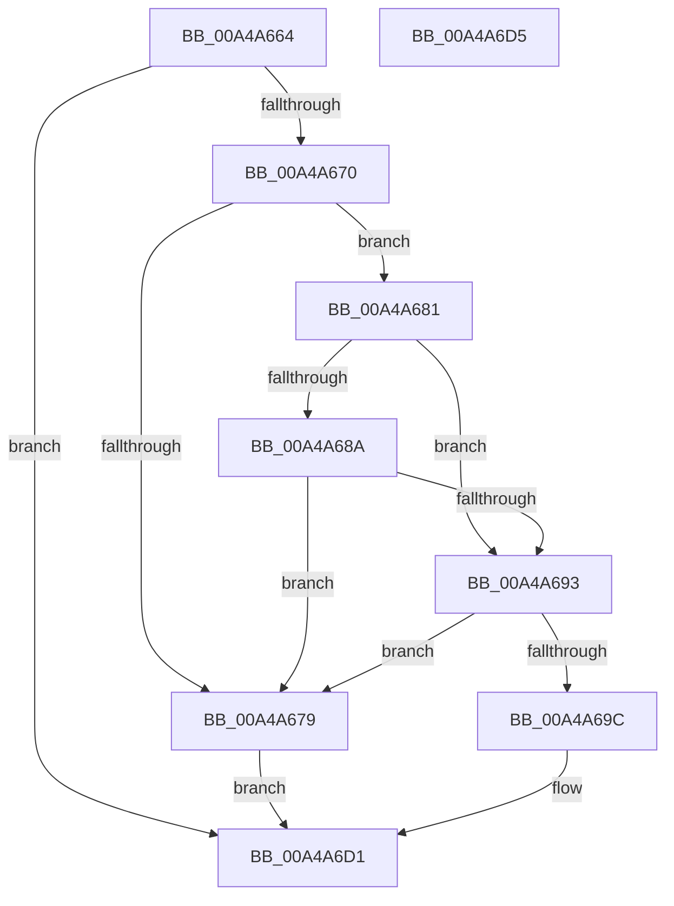

# PopPowerRequestEvaluateExecutionRequiredStatus

- RVA: `0x00A4A664`–`0x00A4A6D6` (길이 `114` bytes)
- VA: `0x0000000140A4A664`
- 실행 섹션: `PAGE`
- PDB 이름 있음: `예`; PDB Function 태그: `아니요`
- unwind 정보 RVA: `0x000DB714`
- 디코드: `26`개 명령, `114/114` bytes 표시
- 미해석 바이트: `0` (있으면 어셈블리에 `.byte`로 보존)

> 이 문서는 커널 이미지의 기계어와 PDB 기호를 분석해 생성했습니다. 4번과 5번은 함수 원형과 자료형을 바이너리 사용 방식에서 추정한 C 해석이며 원본 소스 복구 결과는 아닙니다.

## 1. Dependencies

- 직접 호출 지점: **0**; 고유 호출 대상: **0**
- 직접 호출자로 확인된 함수: **1**
- RIP 상대 이미지 참조: **6**

### Outgoing calls
- 직접 디코드된 call 명령이 없습니다.

### Direct callers
- [PopPowerRequestHandleExecutionEnablementUpdate](PopPowerRequestHandleExecutionEnablementUpdate_function_00A4A624.md) at `0x00A4A63C`

### Static image references
- `0x00A4A667` → RVA `0x00FD80B0` (`PAGEDATA`; read)
- `0x00A4A670` → RVA `0x00F0EFC3` (`.data`; read)
- `0x00A4A681` → RVA `0x00FD81A0` (`PAGEDATA`; read)
- `0x00A4A68A` → RVA `0x00F0EFC2` (`.data`; read)
- `0x00A4A693` → RVA `0x00F0EFC1` (`.data`; read)
- `0x00A4A6AF` → RVA `0x00F0EFC8` (`.data`; read)

## 2. Other-region calls and transfers

- 다른 실행 섹션으로 향하는 call: **0**
- 별도 외부 분기/꼬리 이동을 확인하지 못했습니다.

## 3. Assembly (complete function range)

```asm
00A4A664  45 33 C0                        xor r8d, r8d
00A4A667  44 39 05 42 DA 58 00            cmp dword ptr [rip + 0x58da42], r8d
00A4A66E  74 61                           je 0x140a4a6d1
00A4A670  44 38 05 4C 49 4C 00            cmp byte ptr [rip + 0x4c494c], r8b
00A4A677  75 08                           jne 0x140a4a681
00A4A679  41 B8 01 00 00 00               mov r8d, 1
00A4A67F  EB 50                           jmp 0x140a4a6d1
00A4A681  44 39 05 18 DB 58 00            cmp dword ptr [rip + 0x58db18], r8d
00A4A688  74 09                           je 0x140a4a693
00A4A68A  44 38 05 31 49 4C 00            cmp byte ptr [rip + 0x4c4931], r8b
00A4A691  75 E6                           jne 0x140a4a679
00A4A693  44 38 05 27 49 4C 00            cmp byte ptr [rip + 0x4c4927], r8b
00A4A69A  75 DD                           jne 0x140a4a679
00A4A69C  48 BA 08 00 00 00 80 F7 FF FF   movabs rdx, 0xfffff78000000008
00A4A6A6  48 8B 12                        mov rdx, qword ptr [rdx]
00A4A6A9  8B 05 01 DA 58 00               mov eax, dword ptr [rip + 0x58da01]
00A4A6AF  48 2B 15 12 49 4C 00            sub rdx, qword ptr [rip + 0x4c4912]
00A4A6B6  48 69 C8 80 96 98 00            imul rcx, rax, 0x989680
00A4A6BD  41 0F B6 C0                     movzx eax, r8b
00A4A6C1  41 B8 01 00 00 00               mov r8d, 1
00A4A6C7  48 3B D1                        cmp rdx, rcx
00A4A6CA  41 0F 42 C0                     cmovb eax, r8d
00A4A6CE  44 8A C0                        mov r8b, al
00A4A6D1  41 8A C0                        mov al, r8b
00A4A6D4  C3                              ret
00A4A6D5  CC                              int3
```

## 4. C-style interpretation (structured pseudocode)

```c
__int64 __fastcall PopPowerRequestEvaluateExecutionRequiredStatus(__int64 a1, __int64 a2, int a3)
{
    __int64 result;

    a3 = 0;
    if ((*(unsigned int *)(v_rip + 5823042)) == 0) goto loc_00A4A6D1;
    if ((*(unsigned __int8 *)(v_rip + 4999500)) != 0) goto loc_00A4A681;
loc_00A4A679:
    goto loc_00A4A6D1;
loc_00A4A681:
    if ((*(unsigned int *)(v_rip + 5823256)) == 1) goto loc_00A4A693;
    if ((*(unsigned __int8 *)(v_rip + 4999473)) != 1) goto loc_00A4A679;
loc_00A4A693:
    if ((*(unsigned __int8 *)(v_rip + 4999463)) != 1) goto loc_00A4A679;
    a2 = (*(unsigned __int64 *)(a2)) - (*(unsigned __int64 *)(v_rip + 4999442));
    a1 = (a1) * ((unsigned int)(*(unsigned int *)(v_rip + 5822977)));
    result = 1;
    if (a2 < a1) { result = 1; }
loc_00A4A6D1:
    return (unsigned __int8)((unsigned __int8)(result));
}
```

## 5. (Beta) C Style

```c
int64_t PopPowerRequestEvaluateExecutionRequiredStatus(int64_t Arg1, int64_t Arg2, int32_t Arg3)
{
    int64_t result;

    Arg3 = 0;
    if ((*(uint32_t *)(v_rip + 0x58DA42)) == 0) goto loc_00A4A6D1;
    if ((*(uint8_t *)(v_rip + 0x4C494C)) != 0) goto loc_00A4A681;
loc_00A4A679:
    goto loc_00A4A6D1;
loc_00A4A681:
    if ((*(uint32_t *)(v_rip + 0x58DB18)) == 1) goto loc_00A4A693;
    if ((*(uint8_t *)(v_rip + 0x4C4931)) != 1) goto loc_00A4A679;
loc_00A4A693:
    if ((*(uint8_t *)(v_rip + 0x4C4927)) != 1) goto loc_00A4A679;
    Arg2 = (*(uint64_t *)(Arg2)) - (*(uint64_t *)(v_rip + 0x4C4912));
    Arg1 = (Arg1) * ((uint32_t)(*(uint32_t *)(v_rip + 0x58DA01)));
    result = 1;
    if (Arg2 < Arg1) { result = 1; }
loc_00A4A6D1:
    return (uint8_t)((uint8_t)(result));
}
```

## 6. Execution-region graph

[열기: 2D/3D 그래프와 함수 탐색 컨트롤 패널](../../../control-panel.html?section=page&rva=0x00A4A664&view=graph)

- 2D 그래프는 위에서 아래로 흐르고, 3D 그래프는 빈 공간을 드래그해 회전합니다. Shift+드래그는 이동, 휠은 확대·축소, 함수 노드 선택은 대상 보고서 이동입니다.

### Static fallback


