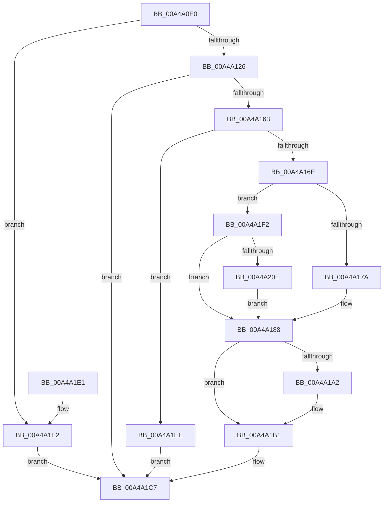

# PopWnfAudioCallback

- RVA: `0x00A4A0E0`–`0x00A4A21D` (길이 `317` bytes)
- VA: `0x0000000140A4A0E0`
- 실행 섹션: `PAGE`
- PDB 이름 있음: `예`; PDB Function 태그: `아니요`
- unwind 정보 RVA: `0x000AFF5C`
- 디코드: `76`개 명령, `317/317` bytes 표시
- 미해석 바이트: `0` (있으면 어셈블리에 `.byte`로 보존)

> 이 문서는 커널 이미지의 기계어와 PDB 기호를 분석해 생성했습니다. 4번과 5번은 함수 원형과 자료형을 바이너리 사용 방식에서 추정한 C 해석이며 원본 소스 복구 결과는 아닙니다.

## 1. Dependencies

- 직접 호출 지점: **16**; 고유 호출 대상: **14**
- 직접 호출자로 확인된 함수: **0**
- RIP 상대 이미지 참조: **6**

### Outgoing calls
- `0x00A4A115` → [ExpWnfAcquireSubscriptionNameInstance](ExpWnfAcquireSubscriptionNameInstance_function_00A4A51C.md) (function, `0x00A4A51C`)
- `0x00A4A143` → [ExpWnfReadStateData](../90/ExpWnfReadStateData_function_00909C50.md) (function, `0x00909C50`)
- `0x00A4A14E` → [ExReleaseRundownProtection](../../text/34/ExReleaseRundownProtection_function_00349E80.md) (function, `0x00349E80`)
- `0x00A4A15A` → [KeLeaveCriticalRegion](../../text/25/KeLeaveCriticalRegion_function_0025D8B0.md) (function, `0x0025D8B0`)
- `0x00A4A16E` → [PopAcquirePolicyLock](../../pagelk/B7/PopAcquirePolicyLock_function_00B783C0.md) (function, `0x00B783C0`)
- `0x00A4A183` → [PopAudioAccountingCallback](PopAudioAccountingCallback_function_00A4A6DC.md) (function, `0x00A4A6DC`)
- `0x00A4A195` → [PopAcquireRwLockExclusive](../../text/43/PopAcquireRwLockExclusive_function_00430B44.md) (function, `0x00430B44`)
- `0x00A4A1AC` → [PopPowerRequestStatsNotifyScenarioStateChange](../../text/45/PopPowerRequestStatsNotifyScenarioStateChange_function_00453794.md) (function, `0x00453794`)
- `0x00A4A1B1` → [PopPowerRequestHandleExecutionEnablementUpdate](PopPowerRequestHandleExecutionEnablementUpdate_function_00A4A624.md) (function, `0x00A4A624`)
- `0x00A4A1BD` → [PopReleaseRwLock](../../text/2D/PopReleaseRwLock_function_002DFBBC.md) (function, `0x002DFBBC`)
- `0x00A4A1C2` → [PopReleasePolicyLock](../../pagelk/B7/PopReleasePolicyLock_function_00B78410.md) (function, `0x00B78410`)
- `0x00A4A1D1` → [_security_check_cookie](../../text/6A/_security_check_cookie_function_006AC640.md) (function, `0x006AC640`)
- `0x00A4A1E2` → [KeLeaveCriticalRegion](../../text/25/KeLeaveCriticalRegion_function_0025D8B0.md) (function, `0x0025D8B0`)
- `0x00A4A1FB` → [PopAudioAccountingCallback](PopAudioAccountingCallback_function_00A4A6DC.md) (function, `0x00A4A6DC`)
- `0x00A4A200` → [PopGetDozeTimerSource](../../text/5D/PopGetDozeTimerSource_function_005D97F8.md) (function, `0x005D97F8`)
- `0x00A4A213` → [PopUpdateSmartUserPresencePredictions](../76/PopUpdateSmartUserPresencePredictions_function_0076894C.md) (function, `0x0076894C`)

### Direct callers
- 이 함수 시작 RVA로 연결되는 직접 call은 확인되지 않았습니다. 간접 호출은 완전히 역산할 수 없습니다.

### Static image references
- `0x00A4A0EA` → RVA `0x00E0A740` (`.data`; read)
- `0x00A4A17C` → RVA `0x00F0CE4D` (`.data`; write)
- `0x00A4A188` → RVA `0x00F0CE4D` (`.data`; read)
- `0x00A4A18E` → RVA `0x00F0ED20` (`.data`; read)
- `0x00A4A19A` → RVA `0x00F0EFC2` (`.data`; read)
- `0x00A4A1A4` → RVA `0x00F0EFC2` (`.data`; write)

## 2. Other-region calls and transfers

- 다른 실행 섹션으로 향하는 call: **10**
  - `0x00A4A14E` → [ExReleaseRundownProtection](../../text/34/ExReleaseRundownProtection_function_00349E80.md) (`PAGE` → `.text`)
  - `0x00A4A15A` → [KeLeaveCriticalRegion](../../text/25/KeLeaveCriticalRegion_function_0025D8B0.md) (`PAGE` → `.text`)
  - `0x00A4A16E` → [PopAcquirePolicyLock](../../pagelk/B7/PopAcquirePolicyLock_function_00B783C0.md) (`PAGE` → `PAGELK`)
  - `0x00A4A195` → [PopAcquireRwLockExclusive](../../text/43/PopAcquireRwLockExclusive_function_00430B44.md) (`PAGE` → `.text`)
  - `0x00A4A1AC` → [PopPowerRequestStatsNotifyScenarioStateChange](../../text/45/PopPowerRequestStatsNotifyScenarioStateChange_function_00453794.md) (`PAGE` → `.text`)
  - `0x00A4A1BD` → [PopReleaseRwLock](../../text/2D/PopReleaseRwLock_function_002DFBBC.md) (`PAGE` → `.text`)
  - `0x00A4A1C2` → [PopReleasePolicyLock](../../pagelk/B7/PopReleasePolicyLock_function_00B78410.md) (`PAGE` → `PAGELK`)
  - `0x00A4A1D1` → [_security_check_cookie](../../text/6A/_security_check_cookie_function_006AC640.md) (`PAGE` → `.text`)
  - `0x00A4A1E2` → [KeLeaveCriticalRegion](../../text/25/KeLeaveCriticalRegion_function_0025D8B0.md) (`PAGE` → `.text`)
  - `0x00A4A200` → [PopGetDozeTimerSource](../../text/5D/PopGetDozeTimerSource_function_005D97F8.md) (`PAGE` → `.text`)
- 별도 외부 분기/꼬리 이동을 확인하지 못했습니다.

## 3. Assembly (complete function range)

```asm
00A4A0E0  48 89 5C 24 10                  mov qword ptr [rsp + 0x10], rbx
00A4A0E5  57                              push rdi
00A4A0E6  48 83 EC 50                     sub rsp, 0x50
00A4A0EA  48 8B 05 4F 06 3C 00            mov rax, qword ptr [rip + 0x3c064f]
00A4A0F1  48 33 C4                        xor rax, rsp
00A4A0F4  48 89 44 24 48                  mov qword ptr [rsp + 0x48], rax
00A4A0F9  65 48 8B 04 25 88 01 00 00      mov rax, qword ptr gs:[0x188]
00A4A102  48 8B D1                        mov rdx, rcx
00A4A105  C7 44 24 30 08 00 00 00         mov dword ptr [rsp + 0x30], 8
00A4A10D  66 FF 88 E4 01 00 00            dec word ptr [rax + 0x1e4]
00A4A114  90                              nop
00A4A115  E8 02 04 00 00                  call 0x140a4a51c
00A4A11A  48 8B F8                        mov rdi, rax
00A4A11D  48 85 C0                        test rax, rax
00A4A120  0F 84 BC 00 00 00               je 0x140a4a1e2
00A4A126  48 8D 44 24 30                  lea rax, [rsp + 0x30]
00A4A12B  41 B9 08 00 00 00               mov r9d, 8
00A4A131  4C 8D 44 24 40                  lea r8, [rsp + 0x40]
00A4A136  48 89 44 24 20                  mov qword ptr [rsp + 0x20], rax
00A4A13B  48 8D 54 24 38                  lea rdx, [rsp + 0x38]
00A4A140  48 8B CF                        mov rcx, rdi
00A4A143  E8 08 FB EB FF                  call 0x140909c50
00A4A148  8B D8                           mov ebx, eax
00A4A14A  48 8D 4F 08                     lea rcx, [rdi + 8]
00A4A14E  E8 2D FD 8F FF                  call 0x140349e80
00A4A153  33 FF                           xor edi, edi
00A4A155  85 DB                           test ebx, ebx
00A4A157  0F 48 FB                        cmovs edi, ebx
00A4A15A  E8 51 37 81 FF                  call 0x14025d8b0
00A4A15F  85 FF                           test edi, edi
00A4A161  78 64                           js 0x140a4a1c7
00A4A163  83 7C 24 30 08                  cmp dword ptr [rsp + 0x30], 8
00A4A168  0F 82 80 00 00 00               jb 0x140a4a1ee
00A4A16E  E8 4D E2 12 00                  call 0x140b783c0
00A4A173  F6 44 24 40 02                  test byte ptr [rsp + 0x40], 2
00A4A178  75 78                           jne 0x140a4a1f2
00A4A17A  33 C9                           xor ecx, ecx
00A4A17C  C6 05 CA 2C 4C 00 00            mov byte ptr [rip + 0x4c2cca], 0
00A4A183  E8 54 05 00 00                  call 0x140a4a6dc
00A4A188  8A 1D BF 2C 4C 00               mov bl, byte ptr [rip + 0x4c2cbf]
00A4A18E  48 8D 0D 8B 4B 4C 00            lea rcx, [rip + 0x4c4b8b]
00A4A195  E8 AA 69 9E FF                  call 0x140430b44
00A4A19A  38 1D 22 4E 4C 00               cmp byte ptr [rip + 0x4c4e22], bl
00A4A1A0  74 0F                           je 0x140a4a1b1
00A4A1A2  8A D3                           mov dl, bl
00A4A1A4  88 1D 18 4E 4C 00               mov byte ptr [rip + 0x4c4e18], bl
00A4A1AA  33 C9                           xor ecx, ecx
00A4A1AC  E8 E3 95 A0 FF                  call 0x140453794
00A4A1B1  E8 6E 04 00 00                  call 0x140a4a624
00A4A1B6  48 8D 0D 63 4B 4C 00            lea rcx, [rip + 0x4c4b63]
00A4A1BD  E8 FA 59 89 FF                  call 0x1402dfbbc
00A4A1C2  E8 49 E2 12 00                  call 0x140b78410
00A4A1C7  8B C7                           mov eax, edi
00A4A1C9  48 8B 4C 24 48                  mov rcx, qword ptr [rsp + 0x48]
00A4A1CE  48 33 CC                        xor rcx, rsp
00A4A1D1  E8 6A 24 C6 FF                  call 0x1406ac640
00A4A1D6  48 8B 5C 24 68                  mov rbx, qword ptr [rsp + 0x68]
00A4A1DB  48 83 C4 50                     add rsp, 0x50
00A4A1DF  5F                              pop rdi
00A4A1E0  C3                              ret
00A4A1E1  CC                              int3
00A4A1E2  E8 C9 36 81 FF                  call 0x14025d8b0
00A4A1E7  BF 34 00 00 C0                  mov edi, 0xc0000034
00A4A1EC  EB D9                           jmp 0x140a4a1c7
00A4A1EE  33 FF                           xor edi, edi
00A4A1F0  EB D5                           jmp 0x140a4a1c7
00A4A1F2  B1 01                           mov cl, 1
00A4A1F4  C6 05 52 2C 4C 00 01            mov byte ptr [rip + 0x4c2c52], 1
00A4A1FB  E8 DC 04 00 00                  call 0x140a4a6dc
00A4A200  E8 F3 F5 B8 FF                  call 0x1405d97f8
00A4A205  83 F8 02                        cmp eax, 2
00A4A208  0F 85 7A FF FF FF               jne 0x140a4a188
00A4A20E  8D 50 03                        lea edx, [rax + 3]
00A4A211  33 C9                           xor ecx, ecx
00A4A213  E8 34 E7 D1 FF                  call 0x14076894c
00A4A218  E9 6B FF FF FF                  jmp 0x140a4a188
```

## 4. C-style interpretation (structured pseudocode)

```c
__int64 __fastcall PopWnfAudioCallback(__int64 a1)
{
    __int64 result;
    __int64 v_rdi;
    __int64 v_rsp;
    unsigned __int64 v_stack_m10;
    unsigned __int64 v_stack_m18;
    unsigned __int64 v_stack_m20;
    unsigned int v_stack_m28;
    unsigned __int64 v_stack_m38;
    unsigned __int64 v_stack_p10;

    v_stack_p10 = v_rbx;
    v_rsp = (v_rsp) - (80);
    result = (*(unsigned __int64 *)(v_rip + 3933775)) ^ (v_rsp);
    v_stack_m10 = result;
    v_stack_m28 = 8;
    result = ExpWnfAcquireSubscriptionNameInstance(a1, a1, a3, a4);
    if (result == 0) goto loc_00A4A1E2;
    v_stack_m38 = v_stack_m28;
    result = ExpWnfReadStateData(result, v_stack_m20, v_stack_m18, 8);
    result = ExReleaseRundownProtection(result + 8, v_stack_m20, v_stack_m18, 8);
    v_rdi = 0;
    if (sign_flag) { v_rdi = (unsigned int)((unsigned int)((unsigned int)(result))); }
    result = KeLeaveCriticalRegion(result + 8, v_stack_m20, v_stack_m18, 8);
    if (sign_flag) goto loc_00A4A1C7;
    if (v_stack_m28 < 8) goto loc_00A4A1EE;
    result = PopAcquirePolicyLock(result + 8, v_stack_m20, v_stack_m18, 8);
    if (((v_stack_m18) & (2)) != 0) goto loc_00A4A1F2;
    a1 = 0;
    *(unsigned __int8 *)(v_rip + 4992202) = 0;
    result = PopAudioAccountingCallback(a1, v_stack_m20, v_stack_m18, 8);
loc_00A4A188:
    result = PopAcquireRwLockExclusive(v_rip + 5000075, v_stack_m20, v_stack_m18, 8);
    if ((*(unsigned __int8 *)(v_rip + 5000738)) != ((unsigned __int8)(*(unsigned __int8 *)(v_rip + 4992191)))) {
        a2 = (unsigned __int8)(*(unsigned __int8 *)(v_rip + 4992191));
        *(unsigned __int8 *)(v_rip + 5000728) = (unsigned __int8)(*(unsigned __int8 *)(v_rip + 4992191));
        a1 = 0;
        result = PopPowerRequestStatsNotifyScenarioStateChange(a1, a2, v_stack_m18, 8);
    }
    result = PopPowerRequestHandleExecutionEnablementUpdate(a1, a2, v_stack_m18, 8);
    result = PopReleaseRwLock(v_rip + 5000035, a2, v_stack_m18, 8);
    result = PopReleasePolicyLock(v_rip + 5000035, a2, v_stack_m18, 8);
loc_00A4A1C7:
    a1 = (v_stack_m10) ^ (v_rsp);
    result = _security_check_cookie(a1, a2, v_stack_m18, 8);
    v_rsp = (v_rsp) + (80);
    return result;
loc_00A4A1E2:
    result = KeLeaveCriticalRegion(a1, a2, v_stack_m18, 8);
    goto loc_00A4A1C7;
loc_00A4A1EE:
    v_rdi = 0;
    goto loc_00A4A1C7;
loc_00A4A1F2:
    *(unsigned __int8 *)(v_rip + 4992082) = 1;
    result = PopAudioAccountingCallback(1, a2, v_stack_m18, 8);
    result = PopGetDozeTimerSource(1, a2, v_stack_m18, 8);
    if (((unsigned int)(result)) != 2) goto loc_00A4A188;
    a1 = 0;
    result = PopUpdateSmartUserPresencePredictions(a1, result + 3, v_stack_m18, 8);
    goto loc_00A4A188;
}
```

## 5. (Beta) C Style

```c
int64_t PopWnfAudioCallback(int64_t Arg1)
{
    int64_t result;
    int64_t local_rdi;
    int64_t local_rsp;
    uint64_t v_stack_m10;
    uint64_t v_stack_m18;
    uint64_t v_stack_m20;
    uint32_t v_stack_m28;
    uint64_t v_stack_m38;
    uint64_t v_stack_p10;

    v_stack_p10 = local_rbx;
    local_rsp = (local_rsp) - (80);
    result = (*(uint64_t *)(v_rip + 0x3C064F)) ^ (local_rsp);
    v_stack_m10 = result;
    v_stack_m28 = 8;
    result = ExpWnfAcquireSubscriptionNameInstance(Arg1, Arg1, a3, a4);
    if (result == 0) goto loc_00A4A1E2;
    v_stack_m38 = v_stack_m28;
    result = ExpWnfReadStateData(result, v_stack_m20, v_stack_m18, 8);
    result = ExReleaseRundownProtection(result + 8, v_stack_m20, v_stack_m18, 8);
    local_rdi = 0;
    if (sign_flag) { local_rdi = (uint32_t)((uint32_t)((uint32_t)(result))); }
    result = KeLeaveCriticalRegion(result + 8, v_stack_m20, v_stack_m18, 8);
    if (sign_flag) goto loc_00A4A1C7;
    if (v_stack_m28 < 8) goto loc_00A4A1EE;
    result = PopAcquirePolicyLock(result + 8, v_stack_m20, v_stack_m18, 8);
    if (((v_stack_m18) & (2)) != 0) goto loc_00A4A1F2;
    Arg1 = 0;
    *(uint8_t *)(v_rip + 0x4C2CCA) = 0;
    result = PopAudioAccountingCallback(Arg1, v_stack_m20, v_stack_m18, 8);
loc_00A4A188:
    result = PopAcquireRwLockExclusive(v_rip + 5000075, v_stack_m20, v_stack_m18, 8);
    if ((*(uint8_t *)(v_rip + 0x4C4E22)) != ((uint8_t)(*(uint8_t *)(v_rip + 0x4C2CBF)))) {
        a2 = (uint8_t)(*(uint8_t *)(v_rip + 0x4C2CBF));
        *(uint8_t *)(v_rip + 0x4C4E18) = (uint8_t)(*(uint8_t *)(v_rip + 0x4C2CBF));
        Arg1 = 0;
        result = PopPowerRequestStatsNotifyScenarioStateChange(Arg1, a2, v_stack_m18, 8);
    }
    result = PopPowerRequestHandleExecutionEnablementUpdate(Arg1, a2, v_stack_m18, 8);
    result = PopReleaseRwLock(v_rip + 5000035, a2, v_stack_m18, 8);
    result = PopReleasePolicyLock(v_rip + 5000035, a2, v_stack_m18, 8);
loc_00A4A1C7:
    Arg1 = (v_stack_m10) ^ (local_rsp);
    result = _security_check_cookie(Arg1, a2, v_stack_m18, 8);
    local_rsp = (local_rsp) + (80);
    return result;
loc_00A4A1E2:
    result = KeLeaveCriticalRegion(Arg1, a2, v_stack_m18, 8);
    goto loc_00A4A1C7;
loc_00A4A1EE:
    local_rdi = 0;
    goto loc_00A4A1C7;
loc_00A4A1F2:
    *(uint8_t *)(v_rip + 0x4C2C52) = 1;
    result = PopAudioAccountingCallback(1, a2, v_stack_m18, 8);
    result = PopGetDozeTimerSource(1, a2, v_stack_m18, 8);
    if (((uint32_t)(result)) != 2) goto loc_00A4A188;
    Arg1 = 0;
    result = PopUpdateSmartUserPresencePredictions(Arg1, result + 3, v_stack_m18, 8);
    goto loc_00A4A188;
}
```

## 6. Execution-region graph

[열기: 2D/3D 그래프와 함수 탐색 컨트롤 패널](../../../control-panel.html?section=page&rva=0x00A4A0E0&view=graph)

- 2D 그래프는 위에서 아래로 흐르고, 3D 그래프는 빈 공간을 드래그해 회전합니다. Shift+드래그는 이동, 휠은 확대·축소, 함수 노드 선택은 대상 보고서 이동입니다.

### Static fallback


