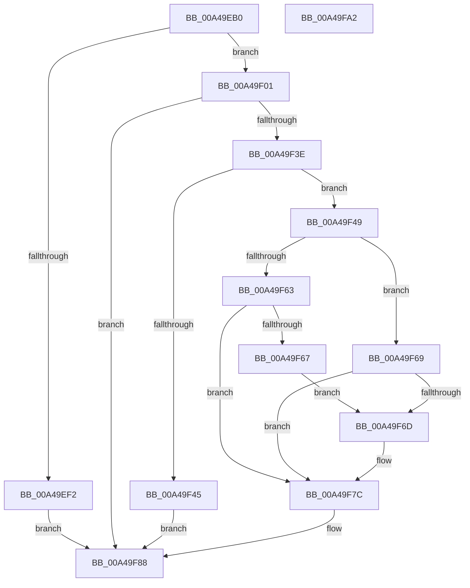

# PopWnfFullscreenVideoCallback

- RVA: `0x00A49EB0`–`0x00A49FA3` (길이 `243` bytes)
- VA: `0x0000000140A49EB0`
- 실행 섹션: `PAGE`
- PDB 이름 있음: `예`; PDB Function 태그: `아니요`
- unwind 정보 RVA: `0x000AFF44`
- 디코드: `63`개 명령, `243/243` bytes 표시
- 미해석 바이트: `0` (있으면 어셈블리에 `.byte`로 보존)

> 이 문서는 커널 이미지의 기계어와 PDB 기호를 분석해 생성했습니다. 4번과 5번은 함수 원형과 자료형을 바이너리 사용 방식에서 추정한 C 해석이며 원본 소스 복구 결과는 아닙니다.

## 1. Dependencies

- 직접 호출 지점: **9**; 고유 호출 대상: **8**
- 직접 호출자로 확인된 함수: **0**
- RIP 상대 이미지 참조: **4**

### Outgoing calls
- `0x00A49EE5` → [ExpWnfAcquireSubscriptionNameInstance](ExpWnfAcquireSubscriptionNameInstance_function_00A4A51C.md) (function, `0x00A4A51C`)
- `0x00A49EF2` → [KeLeaveCriticalRegion](../../text/25/KeLeaveCriticalRegion_function_0025D8B0.md) (function, `0x0025D8B0`)
- `0x00A49F1E` → [ExpWnfReadStateData](../90/ExpWnfReadStateData_function_00909C50.md) (function, `0x00909C50`)
- `0x00A49F29` → [ExReleaseRundownProtection](../../text/34/ExReleaseRundownProtection_function_00349E80.md) (function, `0x00349E80`)
- `0x00A49F35` → [KeLeaveCriticalRegion](../../text/25/KeLeaveCriticalRegion_function_0025D8B0.md) (function, `0x0025D8B0`)
- `0x00A49F50` → [PpmAcquireLock](../../text/2D/PpmAcquireLock_function_002D9AA4.md) (function, `0x002D9AA4`)
- `0x00A49F77` → [PoFxSendSystemLatencyUpdate](../../text/46/PoFxSendSystemLatencyUpdate_function_0046A008.md) (function, `0x0046A008`)
- `0x00A49F83` → [PpmReleaseLock](../../text/2D/PpmReleaseLock_function_002DA428.md) (function, `0x002DA428`)
- `0x00A49F92` → [_security_check_cookie](../../text/6A/_security_check_cookie_function_006AC640.md) (function, `0x006AC640`)

### Direct callers
- 이 함수 시작 RVA로 연결되는 직접 call은 확인되지 않았습니다. 간접 호출은 완전히 역산할 수 없습니다.

### Static image references
- `0x00A49EBA` → RVA `0x00E0A740` (`.data`; read)
- `0x00A49F49` → RVA `0x00F0E760` (`.data`; read)
- `0x00A49F55` → RVA `0x00F0CE4E` (`.data`; read)
- `0x00A49F71` → RVA `0x00F0CE4E` (`.data`; write)

## 2. Other-region calls and transfers

- 다른 실행 섹션으로 향하는 call: **7**
  - `0x00A49EF2` → [KeLeaveCriticalRegion](../../text/25/KeLeaveCriticalRegion_function_0025D8B0.md) (`PAGE` → `.text`)
  - `0x00A49F29` → [ExReleaseRundownProtection](../../text/34/ExReleaseRundownProtection_function_00349E80.md) (`PAGE` → `.text`)
  - `0x00A49F35` → [KeLeaveCriticalRegion](../../text/25/KeLeaveCriticalRegion_function_0025D8B0.md) (`PAGE` → `.text`)
  - `0x00A49F50` → [PpmAcquireLock](../../text/2D/PpmAcquireLock_function_002D9AA4.md) (`PAGE` → `.text`)
  - `0x00A49F77` → [PoFxSendSystemLatencyUpdate](../../text/46/PoFxSendSystemLatencyUpdate_function_0046A008.md) (`PAGE` → `.text`)
  - `0x00A49F83` → [PpmReleaseLock](../../text/2D/PpmReleaseLock_function_002DA428.md) (`PAGE` → `.text`)
  - `0x00A49F92` → [_security_check_cookie](../../text/6A/_security_check_cookie_function_006AC640.md) (`PAGE` → `.text`)
- 별도 외부 분기/꼬리 이동을 확인하지 못했습니다.

## 3. Assembly (complete function range)

```asm
00A49EB0  48 89 5C 24 10                  mov qword ptr [rsp + 0x10], rbx
00A49EB5  57                              push rdi
00A49EB6  48 83 EC 50                     sub rsp, 0x50
00A49EBA  48 8B 05 7F 08 3C 00            mov rax, qword ptr [rip + 0x3c087f]
00A49EC1  48 33 C4                        xor rax, rsp
00A49EC4  48 89 44 24 48                  mov qword ptr [rsp + 0x48], rax
00A49EC9  65 48 8B 04 25 88 01 00 00      mov rax, qword ptr gs:[0x188]
00A49ED2  48 8B D1                        mov rdx, rcx
00A49ED5  C7 44 24 30 08 00 00 00         mov dword ptr [rsp + 0x30], 8
00A49EDD  66 FF 88 E4 01 00 00            dec word ptr [rax + 0x1e4]
00A49EE4  90                              nop
00A49EE5  E8 32 06 00 00                  call 0x140a4a51c
00A49EEA  48 8B F8                        mov rdi, rax
00A49EED  48 85 C0                        test rax, rax
00A49EF0  75 0F                           jne 0x140a49f01
00A49EF2  E8 B9 39 81 FF                  call 0x14025d8b0
00A49EF7  BF 34 00 00 C0                  mov edi, 0xc0000034
00A49EFC  E9 87 00 00 00                  jmp 0x140a49f88
00A49F01  48 8D 44 24 30                  lea rax, [rsp + 0x30]
00A49F06  41 B9 08 00 00 00               mov r9d, 8
00A49F0C  4C 8D 44 24 40                  lea r8, [rsp + 0x40]
00A49F11  48 89 44 24 20                  mov qword ptr [rsp + 0x20], rax
00A49F16  48 8D 54 24 38                  lea rdx, [rsp + 0x38]
00A49F1B  48 8B CF                        mov rcx, rdi
00A49F1E  E8 2D FD EB FF                  call 0x140909c50
00A49F23  8B D8                           mov ebx, eax
00A49F25  48 8D 4F 08                     lea rcx, [rdi + 8]
00A49F29  E8 52 FF 8F FF                  call 0x140349e80
00A49F2E  33 FF                           xor edi, edi
00A49F30  85 DB                           test ebx, ebx
00A49F32  0F 48 FB                        cmovs edi, ebx
00A49F35  E8 76 39 81 FF                  call 0x14025d8b0
00A49F3A  85 FF                           test edi, edi
00A49F3C  78 4A                           js 0x140a49f88
00A49F3E  83 7C 24 30 08                  cmp dword ptr [rsp + 0x30], 8
00A49F43  73 04                           jae 0x140a49f49
00A49F45  33 FF                           xor edi, edi
00A49F47  EB 3F                           jmp 0x140a49f88
00A49F49  48 8D 0D 10 48 4C 00            lea rcx, [rip + 0x4c4810]
00A49F50  E8 4F FB 88 FF                  call 0x1402d9aa4
00A49F55  80 3D F2 2E 4C 00 00            cmp byte ptr [rip + 0x4c2ef2], 0
00A49F5C  48 8B 44 24 40                  mov rax, qword ptr [rsp + 0x40]
00A49F61  75 06                           jne 0x140a49f69
00A49F63  A8 02                           test al, 2
00A49F65  74 15                           je 0x140a49f7c
00A49F67  EB 04                           jmp 0x140a49f6d
00A49F69  A8 02                           test al, 2
00A49F6B  75 0F                           jne 0x140a49f7c
00A49F6D  D0 E8                           shr al, 1
00A49F6F  24 01                           and al, 1
00A49F71  88 05 D7 2E 4C 00               mov byte ptr [rip + 0x4c2ed7], al
00A49F77  E8 8C 00 A2 FF                  call 0x14046a008
00A49F7C  48 8D 0D DD 47 4C 00            lea rcx, [rip + 0x4c47dd]
00A49F83  E8 A0 04 89 FF                  call 0x1402da428
00A49F88  8B C7                           mov eax, edi
00A49F8A  48 8B 4C 24 48                  mov rcx, qword ptr [rsp + 0x48]
00A49F8F  48 33 CC                        xor rcx, rsp
00A49F92  E8 A9 26 C6 FF                  call 0x1406ac640
00A49F97  48 8B 5C 24 68                  mov rbx, qword ptr [rsp + 0x68]
00A49F9C  48 83 C4 50                     add rsp, 0x50
00A49FA0  5F                              pop rdi
00A49FA1  C3                              ret
00A49FA2  CC                              int3
```

## 4. C-style interpretation (structured pseudocode)

```c
__int64 __fastcall PopWnfFullscreenVideoCallback(__int64 a1)
{
    __int64 result;
    __int64 v_rdi;
    __int64 v_rsp;
    unsigned __int64 v_stack_m10;
    unsigned __int64 v_stack_m18;
    unsigned __int64 v_stack_m20;
    unsigned int v_stack_m28;
    unsigned __int64 v_stack_m38;
    unsigned __int64 v_stack_p10;

    v_stack_p10 = v_rbx;
    v_rsp = (v_rsp) - (80);
    result = (*(unsigned __int64 *)(v_rip + 3934335)) ^ (v_rsp);
    v_stack_m10 = result;
    v_stack_m28 = 8;
    result = ExpWnfAcquireSubscriptionNameInstance(a1, a1, a3, a4);
    if (result != 0) goto loc_00A49F01;
    result = KeLeaveCriticalRegion(a1, a1, a3, a4);
    goto loc_00A49F88;
loc_00A49F01:
    v_stack_m38 = v_stack_m28;
    result = ExpWnfReadStateData((unsigned int)(0xC0000034ULL), v_stack_m20, v_stack_m18, 8);
    result = ExReleaseRundownProtection((unsigned int)(0xC0000034ULL) + 8, v_stack_m20, v_stack_m18, 8);
    v_rdi = 0;
    if (sign_flag) { v_rdi = (unsigned int)((unsigned int)((unsigned int)(result))); }
    result = KeLeaveCriticalRegion((unsigned int)(0xC0000034ULL) + 8, v_stack_m20, v_stack_m18, 8);
    if (sign_flag) goto loc_00A49F88;
    if (v_stack_m28 >= 8) goto loc_00A49F49;
    v_rdi = 0;
    goto loc_00A49F88;
loc_00A49F49:
    result = PpmAcquireLock(v_rip + 4999184, v_stack_m20, v_stack_m18, 8);
    if ((*(unsigned __int8 *)(v_rip + 4992754)) != 0) goto loc_00A49F69;
    if ((((unsigned __int8)(v_stack_m18)) & (2)) == 0) goto loc_00A49F7C;
    goto loc_00A49F6D;
loc_00A49F69:
    result = v_stack_m18;
    if ((((unsigned __int8)(v_stack_m18)) & (2)) == 0) {
        result = (unsigned __int8)((v_stack_m18) >> (1));
        result = (unsigned __int8)((result) & (1));
        *(unsigned __int8 *)(v_rip + 4992727) = (unsigned __int8)(result);
        result = PoFxSendSystemLatencyUpdate(v_rip + 4999184, v_stack_m20, v_stack_m18, 8);
    }
    result = PpmReleaseLock(v_rip + 4999133, v_stack_m20, v_stack_m18, 8);
loc_00A49F88:
    a1 = (v_stack_m10) ^ (v_rsp);
    result = _security_check_cookie(a1, v_stack_m20, v_stack_m18, 8);
    v_rsp = (v_rsp) + (80);
    return result;
}
```

## 5. (Beta) C Style

```c
int64_t PopWnfFullscreenVideoCallback(int64_t Arg1)
{
    int64_t result;
    int64_t local_rdi;
    int64_t local_rsp;
    uint64_t v_stack_m10;
    uint64_t v_stack_m18;
    uint64_t v_stack_m20;
    uint32_t v_stack_m28;
    uint64_t v_stack_m38;
    uint64_t v_stack_p10;

    v_stack_p10 = local_rbx;
    local_rsp = (local_rsp) - (80);
    result = (*(uint64_t *)(v_rip + 0x3C087F)) ^ (local_rsp);
    v_stack_m10 = result;
    v_stack_m28 = 8;
    result = ExpWnfAcquireSubscriptionNameInstance(Arg1, Arg1, a3, a4);
    if (result != 0) goto loc_00A49F01;
    result = KeLeaveCriticalRegion(Arg1, Arg1, a3, a4);
    goto loc_00A49F88;
loc_00A49F01:
    v_stack_m38 = v_stack_m28;
    result = ExpWnfReadStateData((uint32_t)(0xC0000034ULL), v_stack_m20, v_stack_m18, 8);
    result = ExReleaseRundownProtection((uint32_t)(0xC0000034ULL) + 8, v_stack_m20, v_stack_m18, 8);
    local_rdi = 0;
    if (sign_flag) { local_rdi = (uint32_t)((uint32_t)((uint32_t)(result))); }
    result = KeLeaveCriticalRegion((uint32_t)(0xC0000034ULL) + 8, v_stack_m20, v_stack_m18, 8);
    if (sign_flag) goto loc_00A49F88;
    if (v_stack_m28 >= 8) goto loc_00A49F49;
    local_rdi = 0;
    goto loc_00A49F88;
loc_00A49F49:
    result = PpmAcquireLock(v_rip + 4999184, v_stack_m20, v_stack_m18, 8);
    if ((*(uint8_t *)(v_rip + 0x4C2EF2)) != 0) goto loc_00A49F69;
    if ((((uint8_t)(v_stack_m18)) & (2)) == 0) goto loc_00A49F7C;
    goto loc_00A49F6D;
loc_00A49F69:
    result = v_stack_m18;
    if ((((uint8_t)(v_stack_m18)) & (2)) == 0) {
        result = (uint8_t)((v_stack_m18) >> (1));
        result = (uint8_t)((result) & (1));
        *(uint8_t *)(v_rip + 0x4C2ED7) = (uint8_t)(result);
        result = PoFxSendSystemLatencyUpdate(v_rip + 4999184, v_stack_m20, v_stack_m18, 8);
    }
    result = PpmReleaseLock(v_rip + 4999133, v_stack_m20, v_stack_m18, 8);
loc_00A49F88:
    Arg1 = (v_stack_m10) ^ (local_rsp);
    result = _security_check_cookie(Arg1, v_stack_m20, v_stack_m18, 8);
    local_rsp = (local_rsp) + (80);
    return result;
}
```

## 6. Execution-region graph

[열기: 2D/3D 그래프와 함수 탐색 컨트롤 패널](../../../control-panel.html?section=page&rva=0x00A49EB0&view=graph)

- 2D 그래프는 위에서 아래로 흐르고, 3D 그래프는 빈 공간을 드래그해 회전합니다. Shift+드래그는 이동, 휠은 확대·축소, 함수 노드 선택은 대상 보고서 이동입니다.

### Static fallback


