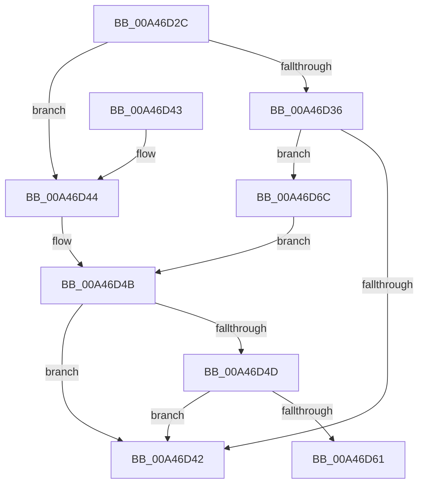

# PpmIdleUpdatePlatformDependencies

- RVA: `0x00A46D2C`–`0x00A46D73` (길이 `71` bytes)
- VA: `0x0000000140A46D2C`
- 실행 섹션: `PAGE`
- PDB 이름 있음: `예`; PDB Function 태그: `예`
- unwind 정보 RVA: `0x000DB714`
- 디코드: `20`개 명령, `71/71` bytes 표시
- 미해석 바이트: `0` (있으면 어셈블리에 `.byte`로 보존)

> 이 문서는 커널 이미지의 기계어와 PDB 기호를 분석해 생성했습니다. 4번과 5번은 함수 원형과 자료형을 바이너리 사용 방식에서 추정한 C 해석이며 원본 소스 복구 결과는 아닙니다.

## 1. Dependencies

- 직접 호출 지점: **0**; 고유 호출 대상: **0**
- 직접 호출자로 확인된 함수: **1**
- RIP 상대 이미지 참조: **3**

### Outgoing calls
- 직접 디코드된 call 명령이 없습니다.

### Direct callers
- [PpmInstallPlatformIdleStates](PpmInstallPlatformIdleStates_function_00A46A80.md) at `0x00A46AEB`

### Static image references
- `0x00A46D2C` → RVA `0x00FC6A90` (`ALMOSTRO`; read)
- `0x00A46D36` → RVA `0x00FC6AB8` (`ALMOSTRO`; read)
- `0x00A46D44` → RVA `0x00FC6A97` (`ALMOSTRO`; read)

## 2. Other-region calls and transfers

- 다른 실행 섹션으로 향하는 call: **0**
- call이 아닌 외부 분기/꼬리 이동: **1**
  - `0x00A46D67` → `0x00B3B64A` (`tail-transfer`)

## 3. Assembly (complete function range)

```asm
00A46D2C  8B 05 5E FD 57 00               mov eax, dword ptr [rip + 0x57fd5e]
00A46D32  A8 02                           test al, 2
00A46D34  74 0E                           je 0x140a46d44
00A46D36  8B 05 7C FD 57 00               mov eax, dword ptr [rip + 0x57fd7c]
00A46D3C  0F BA E0 1C                     bt eax, 0x1c
00A46D40  73 2A                           jae 0x140a46d6c
00A46D42  C3                              ret
00A46D43  CC                              int3
00A46D44  80 3D 4C FD 57 00 00            cmp byte ptr [rip + 0x57fd4c], 0
00A46D4B  74 F5                           je 0x140a46d42
00A46D4D  8B 05 65 FD 57 00               mov eax, dword ptr [rip + 0x57fd65]
00A46D53  45 33 C0                        xor r8d, r8d
00A46D56  25 00 02 00 00                  and eax, 0x200
00A46D5B  44 39 41 04                     cmp dword ptr [rcx + 4], r8d
00A46D5F  76 E1                           jbe 0x140a46d42
00A46D61  85 C0                           test eax, eax
00A46D63  41 0F 95 C3                     setne r11b
00A46D67  E9 DE 48 0F 00                  jmp 0x140b3b64a
00A46D6C  A9 00 04 00 00                  test eax, 0x400
00A46D71  EB D8                           jmp 0x140a46d4b
```

## 4. C-style interpretation (structured pseudocode)

```c
__int64 __fastcall PpmIdleUpdatePlatformDependencies(__int64 a1, __int64 a2, int a3)
{
    __int64 result;
    __int64 v_r11;

    if ((((unsigned __int8)((unsigned int)(*(unsigned int *)(v_rip + 5766494)))) & (2)) == 0) goto loc_00A46D44;
    if (condition_is_above_or_equal) goto loc_00A46D6C;
loc_00A46D42:
    return (unsigned int)(*(unsigned int *)(v_rip + 5766524));
loc_00A46D44:
loc_00A46D4B:
    if ((*(unsigned __int8 *)(v_rip + 5766476)) == 0) goto loc_00A46D42;
    a3 = 0;
    result = (unsigned int)(((unsigned int)(*(unsigned int *)(v_rip + 5766501))) & (512));
    if ((*(unsigned int *)(a1 + 4)) <= 0) goto loc_00A46D42;
    v_r11 = ((unsigned int)(result) != 0) ? 1 : 0;
loc_00A46D6C:
    goto loc_00A46D4B;
}
```

## 5. (Beta) C Style

```c
int64_t PpmIdleUpdatePlatformDependencies(void *Arg1, int64_t Arg2, int32_t Arg3)
{
    uint8_t *arg1 = (uint8_t *)Arg1;

    int64_t result;
    int64_t local_r11;

    if ((((uint8_t)((uint32_t)(*(uint32_t *)(v_rip + 0x57FD5E)))) & (2)) == 0) goto loc_00A46D44;
    if (condition_is_above_or_equal) goto loc_00A46D6C;
loc_00A46D42:
    return (uint32_t)(*(uint32_t *)(v_rip + 0x57FD7C));
loc_00A46D44:
loc_00A46D4B:
    if ((*(uint8_t *)(v_rip + 0x57FD4C)) == 0) goto loc_00A46D42;
    Arg3 = 0;
    result = (uint32_t)(((uint32_t)(*(uint32_t *)(v_rip + 0x57FD65))) & (512));
    if ((*(uint32_t *)(arg1 + 0x4)) <= 0) goto loc_00A46D42;
    local_r11 = ((uint32_t)(result) != 0) ? 1 : 0;
loc_00A46D6C:
    goto loc_00A46D4B;
}
```

### 관측된 메모리 오프셋

구조체 형식이 확인되지 않은 접근은 인자 기준의 오프셋으로만 기록했습니다.

| 기준 인자 | 오프셋 표현 | 폭 (bit) | 접근 |
|---|---:|---:|---|
| `Arg1` | `+ 0x4` | `32` | `R` |

## 6. Execution-region graph

[열기: 2D/3D 그래프와 함수 탐색 컨트롤 패널](../../../control-panel.html?section=page&rva=0x00A46D2C&view=graph)

- 2D 그래프는 위에서 아래로 흐르고, 3D 그래프는 빈 공간을 드래그해 회전합니다. Shift+드래그는 이동, 휠은 확대·축소, 함수 노드 선택은 대상 보고서 이동입니다.

### Static fallback


