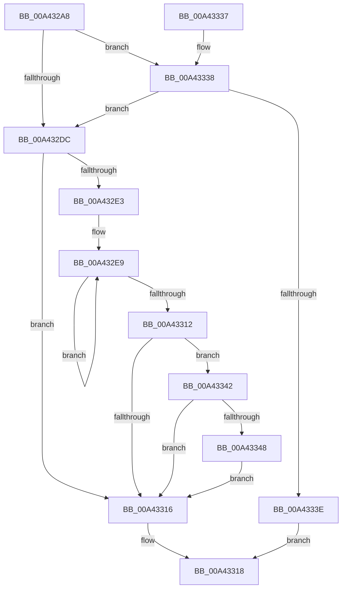

# PpmInfoAdjustSetting

- RVA: `0x00A432A8`–`0x00A43355` (길이 `173` bytes)
- VA: `0x0000000140A432A8`
- 실행 섹션: `PAGE`
- PDB 이름 있음: `예`; PDB Function 태그: `아니요`
- unwind 정보 RVA: `0x000AEFD8`
- 디코드: `55`개 명령, `173/173` bytes 표시
- 미해석 바이트: `0` (있으면 어셈블리에 `.byte`로 보존)

> 이 문서는 커널 이미지의 기계어와 PDB 기호를 분석해 생성했습니다. 4번과 5번은 함수 원형과 자료형을 바이너리 사용 방식에서 추정한 C 해석이며 원본 소스 복구 결과는 아닙니다.

## 1. Dependencies

- 직접 호출 지점: **2**; 고유 호출 대상: **2**
- 직접 호출자로 확인된 함수: **1**
- RIP 상대 이미지 참조: **0**

### Outgoing calls
- `0x00A432FC` → [PpmInfoWriteData](PpmInfoWriteData_function_00A4335C.md) (function, `0x00A4335C`)
- `0x00A4334B` → [PpmPerfComputePerfReductionTolerance](../../text/4D/PpmPerfComputePerfReductionTolerance_function_004D4B40.md) (function, `0x004D4B40`)

### Direct callers
- [PpmSetProfilePolicySetting](../91/PpmSetProfilePolicySetting_function_00915A44.md) at `0x00915BC6`
- [PpmSetProfilePolicySetting](../91/PpmSetProfilePolicySetting_function_00915A44.md) at `0x00915D34`
- [PpmSetProfilePolicySetting](../91/PpmSetProfilePolicySetting_function_00915A44.md) at `0x00915EFF`

### Static image references
- 디코드된 RIP-relative 메모리 참조가 없습니다.

## 2. Other-region calls and transfers

- 다른 실행 섹션으로 향하는 call: **1**
  - `0x00A4334B` → [PpmPerfComputePerfReductionTolerance](../../text/4D/PpmPerfComputePerfReductionTolerance_function_004D4B40.md) (`PAGE` → `.text`)
- 별도 외부 분기/꼬리 이동을 확인하지 못했습니다.

## 3. Assembly (complete function range)

```asm
00A432A8  48 8B C4                        mov rax, rsp
00A432AB  48 89 58 08                     mov qword ptr [rax + 8], rbx
00A432AF  48 89 68 10                     mov qword ptr [rax + 0x10], rbp
00A432B3  48 89 70 18                     mov qword ptr [rax + 0x18], rsi
00A432B7  48 89 78 20                     mov qword ptr [rax + 0x20], rdi
00A432BB  41 54                           push r12
00A432BD  41 56                           push r14
00A432BF  41 57                           push r15
00A432C1  48 83 EC 30                     sub rsp, 0x30
00A432C5  44 8B 7C 24 78                  mov r15d, dword ptr [rsp + 0x78]
00A432CA  45 8B F1                        mov r14d, r9d
00A432CD  41 8B E8                        mov ebp, r8d
00A432D0  48 8B F2                        mov rsi, rdx
00A432D3  48 8B F9                        mov rdi, rcx
00A432D6  44 3B 79 20                     cmp r15d, dword ptr [rcx + 0x20]
00A432DA  72 5C                           jb 0x140a43338
00A432DC  32 DB                           xor bl, bl
00A432DE  45 3B C6                        cmp r8d, r14d
00A432E1  77 33                           ja 0x140a43316
00A432E3  41 BC 01 00 00 00               mov r12d, 1
00A432E9  48 8B 4C 24 70                  mov rcx, qword ptr [rsp + 0x70]
00A432EE  4C 8B CF                        mov r9, rdi
00A432F1  44 8B C5                        mov r8d, ebp
00A432F4  48 89 74 24 20                  mov qword ptr [rsp + 0x20], rsi
00A432F9  41 8B D7                        mov edx, r15d
00A432FC  E8 5B 00 00 00                  call 0x140a4335c
00A43301  84 C0                           test al, al
00A43303  0F B6 DB                        movzx ebx, bl
00A43306  41 0F 45 DC                     cmovne ebx, r12d
00A4330A  41 03 EC                        add ebp, r12d
00A4330D  41 3B EE                        cmp ebp, r14d
00A43310  76 D7                           jbe 0x140a432e9
00A43312  84 DB                           test bl, bl
00A43314  75 2C                           jne 0x140a43342
00A43316  8A C3                           mov al, bl
00A43318  48 8B 5C 24 50                  mov rbx, qword ptr [rsp + 0x50]
00A4331D  48 8B 6C 24 58                  mov rbp, qword ptr [rsp + 0x58]
00A43322  48 8B 74 24 60                  mov rsi, qword ptr [rsp + 0x60]
00A43327  48 8B 7C 24 68                  mov rdi, qword ptr [rsp + 0x68]
00A4332C  48 83 C4 30                     add rsp, 0x30
00A43330  41 5F                           pop r15
00A43332  41 5E                           pop r14
00A43334  41 5C                           pop r12
00A43336  C3                              ret
00A43337  CC                              int3
00A43338  F6 41 25 08                     test byte ptr [rcx + 0x25], 8
00A4333C  75 9E                           jne 0x140a432dc
00A4333E  32 C0                           xor al, al
00A43340  EB D6                           jmp 0x140a43318
00A43342  80 7F 24 09                     cmp byte ptr [rdi + 0x24], 9
00A43346  75 CE                           jne 0x140a43316
00A43348  8B 4E 44                        mov ecx, dword ptr [rsi + 0x44]
00A4334B  E8 F0 17 A9 FF                  call 0x1404d4b40
00A43350  89 46 4C                        mov dword ptr [rsi + 0x4c], eax
00A43353  EB C1                           jmp 0x140a43316
```

## 4. C-style interpretation (structured pseudocode)

```c
__int64 __fastcall PpmInfoAdjustSetting(__int64 a1, __int64 a2, int a3, int a4, __int64 a5, unsigned int a6)
{
    __int64 result;
    __int64 v_rbp;
    __int64 v_rbx;
    __int64 v_rsp;
    unsigned __int64 v_stack_m28;
    unsigned __int64 v_stack_p10;
    unsigned __int64 v_stack_p18;
    unsigned __int64 v_stack_p20;
    unsigned __int64 v_stack_p8;

    *(unsigned __int64 *)(v_rsp + 8) = v_rbx;
    *(unsigned __int64 *)(v_rsp + 16) = v_rbp;
    *(unsigned __int64 *)(v_rsp + 24) = v_rsi;
    *(unsigned __int64 *)(v_rsp + 32) = v_rdi;
    v_rsp = (v_rsp) - (48);
    if (((unsigned int)((unsigned int)(a6))) < (*(unsigned int *)(a1 + 32))) goto loc_00A43338;
loc_00A432DC:
    v_rbx = 0;
    if (a3 > ((unsigned int)((unsigned int)(a4)))) goto loc_00A43316;
loc_00A432E9:
    v_stack_m28 = a2;
    result = PpmInfoWriteData(a5, (unsigned int)((unsigned int)((unsigned int)(a6))), (unsigned int)((unsigned int)((unsigned int)(a3))), a1);
    v_rbx = 0;
    if ((unsigned __int8)(result) != 0) { v_rbx = 1; }
    v_rbp = (unsigned int)(((unsigned int)(a3)) + (1));
    if (((unsigned int)(v_rbp)) <= ((unsigned int)((unsigned int)(a4)))) goto loc_00A432E9;
    if ((unsigned __int8)(v_rbx) != 0) goto loc_00A43342;
loc_00A43316:
loc_00A43318:
    v_rsp = (v_rsp) + (48);
    return (unsigned __int8)(v_rbx);
loc_00A43338:
    if (((*(unsigned __int8 *)(a5 + 37)) & (8)) != 0) goto loc_00A432DC;
    result = 0;
    goto loc_00A43318;
loc_00A43342:
    if ((*(unsigned __int8 *)(v_stack_p20 + 36)) != 9) goto loc_00A43316;
    result = PpmPerfComputePerfReductionTolerance((unsigned int)(*(unsigned int *)(v_stack_p18 + 68)), (unsigned int)((unsigned int)((unsigned int)(a6))), (unsigned int)((unsigned int)((unsigned int)(a3))), a1);
    *(unsigned int *)(v_stack_p18 + 76) = (unsigned int)(result);
    goto loc_00A43316;
}
```

## 5. (Beta) C Style

```c
int64_t PpmInfoAdjustSetting(void *Arg1, void *Arg2, int32_t Arg3, int32_t Arg4, int64_t Arg5, uint32_t Arg6)
{
    uint8_t *arg1 = (uint8_t *)Arg1;
    uint8_t *arg2 = (uint8_t *)Arg2;

    int64_t result;
    int64_t local_rbp;
    int64_t local_rbx;
    int64_t local_rsp;
    uint64_t v_stack_m28;
    uint64_t v_stack_p10;
    uint64_t v_stack_p18;
    uint64_t v_stack_p20;
    uint64_t v_stack_p8;

    *(uint64_t *)(local_rsp + 0x8) = local_rbx;
    *(uint64_t *)(local_rsp + 0x10) = local_rbp;
    *(uint64_t *)(local_rsp + 0x18) = local_rsi;
    *(uint64_t *)(local_rsp + 0x20) = local_rdi;
    local_rsp = (local_rsp) - (48);
    if (((uint32_t)((uint32_t)(Arg6))) < (*(uint32_t *)(arg1 + 0x20))) goto loc_00A43338;
loc_00A432DC:
    local_rbx = 0;
    if (Arg3 > ((uint32_t)((uint32_t)(Arg4)))) goto loc_00A43316;
loc_00A432E9:
    v_stack_m28 = Arg2;
    result = PpmInfoWriteData(Arg5, (uint32_t)((uint32_t)((uint32_t)(Arg6))), (uint32_t)((uint32_t)((uint32_t)(Arg3))), Arg1);
    local_rbx = 0;
    if ((uint8_t)(result) != 0) { local_rbx = 1; }
    local_rbp = (uint32_t)(((uint32_t)(Arg3)) + (1));
    if (((uint32_t)(local_rbp)) <= ((uint32_t)((uint32_t)(Arg4)))) goto loc_00A432E9;
    if ((uint8_t)(local_rbx) != 0) goto loc_00A43342;
loc_00A43316:
loc_00A43318:
    local_rsp = (local_rsp) + (48);
    return (uint8_t)(local_rbx);
loc_00A43338:
    if (((*(uint8_t *)(Arg5 + 0x25)) & (8)) != 0) goto loc_00A432DC;
    result = 0;
    goto loc_00A43318;
loc_00A43342:
    if ((*(uint8_t *)(v_stack_p20 + 0x24)) != 9) goto loc_00A43316;
    result = PpmPerfComputePerfReductionTolerance((uint32_t)(*(uint32_t *)(v_stack_p18 + 0x44)), (uint32_t)((uint32_t)((uint32_t)(Arg6))), (uint32_t)((uint32_t)((uint32_t)(Arg3))), Arg1);
    *(uint32_t *)(v_stack_p18 + 0x4C) = (uint32_t)(result);
    goto loc_00A43316;
}
```

### 관측된 메모리 오프셋

구조체 형식이 확인되지 않은 접근은 인자 기준의 오프셋으로만 기록했습니다.

| 기준 인자 | 오프셋 표현 | 폭 (bit) | 접근 |
|---|---:|---:|---|
| `Arg1` | `+ 0x20` | `32` | `R` |
| `Arg1` | `+ 0x24` | `8` | `R` |
| `Arg1` | `+ 0x25` | `8` | `R` |
| `Arg2` | `+ 0x44` | `32` | `R` |
| `Arg2` | `+ 0x4C` | `32` | `W` |

## 6. Execution-region graph

[열기: 2D/3D 그래프와 함수 탐색 컨트롤 패널](../../../control-panel.html?section=page&rva=0x00A432A8&view=graph)

- 2D 그래프는 위에서 아래로 흐르고, 3D 그래프는 빈 공간을 드래그해 회전합니다. Shift+드래그는 이동, 휠은 확대·축소, 함수 노드 선택은 대상 보고서 이동입니다.

### Static fallback


