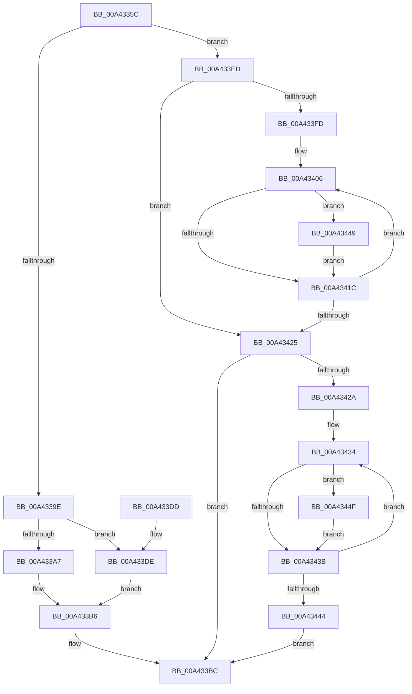

# PpmInfoWriteData

- RVA: `0x00A4335C`–`0x00A43455` (길이 `249` bytes)
- VA: `0x0000000140A4335C`
- 실행 섹션: `PAGE`
- PDB 이름 있음: `예`; PDB Function 태그: `아니요`
- unwind 정보 RVA: `0x000AEFF8`
- 디코드: `82`개 명령, `249/249` bytes 표시
- 미해석 바이트: `0` (있으면 어셈블리에 `.byte`로 보존)

> 이 문서는 커널 이미지의 기계어와 PDB 기호를 분석해 생성했습니다. 4번과 5번은 함수 원형과 자료형을 바이너리 사용 방식에서 추정한 C 해석이며 원본 소스 복구 결과는 아닙니다.

## 1. Dependencies

- 직접 호출 지점: **3**; 고유 호출 대상: **1**
- 직접 호출자로 확인된 함수: **1**
- RIP 상대 이미지 참조: **0**

### Outgoing calls
- `0x00A433AE` → [PpmInfoApplyMinMaxConstraint](../../text/4A/PpmInfoApplyMinMaxConstraint_function_004A0FA0.md) (function, `0x004A0FA0`)
- `0x00A433E3` → [PpmInfoApplyMinMaxConstraint](../../text/4A/PpmInfoApplyMinMaxConstraint_function_004A0FA0.md) (function, `0x004A0FA0`)
- `0x00A4340E` → [PpmInfoApplyMinMaxConstraint](../../text/4A/PpmInfoApplyMinMaxConstraint_function_004A0FA0.md) (function, `0x004A0FA0`)

### Direct callers
- [PpmInfoAdjustSetting](PpmInfoAdjustSetting_function_00A432A8.md) at `0x00A432FC`

### Static image references
- 디코드된 RIP-relative 메모리 참조가 없습니다.

## 2. Other-region calls and transfers

- 다른 실행 섹션으로 향하는 call: **3**
  - `0x00A433AE` → [PpmInfoApplyMinMaxConstraint](../../text/4A/PpmInfoApplyMinMaxConstraint_function_004A0FA0.md) (`PAGE` → `.text`)
  - `0x00A433E3` → [PpmInfoApplyMinMaxConstraint](../../text/4A/PpmInfoApplyMinMaxConstraint_function_004A0FA0.md) (`PAGE` → `.text`)
  - `0x00A4340E` → [PpmInfoApplyMinMaxConstraint](../../text/4A/PpmInfoApplyMinMaxConstraint_function_004A0FA0.md) (`PAGE` → `.text`)
- 별도 외부 분기/꼬리 이동을 확인하지 못했습니다.

## 3. Assembly (complete function range)

```asm
00A4335C  48 8B C4                        mov rax, rsp
00A4335F  48 89 58 08                     mov qword ptr [rax + 8], rbx
00A43363  48 89 68 10                     mov qword ptr [rax + 0x10], rbp
00A43367  48 89 70 18                     mov qword ptr [rax + 0x18], rsi
00A4336B  48 89 78 20                     mov qword ptr [rax + 0x20], rdi
00A4336F  41 54                           push r12
00A43371  41 56                           push r14
00A43373  41 57                           push r15
00A43375  48 83 EC 20                     sub rsp, 0x20
00A43379  45 8B 59 20                     mov r11d, dword ptr [r9 + 0x20]
00A4337D  33 DB                           xor ebx, ebx
00A4337F  45 8B D3                        mov r10d, r11d
00A43382  49 8B E9                        mov rbp, r9
00A43385  45 0F AF D0                     imul r10d, r8d
00A43389  8B FA                           mov edi, edx
00A4338B  4C 8B F1                        mov r14, rcx
00A4338E  4D 03 51 18                     add r10, qword ptr [r9 + 0x18]
00A43392  4C 03 54 24 60                  add r10, qword ptr [rsp + 0x60]
00A43397  41 F6 41 25 08                  test byte ptr [r9 + 0x25], 8
00A4339C  75 4F                           jne 0x140a433ed
00A4339E  49 8B D1                        mov rdx, r9
00A433A1  41 83 FB 01                     cmp r11d, 1
00A433A5  75 37                           jne 0x140a433de
00A433A7  0F B6 09                        movzx ecx, byte ptr [rcx]
00A433AA  45 0F B6 1A                     movzx r11d, byte ptr [r10]
00A433AE  E8 ED DB A5 FF                  call 0x1404a0fa0
00A433B3  41 88 02                        mov byte ptr [r10], al
00A433B6  44 3B D8                        cmp r11d, eax
00A433B9  0F 95 C3                        setne bl
00A433BC  48 8B 6C 24 48                  mov rbp, qword ptr [rsp + 0x48]
00A433C1  8A C3                           mov al, bl
00A433C3  48 8B 5C 24 40                  mov rbx, qword ptr [rsp + 0x40]
00A433C8  48 8B 74 24 50                  mov rsi, qword ptr [rsp + 0x50]
00A433CD  48 8B 7C 24 58                  mov rdi, qword ptr [rsp + 0x58]
00A433D2  48 83 C4 20                     add rsp, 0x20
00A433D6  41 5F                           pop r15
00A433D8  41 5E                           pop r14
00A433DA  41 5C                           pop r12
00A433DC  C3                              ret
00A433DD  CC                              int3
00A433DE  8B 09                           mov ecx, dword ptr [rcx]
00A433E0  45 8B 1A                        mov r11d, dword ptr [r10]
00A433E3  E8 B8 DB A5 FF                  call 0x1404a0fa0
00A433E8  41 89 02                        mov dword ptr [r10], eax
00A433EB  EB C9                           jmp 0x140a433b6
00A433ED  41 3B FB                        cmp edi, r11d
00A433F0  8B D3                           mov edx, ebx
00A433F2  41 0F 43 FB                     cmovae edi, r11d
00A433F6  44 8B FF                        mov r15d, edi
00A433F9  85 FF                           test edi, edi
00A433FB  74 28                           je 0x140a43425
00A433FD  49 8B F2                        mov rsi, r10
00A43400  4D 2B F2                        sub r14, r10
00A43403  45 8B E7                        mov r12d, r15d
00A43406  41 0F B6 0C 36                  movzx ecx, byte ptr [r14 + rsi]
00A4340B  48 8B D5                        mov rdx, rbp
00A4340E  E8 8D DB A5 FF                  call 0x1404a0fa0
00A43413  8B D0                           mov edx, eax
00A43415  0F B6 06                        movzx eax, byte ptr [rsi]
00A43418  3B C2                           cmp eax, edx
00A4341A  75 2D                           jne 0x140a43449
00A4341C  48 FF C6                        inc rsi
00A4341F  49 83 EC 01                     sub r12, 1
00A43423  75 E1                           jne 0x140a43406
00A43425  41 3B FB                        cmp edi, r11d
00A43428  73 92                           jae 0x140a433bc
00A4342A  44 2B DF                        sub r11d, edi
00A4342D  4A 8D 0C 17                     lea rcx, [rdi + r10]
00A43431  45 8B C3                        mov r8d, r11d
00A43434  0F B6 01                        movzx eax, byte ptr [rcx]
00A43437  3B C2                           cmp eax, edx
00A43439  75 14                           jne 0x140a4344f
00A4343B  48 FF C1                        inc rcx
00A4343E  49 83 E8 01                     sub r8, 1
00A43442  75 F0                           jne 0x140a43434
00A43444  E9 73 FF FF FF                  jmp 0x140a433bc
00A43449  B3 01                           mov bl, 1
00A4344B  88 16                           mov byte ptr [rsi], dl
00A4344D  EB CD                           jmp 0x140a4341c
00A4344F  B3 01                           mov bl, 1
00A43451  88 11                           mov byte ptr [rcx], dl
00A43453  EB E6                           jmp 0x140a4343b
```

## 4. C-style interpretation (structured pseudocode)

```c
__int64 __fastcall PpmInfoWriteData(__int64 a1, int a2, int a3, __int64 a4, __int64 a5)
{
    __int64 result;
    __int64 v_r10;
    __int64 v_r11;
    __int64 v_r12;
    __int64 v_r14;
    __int64 v_rbx;
    __int64 v_rdi;
    __int64 v_rsi;
    __int64 v_rsp;
    unsigned __int64 v_stack_p10;
    unsigned __int64 v_stack_p18;
    unsigned __int64 v_stack_p20;
    unsigned __int64 v_stack_p8;

    *(unsigned __int64 *)(v_rsp + 8) = v_rbx;
    *(unsigned __int64 *)(v_rsp + 16) = v_rbp;
    *(unsigned __int64 *)(v_rsp + 24) = v_rsi;
    *(unsigned __int64 *)(v_rsp + 32) = v_rdi;
    v_rsp = (v_rsp) - (32);
    v_rbx = 0;
    v_r10 = (unsigned int)(((unsigned int)((unsigned int)((unsigned int)(*(unsigned int *)(a4 + 32))))) * (a3));
    v_r10 = (v_r10) + (*(unsigned __int64 *)(a4 + 24));
    v_r10 = (v_r10) + (a5);
    if (((*(unsigned __int8 *)(a4 + 37)) & (8)) != 0) goto loc_00A433ED;
    if (((unsigned int)((unsigned int)(*(unsigned int *)(a4 + 32)))) != 1) goto loc_00A433DE;
    result = PpmInfoApplyMinMaxConstraint(*(unsigned __int8 *)(a1), a4, a3, a4);
    *(unsigned __int8 *)(v_r10) = (unsigned __int8)(result);
loc_00A433B6:
    v_rbx = (((unsigned int)(*(unsigned __int8 *)(v_r10))) != ((unsigned int)(result))) ? 1 : 0;
loc_00A433BC:
    v_rsp = (v_rsp) + (32);
    return (unsigned __int8)(v_rbx);
loc_00A433DE:
    result = PpmInfoApplyMinMaxConstraint((unsigned int)(*(unsigned int *)(*(unsigned __int8 *)(a1))), a4, a3, a4);
    *(unsigned int *)(v_r10) = (unsigned int)(result);
    goto loc_00A433B6;
loc_00A433ED:
    v_rdi = v_stack_p20;
    if (((unsigned int)(v_stack_p20)) >= ((unsigned int)((unsigned int)(*(unsigned int *)(v_r10))))) { v_rdi = (unsigned int)((unsigned int)(*(unsigned int *)(v_r10))); }
    if ((unsigned int)(v_rdi) == 0) goto loc_00A43425;
    v_r14 = (a1) - (v_r10);
loc_00A43406:
    result = PpmInfoApplyMinMaxConstraint(*(unsigned __int8 *)(v_r14 + v_r10 * 1), v_stack_p10, a3, a4);
    if (((unsigned int)(*(unsigned __int8 *)(v_r10))) != ((unsigned int)((unsigned int)((unsigned int)(result))))) goto loc_00A43449;
loc_00A4341C:
    v_rsi = (v_r10) + 1;
    v_r12 = ((unsigned int)((unsigned int)((unsigned int)((unsigned int)(v_rdi))))) - (1);
    if (condition_is_not_equal) goto loc_00A43406;
loc_00A43425:
    if (((unsigned int)(v_rdi)) >= ((unsigned int)((unsigned int)(*(unsigned int *)(v_r10))))) goto loc_00A433BC;
    v_r11 = (unsigned int)(((unsigned int)(*(unsigned int *)(v_r10))) - ((unsigned int)(v_rdi)));
loc_00A43434:
    if (((unsigned int)(*(unsigned __int8 *)(v_rdi + v_r10 * 1))) != ((unsigned int)((unsigned int)((unsigned int)(result))))) goto loc_00A4344F;
loc_00A4343B:
    a1 = (v_rdi + v_r10 * 1) + 1;
    a3 = ((unsigned int)((unsigned int)(v_r11))) - (1);
    if (condition_is_not_equal) goto loc_00A43434;
    goto loc_00A433BC;
loc_00A43449:
    *(unsigned __int8 *)(v_rsi) = (unsigned __int8)((unsigned int)((unsigned int)(result)));
    goto loc_00A4341C;
loc_00A4344F:
    *(unsigned __int8 *)(a1) = (unsigned __int8)((unsigned int)((unsigned int)(result)));
    goto loc_00A4343B;
}
```

## 5. (Beta) C Style

```c
int64_t PpmInfoWriteData(void *Arg1, int32_t Arg2, int32_t Arg3, void *Arg4, int64_t Arg5)
{
    uint8_t *arg1 = (uint8_t *)Arg1;
    uint8_t *arg4 = (uint8_t *)Arg4;

    int64_t result;
    int64_t local_r10;
    int64_t local_r11;
    int64_t local_r12;
    int64_t local_r14;
    int64_t local_rbx;
    int64_t local_rdi;
    int64_t local_rsi;
    int64_t local_rsp;
    uint64_t v_stack_p10;
    uint64_t v_stack_p18;
    uint64_t v_stack_p20;
    uint64_t v_stack_p8;

    *(uint64_t *)(local_rsp + 0x8) = local_rbx;
    *(uint64_t *)(local_rsp + 0x10) = local_rbp;
    *(uint64_t *)(local_rsp + 0x18) = local_rsi;
    *(uint64_t *)(local_rsp + 0x20) = local_rdi;
    local_rsp = (local_rsp) - (32);
    local_rbx = 0;
    local_r10 = (uint32_t)(((uint32_t)((uint32_t)((uint32_t)(*(uint32_t *)(arg4 + 0x20))))) * (Arg3));
    local_r10 = (local_r10) + (*(uint64_t *)(arg4 + 0x18));
    local_r10 = (local_r10) + (Arg5);
    if (((*(uint8_t *)(arg4 + 0x25)) & (8)) != 0) goto loc_00A433ED;
    if (((uint32_t)((uint32_t)(*(uint32_t *)(arg4 + 0x20)))) != 1) goto loc_00A433DE;
    result = PpmInfoApplyMinMaxConstraint(*(uint8_t *)(arg1), Arg4, Arg3, Arg4);
    *(uint8_t *)(local_r10) = (uint8_t)(result);
loc_00A433B6:
    local_rbx = (((uint32_t)(*(uint8_t *)(local_r10))) != ((uint32_t)(result))) ? 1 : 0;
loc_00A433BC:
    local_rsp = (local_rsp) + (32);
    return (uint8_t)(local_rbx);
loc_00A433DE:
    result = PpmInfoApplyMinMaxConstraint((uint32_t)(*(uint32_t *)(*(uint8_t *)(arg1))), Arg4, Arg3, Arg4);
    *(uint32_t *)(local_r10) = (uint32_t)(result);
    goto loc_00A433B6;
loc_00A433ED:
    local_rdi = v_stack_p20;
    if (((uint32_t)(v_stack_p20)) >= ((uint32_t)((uint32_t)(*(uint32_t *)(local_r10))))) { local_rdi = (uint32_t)((uint32_t)(*(uint32_t *)(local_r10))); }
    if ((uint32_t)(local_rdi) == 0) goto loc_00A43425;
    local_r14 = (Arg1) - (local_r10);
loc_00A43406:
    result = PpmInfoApplyMinMaxConstraint(*(uint8_t *)(local_r14 + local_r10 * 1), v_stack_p10, Arg3, Arg4);
    if (((uint32_t)(*(uint8_t *)(local_r10))) != ((uint32_t)((uint32_t)((uint32_t)(result))))) goto loc_00A43449;
loc_00A4341C:
    local_rsi = (local_r10) + 1;
    local_r12 = ((uint32_t)((uint32_t)((uint32_t)((uint32_t)(local_rdi))))) - (1);
    if (condition_is_not_equal) goto loc_00A43406;
loc_00A43425:
    if (((uint32_t)(local_rdi)) >= ((uint32_t)((uint32_t)(*(uint32_t *)(local_r10))))) goto loc_00A433BC;
    local_r11 = (uint32_t)(((uint32_t)(*(uint32_t *)(local_r10))) - ((uint32_t)(local_rdi)));
loc_00A43434:
    if (((uint32_t)(*(uint8_t *)(local_rdi + local_r10 * 1))) != ((uint32_t)((uint32_t)((uint32_t)(result))))) goto loc_00A4344F;
loc_00A4343B:
    Arg1 = (local_rdi + local_r10 * 1) + 1;
    Arg3 = ((uint32_t)((uint32_t)(local_r11))) - (1);
    if (condition_is_not_equal) goto loc_00A43434;
    goto loc_00A433BC;
loc_00A43449:
    *(uint8_t *)(local_rsi) = (uint8_t)((uint32_t)((uint32_t)(result)));
    goto loc_00A4341C;
loc_00A4344F:
    *(uint8_t *)(arg1) = (uint8_t)((uint32_t)((uint32_t)(result)));
    goto loc_00A4343B;
}
```

### 관측된 메모리 오프셋

구조체 형식이 확인되지 않은 접근은 인자 기준의 오프셋으로만 기록했습니다.

| 기준 인자 | 오프셋 표현 | 폭 (bit) | 접근 |
|---|---:|---:|---|
| `Arg1` | `+ 0x0` | `8` | `R` |
| `Arg1` | `+ 0x0` | `32` | `R` |
| `Arg1` | `+ 0x0 + rsi*1` | `8` | `R` |
| `Arg4` | `+ 0x18` | `64` | `R` |
| `Arg4` | `+ 0x20` | `32` | `R` |
| `Arg4` | `+ 0x25` | `8` | `R` |

## 6. Execution-region graph

[열기: 2D/3D 그래프와 함수 탐색 컨트롤 패널](../../../control-panel.html?section=page&rva=0x00A4335C&view=graph)

- 2D 그래프는 위에서 아래로 흐르고, 3D 그래프는 빈 공간을 드래그해 회전합니다. Shift+드래그는 이동, 휠은 확대·축소, 함수 노드 선택은 대상 보고서 이동입니다.

### Static fallback


