# PpmInstallPlatformIdleStates

- RVA: `0x00A46A80`–`0x00A46D26` (길이 `678` bytes)
- VA: `0x0000000140A46A80`
- 실행 섹션: `PAGE`
- PDB 이름 있음: `예`; PDB Function 태그: `예`
- unwind 정보 RVA: `0x000AF820`
- 디코드: `184`개 명령, `678/678` bytes 표시
- 미해석 바이트: `0` (있으면 어셈블리에 `.byte`로 보존)

> 이 문서는 커널 이미지의 기계어와 PDB 기호를 분석해 생성했습니다. 4번과 5번은 함수 원형과 자료형을 바이너리 사용 방식에서 추정한 C 해석이며 원본 소스 복구 결과는 아닙니다.

## 1. Dependencies

- 직접 호출 지점: **7**; 고유 호출 대상: **6**
- 직접 호출자로 확인된 함수: **0**
- RIP 상대 이미지 참조: **3**

### Outgoing calls
- `0x00A46AA6` → [PopAcquireRwLockExclusive](../../text/43/PopAcquireRwLockExclusive_function_00430B44.md) (function, `0x00430B44`)
- `0x00A46ACF` → [PopReleaseRwLock](../../text/2D/PopReleaseRwLock_function_002DFBBC.md) (function, `0x002DFBBC`)
- `0x00A46AEB` → [PpmIdleUpdatePlatformDependencies](PpmIdleUpdatePlatformDependencies_function_00A46D2C.md) (function, `0x00A46D2C`)
- `0x00A46B16` → [KeGetPrcb](../../text/2D/KeGetPrcb_function_002D85D0.md) (function, `0x002D85D0`)
- `0x00A46C65` → [KeGetPrcb](../../text/2D/KeGetPrcb_function_002D85D0.md) (function, `0x002D85D0`)
- `0x00A46D09` → [KeGetProcessorIndexFromNumber](../../text/2D/KeGetProcessorIndexFromNumber_function_002DD2D0.md) (function, `0x002DD2D0`)
- `0x00A46D1C` → [PpmEnableCoordinatedIdleStates](../75/PpmEnableCoordinatedIdleStates_function_00754CD0.md) (function, `0x00754CD0`)

### Direct callers
- 이 함수 시작 RVA로 연결되는 직접 call은 확인되지 않았습니다. 간접 호출은 완전히 역산할 수 없습니다.

### Static image references
- `0x00A46A9A` → RVA `0x00F0CA70` (`.data`; read)
- `0x00A46AAB` → RVA `0x00FC6AD0` (`ALMOSTRO`; read)
- `0x00A46AF0` → RVA `0x00FC6A80` (`ALMOSTRO`; read)

## 2. Other-region calls and transfers

- 다른 실행 섹션으로 향하는 call: **5**
  - `0x00A46AA6` → [PopAcquireRwLockExclusive](../../text/43/PopAcquireRwLockExclusive_function_00430B44.md) (`PAGE` → `.text`)
  - `0x00A46ACF` → [PopReleaseRwLock](../../text/2D/PopReleaseRwLock_function_002DFBBC.md) (`PAGE` → `.text`)
  - `0x00A46B16` → [KeGetPrcb](../../text/2D/KeGetPrcb_function_002D85D0.md) (`PAGE` → `.text`)
  - `0x00A46C65` → [KeGetPrcb](../../text/2D/KeGetPrcb_function_002D85D0.md) (`PAGE` → `.text`)
  - `0x00A46D09` → [KeGetProcessorIndexFromNumber](../../text/2D/KeGetProcessorIndexFromNumber_function_002DD2D0.md) (`PAGE` → `.text`)
- call이 아닌 외부 분기/꼬리 이동: **2**
  - `0x00A46B4D` → [sub_00B3B244](../B3/Unknown_function_00B3B244.md) (`tail-transfer`)
  - `0x00A46C41` → [sub_00B3B244 + 0x3B3](../B3/Unknown_function_00B3B244.md) (`tail-transfer`)

## 3. Assembly (complete function range)

```asm
00A46A80  48 89 4C 24 08                  mov qword ptr [rsp + 8], rcx
00A46A85  53                              push rbx
00A46A86  55                              push rbp
00A46A87  56                              push rsi
00A46A88  57                              push rdi
00A46A89  41 54                           push r12
00A46A8B  41 55                           push r13
00A46A8D  41 56                           push r14
00A46A8F  41 57                           push r15
00A46A91  48 83 EC 48                     sub rsp, 0x48
00A46A95  4C 8B F9                        mov r15, rcx
00A46A98  33 F6                           xor esi, esi
00A46A9A  48 8D 0D CF 5F 4C 00            lea rcx, [rip + 0x4c5fcf]
00A46AA1  48 89 74 24 30                  mov qword ptr [rsp + 0x30], rsi
00A46AA6  E8 99 A0 9E FF                  call 0x140430b44
00A46AAB  48 39 35 1E 00 58 00            cmp qword ptr [rip + 0x58001e], rsi
00A46AB2  8D 6E 01                        lea ebp, [rsi + 1]
00A46AB5  0F 85 3A 02 00 00               jne 0x140a46cf5
00A46ABB  41 8B 7F 04                     mov edi, dword ptr [r15 + 4]
00A46ABF  85 FF                           test edi, edi
00A46AC1  75 25                           jne 0x140a46ae8
00A46AC3  BE 0D 00 00 C0                  mov esi, 0xc000000d
00A46AC8  48 8D 0D A1 5F 4C 00            lea rcx, [rip + 0x4c5fa1]
00A46ACF  E8 E8 90 89 FF                  call 0x1402dfbbc
00A46AD4  8B C6                           mov eax, esi
00A46AD6  48 83 C4 48                     add rsp, 0x48
00A46ADA  41 5F                           pop r15
00A46ADC  41 5E                           pop r14
00A46ADE  41 5D                           pop r13
00A46AE0  41 5C                           pop r12
00A46AE2  5F                              pop rdi
00A46AE3  5E                              pop rsi
00A46AE4  5D                              pop rbp
00A46AE5  5B                              pop rbx
00A46AE6  C3                              ret
00A46AE7  CC                              int3
00A46AE8  49 8B CF                        mov rcx, r15
00A46AEB  E8 3C 02 00 00                  call 0x140a46d2c
00A46AF0  44 8B 25 89 FF 57 00            mov r12d, dword ptr [rip + 0x57ff89]
00A46AF7  8B D6                           mov edx, esi
00A46AF9  45 8B 47 04                     mov r8d, dword ptr [r15 + 4]
00A46AFD  44 89 A4 24 A0 00 00 00         mov dword ptr [rsp + 0xa0], r12d
00A46B05  41 3B D0                        cmp edx, r8d
00A46B08  72 25                           jb 0x140a46b2f
00A46B0A  44 8B EE                        mov r13d, esi
00A46B0D  8B DE                           mov ebx, esi
00A46B0F  41 3B DC                        cmp ebx, r12d
00A46B12  73 2F                           jae 0x140a46b43
00A46B14  8B CB                           mov ecx, ebx
00A46B16  E8 B5 1A 89 FF                  call 0x1402d85d0
00A46B1B  48 8B 88 40 88 00 00            mov rcx, qword ptr [rax + 0x8840]
00A46B22  48 85 C9                        test rcx, rcx
00A46B25  74 9C                           je 0x140a46ac3
00A46B27  44 03 69 28                     add r13d, dword ptr [rcx + 0x28]
00A46B2B  03 DD                           add ebx, ebp
00A46B2D  EB E0                           jmp 0x140a46b0f
00A46B2F  8B C2                           mov eax, edx
00A46B31  48 8D 0C 40                     lea rcx, [rax + rax*2]
00A46B35  48 03 C9                        add rcx, rcx
00A46B38  45 39 64 CF 40                  cmp dword ptr [r15 + rcx*8 + 0x40], r12d
00A46B3D  77 84                           ja 0x140a46ac3
00A46B3F  03 D5                           add edx, ebp
00A46B41  EB C2                           jmp 0x140a46b05
00A46B43  4C 8B 35 86 FF 57 00            mov r14, qword ptr [rip + 0x57ff86]
00A46B4A  4D 85 F6                        test r14, r14
00A46B4D  0F 84 F1 46 0F 00               je 0x140b3b244
00A46B53  45 39 66 04                     cmp dword ptr [r14 + 4], r12d
00A46B57  0F 85 66 FF FF FF               jne 0x140a46ac3
00A46B5D  41 39 3E                        cmp dword ptr [r14], edi
00A46B60  0F 85 5D FF FF FF               jne 0x140a46ac3
00A46B66  41 39 77 04                     cmp dword ptr [r15 + 4], esi
00A46B6A  0F 86 EC 00 00 00               jbe 0x140a46c5c
00A46B70  44 8B E6                        mov r12d, esi
00A46B73  41 8B C4                        mov eax, r12d
00A46B76  44 8B CE                        mov r9d, esi
00A46B79  48 69 D8 C0 01 00 00            imul rbx, rax, 0x1c0
00A46B80  4C 8D 68 01                     lea r13, [rax + 1]
00A46B84  4F 8D 6C 6D 00                  lea r13, [r13 + r13*2]
00A46B89  49 C1 E5 04                     shl r13, 4
00A46B8D  4D 03 EF                        add r13, r15
00A46B90  41 8B 45 08                     mov eax, dword ptr [r13 + 8]
00A46B94  42 89 44 33 48                  mov dword ptr [rbx + r14 + 0x48], eax
00A46B99  41 8B 45 0C                     mov eax, dword ptr [r13 + 0xc]
00A46B9D  42 89 44 33 4C                  mov dword ptr [rbx + r14 + 0x4c], eax
00A46BA2  41 39 75 10                     cmp dword ptr [r13 + 0x10], esi
00A46BA6  0F 86 91 00 00 00               jbe 0x140a46c3d
00A46BAC  4D 8B 5D 28                     mov r11, qword ptr [r13 + 0x28]
00A46BB0  8B CE                           mov ecx, esi
00A46BB2  4E 8B BC 33 98 01 00 00         mov r15, qword ptr [rbx + r14 + 0x198]
00A46BBA  45 8B D1                        mov r10d, r9d
00A46BBD  43 8B 04 D3                     mov eax, dword ptr [r11 + r10*8]
00A46BC1  48 8D 3C 40                     lea rdi, [rax + rax*2]
00A46BC5  41 8B 44 FF 08                  mov eax, dword ptr [r15 + rdi*8 + 8]
00A46BCA  85 C0                           test eax, eax
00A46BCC  74 5A                           je 0x140a46c28
00A46BCE  4D 8B 44 FF 10                  mov r8, qword ptr [r15 + rdi*8 + 0x10]
00A46BD3  2B C1                           sub eax, ecx
00A46BD5  2B C5                           sub eax, ebp
00A46BD7  0F 57 C0                        xorps xmm0, xmm0
00A46BDA  48 8D 14 40                     lea rdx, [rax + rax*2]
00A46BDE  33 C0                           xor eax, eax
00A46BE0  41 0F 11 04 D0                  movups xmmword ptr [r8 + rdx*8], xmm0
00A46BE5  49 89 44 D0 10                  mov qword ptr [r8 + rdx*8 + 0x10], rax
00A46BEA  41 89 4C D0 04                  mov dword ptr [r8 + rdx*8 + 4], ecx
00A46BEF  41 38 75 04                     cmp byte ptr [r13 + 4], sil
00A46BF3  75 0E                           jne 0x140a46c03
00A46BF5  41 0F B6 45 05                  movzx eax, byte ptr [r13 + 5]
00A46BFA  3B C8                           cmp ecx, eax
00A46BFC  75 05                           jne 0x140a46c03
00A46BFE  41 88 6C D0 01                  mov byte ptr [r8 + rdx*8 + 1], bpl
00A46C03  43 0F B6 44 D3 04               movzx eax, byte ptr [r11 + r10*8 + 4]
00A46C09  3B C8                           cmp ecx, eax
00A46C0B  72 10                           jb 0x140a46c1d
00A46C0D  41 88 6C D0 02                  mov byte ptr [r8 + rdx*8 + 2], bpl
00A46C12  43 38 74 D3 06                  cmp byte ptr [r11 + r10*8 + 6], sil
00A46C17  75 04                           jne 0x140a46c1d
00A46C19  41 88 2C D0                     mov byte ptr [r8 + rdx*8], bpl
00A46C1D  41 8B 44 FF 08                  mov eax, dword ptr [r15 + rdi*8 + 8]
00A46C22  03 CD                           add ecx, ebp
00A46C24  3B C8                           cmp ecx, eax
00A46C26  72 A6                           jb 0x140a46bce
00A46C28  44 03 CD                        add r9d, ebp
00A46C2B  45 3B 4D 10                     cmp r9d, dword ptr [r13 + 0x10]
00A46C2F  0F 82 77 FF FF FF               jb 0x140a46bac
00A46C35  4C 8B BC 24 90 00 00 00         mov r15, qword ptr [rsp + 0x90]
00A46C3D  41 38 75 04                     cmp byte ptr [r13 + 4], sil
00A46C41  0F 85 B0 49 0F 00               jne 0x140b3b5f7
00A46C47  44 03 E5                        add r12d, ebp
00A46C4A  45 3B 67 04                     cmp r12d, dword ptr [r15 + 4]
00A46C4E  0F 82 1F FF FF FF               jb 0x140a46b73
00A46C54  44 8B A4 24 A0 00 00 00         mov r12d, dword ptr [rsp + 0xa0]
00A46C5C  8B DE                           mov ebx, esi
00A46C5E  45 85 E4                        test r12d, r12d
00A46C61  74 7B                           je 0x140a46cde
00A46C63  8B CB                           mov ecx, ebx
00A46C65  E8 66 19 89 FF                  call 0x1402d85d0
00A46C6A  8B FE                           mov edi, esi
00A46C6C  4C 8B A8 40 88 00 00            mov r13, qword ptr [rax + 0x8840]
00A46C73  41 8B 85 F8 03 00 00            mov eax, dword ptr [r13 + 0x3f8]
00A46C7A  85 C0                           test eax, eax
00A46C7C  74 59                           je 0x140a46cd7
00A46C7E  2B C7                           sub eax, edi
00A46C80  2B C5                           sub eax, ebp
00A46C82  48 8D 04 40                     lea rax, [rax + rax*2]
00A46C86  48 89 84 24 98 00 00 00         mov qword ptr [rsp + 0x98], rax
00A46C8E  49 8B 85 00 04 00 00            mov rax, qword ptr [r13 + 0x400]
00A46C95  48 89 84 24 A0 00 00 00         mov qword ptr [rsp + 0xa0], rax
00A46C9D  8B C7                           mov eax, edi
00A46C9F  48 03 C5                        add rax, rbp
00A46CA2  48 8D 0C 40                     lea rcx, [rax + rax*2]
00A46CA6  48 C1 E1 04                     shl rcx, 4
00A46CAA  49 03 CF                        add rcx, r15
00A46CAD  40 38 71 04                     cmp byte ptr [rcx + 4], sil
00A46CB1  75 56                           jne 0x140a46d09
00A46CB3  40 8A C5                        mov al, bpl
00A46CB6  48 8B 8C 24 98 00 00 00         mov rcx, qword ptr [rsp + 0x98]
00A46CBE  03 FD                           add edi, ebp
00A46CC0  48 8B 94 24 A0 00 00 00         mov rdx, qword ptr [rsp + 0xa0]
00A46CC8  88 44 CA 01                     mov byte ptr [rdx + rcx*8 + 1], al
00A46CCC  41 8B 85 F8 03 00 00            mov eax, dword ptr [r13 + 0x3f8]
00A46CD3  3B F8                           cmp edi, eax
00A46CD5  72 A7                           jb 0x140a46c7e
00A46CD7  03 DD                           add ebx, ebp
00A46CD9  41 3B DC                        cmp ebx, r12d
00A46CDC  72 85                           jb 0x140a46c63
00A46CDE  48 39 35 EB FD 57 00            cmp qword ptr [rip + 0x57fdeb], rsi
00A46CE5  74 30                           je 0x140a46d17
00A46CE7  40 84 ED                        test bpl, bpl
00A46CEA  0F 85 D8 FD FF FF               jne 0x140a46ac8
00A46CF0  E9 DF FD FF FF                  jmp 0x140a46ad4
00A46CF5  41 38 77 28                     cmp byte ptr [r15 + 0x28], sil
00A46CF9  0F 85 BC FD FF FF               jne 0x140a46abb
00A46CFF  BE 89 01 00 C0                  mov esi, 0xc0000189
00A46D04  E9 BF FD FF FF                  jmp 0x140a46ac8
00A46D09  E8 C2 65 89 FF                  call 0x1402dd2d0
00A46D0E  3B C3                           cmp eax, ebx
00A46D10  40 8A C6                        mov al, sil
00A46D13  75 A1                           jne 0x140a46cb6
00A46D15  EB 9C                           jmp 0x140a46cb3
00A46D17  33 D2                           xor edx, edx
00A46D19  49 8B CE                        mov rcx, r14
00A46D1C  E8 AF DF D0 FF                  call 0x140754cd0
00A46D21  40 8A EE                        mov bpl, sil
00A46D24  EB C1                           jmp 0x140a46ce7
```

## 4. C-style interpretation (structured pseudocode)

```c
__int64 __fastcall PpmInstallPlatformIdleStates(__int64 a1)
{
    __int64 result;
    __int64 v_r12;
    __int64 v_r13;
    __int64 v_rbx;
    __int64 v_rdi;
    __int64 v_rsi;
    __int64 v_rsp;
    unsigned __int64 v_stack_m58;
    unsigned __int64 v_stack_p8;
    unsigned __int64 v_stack_p90;
    unsigned __int64 v_stack_p98;
    unsigned int v_stack_pA0;

    v_stack_p8 = a1;
    v_rsp = (v_rsp) - (72);
    v_rsi = 0;
    v_stack_m58 = 0;
    result = PopAcquireRwLockExclusive(v_rip + 5005263, a2, a3, a4);
    if ((*(unsigned __int64 *)(v_rip + 5767198)) != 0) goto loc_00A46CF5;
loc_00A46ABB:
    if ((unsigned int)((unsigned int)(*(unsigned int *)(a1 + 4))) != 0) goto loc_00A46AE8;
loc_00A46AC3:
loc_00A46AC8:
    result = PopReleaseRwLock(v_rip + 5005217, a2, a3, a4);
loc_00A46AD4:
    v_rsp = (v_rsp) + (72);
    return (unsigned int)((unsigned int)((unsigned int)(0xC000000DULL)));
loc_00A46AE8:
    result = PpmIdleUpdatePlatformDependencies(a1, a2, a3, a4);
    v_stack_pA0 = (unsigned int)((unsigned int)(*(unsigned int *)(v_rip + 5767049)));
loc_00A46B05:
    if (((unsigned int)((unsigned int)((unsigned int)((unsigned int)(0xC000000DULL))))) < ((unsigned int)((unsigned int)(*(unsigned int *)(a1 + 4))))) goto loc_00A46B2F;
loc_00A46B0F:
    if (((unsigned int)((unsigned int)((unsigned int)((unsigned int)(0xC000000DULL))))) >= ((unsigned int)((unsigned int)(*(unsigned int *)(v_rip + 5767049))))) goto loc_00A46B43;
    result = KeGetPrcb((unsigned int)((unsigned int)((unsigned int)((unsigned int)((unsigned int)(0xC000000DULL))))), (unsigned int)((unsigned int)((unsigned int)(0xC000000DULL))), (unsigned int)(*(unsigned int *)(a1 + 4)), a4);
    if (*(unsigned __int64 *)(result + 34880) == 0) goto loc_00A46AC3;
    v_r13 = (unsigned int)(((unsigned int)((unsigned int)((unsigned int)(0xC000000DULL)))) + (*(unsigned int *)(*(unsigned __int64 *)(result + 34880) + 40)));
    v_rbx = (unsigned int)(((unsigned int)((unsigned int)((unsigned int)(0xC000000DULL)))) + ((unsigned int)(v_rsi + 1)));
    goto loc_00A46B0F;
loc_00A46B2F:
    a1 = ((unsigned int)((unsigned int)((unsigned int)((unsigned int)((unsigned int)(0xC000000DULL))))) + (unsigned int)((unsigned int)((unsigned int)((unsigned int)((unsigned int)(0xC000000DULL))))) * 2) + ((unsigned int)((unsigned int)((unsigned int)((unsigned int)((unsigned int)(0xC000000DULL))))) + (unsigned int)((unsigned int)((unsigned int)((unsigned int)((unsigned int)(0xC000000DULL))))) * 2);
    if ((*(unsigned int *)(a1 + a1 * 8 + 64)) > ((unsigned int)((unsigned int)(*(unsigned int *)(v_rip + 5767049))))) goto loc_00A46AC3;
    a2 = (unsigned int)(((unsigned int)((unsigned int)((unsigned int)(0xC000000DULL)))) + ((unsigned int)(v_rsi + 1)));
    goto loc_00A46B05;
loc_00A46B43:
    if ((*(unsigned int *)(*(unsigned __int64 *)(v_rip + 5767046) + 4)) != ((unsigned int)((unsigned int)(*(unsigned int *)(v_rip + 5767049))))) goto loc_00A46AC3;
    if ((*(unsigned int *)(*(unsigned __int64 *)(v_rip + 5767046))) != ((unsigned int)((unsigned int)(*(unsigned int *)(a1 + 4))))) goto loc_00A46AC3;
    if ((*(unsigned int *)(a1 + 4)) <= ((unsigned int)((unsigned int)(0xC000000DULL)))) goto loc_00A46C5C;
loc_00A46B73:
    v_rbx = (v_rbx) * ((unsigned int)((unsigned int)((unsigned int)((unsigned int)((unsigned int)(0xC000000DULL))))));
    v_r13 = ((unsigned int)((unsigned int)((unsigned int)((unsigned int)((unsigned int)(0xC000000DULL))))) + 1 + (unsigned int)((unsigned int)((unsigned int)((unsigned int)((unsigned int)(0xC000000DULL))))) + 1 * 2) << (4);
    v_r13 = (v_r13) + (a1);
    *(unsigned int *)(v_rbx + *(unsigned __int64 *)(v_rip + 5767046) * 1 + 72) = (unsigned int)((unsigned int)(*(unsigned int *)(v_r13 + 8)));
    *(unsigned int *)(v_rbx + *(unsigned __int64 *)(v_rip + 5767046) * 1 + 76) = (unsigned int)((unsigned int)(*(unsigned int *)(v_r13 + 12)));
    if ((*(unsigned int *)(v_r13 + 16)) <= ((unsigned int)((unsigned int)(0xC000000DULL)))) goto loc_00A46C3D;
loc_00A46BAC:
    if ((unsigned int)((unsigned int)(*(unsigned int *)(*(unsigned __int64 *)(v_rbx + *(unsigned __int64 *)(v_rip + 5767046) * 1 + 408) + (unsigned int)(*(unsigned int *)(*(unsigned __int64 *)(v_r13 + 40) + (unsigned int)((unsigned int)((unsigned int)((unsigned int)((unsigned int)(0xC000000DULL))))) * 8)) + (unsigned int)(*(unsigned int *)(*(unsigned __int64 *)(v_r13 + 40) + (unsigned int)((unsigned int)((unsigned int)((unsigned int)((unsigned int)(0xC000000DULL))))) * 8)) * 2 * 8 + 8))) == 0) goto loc_00A46C28;
loc_00A46BCE:
    result = (unsigned int)(((unsigned int)(*(unsigned int *)(*(unsigned __int64 *)(v_rbx + *(unsigned __int64 *)(v_rip + 5767046) * 1 + 408) + (unsigned int)(*(unsigned int *)(*(unsigned __int64 *)(v_r13 + 40) + (unsigned int)((unsigned int)((unsigned int)((unsigned int)((unsigned int)(0xC000000DULL))))) * 8)) + (unsigned int)(*(unsigned int *)(*(unsigned __int64 *)(v_r13 + 40) + (unsigned int)((unsigned int)((unsigned int)((unsigned int)((unsigned int)(0xC000000DULL))))) * 8)) * 2 * 8 + 8))) - ((unsigned int)((unsigned int)((unsigned int)((unsigned int)(0xC000000DULL))))));
    result = (unsigned int)((result) - ((unsigned int)(v_rsi + 1)));
    result = 0;
    *(unsigned __int64 *)(*(unsigned __int64 *)(*(unsigned __int64 *)(v_rbx + *(unsigned __int64 *)(v_rip + 5767046) * 1 + 408) + (unsigned int)(*(unsigned int *)(*(unsigned __int64 *)(v_r13 + 40) + (unsigned int)((unsigned int)((unsigned int)((unsigned int)((unsigned int)(0xC000000DULL))))) * 8)) + (unsigned int)(*(unsigned int *)(*(unsigned __int64 *)(v_r13 + 40) + (unsigned int)((unsigned int)((unsigned int)((unsigned int)((unsigned int)(0xC000000DULL))))) * 8)) * 2 * 8 + 16) + result + result * 2 * 8) = v_xmm0;
    *(unsigned __int64 *)(*(unsigned __int64 *)(*(unsigned __int64 *)(v_rbx + *(unsigned __int64 *)(v_rip + 5767046) * 1 + 408) + (unsigned int)(*(unsigned int *)(*(unsigned __int64 *)(v_r13 + 40) + (unsigned int)((unsigned int)((unsigned int)((unsigned int)((unsigned int)(0xC000000DULL))))) * 8)) + (unsigned int)(*(unsigned int *)(*(unsigned __int64 *)(v_r13 + 40) + (unsigned int)((unsigned int)((unsigned int)((unsigned int)((unsigned int)(0xC000000DULL))))) * 8)) * 2 * 8 + 16) + result + result * 2 * 8 + 16) = 0;
    *(unsigned int *)(*(unsigned __int64 *)(*(unsigned __int64 *)(v_rbx + *(unsigned __int64 *)(v_rip + 5767046) * 1 + 408) + (unsigned int)(*(unsigned int *)(*(unsigned __int64 *)(v_r13 + 40) + (unsigned int)((unsigned int)((unsigned int)((unsigned int)((unsigned int)(0xC000000DULL))))) * 8)) + (unsigned int)(*(unsigned int *)(*(unsigned __int64 *)(v_r13 + 40) + (unsigned int)((unsigned int)((unsigned int)((unsigned int)((unsigned int)(0xC000000DULL))))) * 8)) * 2 * 8 + 16) + result + result * 2 * 8 + 4) = (unsigned int)((unsigned int)((unsigned int)((unsigned int)(0xC000000DULL))));
    if ((*(unsigned __int8 *)(v_r13 + 4)) != ((unsigned __int8)((unsigned int)(0xC000000DULL)))) goto loc_00A46C03;
    if (((unsigned int)((unsigned int)((unsigned int)((unsigned int)(0xC000000DULL))))) == ((unsigned int)(*(unsigned __int8 *)(v_r13 + 5)))) {
        *(unsigned __int8 *)(*(unsigned __int64 *)(*(unsigned __int64 *)(v_rbx + *(unsigned __int64 *)(v_rip + 5767046) * 1 + 408) + (unsigned int)(*(unsigned int *)(*(unsigned __int64 *)(v_r13 + 40) + (unsigned int)((unsigned int)((unsigned int)((unsigned int)((unsigned int)(0xC000000DULL))))) * 8)) + (unsigned int)(*(unsigned int *)(*(unsigned __int64 *)(v_r13 + 40) + (unsigned int)((unsigned int)((unsigned int)((unsigned int)((unsigned int)(0xC000000DULL))))) * 8)) * 2 * 8 + 16) + result + result * 2 * 8 + 1) = (unsigned __int8)(v_rsi + 1);
    }
    if (((unsigned int)((unsigned int)((unsigned int)((unsigned int)(0xC000000DULL))))) < ((unsigned int)(*(unsigned __int8 *)(*(unsigned __int64 *)(v_r13 + 40) + (unsigned int)((unsigned int)((unsigned int)((unsigned int)((unsigned int)(0xC000000DULL))))) * 8 + 4)))) goto loc_00A46C1D;
    *(unsigned __int8 *)(*(unsigned __int64 *)(*(unsigned __int64 *)(v_rbx + *(unsigned __int64 *)(v_rip + 5767046) * 1 + 408) + (unsigned int)(*(unsigned int *)(*(unsigned __int64 *)(v_r13 + 40) + (unsigned int)((unsigned int)((unsigned int)((unsigned int)((unsigned int)(0xC000000DULL))))) * 8)) + (unsigned int)(*(unsigned int *)(*(unsigned __int64 *)(v_r13 + 40) + (unsigned int)((unsigned int)((unsigned int)((unsigned int)((unsigned int)(0xC000000DULL))))) * 8)) * 2 * 8 + 16) + result + result * 2 * 8 + 2) = (unsigned __int8)(v_rsi + 1);
    if ((*(unsigned __int8 *)(*(unsigned __int64 *)(v_r13 + 40) + (unsigned int)((unsigned int)((unsigned int)((unsigned int)((unsigned int)(0xC000000DULL))))) * 8 + 6)) == ((unsigned __int8)((unsigned int)(0xC000000DULL)))) {
        *(unsigned __int8 *)(*(unsigned __int64 *)(*(unsigned __int64 *)(v_rbx + *(unsigned __int64 *)(v_rip + 5767046) * 1 + 408) + (unsigned int)(*(unsigned int *)(*(unsigned __int64 *)(v_r13 + 40) + (unsigned int)((unsigned int)((unsigned int)((unsigned int)((unsigned int)(0xC000000DULL))))) * 8)) + (unsigned int)(*(unsigned int *)(*(unsigned __int64 *)(v_r13 + 40) + (unsigned int)((unsigned int)((unsigned int)((unsigned int)((unsigned int)(0xC000000DULL))))) * 8)) * 2 * 8 + 16) + result + result * 2 * 8) = (unsigned __int8)(v_rsi + 1);
    }
    a1 = (unsigned int)(((unsigned int)((unsigned int)((unsigned int)(0xC000000DULL)))) + ((unsigned int)(v_rsi + 1)));
    if (((unsigned int)(a1)) < ((unsigned int)((unsigned int)(*(unsigned int *)(*(unsigned __int64 *)(v_rbx + *(unsigned __int64 *)(v_rip + 5767046) * 1 + 408) + (unsigned int)(*(unsigned int *)(*(unsigned __int64 *)(v_r13 + 40) + (unsigned int)((unsigned int)((unsigned int)((unsigned int)((unsigned int)(0xC000000DULL))))) * 8)) + (unsigned int)(*(unsigned int *)(*(unsigned __int64 *)(v_r13 + 40) + (unsigned int)((unsigned int)((unsigned int)((unsigned int)((unsigned int)(0xC000000DULL))))) * 8)) * 2 * 8 + 8))))) goto loc_00A46BCE;
loc_00A46C28:
    a4 = (unsigned int)(((unsigned int)((unsigned int)((unsigned int)(0xC000000DULL)))) + ((unsigned int)(v_rsi + 1)));
    if (((unsigned int)(a4)) < (*(unsigned int *)(v_r13 + 16))) goto loc_00A46BAC;
loc_00A46C3D:
    v_r12 = (unsigned int)(((unsigned int)((unsigned int)((unsigned int)(0xC000000DULL)))) + ((unsigned int)(v_rsi + 1)));
    if (((unsigned int)(v_r12)) < (*(unsigned int *)(v_stack_p90 + 4))) goto loc_00A46B73;
loc_00A46C5C:
    if ((unsigned int)((unsigned int)(v_stack_pA0)) == 0) goto loc_00A46CDE;
loc_00A46C63:
    result = KeGetPrcb((unsigned int)((unsigned int)((unsigned int)((unsigned int)((unsigned int)(0xC000000DULL))))), result + result * 2, *(unsigned __int64 *)(*(unsigned __int64 *)(v_rbx + *(unsigned __int64 *)(v_rip + 5767046) * 1 + 408) + (unsigned int)(*(unsigned int *)(*(unsigned __int64 *)(v_r13 + 40) + (unsigned int)((unsigned int)((unsigned int)((unsigned int)((unsigned int)(0xC000000DULL))))) * 8)) + (unsigned int)(*(unsigned int *)(*(unsigned __int64 *)(v_r13 + 40) + (unsigned int)((unsigned int)((unsigned int)((unsigned int)((unsigned int)(0xC000000DULL))))) * 8)) * 2 * 8 + 16), a4);
    if ((unsigned int)((unsigned int)(*(unsigned int *)(*(unsigned __int64 *)(result + 34880) + 1016))) == 0) goto loc_00A46CD7;
loc_00A46C7E:
    result = (unsigned int)(((unsigned int)(*(unsigned int *)(*(unsigned __int64 *)(result + 34880) + 1016))) - ((unsigned int)((unsigned int)((unsigned int)((unsigned int)(0xC000000DULL))))));
    result = (unsigned int)((result) - ((unsigned int)(v_rsi + 1)));
    v_stack_p98 = result + result * 2;
    v_stack_pA0 = *(unsigned __int64 *)(*(unsigned __int64 *)(result + 34880) + 1024);
    result = ((unsigned int)((unsigned int)((unsigned int)((unsigned int)((unsigned int)(0xC000000DULL)))))) + (v_rsi + 1);
    a1 = (result + result * 2) << (4);
    a1 = (a1) + (v_stack_p90);
    if ((*(unsigned __int8 *)(a1 + 4)) != ((unsigned __int8)((unsigned int)(0xC000000DULL)))) goto loc_00A46D09;
loc_00A46CB3:
loc_00A46CB6:
    v_rdi = (unsigned int)(((unsigned int)((unsigned int)((unsigned int)(0xC000000DULL)))) + ((unsigned int)(v_rsi + 1)));
    *(unsigned __int8 *)(v_stack_pA0 + v_stack_p98 * 8 + 1) = (unsigned __int8)((unsigned __int8)(v_rsi + 1));
    if (((unsigned int)(v_rdi)) < ((unsigned int)((unsigned int)(*(unsigned int *)(*(unsigned __int64 *)(result + 34880) + 1016))))) goto loc_00A46C7E;
loc_00A46CD7:
    v_rbx = (unsigned int)(((unsigned int)((unsigned int)((unsigned int)(0xC000000DULL)))) + ((unsigned int)(v_rsi + 1)));
    if (((unsigned int)(v_rbx)) < ((unsigned int)((unsigned int)(v_stack_pA0)))) goto loc_00A46C63;
loc_00A46CDE:
    if ((*(unsigned __int64 *)(v_rip + 5766635)) == ((unsigned int)(0xC000000DULL))) goto loc_00A46D17;
loc_00A46CE7:
    if ((unsigned __int8)(v_rsi + 1) != 0) goto loc_00A46AC8;
    goto loc_00A46AD4;
loc_00A46CF5:
    if ((*(unsigned __int8 *)(v_stack_p90 + 40)) != ((unsigned __int8)((unsigned int)(0xC000000DULL)))) goto loc_00A46ABB;
    goto loc_00A46AC8;
loc_00A46D09:
    result = KeGetProcessorIndexFromNumber(v_stack_p98, v_stack_pA0, *(unsigned __int64 *)(*(unsigned __int64 *)(v_rbx + *(unsigned __int64 *)(v_rip + 5767046) * 1 + 408) + (unsigned int)(*(unsigned int *)(*(unsigned __int64 *)(v_r13 + 40) + (unsigned int)((unsigned int)((unsigned int)((unsigned int)((unsigned int)(0xC000000DULL))))) * 8)) + (unsigned int)(*(unsigned int *)(*(unsigned __int64 *)(v_r13 + 40) + (unsigned int)((unsigned int)((unsigned int)((unsigned int)((unsigned int)(0xC000000DULL))))) * 8)) * 2 * 8 + 16), a4);
    if (((unsigned int)(result)) != ((unsigned int)(v_rbx))) goto loc_00A46CB6;
    goto loc_00A46CB3;
loc_00A46D17:
    a2 = 0;
    result = PpmEnableCoordinatedIdleStates(*(unsigned __int64 *)(v_rip + 5767046), a2, *(unsigned __int64 *)(*(unsigned __int64 *)(v_rbx + *(unsigned __int64 *)(v_rip + 5767046) * 1 + 408) + (unsigned int)(*(unsigned int *)(*(unsigned __int64 *)(v_r13 + 40) + (unsigned int)((unsigned int)((unsigned int)((unsigned int)((unsigned int)(0xC000000DULL))))) * 8)) + (unsigned int)(*(unsigned int *)(*(unsigned __int64 *)(v_r13 + 40) + (unsigned int)((unsigned int)((unsigned int)((unsigned int)((unsigned int)(0xC000000DULL))))) * 8)) * 2 * 8 + 16), a4);
    goto loc_00A46CE7;
}
```

## 5. (Beta) C Style

```c
int64_t PpmInstallPlatformIdleStates(void *Arg1)
{
    uint8_t *arg1 = (uint8_t *)Arg1;

    int64_t result;
    int64_t local_r12;
    int64_t local_r13;
    int64_t local_rbx;
    int64_t local_rdi;
    int64_t local_rsi;
    int64_t local_rsp;
    uint64_t v_stack_m58;
    uint64_t v_stack_p8;
    uint64_t v_stack_p90;
    uint64_t v_stack_p98;
    uint32_t v_stack_pA0;

    v_stack_p8 = Arg1;
    local_rsp = (local_rsp) - (72);
    local_rsi = 0;
    v_stack_m58 = 0;
    result = PopAcquireRwLockExclusive(v_rip + 5005263, a2, a3, a4);
    if ((*(uint64_t *)(v_rip + 0x58001E)) != 0) goto loc_00A46CF5;
loc_00A46ABB:
    if ((uint32_t)((uint32_t)(*(uint32_t *)(arg1 + 0x4))) != 0) goto loc_00A46AE8;
loc_00A46AC3:
loc_00A46AC8:
    result = PopReleaseRwLock(v_rip + 5005217, a2, a3, a4);
loc_00A46AD4:
    local_rsp = (local_rsp) + (72);
    return (uint32_t)((uint32_t)((uint32_t)(0xC000000DULL)));
loc_00A46AE8:
    result = PpmIdleUpdatePlatformDependencies(Arg1, a2, a3, a4);
    v_stack_pA0 = (uint32_t)((uint32_t)(*(uint32_t *)(v_rip + 0x57FF89)));
loc_00A46B05:
    if (((uint32_t)((uint32_t)((uint32_t)((uint32_t)(0xC000000DULL))))) < ((uint32_t)((uint32_t)(*(uint32_t *)(arg1 + 0x4))))) goto loc_00A46B2F;
loc_00A46B0F:
    if (((uint32_t)((uint32_t)((uint32_t)((uint32_t)(0xC000000DULL))))) >= ((uint32_t)((uint32_t)(*(uint32_t *)(v_rip + 0x57FF89))))) goto loc_00A46B43;
    result = KeGetPrcb((uint32_t)((uint32_t)((uint32_t)((uint32_t)((uint32_t)(0xC000000DULL))))), (uint32_t)((uint32_t)((uint32_t)(0xC000000DULL))), (uint32_t)(*(uint32_t *)(arg1 + 0x4)), a4);
    if (*(uint64_t *)(result + 0x8840) == 0) goto loc_00A46AC3;
    local_r13 = (uint32_t)(((uint32_t)((uint32_t)((uint32_t)(0xC000000DULL)))) + (*(uint32_t *)(*(uint64_t *)(result + 0x8840) + 0x28)));
    local_rbx = (uint32_t)(((uint32_t)((uint32_t)((uint32_t)(0xC000000DULL)))) + ((uint32_t)(local_rsi + 1)));
    goto loc_00A46B0F;
loc_00A46B2F:
    Arg1 = ((uint32_t)((uint32_t)((uint32_t)((uint32_t)((uint32_t)(0xC000000DULL))))) + (uint32_t)((uint32_t)((uint32_t)((uint32_t)((uint32_t)(0xC000000DULL))))) * 2) + ((uint32_t)((uint32_t)((uint32_t)((uint32_t)((uint32_t)(0xC000000DULL))))) + (uint32_t)((uint32_t)((uint32_t)((uint32_t)((uint32_t)(0xC000000DULL))))) * 2);
    if ((*(uint32_t *)(arg1 + arg1 * 8 + 0x40)) > ((uint32_t)((uint32_t)(*(uint32_t *)(v_rip + 0x57FF89))))) goto loc_00A46AC3;
    a2 = (uint32_t)(((uint32_t)((uint32_t)((uint32_t)(0xC000000DULL)))) + ((uint32_t)(local_rsi + 1)));
    goto loc_00A46B05;
loc_00A46B43:
    if ((*(uint32_t *)(*(uint64_t *)(v_rip + 0x57FF86) + 0x4)) != ((uint32_t)((uint32_t)(*(uint32_t *)(v_rip + 0x57FF89))))) goto loc_00A46AC3;
    if ((*(uint32_t *)(*(uint64_t *)(v_rip + 0x57FF86))) != ((uint32_t)((uint32_t)(*(uint32_t *)(arg1 + 0x4))))) goto loc_00A46AC3;
    if ((*(uint32_t *)(arg1 + 0x4)) <= ((uint32_t)((uint32_t)(0xC000000DULL)))) goto loc_00A46C5C;
loc_00A46B73:
    local_rbx = (local_rbx) * ((uint32_t)((uint32_t)((uint32_t)((uint32_t)((uint32_t)(0xC000000DULL))))));
    local_r13 = ((uint32_t)((uint32_t)((uint32_t)((uint32_t)((uint32_t)(0xC000000DULL))))) + 1 + (uint32_t)((uint32_t)((uint32_t)((uint32_t)((uint32_t)(0xC000000DULL))))) + 1 * 2) << (4);
    local_r13 = (local_r13) + (Arg1);
    *(uint32_t *)(local_rbx + *(uint64_t *)(v_rip + 0x57FF86) * 1 + 0x48) = (uint32_t)((uint32_t)(*(uint32_t *)(local_r13 + 0x8)));
    *(uint32_t *)(local_rbx + *(uint64_t *)(v_rip + 0x57FF86) * 1 + 0x4C) = (uint32_t)((uint32_t)(*(uint32_t *)(local_r13 + 0xC)));
    if ((*(uint32_t *)(local_r13 + 0x10)) <= ((uint32_t)((uint32_t)(0xC000000DULL)))) goto loc_00A46C3D;
loc_00A46BAC:
    if ((uint32_t)((uint32_t)(*(uint32_t *)(*(uint64_t *)(local_rbx + *(uint64_t *)(v_rip + 0x57FF86) * 1 + 0x198) + (uint32_t)(*(uint32_t *)(*(uint64_t *)(local_r13 + 0x28) + (uint32_t)((uint32_t)((uint32_t)((uint32_t)((uint32_t)(0xC000000DULL))))) * 8)) + (uint32_t)(*(uint32_t *)(*(uint64_t *)(local_r13 + 0x28) + (uint32_t)((uint32_t)((uint32_t)((uint32_t)((uint32_t)(0xC000000DULL))))) * 8)) * 2 * 8 + 0x8))) == 0) goto loc_00A46C28;
loc_00A46BCE:
    result = (uint32_t)(((uint32_t)(*(uint32_t *)(*(uint64_t *)(local_rbx + *(uint64_t *)(v_rip + 0x57FF86) * 1 + 0x198) + (uint32_t)(*(uint32_t *)(*(uint64_t *)(local_r13 + 0x28) + (uint32_t)((uint32_t)((uint32_t)((uint32_t)((uint32_t)(0xC000000DULL))))) * 8)) + (uint32_t)(*(uint32_t *)(*(uint64_t *)(local_r13 + 0x28) + (uint32_t)((uint32_t)((uint32_t)((uint32_t)((uint32_t)(0xC000000DULL))))) * 8)) * 2 * 8 + 0x8))) - ((uint32_t)((uint32_t)((uint32_t)((uint32_t)(0xC000000DULL))))));
    result = (uint32_t)((result) - ((uint32_t)(local_rsi + 1)));
    result = 0;
    *(uint64_t *)(*(uint64_t *)(*(uint64_t *)(local_rbx + *(uint64_t *)(v_rip + 0x57FF86) * 1 + 0x198) + (uint32_t)(*(uint32_t *)(*(uint64_t *)(local_r13 + 0x28) + (uint32_t)((uint32_t)((uint32_t)((uint32_t)((uint32_t)(0xC000000DULL))))) * 8)) + (uint32_t)(*(uint32_t *)(*(uint64_t *)(local_r13 + 0x28) + (uint32_t)((uint32_t)((uint32_t)((uint32_t)((uint32_t)(0xC000000DULL))))) * 8)) * 2 * 8 + 0x10) + result + result * 2 * 8) = v_xmm0;
    *(uint64_t *)(*(uint64_t *)(*(uint64_t *)(local_rbx + *(uint64_t *)(v_rip + 0x57FF86) * 1 + 0x198) + (uint32_t)(*(uint32_t *)(*(uint64_t *)(local_r13 + 0x28) + (uint32_t)((uint32_t)((uint32_t)((uint32_t)((uint32_t)(0xC000000DULL))))) * 8)) + (uint32_t)(*(uint32_t *)(*(uint64_t *)(local_r13 + 0x28) + (uint32_t)((uint32_t)((uint32_t)((uint32_t)((uint32_t)(0xC000000DULL))))) * 8)) * 2 * 8 + 0x10) + result + result * 2 * 8 + 0x10) = 0;
    *(uint32_t *)(*(uint64_t *)(*(uint64_t *)(local_rbx + *(uint64_t *)(v_rip + 0x57FF86) * 1 + 0x198) + (uint32_t)(*(uint32_t *)(*(uint64_t *)(local_r13 + 0x28) + (uint32_t)((uint32_t)((uint32_t)((uint32_t)((uint32_t)(0xC000000DULL))))) * 8)) + (uint32_t)(*(uint32_t *)(*(uint64_t *)(local_r13 + 0x28) + (uint32_t)((uint32_t)((uint32_t)((uint32_t)((uint32_t)(0xC000000DULL))))) * 8)) * 2 * 8 + 0x10) + result + result * 2 * 8 + 0x4) = (uint32_t)((uint32_t)((uint32_t)((uint32_t)(0xC000000DULL))));
    if ((*(uint8_t *)(local_r13 + 0x4)) != ((uint8_t)((uint32_t)(0xC000000DULL)))) goto loc_00A46C03;
    if (((uint32_t)((uint32_t)((uint32_t)((uint32_t)(0xC000000DULL))))) == ((uint32_t)(*(uint8_t *)(local_r13 + 0x5)))) {
        *(uint8_t *)(*(uint64_t *)(*(uint64_t *)(local_rbx + *(uint64_t *)(v_rip + 0x57FF86) * 1 + 0x198) + (uint32_t)(*(uint32_t *)(*(uint64_t *)(local_r13 + 0x28) + (uint32_t)((uint32_t)((uint32_t)((uint32_t)((uint32_t)(0xC000000DULL))))) * 8)) + (uint32_t)(*(uint32_t *)(*(uint64_t *)(local_r13 + 0x28) + (uint32_t)((uint32_t)((uint32_t)((uint32_t)((uint32_t)(0xC000000DULL))))) * 8)) * 2 * 8 + 0x10) + result + result * 2 * 8 + 0x1) = (uint8_t)(local_rsi + 1);
    }
    if (((uint32_t)((uint32_t)((uint32_t)((uint32_t)(0xC000000DULL))))) < ((uint32_t)(*(uint8_t *)(*(uint64_t *)(local_r13 + 0x28) + (uint32_t)((uint32_t)((uint32_t)((uint32_t)((uint32_t)(0xC000000DULL))))) * 8 + 0x4)))) goto loc_00A46C1D;
    *(uint8_t *)(*(uint64_t *)(*(uint64_t *)(local_rbx + *(uint64_t *)(v_rip + 0x57FF86) * 1 + 0x198) + (uint32_t)(*(uint32_t *)(*(uint64_t *)(local_r13 + 0x28) + (uint32_t)((uint32_t)((uint32_t)((uint32_t)((uint32_t)(0xC000000DULL))))) * 8)) + (uint32_t)(*(uint32_t *)(*(uint64_t *)(local_r13 + 0x28) + (uint32_t)((uint32_t)((uint32_t)((uint32_t)((uint32_t)(0xC000000DULL))))) * 8)) * 2 * 8 + 0x10) + result + result * 2 * 8 + 0x2) = (uint8_t)(local_rsi + 1);
    if ((*(uint8_t *)(*(uint64_t *)(local_r13 + 0x28) + (uint32_t)((uint32_t)((uint32_t)((uint32_t)((uint32_t)(0xC000000DULL))))) * 8 + 0x6)) == ((uint8_t)((uint32_t)(0xC000000DULL)))) {
        *(uint8_t *)(*(uint64_t *)(*(uint64_t *)(local_rbx + *(uint64_t *)(v_rip + 0x57FF86) * 1 + 0x198) + (uint32_t)(*(uint32_t *)(*(uint64_t *)(local_r13 + 0x28) + (uint32_t)((uint32_t)((uint32_t)((uint32_t)((uint32_t)(0xC000000DULL))))) * 8)) + (uint32_t)(*(uint32_t *)(*(uint64_t *)(local_r13 + 0x28) + (uint32_t)((uint32_t)((uint32_t)((uint32_t)((uint32_t)(0xC000000DULL))))) * 8)) * 2 * 8 + 0x10) + result + result * 2 * 8) = (uint8_t)(local_rsi + 1);
    }
    Arg1 = (uint32_t)(((uint32_t)((uint32_t)((uint32_t)(0xC000000DULL)))) + ((uint32_t)(local_rsi + 1)));
    if (((uint32_t)(Arg1)) < ((uint32_t)((uint32_t)(*(uint32_t *)(*(uint64_t *)(local_rbx + *(uint64_t *)(v_rip + 0x57FF86) * 1 + 0x198) + (uint32_t)(*(uint32_t *)(*(uint64_t *)(local_r13 + 0x28) + (uint32_t)((uint32_t)((uint32_t)((uint32_t)((uint32_t)(0xC000000DULL))))) * 8)) + (uint32_t)(*(uint32_t *)(*(uint64_t *)(local_r13 + 0x28) + (uint32_t)((uint32_t)((uint32_t)((uint32_t)((uint32_t)(0xC000000DULL))))) * 8)) * 2 * 8 + 0x8))))) goto loc_00A46BCE;
loc_00A46C28:
    a4 = (uint32_t)(((uint32_t)((uint32_t)((uint32_t)(0xC000000DULL)))) + ((uint32_t)(local_rsi + 1)));
    if (((uint32_t)(a4)) < (*(uint32_t *)(local_r13 + 0x10))) goto loc_00A46BAC;
loc_00A46C3D:
    local_r12 = (uint32_t)(((uint32_t)((uint32_t)((uint32_t)(0xC000000DULL)))) + ((uint32_t)(local_rsi + 1)));
    if (((uint32_t)(local_r12)) < (*(uint32_t *)(v_stack_p90 + 0x4))) goto loc_00A46B73;
loc_00A46C5C:
    if ((uint32_t)((uint32_t)(v_stack_pA0)) == 0) goto loc_00A46CDE;
loc_00A46C63:
    result = KeGetPrcb((uint32_t)((uint32_t)((uint32_t)((uint32_t)((uint32_t)(0xC000000DULL))))), result + result * 2, *(uint64_t *)(*(uint64_t *)(local_rbx + *(uint64_t *)(v_rip + 0x57FF86) * 1 + 0x198) + (uint32_t)(*(uint32_t *)(*(uint64_t *)(local_r13 + 0x28) + (uint32_t)((uint32_t)((uint32_t)((uint32_t)((uint32_t)(0xC000000DULL))))) * 8)) + (uint32_t)(*(uint32_t *)(*(uint64_t *)(local_r13 + 0x28) + (uint32_t)((uint32_t)((uint32_t)((uint32_t)((uint32_t)(0xC000000DULL))))) * 8)) * 2 * 8 + 0x10), a4);
    if ((uint32_t)((uint32_t)(*(uint32_t *)(*(uint64_t *)(result + 0x8840) + 0x3F8))) == 0) goto loc_00A46CD7;
loc_00A46C7E:
    result = (uint32_t)(((uint32_t)(*(uint32_t *)(*(uint64_t *)(result + 0x8840) + 0x3F8))) - ((uint32_t)((uint32_t)((uint32_t)((uint32_t)(0xC000000DULL))))));
    result = (uint32_t)((result) - ((uint32_t)(local_rsi + 1)));
    v_stack_p98 = result + result * 2;
    v_stack_pA0 = *(uint64_t *)(*(uint64_t *)(result + 0x8840) + 0x400);
    result = ((uint32_t)((uint32_t)((uint32_t)((uint32_t)((uint32_t)(0xC000000DULL)))))) + (local_rsi + 1);
    Arg1 = (result + result * 2) << (4);
    Arg1 = (Arg1) + (v_stack_p90);
    if ((*(uint8_t *)(arg1 + 0x4)) != ((uint8_t)((uint32_t)(0xC000000DULL)))) goto loc_00A46D09;
loc_00A46CB3:
loc_00A46CB6:
    local_rdi = (uint32_t)(((uint32_t)((uint32_t)((uint32_t)(0xC000000DULL)))) + ((uint32_t)(local_rsi + 1)));
    *(uint8_t *)(v_stack_pA0 + v_stack_p98 * 8 + 0x1) = (uint8_t)((uint8_t)(local_rsi + 1));
    if (((uint32_t)(local_rdi)) < ((uint32_t)((uint32_t)(*(uint32_t *)(*(uint64_t *)(result + 0x8840) + 0x3F8))))) goto loc_00A46C7E;
loc_00A46CD7:
    local_rbx = (uint32_t)(((uint32_t)((uint32_t)((uint32_t)(0xC000000DULL)))) + ((uint32_t)(local_rsi + 1)));
    if (((uint32_t)(local_rbx)) < ((uint32_t)((uint32_t)(v_stack_pA0)))) goto loc_00A46C63;
loc_00A46CDE:
    if ((*(uint64_t *)(v_rip + 0x57FDEB)) == ((uint32_t)(0xC000000DULL))) goto loc_00A46D17;
loc_00A46CE7:
    if ((uint8_t)(local_rsi + 1) != 0) goto loc_00A46AC8;
    goto loc_00A46AD4;
loc_00A46CF5:
    if ((*(uint8_t *)(v_stack_p90 + 0x28)) != ((uint8_t)((uint32_t)(0xC000000DULL)))) goto loc_00A46ABB;
    goto loc_00A46AC8;
loc_00A46D09:
    result = KeGetProcessorIndexFromNumber(v_stack_p98, v_stack_pA0, *(uint64_t *)(*(uint64_t *)(local_rbx + *(uint64_t *)(v_rip + 0x57FF86) * 1 + 0x198) + (uint32_t)(*(uint32_t *)(*(uint64_t *)(local_r13 + 0x28) + (uint32_t)((uint32_t)((uint32_t)((uint32_t)((uint32_t)(0xC000000DULL))))) * 8)) + (uint32_t)(*(uint32_t *)(*(uint64_t *)(local_r13 + 0x28) + (uint32_t)((uint32_t)((uint32_t)((uint32_t)((uint32_t)(0xC000000DULL))))) * 8)) * 2 * 8 + 0x10), a4);
    if (((uint32_t)(result)) != ((uint32_t)(local_rbx))) goto loc_00A46CB6;
    goto loc_00A46CB3;
loc_00A46D17:
    a2 = 0;
    result = PpmEnableCoordinatedIdleStates(*(uint64_t *)(v_rip + 0x57FF86), a2, *(uint64_t *)(*(uint64_t *)(local_rbx + *(uint64_t *)(v_rip + 0x57FF86) * 1 + 0x198) + (uint32_t)(*(uint32_t *)(*(uint64_t *)(local_r13 + 0x28) + (uint32_t)((uint32_t)((uint32_t)((uint32_t)((uint32_t)(0xC000000DULL))))) * 8)) + (uint32_t)(*(uint32_t *)(*(uint64_t *)(local_r13 + 0x28) + (uint32_t)((uint32_t)((uint32_t)((uint32_t)((uint32_t)(0xC000000DULL))))) * 8)) * 2 * 8 + 0x10), a4);
    goto loc_00A46CE7;
}
```

### 관측된 메모리 오프셋

구조체 형식이 확인되지 않은 접근은 인자 기준의 오프셋으로만 기록했습니다.

| 기준 인자 | 오프셋 표현 | 폭 (bit) | 접근 |
|---|---:|---:|---|
| `Arg1` | `+ 0x4` | `32` | `R` |
| `Arg1` | `+ 0x28` | `8` | `R` |
| `Arg1` | `+ 0x40 + rcx*8` | `32` | `R` |

## 6. Execution-region graph

[열기: 2D/3D 그래프와 함수 탐색 컨트롤 패널](../../../control-panel.html?section=page&rva=0x00A46A80&view=graph)

- 2D 그래프는 위에서 아래로 흐르고, 3D 그래프는 빈 공간을 드래그해 회전합니다. Shift+드래그는 이동, 휠은 확대·축소, 함수 노드 선택은 대상 보고서 이동입니다.

### Static fallback

```mermaid
flowchart TD
  bb_00A46A80[BB_00A46A80]
  bb_00A46ABB[BB_00A46ABB]
  bb_00A46AC3[BB_00A46AC3]
  bb_00A46AC8[BB_00A46AC8]
  bb_00A46AD4[BB_00A46AD4]
  bb_00A46AE7[BB_00A46AE7]
  bb_00A46AE8[BB_00A46AE8]
  bb_00A46B05[BB_00A46B05]
  bb_00A46B0A[BB_00A46B0A]
  bb_00A46B0F[BB_00A46B0F]
  bb_00A46B14[BB_00A46B14]
  bb_00A46B27[BB_00A46B27]
  bb_00A46B2F[BB_00A46B2F]
  bb_00A46B3F[BB_00A46B3F]
  bb_00A46B43[BB_00A46B43]
  bb_00A46B53[BB_00A46B53]
  bb_00A46B5D[BB_00A46B5D]
  bb_00A46B66[BB_00A46B66]
  bb_00A46B70[BB_00A46B70]
  bb_00A46B73[BB_00A46B73]
  bb_00A46BAC[BB_00A46BAC]
  bb_00A46BCE[BB_00A46BCE]
  bb_00A46BF5[BB_00A46BF5]
  bb_00A46BFE[BB_00A46BFE]
  bb_00A46C03[BB_00A46C03]
  bb_00A46C0D[BB_00A46C0D]
  bb_00A46C19[BB_00A46C19]
  bb_00A46C1D[BB_00A46C1D]
  bb_00A46C28[BB_00A46C28]
  bb_00A46C35[BB_00A46C35]
  bb_00A46C3D[BB_00A46C3D]
  bb_00A46C47[BB_00A46C47]
  bb_00A46C54[BB_00A46C54]
  bb_00A46C5C[BB_00A46C5C]
  bb_00A46C63[BB_00A46C63]
  bb_00A46C7E[BB_00A46C7E]
  bb_00A46CB3[BB_00A46CB3]
  bb_00A46CB6[BB_00A46CB6]
  bb_00A46CD7[BB_00A46CD7]
  bb_00A46CDE[BB_00A46CDE]
  bb_00A46CE7[BB_00A46CE7]
  bb_00A46CF0[BB_00A46CF0]
  bb_00A46CF5[BB_00A46CF5]
  bb_00A46CFF[BB_00A46CFF]
  bb_00A46D09[BB_00A46D09]
  bb_00A46D15[BB_00A46D15]
  bb_00A46D17[BB_00A46D17]
  bb_00A46A80 -->|branch| bb_00A46CF5
  bb_00A46A80 -->|fallthrough| bb_00A46ABB
  bb_00A46ABB -->|branch| bb_00A46AE8
  bb_00A46ABB -->|fallthrough| bb_00A46AC3
  bb_00A46AC3 -->|flow| bb_00A46AC8
  bb_00A46AC8 -->|flow| bb_00A46AD4
  bb_00A46AE7 -->|flow| bb_00A46AE8
  bb_00A46AE8 -->|flow| bb_00A46B05
  bb_00A46B05 -->|branch| bb_00A46B2F
  bb_00A46B05 -->|fallthrough| bb_00A46B0A
  bb_00A46B0A -->|flow| bb_00A46B0F
  bb_00A46B0F -->|branch| bb_00A46B43
  bb_00A46B0F -->|fallthrough| bb_00A46B14
  bb_00A46B14 -->|branch| bb_00A46AC3
  bb_00A46B14 -->|fallthrough| bb_00A46B27
  bb_00A46B27 -->|branch| bb_00A46B0F
  bb_00A46B2F -->|branch| bb_00A46AC3
  bb_00A46B2F -->|fallthrough| bb_00A46B3F
  bb_00A46B3F -->|branch| bb_00A46B05
  bb_00A46B43 -->|fallthrough| bb_00A46B53
  bb_00A46B53 -->|branch| bb_00A46AC3
  bb_00A46B53 -->|fallthrough| bb_00A46B5D
  bb_00A46B5D -->|branch| bb_00A46AC3
  bb_00A46B5D -->|fallthrough| bb_00A46B66
  bb_00A46B66 -->|branch| bb_00A46C5C
  bb_00A46B66 -->|fallthrough| bb_00A46B70
  bb_00A46B70 -->|flow| bb_00A46B73
  bb_00A46B73 -->|branch| bb_00A46C3D
  bb_00A46B73 -->|fallthrough| bb_00A46BAC
  bb_00A46BAC -->|branch| bb_00A46C28
  bb_00A46BAC -->|fallthrough| bb_00A46BCE
  bb_00A46BCE -->|branch| bb_00A46C03
  bb_00A46BCE -->|fallthrough| bb_00A46BF5
  bb_00A46BF5 -->|branch| bb_00A46C03
  bb_00A46BF5 -->|fallthrough| bb_00A46BFE
  bb_00A46BFE -->|flow| bb_00A46C03
  bb_00A46C03 -->|branch| bb_00A46C1D
  bb_00A46C03 -->|fallthrough| bb_00A46C0D
  bb_00A46C0D -->|branch| bb_00A46C1D
  bb_00A46C0D -->|fallthrough| bb_00A46C19
  bb_00A46C19 -->|flow| bb_00A46C1D
  bb_00A46C1D -->|branch| bb_00A46BCE
  bb_00A46C1D -->|fallthrough| bb_00A46C28
  bb_00A46C28 -->|branch| bb_00A46BAC
  bb_00A46C28 -->|fallthrough| bb_00A46C35
  bb_00A46C35 -->|flow| bb_00A46C3D
  bb_00A46C3D -->|fallthrough| bb_00A46C47
  bb_00A46C47 -->|branch| bb_00A46B73
  bb_00A46C47 -->|fallthrough| bb_00A46C54
  bb_00A46C54 -->|flow| bb_00A46C5C
  bb_00A46C5C -->|branch| bb_00A46CDE
  bb_00A46C5C -->|fallthrough| bb_00A46C63
  bb_00A46C63 -->|branch| bb_00A46CD7
  bb_00A46C63 -->|fallthrough| bb_00A46C7E
  bb_00A46C7E -->|branch| bb_00A46D09
  bb_00A46C7E -->|fallthrough| bb_00A46CB3
  bb_00A46CB3 -->|flow| bb_00A46CB6
  bb_00A46CB6 -->|branch| bb_00A46C7E
  bb_00A46CB6 -->|fallthrough| bb_00A46CD7
  bb_00A46CD7 -->|branch| bb_00A46C63
  bb_00A46CD7 -->|fallthrough| bb_00A46CDE
  bb_00A46CDE -->|branch| bb_00A46D17
  bb_00A46CDE -->|fallthrough| bb_00A46CE7
  bb_00A46CE7 -->|branch| bb_00A46AC8
  bb_00A46CE7 -->|fallthrough| bb_00A46CF0
  bb_00A46CF0 -->|branch| bb_00A46AD4
  bb_00A46CF5 -->|branch| bb_00A46ABB
  bb_00A46CF5 -->|fallthrough| bb_00A46CFF
  bb_00A46CFF -->|branch| bb_00A46AC8
  bb_00A46D09 -->|branch| bb_00A46CB6
  bb_00A46D09 -->|fallthrough| bb_00A46D15
  bb_00A46D15 -->|branch| bb_00A46CB3
  bb_00A46D17 -->|branch| bb_00A46CE7
```


