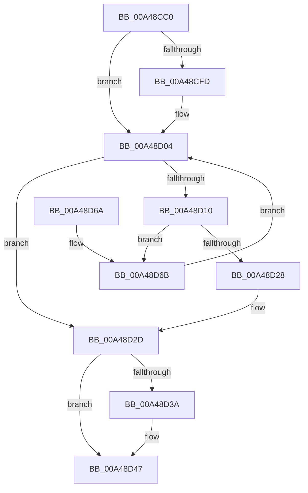

# PsGetNextProcessEx

- RVA: `0x00A48CC0`–`0x00A48D70` (길이 `176` bytes)
- VA: `0x0000000140A48CC0`
- 실행 섹션: `PAGE`
- PDB 이름 있음: `예`; PDB Function 태그: `아니요`
- unwind 정보 RVA: `0x000AFAEC`
- 디코드: `47`개 명령, `176/176` bytes 표시
- 미해석 바이트: `0` (있으면 어셈블리에 `.byte`로 보존)

> 이 문서는 커널 이미지의 기계어와 PDB 기호를 분석해 생성했습니다. 4번과 5번은 함수 원형과 자료형을 바이너리 사용 방식에서 추정한 C 해석이며 원본 소스 복구 결과는 아닙니다.

## 1. Dependencies

- 직접 호출 지점: **4**; 고유 호출 대상: **4**
- 직접 호출자로 확인된 함수: **0**
- RIP 상대 이미지 참조: **1**

### Outgoing calls
- `0x00A48CEC` → [PspLockProcessListShared](../../text/41/PspLockProcessListShared_function_0041BAB0.md) (function, `0x0041BAB0`)
- `0x00A48D1F` → [ObReferenceObjectSafeWithTag](../../text/21/ObReferenceObjectSafeWithTag_function_00210EE0.md) (function, `0x00210EE0`)
- `0x00A48D30` → [PspUnlockProcessListShared](../../text/2E/PspUnlockProcessListShared_function_002E2920.md) (function, `0x002E2920`)
- `0x00A48D42` → [ObfDereferenceObjectWithTag](../../text/2F/ObfDereferenceObjectWithTag_function_002F78E0.md) (function, `0x002F78E0`)

### Direct callers
- 이 함수 시작 RVA로 연결되는 직접 call은 확인되지 않았습니다. 간접 호출은 완전히 역산할 수 없습니다.

### Static image references
- `0x00A48CF1` → RVA `0x00F067C0` (`.data`; read)

## 2. Other-region calls and transfers

- 다른 실행 섹션으로 향하는 call: **4**
  - `0x00A48CEC` → [PspLockProcessListShared](../../text/41/PspLockProcessListShared_function_0041BAB0.md) (`PAGE` → `.text`)
  - `0x00A48D1F` → [ObReferenceObjectSafeWithTag](../../text/21/ObReferenceObjectSafeWithTag_function_00210EE0.md) (`PAGE` → `.text`)
  - `0x00A48D30` → [PspUnlockProcessListShared](../../text/2E/PspUnlockProcessListShared_function_002E2920.md) (`PAGE` → `.text`)
  - `0x00A48D42` → [ObfDereferenceObjectWithTag](../../text/2F/ObfDereferenceObjectWithTag_function_002F78E0.md) (`PAGE` → `.text`)
- 별도 외부 분기/꼬리 이동을 확인하지 못했습니다.

## 3. Assembly (complete function range)

```asm
00A48CC0  48 8B C4                        mov rax, rsp
00A48CC3  48 89 58 08                     mov qword ptr [rax + 8], rbx
00A48CC7  48 89 68 10                     mov qword ptr [rax + 0x10], rbp
00A48CCB  48 89 70 18                     mov qword ptr [rax + 0x18], rsi
00A48CCF  48 89 78 20                     mov qword ptr [rax + 0x20], rdi
00A48CD3  41 56                           push r14
00A48CD5  48 83 EC 20                     sub rsp, 0x20
00A48CD9  65 4C 8B 34 25 88 01 00 00      mov r14, qword ptr gs:[0x188]
00A48CE2  48 8B F9                        mov rdi, rcx
00A48CE5  49 8B CE                        mov rcx, r14
00A48CE8  33 ED                           xor ebp, ebp
00A48CEA  33 F6                           xor esi, esi
00A48CEC  E8 BF 2D 9D FF                  call 0x14041bab0
00A48CF1  48 8B 1D C8 DA 4B 00            mov rbx, qword ptr [rip + 0x4bdac8]
00A48CF8  48 85 FF                        test rdi, rdi
00A48CFB  74 07                           je 0x140a48d04
00A48CFD  48 8B 9F D8 01 00 00            mov rbx, qword ptr [rdi + 0x1d8]
00A48D04  48 8D 05 B5 DA 4B 00            lea rax, [rip + 0x4bdab5]
00A48D0B  48 3B D8                        cmp rbx, rax
00A48D0E  74 1D                           je 0x140a48d2d
00A48D10  48 8D AB 28 FE FF FF            lea rbp, [rbx - 0x1d8]
00A48D17  BA 44 66 6C 74                  mov edx, 0x746c6644
00A48D1C  48 8B CD                        mov rcx, rbp
00A48D1F  E8 BC 81 7C FF                  call 0x140210ee0
00A48D24  84 C0                           test al, al
00A48D26  74 43                           je 0x140a48d6b
00A48D28  BE 01 00 00 00                  mov esi, 1
00A48D2D  49 8B CE                        mov rcx, r14
00A48D30  E8 EB 9B 89 FF                  call 0x1402e2920
00A48D35  48 85 FF                        test rdi, rdi
00A48D38  74 0D                           je 0x140a48d47
00A48D3A  BA 44 66 6C 74                  mov edx, 0x746c6644
00A48D3F  48 8B CF                        mov rcx, rdi
00A48D42  E8 99 EB 8A FF                  call 0x1402f78e0
00A48D47  48 8B 5C 24 30                  mov rbx, qword ptr [rsp + 0x30]
00A48D4C  F7 DE                           neg esi
00A48D4E  48 8B 74 24 40                  mov rsi, qword ptr [rsp + 0x40]
00A48D53  48 8B 7C 24 48                  mov rdi, qword ptr [rsp + 0x48]
00A48D58  48 1B C0                        sbb rax, rax
00A48D5B  48 23 C5                        and rax, rbp
00A48D5E  48 8B 6C 24 38                  mov rbp, qword ptr [rsp + 0x38]
00A48D63  48 83 C4 20                     add rsp, 0x20
00A48D67  41 5E                           pop r14
00A48D69  C3                              ret
00A48D6A  CC                              int3
00A48D6B  48 8B 1B                        mov rbx, qword ptr [rbx]
00A48D6E  EB 94                           jmp 0x140a48d04
```

## 4. C-style interpretation (structured pseudocode)

```c
__int64 __fastcall PsGetNextProcessEx(__int64 a1)
{
    __int64 result;
    __int64 v_rbp;
    __int64 v_rbx;
    __int64 v_rsi;
    __int64 v_rsp;
    unsigned __int64 v_stack_p10;
    unsigned __int64 v_stack_p18;
    unsigned __int64 v_stack_p20;
    unsigned __int64 v_stack_p8;

    *(unsigned __int64 *)(v_rsp + 8) = v_rbx;
    *(unsigned __int64 *)(v_rsp + 16) = v_rbp;
    *(unsigned __int64 *)(v_rsp + 24) = v_rsi;
    *(unsigned __int64 *)(v_rsp + 32) = v_rdi;
    v_rsp = (v_rsp) - (32);
    v_rbp = 0;
    v_rsi = 0;
    result = PspLockProcessListShared(*(unsigned __int64 *)(gs_base + (0 + 392)), a2, a3, a4);
    v_rbx = *(unsigned __int64 *)(v_rip + 4971208);
    if (a1 != 0) {
        v_rbx = *(unsigned __int64 *)(a1 + 472);
    }
    if (v_rbx == (v_rip + 4971189)) goto loc_00A48D2D;
    result = ObReferenceObjectSafeWithTag(v_rbx - 472, (unsigned int)(0x746C6644ULL), a3, a4);
    if ((unsigned __int8)(result) == 0) goto loc_00A48D6B;
loc_00A48D2D:
    result = PspUnlockProcessListShared(*(unsigned __int64 *)(gs_base + (0 + 392)), (unsigned int)(0x746C6644ULL), a3, a4);
    if (a1 != 0) {
        a2 = 0x746C6644ULL;
        a1 = a1;
        result = ObfDereferenceObjectWithTag(a1, a2, a3, a4);
    }
    v_rsi = (unsigned int)(-(1));
    result = (result) & (v_rbx - 472);
    v_rsp = (v_rsp) + (32);
    return result;
loc_00A48D6B:
    goto loc_00A48D04;
}
```

## 5. (Beta) C Style

```c
int64_t PsGetNextProcessEx(int64_t Arg1)
{
    int64_t result;
    int64_t local_rbp;
    int64_t local_rbx;
    int64_t local_rsi;
    int64_t local_rsp;
    uint64_t v_stack_p10;
    uint64_t v_stack_p18;
    uint64_t v_stack_p20;
    uint64_t v_stack_p8;

    *(uint64_t *)(local_rsp + 0x8) = local_rbx;
    *(uint64_t *)(local_rsp + 0x10) = local_rbp;
    *(uint64_t *)(local_rsp + 0x18) = local_rsi;
    *(uint64_t *)(local_rsp + 0x20) = local_rdi;
    local_rsp = (local_rsp) - (32);
    local_rbp = 0;
    local_rsi = 0;
    result = PspLockProcessListShared(*(uint64_t *)(gs_base + (0 + 0x188)), a2, a3, a4);
    local_rbx = *(uint64_t *)(v_rip + 0x4BDAC8);
    if (Arg1 != 0) {
        local_rbx = *(uint64_t *)(Arg1 + 0x1D8);
    }
    if (local_rbx == (v_rip + 4971189)) goto loc_00A48D2D;
    result = ObReferenceObjectSafeWithTag(local_rbx - 472, (uint32_t)(0x746C6644ULL), a3, a4);
    if ((uint8_t)(result) == 0) goto loc_00A48D6B;
loc_00A48D2D:
    result = PspUnlockProcessListShared(*(uint64_t *)(gs_base + (0 + 0x188)), (uint32_t)(0x746C6644ULL), a3, a4);
    if (Arg1 != 0) {
        a2 = 0x746C6644ULL;
        Arg1 = Arg1;
        result = ObfDereferenceObjectWithTag(Arg1, a2, a3, a4);
    }
    local_rsi = (uint32_t)(-(1));
    result = (result) & (local_rbx - 472);
    local_rsp = (local_rsp) + (32);
    return result;
loc_00A48D6B:
    goto loc_00A48D04;
}
```

## 6. Execution-region graph

[열기: 2D/3D 그래프와 함수 탐색 컨트롤 패널](../../../control-panel.html?section=page&rva=0x00A48CC0&view=graph)

- 2D 그래프는 위에서 아래로 흐르고, 3D 그래프는 빈 공간을 드래그해 회전합니다. Shift+드래그는 이동, 휠은 확대·축소, 함수 노드 선택은 대상 보고서 이동입니다.

### Static fallback


