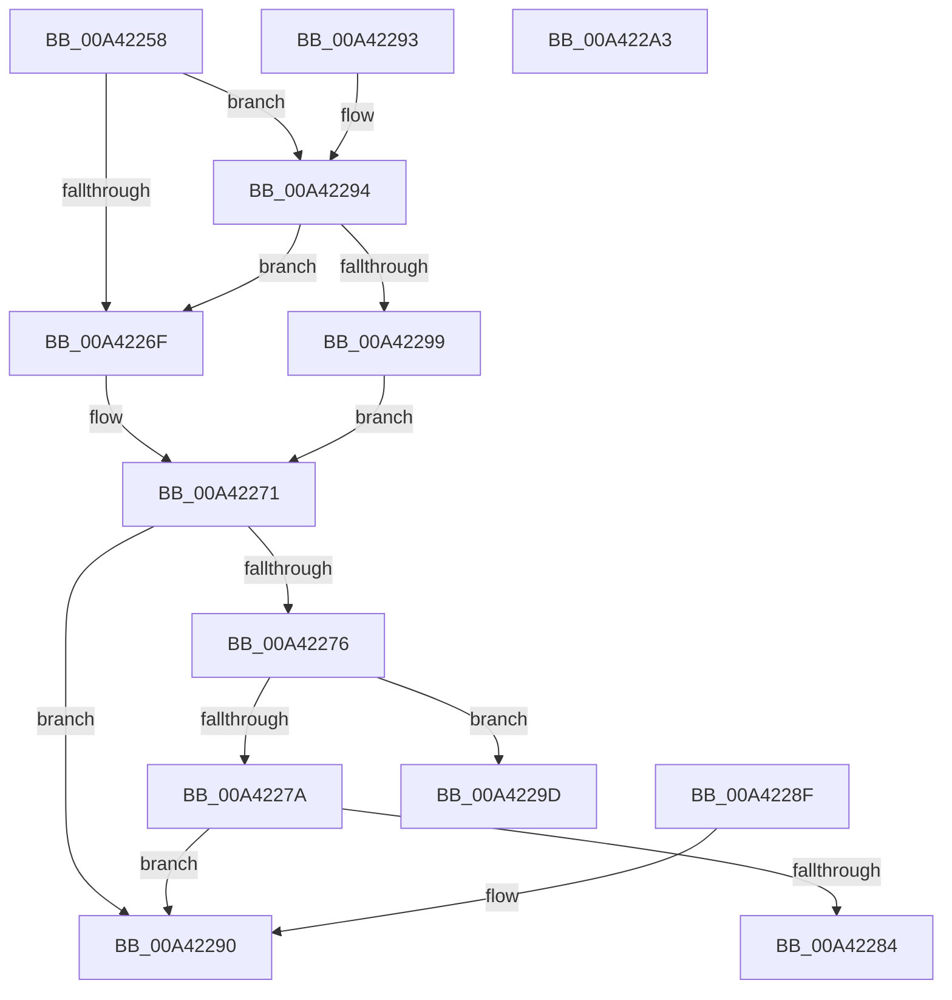

# PsGetScpCfgPageTypeForProcess

- RVA: `0x00A42258`–`0x00A422A4` (길이 `76` bytes)
- VA: `0x0000000140A42258`
- 실행 섹션: `PAGE`
- PDB 이름 있음: `예`; PDB Function 태그: `아니요`
- unwind 정보 RVA: `0x000DB714`
- 디코드: `29`개 명령, `76/76` bytes 표시
- 미해석 바이트: `0` (있으면 어셈블리에 `.byte`로 보존)

> 이 문서는 커널 이미지의 기계어와 PDB 기호를 분석해 생성했습니다. 4번과 5번은 함수 원형과 자료형을 바이너리 사용 방식에서 추정한 C 해석이며 원본 소스 복구 결과는 아닙니다.

## 1. Dependencies

- 직접 호출 지점: **0**; 고유 호출 대상: **0**
- 직접 호출자로 확인된 함수: **2**
- RIP 상대 이미지 참조: **1**

### Outgoing calls
- 직접 디코드된 call 명령이 없습니다.

### Direct callers
- [MiMapImageScpCfgPages](../../text/29/MiMapImageScpCfgPages_function_00294FA4.md) at `0x00295016`
- [PspGetScpCfgFunctions](../8C/PspGetScpCfgFunctions_function_008CE498.md) at `0x008CE51D`

### Static image references
- `0x00A42266` → RVA `0x00E2DB88` (`.data`; read)

## 2. Other-region calls and transfers

- 다른 실행 섹션으로 향하는 call: **0**
- 별도 외부 분기/꼬리 이동을 확인하지 못했습니다.

## 3. Assembly (complete function range)

```asm
00A42258  48 8B 81 10 04 00 00            mov rax, qword ptr [rcx + 0x410]
00A4225F  48 8B 90 A0 04 00 00            mov rdx, qword ptr [rax + 0x4a0]
00A42266  48 39 15 1B B9 3E 00            cmp qword ptr [rip + 0x3eb91b], rdx
00A4226D  75 25                           jne 0x140a42294
00A4226F  B0 01                           mov al, 1
00A42271  45 84 C0                        test r8b, r8b
00A42274  74 1A                           je 0x140a42290
00A42276  84 C0                           test al, al
00A42278  74 23                           je 0x140a4229d
00A4227A  8B 81 50 07 00 00               mov eax, dword ptr [rcx + 0x750]
00A42280  A8 01                           test al, 1
00A42282  74 0C                           je 0x140a42290
00A42284  24 02                           and al, 2
00A42286  F6 D8                           neg al
00A42288  1B C0                           sbb eax, eax
00A4228A  F7 D8                           neg eax
00A4228C  FF C0                           inc eax
00A4228E  C3                              ret
00A4228F  CC                              int3
00A42290  33 C0                           xor eax, eax
00A42292  C3                              ret
00A42293  CC                              int3
00A42294  48 85 D2                        test rdx, rdx
00A42297  74 D6                           je 0x140a4226f
00A42299  32 C0                           xor al, al
00A4229B  EB D4                           jmp 0x140a42271
00A4229D  B8 03 00 00 00                  mov eax, 3
00A422A2  C3                              ret
00A422A3  CC                              int3
```

## 4. C-style interpretation (structured pseudocode)

```c
__int64 __fastcall PsGetScpCfgPageTypeForProcess(__int64 a1, __int64 a2, unsigned __int8 a3)
{
    __int64 result;

    if ((*(unsigned __int64 *)(v_rip + 4110619)) != (*(unsigned __int64 *)(*(unsigned __int64 *)(a1 + 1040) + 1184))) goto loc_00A42294;
loc_00A4226F:
loc_00A42271:
    if (a3 == 0) goto loc_00A42290;
    if (1 == 0) goto loc_00A4229D;
    if ((((unsigned __int8)((unsigned int)(*(unsigned int *)(a1 + 1872)))) & (1)) == 0) goto loc_00A42290;
    result = (unsigned __int8)(((unsigned int)(*(unsigned int *)(a1 + 1872))) & (2));
    result = (unsigned __int8)(-(result));
    result = (unsigned int)(-(result));
    result = (unsigned int)((result) + 1);
    return result;
loc_00A42290:
    result = 0;
    return result;
loc_00A42294:
    if (*(unsigned __int64 *)(*(unsigned __int64 *)(a1 + 1040) + 1184) == 0) goto loc_00A4226F;
    result = 0;
    goto loc_00A42271;
loc_00A4229D:
    return 3;
}
```

## 5. (Beta) C Style

```c
int64_t PsGetScpCfgPageTypeForProcess(void *Arg1, int64_t Arg2, uint8_t Arg3)
{
    uint8_t *arg1 = (uint8_t *)Arg1;

    int64_t result;

    if ((*(uint64_t *)(v_rip + 0x3EB91B)) != (*(uint64_t *)(*(uint64_t *)(arg1 + 0x410) + 0x4A0))) goto loc_00A42294;
loc_00A4226F:
loc_00A42271:
    if (Arg3 == 0) goto loc_00A42290;
    if (1 == 0) goto loc_00A4229D;
    if ((((uint8_t)((uint32_t)(*(uint32_t *)(arg1 + 0x750)))) & (1)) == 0) goto loc_00A42290;
    result = (uint8_t)(((uint32_t)(*(uint32_t *)(arg1 + 0x750))) & (2));
    result = (uint8_t)(-(result));
    result = (uint32_t)(-(result));
    result = (uint32_t)((result) + 1);
    return result;
loc_00A42290:
    result = 0;
    return result;
loc_00A42294:
    if (*(uint64_t *)(*(uint64_t *)(arg1 + 0x410) + 0x4A0) == 0) goto loc_00A4226F;
    result = 0;
    goto loc_00A42271;
loc_00A4229D:
    return 3;
}
```

### 관측된 메모리 오프셋

구조체 형식이 확인되지 않은 접근은 인자 기준의 오프셋으로만 기록했습니다.

| 기준 인자 | 오프셋 표현 | 폭 (bit) | 접근 |
|---|---:|---:|---|
| `Arg1` | `+ 0x410` | `64` | `R` |
| `Arg1` | `+ 0x750` | `32` | `R` |

## 6. Execution-region graph

[열기: 2D/3D 그래프와 함수 탐색 컨트롤 패널](../../../control-panel.html?section=page&rva=0x00A42258&view=graph)

- 2D 그래프는 위에서 아래로 흐르고, 3D 그래프는 빈 공간을 드래그해 회전합니다. Shift+드래그는 이동, 휠은 확대·축소, 함수 노드 선택은 대상 보고서 이동입니다.

### Static fallback


