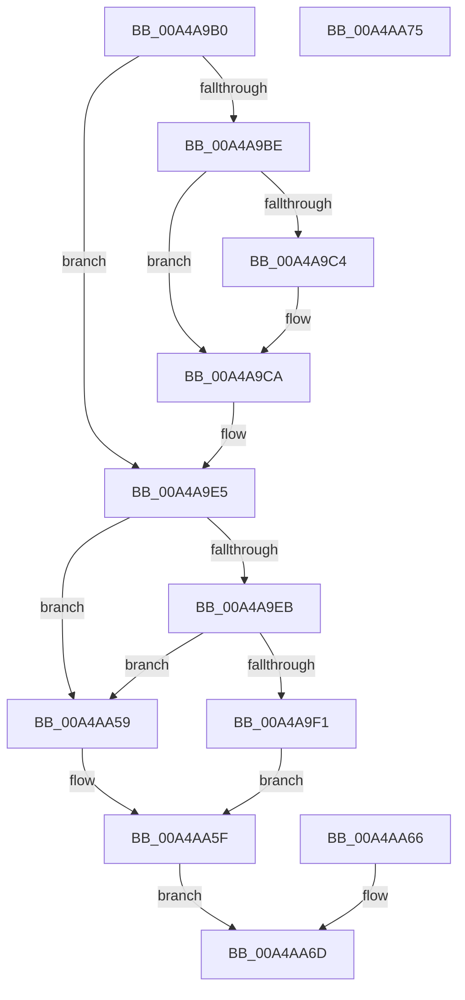

# PspCaptureCreateInfo

- RVA: `0x00A4A9B0`–`0x00A4AA76` (길이 `198` bytes)
- VA: `0x0000000140A4A9B0`
- 실행 섹션: `PAGE`
- PDB 이름 있음: `예`; PDB Function 태그: `아니요`
- unwind 정보 RVA: `0x000B0000`
- 디코드: `61`개 명령, `198/198` bytes 표시
- 미해석 바이트: `0` (있으면 어셈블리에 `.byte`로 보존)

> 이 문서는 커널 이미지의 기계어와 PDB 기호를 분석해 생성했습니다. 4번과 5번은 함수 원형과 자료형을 바이너리 사용 방식에서 추정한 C 해석이며 원본 소스 복구 결과는 아닙니다.

## 1. Dependencies

- 직접 호출 지점: **1**; 고유 호출 대상: **1**
- 직접 호출자로 확인된 함수: **1**
- RIP 상대 이미지 참조: **0**

### Outgoing calls
- `0x00A4A9C4` → [ExRaiseDatatypeMisalignment](../89/ExRaiseDatatypeMisalignment_function_00899FD0.md) (function, `0x00899FD0`)

### Direct callers
- [NtCreateUserProcess](../AE/NtCreateUserProcess_function_00AEA680.md) at `0x00AEA98A`

### Static image references
- 디코드된 RIP-relative 메모리 참조가 없습니다.

## 2. Other-region calls and transfers

- 다른 실행 섹션으로 향하는 call: **0**
- 별도 외부 분기/꼬리 이동을 확인하지 못했습니다.

## 3. Assembly (complete function range)

```asm
00A4A9B0  48 83 EC 38                     sub rsp, 0x38
00A4A9B4  4C 8B D2                        mov r10, rdx
00A4A9B7  45 33 C9                        xor r9d, r9d
00A4A9BA  84 C9                           test cl, cl
00A4A9BC  74 27                           je 0x140a4a9e5
00A4A9BE  41 F6 C2 03                     test r10b, 3
00A4A9C2  74 06                           je 0x140a4a9ca
00A4A9C4  E8 07 F6 E4 FF                  call 0x140899fd0
00A4A9C9  CC                              int3
00A4A9CA  48 B9 00 00 FF FF FF 7F 00 00   movabs rcx, 0x7fffffff0000
00A4A9D4  4C 3B D1                        cmp r10, rcx
00A4A9D7  49 0F 42 CA                     cmovb rcx, r10
00A4A9DB  8A 01                           mov al, byte ptr [rcx]
00A4A9DD  88 01                           mov byte ptr [rcx], al
00A4A9DF  8A 41 57                        mov al, byte ptr [rcx + 0x57]
00A4A9E2  88 41 57                        mov byte ptr [rcx + 0x57], al
00A4A9E5  44 39 4A 08                     cmp dword ptr [rdx + 8], r9d
00A4A9E9  75 6E                           jne 0x140a4aa59
00A4A9EB  48 83 3A 58                     cmp qword ptr [rdx], 0x58
00A4A9EF  75 68                           jne 0x140a4aa59
00A4A9F1  8A 52 10                        mov dl, byte ptr [rdx + 0x10]
00A4A9F4  80 E2 FC                        and dl, 0xfc
00A4A9F7  C0 E2 05                        shl dl, 5
00A4A9FA  41 8A 40 10                     mov al, byte ptr [r8 + 0x10]
00A4A9FE  24 7F                           and al, 0x7f
00A4AA00  0A D0                           or dl, al
00A4AA02  41 88 50 10                     mov byte ptr [r8 + 0x10], dl
00A4AA06  41 8A 40 11                     mov al, byte ptr [r8 + 0x11]
00A4AA0A  41 8A 4A 10                     mov cl, byte ptr [r10 + 0x10]
00A4AA0E  C0 E9 03                        shr cl, 3
00A4AA11  32 C8                           xor cl, al
00A4AA13  80 E1 01                        and cl, 1
00A4AA16  32 C8                           xor cl, al
00A4AA18  41 88 48 11                     mov byte ptr [r8 + 0x11], cl
00A4AA1C  41 8B 42 14                     mov eax, dword ptr [r10 + 0x14]
00A4AA20  41 89 80 AC 00 00 00            mov dword ptr [r8 + 0xac], eax
00A4AA27  41 8A 4A 10                     mov cl, byte ptr [r10 + 0x10]
00A4AA2B  02 C9                           add cl, cl
00A4AA2D  32 CA                           xor cl, dl
00A4AA2F  80 E1 02                        and cl, 2
00A4AA32  32 CA                           xor cl, dl
00A4AA34  41 88 48 10                     mov byte ptr [r8 + 0x10], cl
00A4AA38  41 8A 42 10                     mov al, byte ptr [r10 + 0x10]
00A4AA3C  C0 E0 03                        shl al, 3
00A4AA3F  32 C1                           xor al, cl
00A4AA41  24 10                           and al, 0x10
00A4AA43  32 C1                           xor al, cl
00A4AA45  41 88 40 10                     mov byte ptr [r8 + 0x10], al
00A4AA49  41 0F B7 42 12                  movzx eax, word ptr [r10 + 0x12]
00A4AA4E  66 41 89 40 12                  mov word ptr [r8 + 0x12], ax
00A4AA53  4D 89 50 30                     mov qword ptr [r8 + 0x30], r10
00A4AA57  EB 06                           jmp 0x140a4aa5f
00A4AA59  41 B9 0D 00 00 C0               mov r9d, 0xc000000d
00A4AA5F  44 89 4C 24 20                  mov dword ptr [rsp + 0x20], r9d
00A4AA64  EB 07                           jmp 0x140a4aa6d
00A4AA66  44 8B C8                        mov r9d, eax
00A4AA69  89 44 24 20                     mov dword ptr [rsp + 0x20], eax
00A4AA6D  41 8B C1                        mov eax, r9d
00A4AA70  48 83 C4 38                     add rsp, 0x38
00A4AA74  C3                              ret
00A4AA75  CC                              int3
```

## 4. C-style interpretation (structured pseudocode)

```c
__int64 __fastcall PspCaptureCreateInfo(unsigned __int8 a1, __int64 a2, __int64 a3, int a4)
{
    __int64 result;
    __int64 v_rsp;
    unsigned int v_stack_m18;

    v_rsp = (v_rsp) - (56);
    a4 = 0;
    if (a1 == 0) goto loc_00A4A9E5;
    if ((((unsigned __int8)(a2)) & (3)) != 0) {
        result = ExRaiseDatatypeMisalignment(a1, a2, a3, a4);
    }
    if (a2 < a1) { a1 = a2; }
    *(unsigned __int8 *)(a1) = (unsigned __int8)(*(unsigned __int8 *)(a1));
    *(unsigned __int8 *)(a1 + 87) = (unsigned __int8)(*(unsigned __int8 *)(a1 + 87));
loc_00A4A9E5:
    if ((*(unsigned int *)(a2 + 8)) != 0) goto loc_00A4AA59;
    if ((*(unsigned __int64 *)(a2)) != 88) goto loc_00A4AA59;
    a2 = (unsigned __int8)((*(unsigned __int8 *)(a2 + 16)) & (252));
    a2 = (unsigned __int8)((a2) << (5));
    result = (unsigned __int8)((*(unsigned __int8 *)(a3 + 16)) & (127));
    a2 = (unsigned __int8)((a2) | ((unsigned __int8)(result)));
    *(unsigned __int8 *)(a3 + 16) = (unsigned __int8)(a2);
    a1 = (unsigned __int8)((*(unsigned __int8 *)(a2 + 16)) >> (3));
    a1 = (unsigned __int8)((a1) ^ ((unsigned __int8)(*(unsigned __int8 *)(a3 + 17))));
    a1 = (unsigned __int8)((a1) & (1));
    a1 = (unsigned __int8)((a1) ^ ((unsigned __int8)(*(unsigned __int8 *)(a3 + 17))));
    *(unsigned __int8 *)(a3 + 17) = a1;
    *(unsigned int *)(a3 + 172) = (unsigned int)((unsigned int)(*(unsigned int *)(a2 + 20)));
    a1 = (unsigned __int8)((*(unsigned __int8 *)(a2 + 16)) + ((unsigned __int8)(*(unsigned __int8 *)(a2 + 16))));
    a1 = (unsigned __int8)((a1) ^ ((unsigned __int8)(a2)));
    a1 = (unsigned __int8)((a1) & (2));
    a1 = (unsigned __int8)((a1) ^ ((unsigned __int8)(a2)));
    *(unsigned __int8 *)(a3 + 16) = a1;
    result = (unsigned __int8)((*(unsigned __int8 *)(a2 + 16)) << (3));
    result = (unsigned __int8)((result) ^ (a1));
    result = (unsigned __int8)((result) & (16));
    result = (unsigned __int8)((result) ^ (a1));
    *(unsigned __int8 *)(a3 + 16) = (unsigned __int8)(result);
    *(unsigned __int16 *)(a3 + 18) = (unsigned __int16)(*(unsigned __int16 *)(a2 + 18));
    *(unsigned __int64 *)(a3 + 48) = a2;
    goto loc_00A4AA5F;
loc_00A4AA59:
loc_00A4AA5F:
    v_stack_m18 = (unsigned int)((unsigned int)(0xC000000DULL));
    goto loc_00A4AA6D;
loc_00A4AA6D:
    v_rsp = (v_rsp) + (56);
    return (unsigned int)((unsigned int)((unsigned int)(0xC000000DULL)));
}
```

## 5. (Beta) C Style

```c
int64_t PspCaptureCreateInfo(uint8_t Arg1, int64_t Arg2, int64_t Arg3, int32_t Arg4)
{
    int64_t result;
    int64_t local_rsp;
    uint32_t v_stack_m18;

    local_rsp = (local_rsp) - (56);
    Arg4 = 0;
    if (Arg1 == 0) goto loc_00A4A9E5;
    if ((((uint8_t)(Arg2)) & (3)) != 0) {
        result = ExRaiseDatatypeMisalignment(Arg1, Arg2, Arg3, Arg4);
    }
    if (Arg2 < Arg1) { Arg1 = Arg2; }
    *(uint8_t *)(Arg1) = (uint8_t)(*(uint8_t *)(Arg1));
    *(uint8_t *)(Arg1 + 0x57) = (uint8_t)(*(uint8_t *)(Arg1 + 0x57));
loc_00A4A9E5:
    if ((*(uint32_t *)(Arg2 + 0x8)) != 0) goto loc_00A4AA59;
    if ((*(uint64_t *)(Arg2)) != 88) goto loc_00A4AA59;
    Arg2 = (uint8_t)((*(uint8_t *)(Arg2 + 0x10)) & (252));
    Arg2 = (uint8_t)((Arg2) << (5));
    result = (uint8_t)((*(uint8_t *)(Arg3 + 0x10)) & (127));
    Arg2 = (uint8_t)((Arg2) | ((uint8_t)(result)));
    *(uint8_t *)(Arg3 + 0x10) = (uint8_t)(Arg2);
    Arg1 = (uint8_t)((*(uint8_t *)(Arg2 + 0x10)) >> (3));
    Arg1 = (uint8_t)((Arg1) ^ ((uint8_t)(*(uint8_t *)(Arg3 + 0x11))));
    Arg1 = (uint8_t)((Arg1) & (1));
    Arg1 = (uint8_t)((Arg1) ^ ((uint8_t)(*(uint8_t *)(Arg3 + 0x11))));
    *(uint8_t *)(Arg3 + 0x11) = Arg1;
    *(uint32_t *)(Arg3 + 0xAC) = (uint32_t)((uint32_t)(*(uint32_t *)(Arg2 + 0x14)));
    Arg1 = (uint8_t)((*(uint8_t *)(Arg2 + 0x10)) + ((uint8_t)(*(uint8_t *)(Arg2 + 0x10))));
    Arg1 = (uint8_t)((Arg1) ^ ((uint8_t)(Arg2)));
    Arg1 = (uint8_t)((Arg1) & (2));
    Arg1 = (uint8_t)((Arg1) ^ ((uint8_t)(Arg2)));
    *(uint8_t *)(Arg3 + 0x10) = Arg1;
    result = (uint8_t)((*(uint8_t *)(Arg2 + 0x10)) << (3));
    result = (uint8_t)((result) ^ (Arg1));
    result = (uint8_t)((result) & (16));
    result = (uint8_t)((result) ^ (Arg1));
    *(uint8_t *)(Arg3 + 0x10) = (uint8_t)(result);
    *(uint16_t *)(Arg3 + 0x12) = (uint16_t)(*(uint16_t *)(Arg2 + 0x12));
    *(uint64_t *)(Arg3 + 0x30) = Arg2;
    goto loc_00A4AA5F;
loc_00A4AA59:
loc_00A4AA5F:
    v_stack_m18 = (uint32_t)((uint32_t)(0xC000000DULL));
    goto loc_00A4AA6D;
loc_00A4AA6D:
    local_rsp = (local_rsp) + (56);
    return (uint32_t)((uint32_t)((uint32_t)(0xC000000DULL)));
}
```

## 6. Execution-region graph

[열기: 2D/3D 그래프와 함수 탐색 컨트롤 패널](../../../control-panel.html?section=page&rva=0x00A4A9B0&view=graph)

- 2D 그래프는 위에서 아래로 흐르고, 3D 그래프는 빈 공간을 드래그해 회전합니다. Shift+드래그는 이동, 휠은 확대·축소, 함수 노드 선택은 대상 보고서 이동입니다.

### Static fallback


