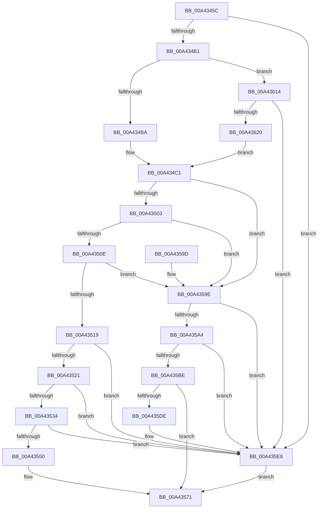

# PspInitializeFullProcessImageName

- RVA: `0x00A4345C`–`0x00A4362D` (길이 `465` bytes)
- VA: `0x0000000140A4345C`
- 실행 섹션: `PAGE`
- PDB 이름 있음: `예`; PDB Function 태그: `아니요`
- unwind 정보 RVA: `0x000AF018`
- 디코드: `116`개 명령, `465/465` bytes 표시
- 미해석 바이트: `0` (있으면 어셈블리에 `.byte`로 보존)

> 이 문서는 커널 이미지의 기계어와 PDB 기호를 분석해 생성했습니다. 4번과 5번은 함수 원형과 자료형을 바이너리 사용 방식에서 추정한 C 해석이며 원본 소스 복구 결과는 아닙니다.

## 1. Dependencies

- 직접 호출 지점: **11**; 고유 호출 대상: **8**
- 직접 호출자로 확인된 함수: **1**
- RIP 상대 이미지 참조: **1**

### Outgoing calls
- `0x00A43497` → [memset](../../text/6C/memset_function_006C6C40.md) (function, `0x006C6C40`)
- `0x00A434D3` → [PspSetProcessShortName](PspSetProcessShortName_function_00A43634.md) (function, `0x00A43634`)
- `0x00A434F1` → [ObQueryNameStringMode](../8A/ObQueryNameStringMode_function_008A7ED0.md) (function, `0x008A7ED0`)
- `0x00A4353F` → [ExAllocatePool2](../../poolcode/B8/ExAllocatePool2_function_00B820F0.md) (function, `0x00B820F0`)
- `0x00A4356C` → [memcpy](../../text/6C/memcpy_function_006C6840.md) (function, `0x006C6840`)
- `0x00A43581` → [_security_check_cookie](../../text/6A/_security_check_cookie_function_006AC640.md) (function, `0x006AC640`)
- `0x00A435B1` → [ExAllocatePool2](../../poolcode/B8/ExAllocatePool2_function_00B820F0.md) (function, `0x00B820F0`)
- `0x00A435D3` → [ObQueryNameStringMode](../8A/ObQueryNameStringMode_function_008A7ED0.md) (function, `0x008A7ED0`)
- `0x00A435E3` → [ExFreePoolWithTag](../../poolcode/B8/ExFreePoolWithTag_function_00B82870.md) (function, `0x00B82870`)
- `0x00A435FA` → [ExAllocatePool2](../../poolcode/B8/ExAllocatePool2_function_00B820F0.md) (function, `0x00B820F0`)
- `0x00A43620` → [MmGetFileObjectForSection](../8D/MmGetFileObjectForSection_function_008D68E0.md) (function, `0x008D68E0`)

### Direct callers
- [PspAllocateProcess](../A1/PspAllocateProcess_function_00A13B3C.md) at `0x00A15BAC`

### Static image references
- `0x00A43474` → RVA `0x00E0A740` (`.data`; read)

## 2. Other-region calls and transfers

- 다른 실행 섹션으로 향하는 call: **7**
  - `0x00A43497` → [memset](../../text/6C/memset_function_006C6C40.md) (`PAGE` → `.text`)
  - `0x00A4353F` → [ExAllocatePool2](../../poolcode/B8/ExAllocatePool2_function_00B820F0.md) (`PAGE` → `POOLCODE`)
  - `0x00A4356C` → [memcpy](../../text/6C/memcpy_function_006C6840.md) (`PAGE` → `.text`)
  - `0x00A43581` → [_security_check_cookie](../../text/6A/_security_check_cookie_function_006AC640.md) (`PAGE` → `.text`)
  - `0x00A435B1` → [ExAllocatePool2](../../poolcode/B8/ExAllocatePool2_function_00B820F0.md) (`PAGE` → `POOLCODE`)
  - `0x00A435E3` → [ExFreePoolWithTag](../../poolcode/B8/ExFreePoolWithTag_function_00B82870.md) (`PAGE` → `POOLCODE`)
  - `0x00A435FA` → [ExAllocatePool2](../../poolcode/B8/ExAllocatePool2_function_00B820F0.md) (`PAGE` → `POOLCODE`)
- 별도 외부 분기/꼬리 이동을 확인하지 못했습니다.

## 3. Assembly (complete function range)

```asm
00A4345C  48 89 5C 24 18                  mov qword ptr [rsp + 0x18], rbx
00A43461  55                              push rbp
00A43462  56                              push rsi
00A43463  57                              push rdi
00A43464  41 54                           push r12
00A43466  41 56                           push r14
00A43468  48 8D 6C 24 90                  lea rbp, [rsp - 0x70]
00A4346D  48 81 EC 70 01 00 00            sub rsp, 0x170
00A43474  48 8B 05 C5 72 3C 00            mov rax, qword ptr [rip + 0x3c72c5]
00A4347B  48 33 C4                        xor rax, rsp
00A4347E  48 89 45 60                     mov qword ptr [rbp + 0x60], rax
00A43482  4C 8B F2                        mov r14, rdx
00A43485  48 8B F1                        mov rsi, rcx
00A43488  BB 10 01 00 00                  mov ebx, 0x110
00A4348D  48 8D 4C 24 50                  lea rcx, [rsp + 0x50]
00A43492  44 8B C3                        mov r8d, ebx
00A43495  33 D2                           xor edx, edx
00A43497  E8 A4 37 C8 FF                  call 0x1406c6c40
00A4349C  41 8B 86 FC 05 00 00            mov eax, dword ptr [r14 + 0x5fc]
00A434A3  41 BC 40 00 00 00               mov r12d, 0x40
00A434A9  A8 01                           test al, 1
00A434AB  0F 85 37 01 00 00               jne 0x140a435e8
00A434B1  48 85 F6                        test rsi, rsi
00A434B4  0F 84 5A 01 00 00               je 0x140a43614
00A434BA  48 8B B6 B8 00 00 00            mov rsi, qword ptr [rsi + 0xb8]
00A434C1  0F 10 46 58                     movups xmm0, xmmword ptr [rsi + 0x58]
00A434C5  48 8D 54 24 38                  lea rdx, [rsp + 0x38]
00A434CA  49 8B CE                        mov rcx, r14
00A434CD  F3 0F 7F 44 24 38               movdqu xmmword ptr [rsp + 0x38], xmm0
00A434D3  E8 5C 01 00 00                  call 0x140a43634
00A434D8  4C 8D 4C 24 30                  lea r9, [rsp + 0x30]
00A434DD  89 5C 24 30                     mov dword ptr [rsp + 0x30], ebx
00A434E1  44 8B C3                        mov r8d, ebx
00A434E4  C6 44 24 20 00                  mov byte ptr [rsp + 0x20], 0
00A434E9  48 8D 54 24 50                  lea rdx, [rsp + 0x50]
00A434EE  48 8B CE                        mov rcx, rsi
00A434F1  E8 DA 49 E6 FF                  call 0x1408a7ed0
00A434F6  8B F8                           mov edi, eax
00A434F8  3D 05 00 00 80                  cmp eax, 0x80000005
00A434FD  0F 84 9B 00 00 00               je 0x140a4359e
00A43503  3D 04 00 00 C0                  cmp eax, 0xc0000004
00A43508  0F 84 90 00 00 00               je 0x140a4359e
00A4350E  3D 23 00 00 C0                  cmp eax, 0xc0000023
00A43513  0F 84 85 00 00 00               je 0x140a4359e
00A43519  85 C0                           test eax, eax
00A4351B  0F 88 C7 00 00 00               js 0x140a435e8
00A43521  8B 44 24 30                     mov eax, dword ptr [rsp + 0x30]
00A43525  8D 48 EF                        lea ecx, [rax - 0x11]
00A43528  81 F9 FF 00 00 00               cmp ecx, 0xff
00A4352E  0F 87 B4 00 00 00               ja 0x140a435e8
00A43534  8B D0                           mov edx, eax
00A43536  41 B8 50 73 49 6E               mov r8d, 0x6e497350
00A4353C  49 8B CC                        mov rcx, r12
00A4353F  E8 AC EB 13 00                  call 0x140b820f0
00A43544  48 8B D8                        mov rbx, rax
00A43547  48 85 C0                        test rax, rax
00A4354A  0F 84 98 00 00 00               je 0x140a435e8
00A43550  0F 28 44 24 50                  movaps xmm0, xmmword ptr [rsp + 0x50]
00A43555  48 8D 48 10                     lea rcx, [rax + 0x10]
00A43559  F3 0F 7F 00                     movdqu xmmword ptr [rax], xmm0
00A4355D  48 89 48 08                     mov qword ptr [rax + 8], rcx
00A43561  44 0F B7 44 24 52               movzx r8d, word ptr [rsp + 0x52]
00A43567  48 8B 54 24 58                  mov rdx, qword ptr [rsp + 0x58]
00A4356C  E8 CF 32 C8 FF                  call 0x1406c6840
00A43571  49 89 9E 50 03 00 00            mov qword ptr [r14 + 0x350], rbx
00A43578  8B C7                           mov eax, edi
00A4357A  48 8B 4D 60                     mov rcx, qword ptr [rbp + 0x60]
00A4357E  48 33 CC                        xor rcx, rsp
00A43581  E8 BA 90 C6 FF                  call 0x1406ac640
00A43586  48 8B 9C 24 B0 01 00 00         mov rbx, qword ptr [rsp + 0x1b0]
00A4358E  48 81 C4 70 01 00 00            add rsp, 0x170
00A43595  41 5E                           pop r14
00A43597  41 5C                           pop r12
00A43599  5F                              pop rdi
00A4359A  5E                              pop rsi
00A4359B  5D                              pop rbp
00A4359C  C3                              ret
00A4359D  CC                              int3
00A4359E  39 5C 24 30                     cmp dword ptr [rsp + 0x30], ebx
00A435A2  76 44                           jbe 0x140a435e8
00A435A4  8B 54 24 30                     mov edx, dword ptr [rsp + 0x30]
00A435A8  41 B8 50 73 49 6E               mov r8d, 0x6e497350
00A435AE  49 8B CC                        mov rcx, r12
00A435B1  E8 3A EB 13 00                  call 0x140b820f0
00A435B6  48 8B D8                        mov rbx, rax
00A435B9  48 85 C0                        test rax, rax
00A435BC  74 2A                           je 0x140a435e8
00A435BE  44 8B 44 24 30                  mov r8d, dword ptr [rsp + 0x30]
00A435C3  4C 8D 4C 24 30                  lea r9, [rsp + 0x30]
00A435C8  48 8B D0                        mov rdx, rax
00A435CB  C6 44 24 20 00                  mov byte ptr [rsp + 0x20], 0
00A435D0  48 8B CE                        mov rcx, rsi
00A435D3  E8 F8 48 E6 FF                  call 0x1408a7ed0
00A435D8  8B F8                           mov edi, eax
00A435DA  85 C0                           test eax, eax
00A435DC  79 93                           jns 0x140a43571
00A435DE  33 D2                           xor edx, edx
00A435E0  48 8B CB                        mov rcx, rbx
00A435E3  E8 88 F2 13 00                  call 0x140b82870
00A435E8  BA 10 00 00 00                  mov edx, 0x10
00A435ED  41 B8 50 73 49 6E               mov r8d, 0x6e497350
00A435F3  49 8B CC                        mov rcx, r12
00A435F6  89 54 24 30                     mov dword ptr [rsp + 0x30], edx
00A435FA  E8 F1 EA 13 00                  call 0x140b820f0
00A435FF  48 8B D8                        mov rbx, rax
00A43602  48 F7 D8                        neg rax
00A43605  1B FF                           sbb edi, edi
00A43607  F7 D7                           not edi
00A43609  81 E7 17 00 00 C0               and edi, 0xc0000017
00A4360F  E9 5D FF FF FF                  jmp 0x140a43571
00A43614  49 8B 8E A8 02 00 00            mov rcx, qword ptr [r14 + 0x2a8]
00A4361B  48 85 C9                        test rcx, rcx
00A4361E  74 C8                           je 0x140a435e8
00A43620  E8 BB 32 E9 FF                  call 0x1408d68e0
00A43625  48 8B F0                        mov rsi, rax
00A43628  E9 94 FE FF FF                  jmp 0x140a434c1
```

## 4. C-style interpretation (structured pseudocode)

```c
__int64 __fastcall PspInitializeFullProcessImageName(__int64 a1, __int64 a2)
{
    __int64 result;
    __int64 v_rdi;
    __int64 v_rsp;
    unsigned __int64 v_stack_m140;
    unsigned __int16 v_stack_m146;
    unsigned __int64 v_stack_m148;
    unsigned __int64 v_stack_m160;
    unsigned __int64 v_stack_m168;
    unsigned __int8 v_stack_m178;
    unsigned __int64 v_stack_m38;
    unsigned __int64 v_stack_m98;
    unsigned __int64 v_stack_p18;
    unsigned __int8 v_stack_p20;
    unsigned int v_stack_p30;

    v_stack_p18 = v_rbx;
    v_rsp = (v_rsp) - (368);
    result = (*(unsigned __int64 *)(v_rip + 3961541)) ^ (v_rsp);
    v_stack_m38 = result;
    a2 = 0;
    result = memset(v_stack_m148, a2, 272, a4);
    if ((((unsigned __int8)((unsigned int)(*(unsigned int *)(a2 + 1532)))) & (1)) != 0) goto loc_00A435E8;
    if (a1 == 0) goto loc_00A43614;
loc_00A434C1:
    v_stack_m160 = v_xmm0;
    result = PspSetProcessShortName(0, v_stack_m160, 272, a4);
    v_stack_m168 = 272;
    v_stack_m178 = 0;
    result = ObQueryNameStringMode(*(unsigned __int64 *)(a1 + 184), v_stack_m148, 272, v_stack_m168);
    if (((unsigned int)(result)) == 0x80000005ULL) goto loc_00A4359E;
    if (((unsigned int)(result)) == 0xC0000004ULL) goto loc_00A4359E;
    if (((unsigned int)(result)) == 0xC0000023ULL) goto loc_00A4359E;
    if (sign_flag) goto loc_00A435E8;
    if (((unsigned int)((unsigned int)(v_stack_m168) - 17)) > 255) goto loc_00A435E8;
    result = ExAllocatePool2(64, (unsigned int)((unsigned int)((unsigned int)(v_stack_m168))), (unsigned int)(0x6E497350ULL), v_stack_m168);
    if (result == 0) goto loc_00A435E8;
    *(unsigned __int64 *)(result) = v_xmm0;
    *(unsigned __int64 *)(result + 8) = result + 16;
    result = memcpy(result + 16, v_stack_m140, v_stack_m146, v_stack_m168);
loc_00A43571:
    *(unsigned __int64 *)(a2 + 848) = result;
    a1 = (v_stack_m38) ^ (v_rsp);
    result = _security_check_cookie(a1, v_stack_m140, v_stack_m146, v_stack_m168);
    v_rsp = (v_rsp) + (368);
    return result;
loc_00A4359E:
    if (v_stack_p30 <= ((unsigned int)(v_stack_p18))) goto loc_00A435E8;
    result = ExAllocatePool2(64, (unsigned int)(v_stack_p30), (unsigned int)(0x6E497350ULL), v_stack_m168);
    if (result == 0) goto loc_00A435E8;
    v_stack_p20 = 0;
    result = ObQueryNameStringMode(*(unsigned __int64 *)(a1 + 184), result, (unsigned int)(v_stack_p30), v_stack_p30);
    if (!sign_flag) goto loc_00A43571;
    a2 = 0;
    result = ExFreePoolWithTag(result, a2, (unsigned int)(v_stack_p30), v_stack_p30);
loc_00A435E8:
    v_stack_p30 = 16;
    result = ExAllocatePool2(64, 16, (unsigned int)(0x6E497350ULL), v_stack_p30);
    result = -(result);
    v_rdi = (unsigned int)(~((unsigned int)((unsigned int)(result))));
    v_rdi = (unsigned int)((v_rdi) & (0xC0000017ULL));
    goto loc_00A43571;
loc_00A43614:
    if (*(unsigned __int64 *)(a2 + 680) == 0) goto loc_00A435E8;
    result = MmGetFileObjectForSection(*(unsigned __int64 *)(a2 + 680), 16, (unsigned int)(0x6E497350ULL), v_stack_p30);
    goto loc_00A434C1;
}
```

## 5. (Beta) C Style

```c
int64_t PspInitializeFullProcessImageName(int64_t Arg1, void *Arg2)
{
    uint8_t *arg2 = (uint8_t *)Arg2;

    int64_t result;
    int64_t local_rdi;
    int64_t local_rsp;
    uint64_t v_stack_m140;
    uint16_t v_stack_m146;
    uint64_t v_stack_m148;
    uint64_t v_stack_m160;
    uint64_t v_stack_m168;
    uint8_t v_stack_m178;
    uint64_t v_stack_m38;
    uint64_t v_stack_m98;
    uint64_t v_stack_p18;
    uint8_t v_stack_p20;
    uint32_t v_stack_p30;

    v_stack_p18 = local_rbx;
    local_rsp = (local_rsp) - (368);
    result = (*(uint64_t *)(v_rip + 0x3C72C5)) ^ (local_rsp);
    v_stack_m38 = result;
    Arg2 = 0;
    result = memset(v_stack_m148, Arg2, 272, a4);
    if ((((uint8_t)((uint32_t)(*(uint32_t *)(arg2 + 0x5FC)))) & (1)) != 0) goto loc_00A435E8;
    if (Arg1 == 0) goto loc_00A43614;
loc_00A434C1:
    v_stack_m160 = v_xmm0;
    result = PspSetProcessShortName(0, v_stack_m160, 272, a4);
    v_stack_m168 = 272;
    v_stack_m178 = 0;
    result = ObQueryNameStringMode(*(uint64_t *)(Arg1 + 0xB8), v_stack_m148, 272, v_stack_m168);
    if (((uint32_t)(result)) == 0x80000005ULL) goto loc_00A4359E;
    if (((uint32_t)(result)) == 0xC0000004ULL) goto loc_00A4359E;
    if (((uint32_t)(result)) == 0xC0000023ULL) goto loc_00A4359E;
    if (sign_flag) goto loc_00A435E8;
    if (((uint32_t)((uint32_t)(v_stack_m168) - 17)) > 255) goto loc_00A435E8;
    result = ExAllocatePool2(64, (uint32_t)((uint32_t)((uint32_t)(v_stack_m168))), (uint32_t)(0x6E497350ULL), v_stack_m168);
    if (result == 0) goto loc_00A435E8;
    *(uint64_t *)(result) = v_xmm0;
    *(uint64_t *)(result + 0x8) = result + 16;
    result = memcpy(result + 16, v_stack_m140, v_stack_m146, v_stack_m168);
loc_00A43571:
    *(uint64_t *)(arg2 + 0x350) = result;
    Arg1 = (v_stack_m38) ^ (local_rsp);
    result = _security_check_cookie(Arg1, v_stack_m140, v_stack_m146, v_stack_m168);
    local_rsp = (local_rsp) + (368);
    return result;
loc_00A4359E:
    if (v_stack_p30 <= ((uint32_t)(v_stack_p18))) goto loc_00A435E8;
    result = ExAllocatePool2(64, (uint32_t)(v_stack_p30), (uint32_t)(0x6E497350ULL), v_stack_m168);
    if (result == 0) goto loc_00A435E8;
    v_stack_p20 = 0;
    result = ObQueryNameStringMode(*(uint64_t *)(Arg1 + 0xB8), result, (uint32_t)(v_stack_p30), v_stack_p30);
    if (!sign_flag) goto loc_00A43571;
    Arg2 = 0;
    result = ExFreePoolWithTag(result, Arg2, (uint32_t)(v_stack_p30), v_stack_p30);
loc_00A435E8:
    v_stack_p30 = 16;
    result = ExAllocatePool2(64, 16, (uint32_t)(0x6E497350ULL), v_stack_p30);
    result = -(result);
    local_rdi = (uint32_t)(~((uint32_t)((uint32_t)(result))));
    local_rdi = (uint32_t)((local_rdi) & (0xC0000017ULL));
    goto loc_00A43571;
loc_00A43614:
    if (*(uint64_t *)(arg2 + 0x2A8) == 0) goto loc_00A435E8;
    result = MmGetFileObjectForSection(*(uint64_t *)(arg2 + 0x2A8), 16, (uint32_t)(0x6E497350ULL), v_stack_p30);
    goto loc_00A434C1;
}
```

### 관측된 메모리 오프셋

구조체 형식이 확인되지 않은 접근은 인자 기준의 오프셋으로만 기록했습니다.

| 기준 인자 | 오프셋 표현 | 폭 (bit) | 접근 |
|---|---:|---:|---|
| `Arg2` | `+ 0x2A8` | `64` | `R` |
| `Arg2` | `+ 0x350` | `64` | `W` |
| `Arg2` | `+ 0x5FC` | `32` | `R` |

## 6. Execution-region graph

[열기: 2D/3D 그래프와 함수 탐색 컨트롤 패널](../../../control-panel.html?section=page&rva=0x00A4345C&view=graph)

- 2D 그래프는 위에서 아래로 흐르고, 3D 그래프는 빈 공간을 드래그해 회전합니다. Shift+드래그는 이동, 휠은 확대·축소, 함수 노드 선택은 대상 보고서 이동입니다.

### Static fallback


