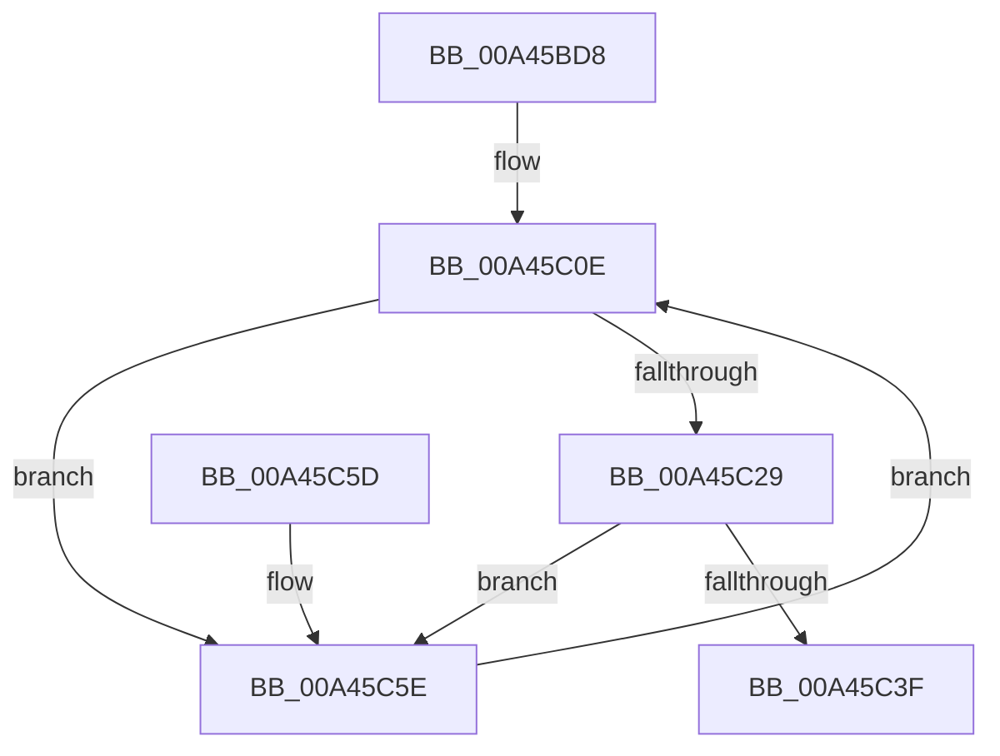

# PspLockRootJobFromProcess

- RVA: `0x00A45BD8`–`0x00A45C8D` (길이 `181` bytes)
- VA: `0x0000000140A45BD8`
- 실행 섹션: `PAGE`
- PDB 이름 있음: `예`; PDB Function 태그: `아니요`
- unwind 정보 RVA: `0x000AF5F0`
- 디코드: `46`개 명령, `181/181` bytes 표시
- 미해석 바이트: `0` (있으면 어셈블리에 `.byte`로 보존)

> 이 문서는 커널 이미지의 기계어와 PDB 기호를 분석해 생성했습니다. 4번과 5번은 함수 원형과 자료형을 바이너리 사용 방식에서 추정한 C 해석이며 원본 소스 복구 결과는 아닙니다.

## 1. Dependencies

- 직접 호출 지점: **2**; 고유 호출 대상: **2**
- 직접 호출자로 확인된 함수: **2**
- RIP 상대 이미지 참조: **0**

### Outgoing calls
- `0x00A45C13` → [PspLockJobExclusive](../91/PspLockJobExclusive_function_0091A4B8.md) (function, `0x0091A4B8`)
- `0x00A45C66` → [PspUnlockJob](../91/PspUnlockJob_function_00919E00.md) (function, `0x00919E00`)

### Direct callers
- [PspRemoveProcessFromJobChain](../90/PspRemoveProcessFromJobChain_function_00907288.md) at `0x0090734A`
- [PspSendProcessNotificationToJobChain](PspSendProcessNotificationToJobChain_function_00A45ADC.md) at `0x00A45B19`

### Static image references
- 디코드된 RIP-relative 메모리 참조가 없습니다.

## 2. Other-region calls and transfers

- 다른 실행 섹션으로 향하는 call: **0**
- 별도 외부 분기/꼬리 이동을 확인하지 못했습니다.

## 3. Assembly (complete function range)

```asm
00A45BD8  48 89 5C 24 10                  mov qword ptr [rsp + 0x10], rbx
00A45BDD  56                              push rsi
00A45BDE  57                              push rdi
00A45BDF  41 56                           push r14
00A45BE1  48 83 EC 20                     sub rsp, 0x20
00A45BE5  48 8B 81 A0 02 00 00            mov rax, qword ptr [rcx + 0x2a0]
00A45BEC  49 8B F1                        mov rsi, r9
00A45BEF  48 89 44 24 40                  mov qword ptr [rsp + 0x40], rax
00A45BF4  4D 8B F0                        mov r14, r8
00A45BF7  48 8B 44 24 40                  mov rax, qword ptr [rsp + 0x40]
00A45BFC  48 8B FA                        mov rdi, rdx
00A45BFF  48 8B D9                        mov rbx, rcx
00A45C02  4C 8B 90 20 05 00 00            mov r10, qword ptr [rax + 0x520]
00A45C09  4C 89 54 24 50                  mov qword ptr [rsp + 0x50], r10
00A45C0E  48 8B 4C 24 50                  mov rcx, qword ptr [rsp + 0x50]
00A45C13  E8 A0 48 ED FF                  call 0x14091a4b8
00A45C18  48 8B 54 24 40                  mov rdx, qword ptr [rsp + 0x40]
00A45C1D  48 8B 83 A0 02 00 00            mov rax, qword ptr [rbx + 0x2a0]
00A45C24  48 3B D0                        cmp rdx, rax
00A45C27  75 35                           jne 0x140a45c5e
00A45C29  48 8B 44 24 40                  mov rax, qword ptr [rsp + 0x40]
00A45C2E  48 8B 88 20 05 00 00            mov rcx, qword ptr [rax + 0x520]
00A45C35  48 8B 44 24 50                  mov rax, qword ptr [rsp + 0x50]
00A45C3A  48 3B C1                        cmp rax, rcx
00A45C3D  75 1F                           jne 0x140a45c5e
00A45C3F  48 8B 44 24 40                  mov rax, qword ptr [rsp + 0x40]
00A45C44  48 8B 5C 24 48                  mov rbx, qword ptr [rsp + 0x48]
00A45C49  49 89 06                        mov qword ptr [r14], rax
00A45C4C  48 8B 44 24 50                  mov rax, qword ptr [rsp + 0x50]
00A45C51  48 89 06                        mov qword ptr [rsi], rax
00A45C54  48 83 C4 20                     add rsp, 0x20
00A45C58  41 5E                           pop r14
00A45C5A  5F                              pop rdi
00A45C5B  5E                              pop rsi
00A45C5C  C3                              ret
00A45C5D  CC                              int3
00A45C5E  48 8B 4C 24 50                  mov rcx, qword ptr [rsp + 0x50]
00A45C63  48 8B D7                        mov rdx, rdi
00A45C66  E8 95 41 ED FF                  call 0x140919e00
00A45C6B  48 8B 83 A0 02 00 00            mov rax, qword ptr [rbx + 0x2a0]
00A45C72  48 8B D7                        mov rdx, rdi
00A45C75  48 89 44 24 40                  mov qword ptr [rsp + 0x40], rax
00A45C7A  48 8B 44 24 40                  mov rax, qword ptr [rsp + 0x40]
00A45C7F  48 8B 88 20 05 00 00            mov rcx, qword ptr [rax + 0x520]
00A45C86  48 89 4C 24 50                  mov qword ptr [rsp + 0x50], rcx
00A45C8B  EB 81                           jmp 0x140a45c0e
```

## 4. C-style interpretation (structured pseudocode)

```c
__int64 __fastcall PspLockRootJobFromProcess(__int64 a1, __int64 a2, __int64 a3, __int64 a4)
{
    __int64 result;
    __int64 v_rsp;
    unsigned __int64 v_stack_p10;
    unsigned __int64 v_stack_p18;
    unsigned __int64 v_stack_p40;
    unsigned __int64 v_stack_p50;
    unsigned __int64 v_stack_p8;

    v_stack_p10 = v_rbx;
    v_rsp = (v_rsp) - (32);
    v_stack_p8 = *(unsigned __int64 *)(a1 + 672);
    v_stack_p18 = *(unsigned __int64 *)(v_stack_p8 + 1312);
loc_00A45C0E:
    result = PspLockJobExclusive(v_stack_p18, a2, a3, a4);
    if (v_stack_p8 != (*(unsigned __int64 *)(a1 + 672))) goto loc_00A45C5E;
    if (v_stack_p18 != (*(unsigned __int64 *)(v_stack_p8 + 1312))) goto loc_00A45C5E;
    *(unsigned __int64 *)(a3) = v_stack_p8;
    *(unsigned __int64 *)(a4) = v_stack_p18;
    v_rsp = (v_rsp) + (32);
    return v_stack_p18;
loc_00A45C5E:
    result = PspUnlockJob(v_stack_p50, a2, a3, a4);
    v_stack_p40 = *(unsigned __int64 *)(v_stack_p10 + 672);
    v_stack_p50 = *(unsigned __int64 *)(v_stack_p40 + 1312);
    goto loc_00A45C0E;
}
```

## 5. (Beta) C Style

```c
int64_t PspLockRootJobFromProcess(void *Arg1, int64_t Arg2, void *Arg3, void *Arg4)
{
    uint8_t *arg1 = (uint8_t *)Arg1;
    uint8_t *arg3 = (uint8_t *)Arg3;
    uint8_t *arg4 = (uint8_t *)Arg4;

    int64_t result;
    int64_t local_rsp;
    uint64_t v_stack_p10;
    uint64_t v_stack_p18;
    uint64_t v_stack_p40;
    uint64_t v_stack_p50;
    uint64_t v_stack_p8;

    v_stack_p10 = local_rbx;
    local_rsp = (local_rsp) - (32);
    v_stack_p8 = *(uint64_t *)(arg1 + 0x2A0);
    v_stack_p18 = *(uint64_t *)(v_stack_p8 + 0x520);
loc_00A45C0E:
    result = PspLockJobExclusive(v_stack_p18, Arg2, Arg3, Arg4);
    if (v_stack_p8 != (*(uint64_t *)(arg1 + 0x2A0))) goto loc_00A45C5E;
    if (v_stack_p18 != (*(uint64_t *)(v_stack_p8 + 0x520))) goto loc_00A45C5E;
    *(uint64_t *)(arg3) = v_stack_p8;
    *(uint64_t *)(arg4) = v_stack_p18;
    local_rsp = (local_rsp) + (32);
    return v_stack_p18;
loc_00A45C5E:
    result = PspUnlockJob(v_stack_p50, Arg2, Arg3, Arg4);
    v_stack_p40 = *(uint64_t *)(v_stack_p10 + 0x2A0);
    v_stack_p50 = *(uint64_t *)(v_stack_p40 + 0x520);
    goto loc_00A45C0E;
}
```

### 관측된 메모리 오프셋

구조체 형식이 확인되지 않은 접근은 인자 기준의 오프셋으로만 기록했습니다.

| 기준 인자 | 오프셋 표현 | 폭 (bit) | 접근 |
|---|---:|---:|---|
| `Arg1` | `+ 0x2A0` | `64` | `R` |
| `Arg3` | `+ 0x0` | `64` | `W` |
| `Arg4` | `+ 0x0` | `64` | `W` |

## 6. Execution-region graph

[열기: 2D/3D 그래프와 함수 탐색 컨트롤 패널](../../../control-panel.html?section=page&rva=0x00A45BD8&view=graph)

- 2D 그래프는 위에서 아래로 흐르고, 3D 그래프는 빈 공간을 드래그해 회전합니다. Shift+드래그는 이동, 휠은 확대·축소, 함수 노드 선택은 대상 보고서 이동입니다.

### Static fallback


