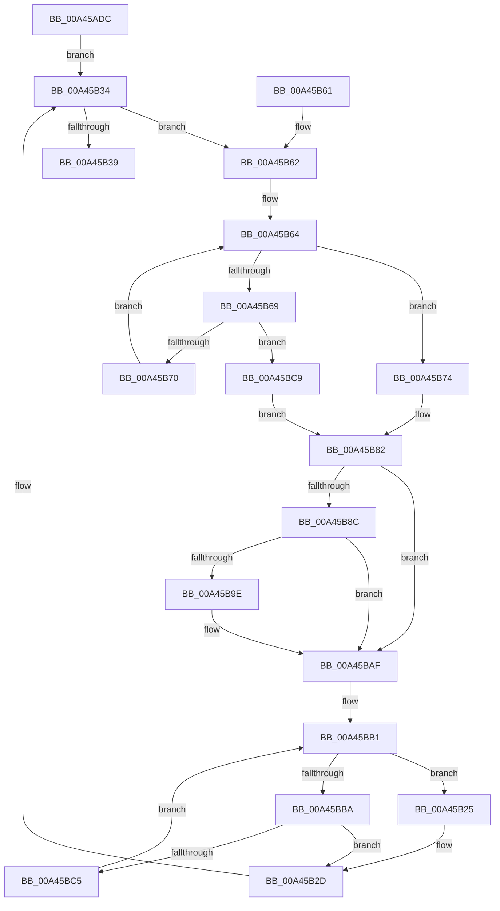

# PspSendProcessNotificationToJobChain

- RVA: `0x00A45ADC`–`0x00A45BCF` (길이 `243` bytes)
- VA: `0x0000000140A45ADC`
- 실행 섹션: `PAGE`
- PDB 이름 있음: `예`; PDB Function 태그: `아니요`
- unwind 정보 RVA: `0x000AF5D4`
- 디코드: `66`개 명령, `243/243` bytes 표시
- 미해석 바이트: `0` (있으면 어셈블리에 `.byte`로 보존)

> 이 문서는 커널 이미지의 기계어와 PDB 기호를 분석해 생성했습니다. 4번과 5번은 함수 원형과 자료형을 바이너리 사용 방식에서 추정한 C 해석이며 원본 소스 복구 결과는 아닙니다.

## 1. Dependencies

- 직접 호출 지점: **5**; 고유 호출 대상: **5**
- 직접 호출자로 확인된 함수: **1**
- RIP 상대 이미지 참조: **0**

### Outgoing calls
- `0x00A45B19` → [PspLockRootJobFromProcess](PspLockRootJobFromProcess_function_00A45BD8.md) (function, `0x00A45BD8`)
- `0x00A45B28` → [ExReleaseResourceLite](../../text/25/ExReleaseResourceLite_function_0025FA10.md) (function, `0x0025FA10`)
- `0x00A45B41` → [PspUnlockJob](../91/PspUnlockJob_function_00919E00.md) (function, `0x00919E00`)
- `0x00A45B7D` → [ExAcquireResourceExclusiveLite](../../text/21/ExAcquireResourceExclusiveLite_function_00214E20.md) (function, `0x00214E20`)
- `0x00A45BAA` → [PspSendJobNotification](../../text/49/PspSendJobNotification_function_0049EC28.md) (function, `0x0049EC28`)

### Direct callers
- [PspRundownSingleProcess](../90/PspRundownSingleProcess_function_00906D50.md) at `0x0090703C`

### Static image references
- 디코드된 RIP-relative 메모리 참조가 없습니다.

## 2. Other-region calls and transfers

- 다른 실행 섹션으로 향하는 call: **3**
  - `0x00A45B28` → [ExReleaseResourceLite](../../text/25/ExReleaseResourceLite_function_0025FA10.md) (`PAGE` → `.text`)
  - `0x00A45B7D` → [ExAcquireResourceExclusiveLite](../../text/21/ExAcquireResourceExclusiveLite_function_00214E20.md) (`PAGE` → `.text`)
  - `0x00A45BAA` → [PspSendJobNotification](../../text/49/PspSendJobNotification_function_0049EC28.md) (`PAGE` → `.text`)
- 별도 외부 분기/꼬리 이동을 확인하지 못했습니다.

## 3. Assembly (complete function range)

```asm
00A45ADC  48 8B C4                        mov rax, rsp
00A45ADF  48 89 58 08                     mov qword ptr [rax + 8], rbx
00A45AE3  48 89 68 10                     mov qword ptr [rax + 0x10], rbp
00A45AE7  48 89 70 18                     mov qword ptr [rax + 0x18], rsi
00A45AEB  48 89 78 20                     mov qword ptr [rax + 0x20], rdi
00A45AEF  41 56                           push r14
00A45AF1  48 83 EC 30                     sub rsp, 0x30
00A45AF5  65 48 8B 34 25 88 01 00 00      mov rsi, qword ptr gs:[0x188]
00A45AFE  4C 8D 48 E8                     lea r9, [rax - 0x18]
00A45B02  48 83 60 F0 00                  and qword ptr [rax - 0x10], 0
00A45B07  4D 8B F0                        mov r14, r8
00A45B0A  48 83 60 E8 00                  and qword ptr [rax - 0x18], 0
00A45B0F  4C 8D 40 F0                     lea r8, [rax - 0x10]
00A45B13  48 8B EA                        mov rbp, rdx
00A45B16  48 8B D6                        mov rdx, rsi
00A45B19  E8 BA 00 00 00                  call 0x140a45bd8
00A45B1E  48 8B 5C 24 28                  mov rbx, qword ptr [rsp + 0x28]
00A45B23  EB 0F                           jmp 0x140a45b34
00A45B25  48 8B CF                        mov rcx, rdi
00A45B28  E8 E3 9E 81 FF                  call 0x14025fa10
00A45B2D  48 8B 9B 18 05 00 00            mov rbx, qword ptr [rbx + 0x518]
00A45B34  48 85 DB                        test rbx, rbx
00A45B37  75 29                           jne 0x140a45b62
00A45B39  48 8B 4C 24 20                  mov rcx, qword ptr [rsp + 0x20]
00A45B3E  48 8B D6                        mov rdx, rsi
00A45B41  E8 BA 42 ED FF                  call 0x140919e00
00A45B46  48 8B 5C 24 40                  mov rbx, qword ptr [rsp + 0x40]
00A45B4B  48 8B 6C 24 48                  mov rbp, qword ptr [rsp + 0x48]
00A45B50  48 8B 74 24 50                  mov rsi, qword ptr [rsp + 0x50]
00A45B55  48 8B 7C 24 58                  mov rdi, qword ptr [rsp + 0x58]
00A45B5A  48 83 C4 30                     add rsp, 0x30
00A45B5E  41 5E                           pop r14
00A45B60  C3                              ret
00A45B61  CC                              int3
00A45B62  33 C9                           xor ecx, ecx
00A45B64  83 F9 01                        cmp ecx, 1
00A45B67  73 0B                           jae 0x140a45b74
00A45B69  48 3B 5C CC 20                  cmp rbx, qword ptr [rsp + rcx*8 + 0x20]
00A45B6E  74 59                           je 0x140a45bc9
00A45B70  FF C1                           inc ecx
00A45B72  EB F0                           jmp 0x140a45b64
00A45B74  48 8D 7B 38                     lea rdi, [rbx + 0x38]
00A45B78  B2 01                           mov dl, 1
00A45B7A  48 8B CF                        mov rcx, rdi
00A45B7D  E8 9E F2 7C FF                  call 0x140214e20
00A45B82  48 83 BB 28 02 00 00 00         cmp qword ptr [rbx + 0x228], 0
00A45B8A  74 23                           je 0x140a45baf
00A45B8C  48 8B CD                        mov rcx, rbp
00A45B8F  BA 01 00 00 00                  mov edx, 1
00A45B94  D3 E2                           shl edx, cl
00A45B96  85 93 50 04 00 00               test dword ptr [rbx + 0x450], edx
00A45B9C  74 11                           je 0x140a45baf
00A45B9E  45 33 C9                        xor r9d, r9d
00A45BA1  4D 8B C6                        mov r8, r14
00A45BA4  48 8B D5                        mov rdx, rbp
00A45BA7  48 8B CB                        mov rcx, rbx
00A45BAA  E8 79 90 A5 FF                  call 0x14049ec28
00A45BAF  33 C9                           xor ecx, ecx
00A45BB1  83 F9 01                        cmp ecx, 1
00A45BB4  0F 83 6B FF FF FF               jae 0x140a45b25
00A45BBA  48 3B 5C CC 20                  cmp rbx, qword ptr [rsp + rcx*8 + 0x20]
00A45BBF  0F 84 68 FF FF FF               je 0x140a45b2d
00A45BC5  FF C1                           inc ecx
00A45BC7  EB E8                           jmp 0x140a45bb1
00A45BC9  48 8D 7B 38                     lea rdi, [rbx + 0x38]
00A45BCD  EB B3                           jmp 0x140a45b82
```

## 4. C-style interpretation (structured pseudocode)

```c
__int64 __fastcall PspSendProcessNotificationToJobChain(__int64 a1, __int64 a2, __int64 a3)
{
    __int64 result;
    __int64 v_rsp;
    unsigned __int64 v_stack_m10;
    unsigned __int64 v_stack_m18;
    unsigned __int64 v_stack_p10;
    unsigned __int64 v_stack_p18;
    unsigned __int64 v_stack_p20;
    unsigned __int64 v_stack_p8;

    *(unsigned __int64 *)(v_rsp + 8) = v_rbx;
    *(unsigned __int64 *)(v_rsp + 16) = v_rbp;
    *(unsigned __int64 *)(v_rsp + 24) = v_rsi;
    *(unsigned __int64 *)(v_rsp + 32) = v_rdi;
    v_rsp = (v_rsp) - (48);
    result = PspLockRootJobFromProcess(a1, *(unsigned __int64 *)(gs_base + (0 + 392)), v_rsp - 16, v_rsp - 24);
    goto loc_00A45B34;
loc_00A45B25:
    result = ExReleaseResourceLite(v_rdi, *(unsigned __int64 *)(gs_base + (0 + 392)), v_rsp - 16, v_rsp - 24);
loc_00A45B2D:
loc_00A45B34:
    if (*(unsigned __int64 *)(v_stack_m10 + 1304) != 0) goto loc_00A45B62;
    result = PspUnlockJob(v_stack_m18, *(unsigned __int64 *)(gs_base + (0 + 392)), v_rsp - 16, v_rsp - 24);
    v_rsp = (v_rsp) + (48);
    return result;
loc_00A45B62:
    a1 = 0;
loc_00A45B64:
    if (0 >= 1) goto loc_00A45B74;
    if (v_stack_p8 == (*(unsigned __int64 *)(v_rsp + a1 * 8 + 32))) goto loc_00A45BC9;
    a1 = (unsigned int)((a1) + 1);
    goto loc_00A45B64;
loc_00A45B74:
    result = ExAcquireResourceExclusiveLite(v_stack_p8 + 56, 1, v_rsp - 16, v_rsp - 24);
loc_00A45B82:
    if ((*(unsigned __int64 *)(v_stack_p8 + 552)) == 0) goto loc_00A45BAF;
    a2 = (unsigned int)((1) << ((unsigned __int8)(v_stack_p10)));
    if (((*(unsigned int *)(v_stack_p8 + 1104)) & ((unsigned int)(a2))) != 0) {
        a4 = 0;
        a3 = a3;
        a2 = v_stack_p10;
        a1 = v_stack_p8;
        result = PspSendJobNotification(a1, a2, a3, a4);
    }
    a1 = 0;
loc_00A45BB1:
    if (0 >= 1) goto loc_00A45B25;
    if (v_stack_p8 == (*(unsigned __int64 *)(v_rsp + a1 * 8 + 32))) goto loc_00A45B2D;
    a1 = (unsigned int)((a1) + 1);
    goto loc_00A45BB1;
loc_00A45BC9:
    goto loc_00A45B82;
}
```

## 5. (Beta) C Style

```c
int64_t PspSendProcessNotificationToJobChain(int64_t Arg1, int64_t Arg2, int64_t Arg3)
{
    int64_t result;
    int64_t local_rsp;
    uint64_t v_stack_m10;
    uint64_t v_stack_m18;
    uint64_t v_stack_p10;
    uint64_t v_stack_p18;
    uint64_t v_stack_p20;
    uint64_t v_stack_p8;

    *(uint64_t *)(local_rsp + 0x8) = local_rbx;
    *(uint64_t *)(local_rsp + 0x10) = local_rbp;
    *(uint64_t *)(local_rsp + 0x18) = local_rsi;
    *(uint64_t *)(local_rsp + 0x20) = local_rdi;
    local_rsp = (local_rsp) - (48);
    result = PspLockRootJobFromProcess(Arg1, *(uint64_t *)(gs_base + (0 + 0x188)), local_rsp - 16, local_rsp - 24);
    goto loc_00A45B34;
loc_00A45B25:
    result = ExReleaseResourceLite(local_rdi, *(uint64_t *)(gs_base + (0 + 0x188)), local_rsp - 16, local_rsp - 24);
loc_00A45B2D:
loc_00A45B34:
    if (*(uint64_t *)(v_stack_m10 + 0x518) != 0) goto loc_00A45B62;
    result = PspUnlockJob(v_stack_m18, *(uint64_t *)(gs_base + (0 + 0x188)), local_rsp - 16, local_rsp - 24);
    local_rsp = (local_rsp) + (48);
    return result;
loc_00A45B62:
    Arg1 = 0;
loc_00A45B64:
    if (0 >= 1) goto loc_00A45B74;
    if (v_stack_p8 == (*(uint64_t *)(local_rsp + Arg1 * 8 + 0x20))) goto loc_00A45BC9;
    Arg1 = (uint32_t)((Arg1) + 1);
    goto loc_00A45B64;
loc_00A45B74:
    result = ExAcquireResourceExclusiveLite(v_stack_p8 + 56, 1, local_rsp - 16, local_rsp - 24);
loc_00A45B82:
    if ((*(uint64_t *)(v_stack_p8 + 0x228)) == 0) goto loc_00A45BAF;
    Arg2 = (uint32_t)((1) << ((uint8_t)(v_stack_p10)));
    if (((*(uint32_t *)(v_stack_p8 + 0x450)) & ((uint32_t)(Arg2))) != 0) {
        a4 = 0;
        Arg3 = Arg3;
        Arg2 = v_stack_p10;
        Arg1 = v_stack_p8;
        result = PspSendJobNotification(Arg1, Arg2, Arg3, a4);
    }
    Arg1 = 0;
loc_00A45BB1:
    if (0 >= 1) goto loc_00A45B25;
    if (v_stack_p8 == (*(uint64_t *)(local_rsp + Arg1 * 8 + 0x20))) goto loc_00A45B2D;
    Arg1 = (uint32_t)((Arg1) + 1);
    goto loc_00A45BB1;
loc_00A45BC9:
    goto loc_00A45B82;
}
```

## 6. Execution-region graph

[열기: 2D/3D 그래프와 함수 탐색 컨트롤 패널](../../../control-panel.html?section=page&rva=0x00A45ADC&view=graph)

- 2D 그래프는 위에서 아래로 흐르고, 3D 그래프는 빈 공간을 드래그해 회전합니다. Shift+드래그는 이동, 휠은 확대·축소, 함수 노드 선택은 대상 보고서 이동입니다.

### Static fallback


