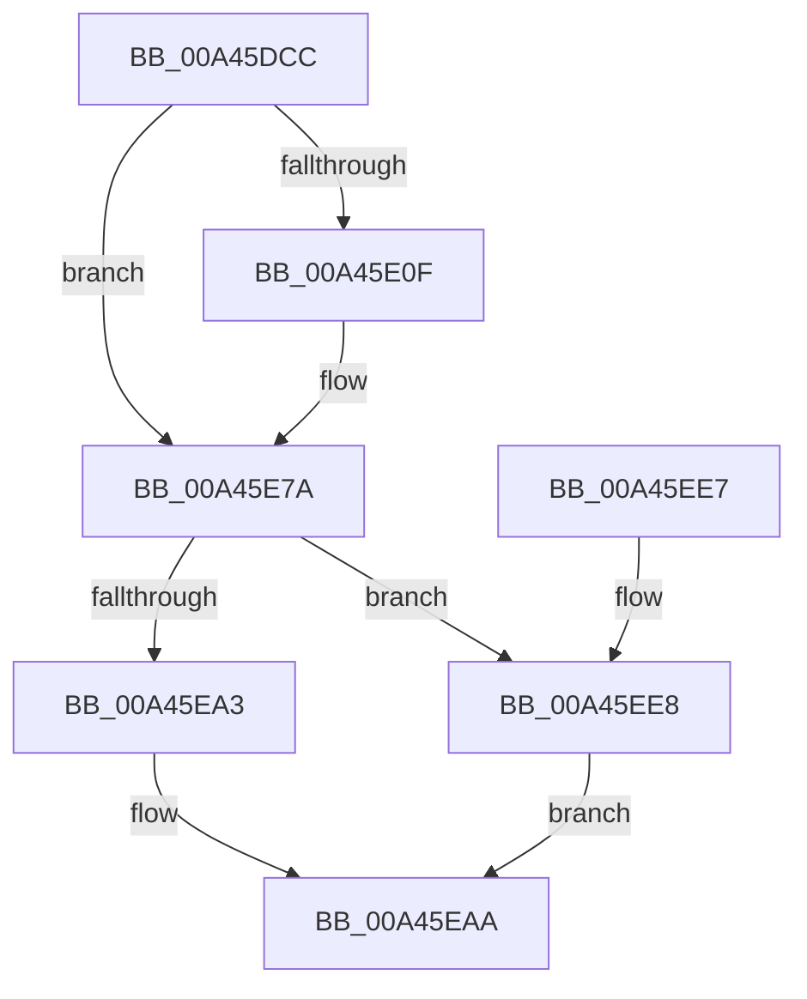

# PspSetProcessForegroundBackgroundRequest

- RVA: `0x00A45DCC`–`0x00A45F12` (길이 `326` bytes)
- VA: `0x0000000140A45DCC`
- 실행 섹션: `PAGE`
- PDB 이름 있음: `예`; PDB Function 태그: `아니요`
- unwind 정보 RVA: `0x000AF614`
- 디코드: `87`개 명령, `326/326` bytes 표시
- 미해석 바이트: `0` (있으면 어셈블리에 `.byte`로 보존)

> 이 문서는 커널 이미지의 기계어와 PDB 기호를 분석해 생성했습니다. 4번과 5번은 함수 원형과 자료형을 바이너리 사용 방식에서 추정한 C 해석이며 원본 소스 복구 결과는 아닙니다.

## 1. Dependencies

- 직접 호출 지점: **5**; 고유 호출 대상: **5**
- 직접 호출자로 확인된 함수: **2**
- RIP 상대 이미지 참조: **3**

### Outgoing calls
- `0x00A45E75` → [tlgWriteTransfer_EtwWriteTransfer](../../text/42/tlgWriteTransfer_EtwWriteTransfer_function_004260E0.md) (function, `0x004260E0`)
- `0x00A45E99` → [PspLockProcessExclusive](../../text/46/PspLockProcessExclusive_function_00460164.md) (function, `0x00460164`)
- `0x00A45EAF` → [PspSetProcessPriorityByClass](../../text/4E/PspSetProcessPriorityByClass_function_004E9754.md) (function, `0x004E9754`)
- `0x00A45EBA` → [PspUnlockProcessExclusive](../../text/46/PspUnlockProcessExclusive_function_004601C0.md) (function, `0x004601C0`)
- `0x00A45EC6` → [_security_check_cookie](../../text/6A/_security_check_cookie_function_006AC640.md) (function, `0x006AC640`)

### Direct callers
- [PsSetProcessPriorityByClass](PsSetProcessPriorityByClass_function_00A45DA0.md) at `0x00A45DBD`
- [NtSetInformationProcess](../AE/NtSetInformationProcess_function_00AE5370.md) at `0x00AE5A91`
- [NtSetInformationProcess](../AE/NtSetInformationProcess_function_00AE5370.md) at `0x00AE5D67`
- [NtSetInformationProcess](../AE/NtSetInformationProcess_function_00AE5370.md) at `0x00AE976D`

### Static image references
- `0x00A45DEA` → RVA `0x00E0A740` (`.data`; read)
- `0x00A45DF8` → RVA `0x00E08640` (`.data`; read)
- `0x00A45E4D` → RVA `0x00052CCC` (`.rdata`; read)

## 2. Other-region calls and transfers

- 다른 실행 섹션으로 향하는 call: **5**
  - `0x00A45E75` → [tlgWriteTransfer_EtwWriteTransfer](../../text/42/tlgWriteTransfer_EtwWriteTransfer_function_004260E0.md) (`PAGE` → `.text`)
  - `0x00A45E99` → [PspLockProcessExclusive](../../text/46/PspLockProcessExclusive_function_00460164.md) (`PAGE` → `.text`)
  - `0x00A45EAF` → [PspSetProcessPriorityByClass](../../text/4E/PspSetProcessPriorityByClass_function_004E9754.md) (`PAGE` → `.text`)
  - `0x00A45EBA` → [PspUnlockProcessExclusive](../../text/46/PspUnlockProcessExclusive_function_004601C0.md) (`PAGE` → `.text`)
  - `0x00A45EC6` → [_security_check_cookie](../../text/6A/_security_check_cookie_function_006AC640.md) (`PAGE` → `.text`)
- 별도 외부 분기/꼬리 이동을 확인하지 못했습니다.

## 3. Assembly (complete function range)

```asm
00A45DCC  48 89 5C 24 10                  mov qword ptr [rsp + 0x10], rbx
00A45DD1  48 89 74 24 18                  mov qword ptr [rsp + 0x18], rsi
00A45DD6  55                              push rbp
00A45DD7  57                              push rdi
00A45DD8  41 54                           push r12
00A45DDA  41 56                           push r14
00A45DDC  41 57                           push r15
00A45DDE  48 8D 6C 24 C9                  lea rbp, [rsp - 0x37]
00A45DE3  48 81 EC A0 00 00 00            sub rsp, 0xa0
00A45DEA  48 8B 05 4F 49 3C 00            mov rax, qword ptr [rip + 0x3c494f]
00A45DF1  48 33 C4                        xor rax, rsp
00A45DF4  48 89 45 27                     mov qword ptr [rbp + 0x27], rax
00A45DF8  83 3D 41 28 3C 00 05            cmp dword ptr [rip + 0x3c2841], 5
00A45DFF  45 8A F0                        mov r14b, r8b
00A45E02  44 8A E2                        mov r12b, dl
00A45E05  48 8B D9                        mov rbx, rcx
00A45E08  BE 01 00 00 00                  mov esi, 1
00A45E0D  76 6B                           jbe 0x140a45e7a
00A45E0F  8B 81 D0 01 00 00               mov eax, dword ptr [rcx + 0x1d0]
00A45E15  45 33 C9                        xor r9d, r9d
00A45E18  83 65 03 00                     and dword ptr [rbp + 3], 0
00A45E1C  48 8D 0D 1D 28 3C 00            lea rcx, [rip + 0x3c281d]
00A45E23  83 65 13 00                     and dword ptr [rbp + 0x13], 0
00A45E27  83 65 23 00                     and dword ptr [rbp + 0x23], 0
00A45E2B  89 45 CB                        mov dword ptr [rbp - 0x35], eax
00A45E2E  48 8D 45 CB                     lea rax, [rbp - 0x35]
00A45E32  48 89 45 F7                     mov qword ptr [rbp - 9], rax
00A45E36  48 8D 45 C7                     lea rax, [rbp - 0x39]
00A45E3A  48 89 45 07                     mov qword ptr [rbp + 7], rax
00A45E3E  48 8D 45 C8                     lea rax, [rbp - 0x38]
00A45E42  48 89 45 17                     mov qword ptr [rbp + 0x17], rax
00A45E46  48 8D 45 D7                     lea rax, [rbp - 0x29]
00A45E4A  88 55 C7                        mov byte ptr [rbp - 0x39], dl
00A45E4D  48 8D 15 78 CE 60 FF            lea rdx, [rip - 0x9f3188]
00A45E54  44 88 45 C8                     mov byte ptr [rbp - 0x38], r8b
00A45E58  45 33 C0                        xor r8d, r8d
00A45E5B  48 89 44 24 28                  mov qword ptr [rsp + 0x28], rax
00A45E60  C7 44 24 20 05 00 00 00         mov dword ptr [rsp + 0x20], 5
00A45E68  C7 45 FF 04 00 00 00            mov dword ptr [rbp - 1], 4
00A45E6F  89 75 0F                        mov dword ptr [rbp + 0xf], esi
00A45E72  89 75 1F                        mov dword ptr [rbp + 0x1f], esi
00A45E75  E8 66 02 9E FF                  call 0x1404260e0
00A45E7A  65 4C 8B 3C 25 88 01 00 00      mov r15, qword ptr gs:[0x188]
00A45E83  41 8A C6                        mov al, r14b
00A45E86  F6 D8                           neg al
00A45E88  49 8B D7                        mov rdx, r15
00A45E8B  B8 00 00 01 00                  mov eax, 0x10000
00A45E90  48 8B CB                        mov rcx, rbx
00A45E93  1B FF                           sbb edi, edi
00A45E95  23 F8                           and edi, eax
00A45E97  03 F8                           add edi, eax
00A45E99  E8 C6 A2 A1 FF                  call 0x140460164
00A45E9E  45 84 E4                        test r12b, r12b
00A45EA1  74 45                           je 0x140a45ee8
00A45EA3  F0 09 BB FC 05 00 00            lock or dword ptr [rbx + 0x5fc], edi
00A45EAA  8B D6                           mov edx, esi
00A45EAC  48 8B CB                        mov rcx, rbx
00A45EAF  E8 A0 38 AA FF                  call 0x1404e9754
00A45EB4  49 8B D7                        mov rdx, r15
00A45EB7  48 8B CB                        mov rcx, rbx
00A45EBA  E8 01 A3 A1 FF                  call 0x1404601c0
00A45EBF  48 8B 4D 27                     mov rcx, qword ptr [rbp + 0x27]
00A45EC3  48 33 CC                        xor rcx, rsp
00A45EC6  E8 75 67 C6 FF                  call 0x1406ac640
00A45ECB  4C 8D 9C 24 A0 00 00 00         lea r11, [rsp + 0xa0]
00A45ED3  49 8B 5B 38                     mov rbx, qword ptr [r11 + 0x38]
00A45ED7  49 8B 73 40                     mov rsi, qword ptr [r11 + 0x40]
00A45EDB  49 8B E3                        mov rsp, r11
00A45EDE  41 5F                           pop r15
00A45EE0  41 5E                           pop r14
00A45EE2  41 5C                           pop r12
00A45EE4  5F                              pop rdi
00A45EE5  5D                              pop rbp
00A45EE6  C3                              ret
00A45EE7  CC                              int3
00A45EE8  44 8B 83 FC 05 00 00            mov r8d, dword ptr [rbx + 0x5fc]
00A45EEF  F7 D7                           not edi
00A45EF1  F0 21 BB FC 05 00 00            lock and dword ptr [rbx + 0x5fc], edi
00A45EF8  41 F6 DE                        neg r14b
00A45EFB  1B C0                           sbb eax, eax
00A45EFD  25 00 00 FF FF                  and eax, 0xffff0000
00A45F02  05 00 00 02 00                  add eax, 0x20000
00A45F07  41 23 C0                        and eax, r8d
00A45F0A  F7 D8                           neg eax
00A45F0C  1B C0                           sbb eax, eax
00A45F0E  23 F0                           and esi, eax
00A45F10  EB 98                           jmp 0x140a45eaa
```

## 4. C-style interpretation (structured pseudocode)

```c
__int64 __fastcall PspSetProcessForegroundBackgroundRequest(__int64 a1, unsigned __int8 a2, int a3, int a4)
{
    __int64 result;
    __int64 v_r14;
    __int64 v_rdi;
    __int64 v_rsi;
    __int64 v_rsp;
    unsigned __int64 v_stack_m28;
    unsigned __int64 v_stack_m38;
    unsigned int v_stack_m3C;
    unsigned int v_stack_m40;
    unsigned __int64 v_stack_m48;
    unsigned int v_stack_m4C;
    unsigned int v_stack_m50;
    unsigned __int64 v_stack_m58;
    unsigned int v_stack_m5C;
    unsigned __int64 v_stack_m5F;
    unsigned int v_stack_m60;
    unsigned __int64 v_stack_m68;
    unsigned __int64 v_stack_m88;
    unsigned int v_stack_m94;
    unsigned __int64 v_stack_m97;
    unsigned __int64 v_stack_m98;
    unsigned __int64 v_stack_mA0;
    unsigned int v_stack_mA8;
    unsigned __int64 v_stack_p10;
    unsigned __int64 v_stack_p18;

    v_stack_p10 = v_rbx;
    v_stack_p18 = v_rsi;
    v_rsp = (v_rsp) - (160);
    result = (*(unsigned __int64 *)(v_rip + 3950927)) ^ (v_rsp);
    v_stack_m38 = result;
    if ((*(unsigned int *)(v_rip + 3942465)) >= = 5) {
        result = *(unsigned int *)(a1 + 464);
        a4 = 0;
        a1 = v_rip + 3942429;
        v_stack_m94 = (unsigned int)(result);
        result = v_stack_m94;
        v_stack_m68 = result;
        result = v_stack_m98;
        v_stack_m58 = result;
        result = v_stack_m97;
        v_stack_m48 = result;
        result = v_stack_m88;
        v_stack_m98 = a2;
        a2 = v_rip - 10432904;
        v_stack_m97 = (unsigned __int8)(a3);
        a3 = 0;
        v_stack_mA0 = result;
        v_stack_mA8 = 5;
        v_stack_m60 = 4;
        v_stack_m50 = 1;
        v_stack_m40 = 1;
        result = tlgWriteTransfer_EtwWriteTransfer(a1, a2, a3, a4);
    }
    result = (unsigned __int8)(-((unsigned __int8)((unsigned __int8)(a3))));
    v_rdi = (unsigned int)((v_rdi) & ((unsigned int)((unsigned int)(0x10000ULL))));
    v_rdi = (unsigned int)((v_rdi) + ((unsigned int)((unsigned int)(0x10000ULL))));
    result = PspLockProcessExclusive(a1, *(unsigned __int64 *)(gs_base + (0 + 392)), a3, a4);
    if (a2 == 0) goto loc_00A45EE8;
loc_00A45EAA:
    result = PspSetProcessPriorityByClass(a1, 1, a3, a4);
    result = PspUnlockProcessExclusive(a1, *(unsigned __int64 *)(gs_base + (0 + 392)), a3, a4);
    a1 = (v_stack_m38) ^ (v_rsp);
    result = _security_check_cookie(a1, *(unsigned __int64 *)(gs_base + (0 + 392)), a3, a4);
    return result;
loc_00A45EE8:
    v_rdi = (unsigned int)(~(v_rdi));
    v_r14 = (unsigned __int8)(-((unsigned __int8)(a3)));
    result = (unsigned int)((result) & (0xFFFF0000ULL));
    result = (unsigned int)((result) + (0x20000ULL));
    result = (unsigned int)((result) & ((unsigned int)((unsigned int)(*(unsigned int *)(*(unsigned __int64 *)(v_stack_m28 + 56) + 1532)))));
    result = (unsigned int)(-(result));
    v_rsi = (unsigned int)((*(unsigned __int64 *)(v_stack_m28 + 64)) & ((unsigned int)(result)));
    goto loc_00A45EAA;
}
```

## 5. (Beta) C Style

```c
int64_t PspSetProcessForegroundBackgroundRequest(void *Arg1, uint8_t Arg2, int32_t Arg3, int32_t Arg4)
{
    uint8_t *arg1 = (uint8_t *)Arg1;

    int64_t result;
    int64_t local_r14;
    int64_t local_rdi;
    int64_t local_rsi;
    int64_t local_rsp;
    uint64_t v_stack_m28;
    uint64_t v_stack_m38;
    uint32_t v_stack_m3C;
    uint32_t v_stack_m40;
    uint64_t v_stack_m48;
    uint32_t v_stack_m4C;
    uint32_t v_stack_m50;
    uint64_t v_stack_m58;
    uint32_t v_stack_m5C;
    uint64_t v_stack_m5F;
    uint32_t v_stack_m60;
    uint64_t v_stack_m68;
    uint64_t v_stack_m88;
    uint32_t v_stack_m94;
    uint64_t v_stack_m97;
    uint64_t v_stack_m98;
    uint64_t v_stack_mA0;
    uint32_t v_stack_mA8;
    uint64_t v_stack_p10;
    uint64_t v_stack_p18;

    v_stack_p10 = local_rbx;
    v_stack_p18 = local_rsi;
    local_rsp = (local_rsp) - (160);
    result = (*(uint64_t *)(v_rip + 0x3C494F)) ^ (local_rsp);
    v_stack_m38 = result;
    if ((*(uint32_t *)(v_rip + 0x3C2841)) >= = 5) {
        result = *(uint32_t *)(arg1 + 0x1D0);
        Arg4 = 0;
        Arg1 = v_rip + 3942429;
        v_stack_m94 = (uint32_t)(result);
        result = v_stack_m94;
        v_stack_m68 = result;
        result = v_stack_m98;
        v_stack_m58 = result;
        result = v_stack_m97;
        v_stack_m48 = result;
        result = v_stack_m88;
        v_stack_m98 = Arg2;
        Arg2 = v_rip - 10432904;
        v_stack_m97 = (uint8_t)(Arg3);
        Arg3 = 0;
        v_stack_mA0 = result;
        v_stack_mA8 = 5;
        v_stack_m60 = 4;
        v_stack_m50 = 1;
        v_stack_m40 = 1;
        result = tlgWriteTransfer_EtwWriteTransfer(Arg1, Arg2, Arg3, Arg4);
    }
    result = (uint8_t)(-((uint8_t)((uint8_t)(Arg3))));
    local_rdi = (uint32_t)((local_rdi) & ((uint32_t)((uint32_t)(0x10000ULL))));
    local_rdi = (uint32_t)((local_rdi) + ((uint32_t)((uint32_t)(0x10000ULL))));
    result = PspLockProcessExclusive(Arg1, *(uint64_t *)(gs_base + (0 + 0x188)), Arg3, Arg4);
    if (Arg2 == 0) goto loc_00A45EE8;
loc_00A45EAA:
    result = PspSetProcessPriorityByClass(Arg1, 1, Arg3, Arg4);
    result = PspUnlockProcessExclusive(Arg1, *(uint64_t *)(gs_base + (0 + 0x188)), Arg3, Arg4);
    Arg1 = (v_stack_m38) ^ (local_rsp);
    result = _security_check_cookie(Arg1, *(uint64_t *)(gs_base + (0 + 0x188)), Arg3, Arg4);
    return result;
loc_00A45EE8:
    local_rdi = (uint32_t)(~(local_rdi));
    local_r14 = (uint8_t)(-((uint8_t)(Arg3)));
    result = (uint32_t)((result) & (0xFFFF0000ULL));
    result = (uint32_t)((result) + (0x20000ULL));
    result = (uint32_t)((result) & ((uint32_t)((uint32_t)(*(uint32_t *)(*(uint64_t *)(v_stack_m28 + 0x38) + 0x5FC)))));
    result = (uint32_t)(-(result));
    local_rsi = (uint32_t)((*(uint64_t *)(v_stack_m28 + 0x40)) & ((uint32_t)(result)));
    goto loc_00A45EAA;
}
```

### 관측된 메모리 오프셋

구조체 형식이 확인되지 않은 접근은 인자 기준의 오프셋으로만 기록했습니다.

| 기준 인자 | 오프셋 표현 | 폭 (bit) | 접근 |
|---|---:|---:|---|
| `Arg1` | `+ 0x1D0` | `32` | `R` |
| `Arg1` | `+ 0x5FC` | `32` | `R` |
| `Arg1` | `+ 0x5FC` | `32` | `R/W` |

## 6. Execution-region graph

[열기: 2D/3D 그래프와 함수 탐색 컨트롤 패널](../../../control-panel.html?section=page&rva=0x00A45DCC&view=graph)

- 2D 그래프는 위에서 아래로 흐르고, 3D 그래프는 빈 공간을 드래그해 회전합니다. Shift+드래그는 이동, 휠은 확대·축소, 함수 노드 선택은 대상 보고서 이동입니다.

### Static fallback


