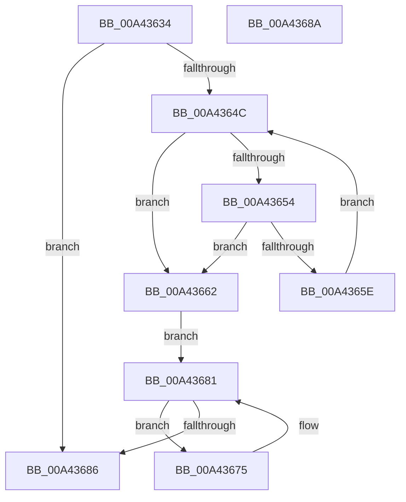

# PspSetProcessShortName

- RVA: `0x00A43634`–`0x00A4368B` (길이 `87` bytes)
- VA: `0x0000000140A43634`
- 실행 섹션: `PAGE`
- PDB 이름 있음: `예`; PDB Function 태그: `아니요`
- unwind 정보 RVA: `0x000DB714`
- 디코드: `30`개 명령, `87/87` bytes 표시
- 미해석 바이트: `0` (있으면 어셈블리에 `.byte`로 보존)

> 이 문서는 커널 이미지의 기계어와 PDB 기호를 분석해 생성했습니다. 4번과 5번은 함수 원형과 자료형을 바이너리 사용 방식에서 추정한 C 해석이며 원본 소스 복구 결과는 아닙니다.

## 1. Dependencies

- 직접 호출 지점: **0**; 고유 호출 대상: **0**
- 직접 호출자로 확인된 함수: **2**
- RIP 상대 이미지 참조: **0**

### Outgoing calls
- 직접 디코드된 call 명령이 없습니다.

### Direct callers
- [PspSetMinimalProcessName](../78/PspSetMinimalProcessName_function_00787674.md) at `0x007876F1`
- [PspInitializeFullProcessImageName](PspInitializeFullProcessImageName_function_00A4345C.md) at `0x00A434D3`

### Static image references
- 디코드된 RIP-relative 메모리 참조가 없습니다.

## 2. Other-region calls and transfers

- 다른 실행 섹션으로 향하는 call: **0**
- 별도 외부 분기/꼬리 이동을 확인하지 못했습니다.

## 3. Assembly (complete function range)

```asm
00A43634  4C 8B 4A 08                     mov r9, qword ptr [rdx + 8]
00A43638  48 81 C1 38 03 00 00            add rcx, 0x338
00A4363F  0F B7 02                        movzx eax, word ptr [rdx]
00A43642  33 D2                           xor edx, edx
00A43644  49 03 C1                        add rax, r9
00A43647  4D 85 C9                        test r9, r9
00A4364A  74 3A                           je 0x140a43686
00A4364C  4C 8B C0                        mov r8, rax
00A4364F  49 3B C1                        cmp rax, r9
00A43652  76 0E                           jbe 0x140a43662
00A43654  48 83 E8 02                     sub rax, 2
00A43658  66 83 38 5C                     cmp word ptr [rax], 0x5c
00A4365C  74 04                           je 0x140a43662
00A4365E  FF C2                           inc edx
00A43660  EB EA                           jmp 0x140a4364c
00A43662  83 FA 0F                        cmp edx, 0xf
00A43665  B8 0E 00 00 00                  mov eax, 0xe
00A4366A  0F 43 D0                        cmovae edx, eax
00A4366D  44 8B CA                        mov r9d, edx
00A43670  4C 03 C9                        add r9, rcx
00A43673  EB 0C                           jmp 0x140a43681
00A43675  41 8A 00                        mov al, byte ptr [r8]
00A43678  4D 8D 40 02                     lea r8, [r8 + 2]
00A4367C  88 01                           mov byte ptr [rcx], al
00A4367E  48 FF C1                        inc rcx
00A43681  49 3B C9                        cmp rcx, r9
00A43684  72 EF                           jb 0x140a43675
00A43686  C6 01 00                        mov byte ptr [rcx], 0
00A43689  C3                              ret
00A4368A  CC                              int3
```

## 4. C-style interpretation (structured pseudocode)

```c
__int64 __fastcall PspSetProcessShortName(__int64 a1, __int64 a2)
{
    __int64 result;

    a1 = (a1) + (824);
    a2 = 0;
    result = (*(unsigned __int16 *)(a2)) + (*(unsigned __int64 *)(a2 + 8));
    if (*(unsigned __int64 *)(a2 + 8) == 0) goto loc_00A43686;
loc_00A4364C:
    if (result <= (*(unsigned __int64 *)(a2 + 8))) goto loc_00A43662;
    result = (result) - (2);
    if ((*(unsigned __int16 *)(result)) == 92) goto loc_00A43662;
    a2 = (unsigned int)((a2) + 1);
    goto loc_00A4364C;
loc_00A43662:
    if (((unsigned int)(a2)) >= 15) { a2 = 14; }
    a4 = ((unsigned int)((unsigned int)(a2))) + (a1);
    goto loc_00A43681;
loc_00A43675:
    *(unsigned __int8 *)(a1) = (unsigned __int8)(*(unsigned __int8 *)(result));
    a1 = (a1) + 1;
loc_00A43681:
    if (a1 < a4) goto loc_00A43675;
loc_00A43686:
    *(unsigned __int8 *)(a1) = 0;
    return *(unsigned __int8 *)(result);
}
```

## 5. (Beta) C Style

```c
int64_t PspSetProcessShortName(int64_t Arg1, void *Arg2)
{
    uint8_t *arg2 = (uint8_t *)Arg2;

    int64_t result;

    Arg1 = (Arg1) + (824);
    Arg2 = 0;
    result = (*(uint16_t *)(arg2)) + (*(uint64_t *)(arg2 + 0x8));
    if (*(uint64_t *)(arg2 + 0x8) == 0) goto loc_00A43686;
loc_00A4364C:
    if (result <= (*(uint64_t *)(arg2 + 0x8))) goto loc_00A43662;
    result = (result) - (2);
    if ((*(uint16_t *)(result)) == 92) goto loc_00A43662;
    Arg2 = (uint32_t)((Arg2) + 1);
    goto loc_00A4364C;
loc_00A43662:
    if (((uint32_t)(Arg2)) >= 15) { Arg2 = 14; }
    a4 = ((uint32_t)((uint32_t)(Arg2))) + (Arg1);
    goto loc_00A43681;
loc_00A43675:
    *(uint8_t *)(Arg1) = (uint8_t)(*(uint8_t *)(result));
    Arg1 = (Arg1) + 1;
loc_00A43681:
    if (Arg1 < a4) goto loc_00A43675;
loc_00A43686:
    *(uint8_t *)(Arg1) = 0;
    return *(uint8_t *)(result);
}
```

### 관측된 메모리 오프셋

구조체 형식이 확인되지 않은 접근은 인자 기준의 오프셋으로만 기록했습니다.

| 기준 인자 | 오프셋 표현 | 폭 (bit) | 접근 |
|---|---:|---:|---|
| `Arg2` | `+ 0x0` | `16` | `R` |
| `Arg2` | `+ 0x8` | `64` | `R` |

## 6. Execution-region graph

[열기: 2D/3D 그래프와 함수 탐색 컨트롤 패널](../../../control-panel.html?section=page&rva=0x00A43634&view=graph)

- 2D 그래프는 위에서 아래로 흐르고, 3D 그래프는 빈 공간을 드래그해 회전합니다. Shift+드래그는 이동, 휠은 확대·축소, 함수 노드 선택은 대상 보고서 이동입니다.

### Static fallback


