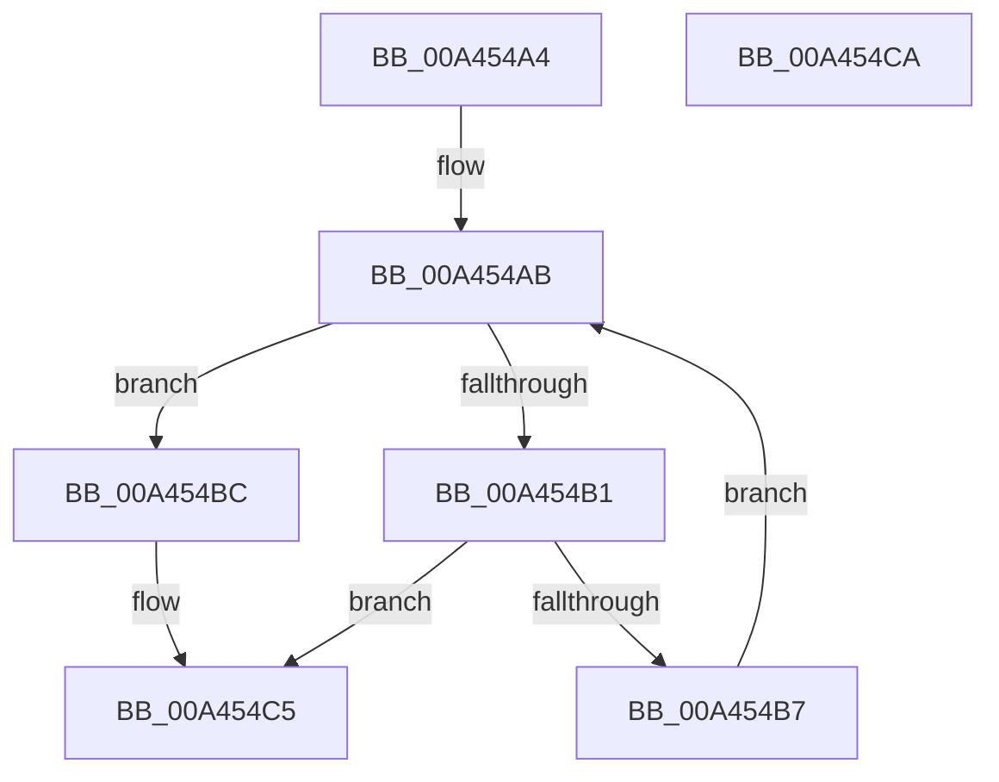

# PspUnlockJobConditionally

- RVA: `0x00A454A4`–`0x00A454CB` (길이 `39` bytes)
- VA: `0x0000000140A454A4`
- 실행 섹션: `PAGE`
- PDB 이름 있음: `예`; PDB Function 태그: `아니요`
- unwind 정보 RVA: `0x0005C788`
- 디코드: `13`개 명령, `39/39` bytes 표시
- 미해석 바이트: `0` (있으면 어셈블리에 `.byte`로 보존)

> 이 문서는 커널 이미지의 기계어와 PDB 기호를 분석해 생성했습니다. 4번과 5번은 함수 원형과 자료형을 바이너리 사용 방식에서 추정한 C 해석이며 원본 소스 복구 결과는 아닙니다.

## 1. Dependencies

- 직접 호출 지점: **1**; 고유 호출 대상: **1**
- 직접 호출자로 확인된 함수: **4**
- RIP 상대 이미지 참조: **0**

### Outgoing calls
- `0x00A454C0` → [ExReleaseResourceLite](../../text/25/ExReleaseResourceLite_function_0025FA10.md) (function, `0x0025FA10`)

### Direct callers
- [PspJobDelete](../../text/4B/PspJobDelete_function_004BF8F0.md) at `0x004BF9DB`
- [PspJobDelete](../../text/4B/PspJobDelete_function_004BF8F0.md) at `0x004BFA30`
- [PspSetNetRateControl](../78/PspSetNetRateControl_function_00785944.md) at `0x00785BCD`
- [PspRemoveProcessFromJobChain](../90/PspRemoveProcessFromJobChain_function_00907288.md) at `0x0090749E`
- [PspRemoveProcessFromJobChain](../90/PspRemoveProcessFromJobChain_function_00907288.md) at `0x009074E7`
- [PspRemoveProcessFromJobChain](../90/PspRemoveProcessFromJobChain_function_00907288.md) at `0x00907546`
- [NtSetInformationJobObject](../9F/NtSetInformationJobObject_function_009F84C0.md) at `0x009FABC8`

### Static image references
- 디코드된 RIP-relative 메모리 참조가 없습니다.

## 2. Other-region calls and transfers

- 다른 실행 섹션으로 향하는 call: **1**
  - `0x00A454C0` → [ExReleaseResourceLite](../../text/25/ExReleaseResourceLite_function_0025FA10.md) (`PAGE` → `.text`)
- 별도 외부 분기/꼬리 이동을 확인하지 못했습니다.

## 3. Assembly (complete function range)

```asm
00A454A4  48 83 EC 28                     sub rsp, 0x28
00A454A8  45 33 C0                        xor r8d, r8d
00A454AB  41 83 F8 01                     cmp r8d, 1
00A454AF  73 0B                           jae 0x140a454bc
00A454B1  4A 3B 0C C2                     cmp rcx, qword ptr [rdx + r8*8]
00A454B5  74 0E                           je 0x140a454c5
00A454B7  41 FF C0                        inc r8d
00A454BA  EB EF                           jmp 0x140a454ab
00A454BC  48 83 C1 38                     add rcx, 0x38
00A454C0  E8 4B A5 81 FF                  call 0x14025fa10
00A454C5  48 83 C4 28                     add rsp, 0x28
00A454C9  C3                              ret
00A454CA  CC                              int3
```

## 4. C-style interpretation (structured pseudocode)

```c
__int64 __fastcall PspUnlockJobConditionally(__int64 a1, __int64 a2, int a3)
{
    __int64 result;
    __int64 v_rsp;

    v_rsp = (v_rsp) - (40);
    a3 = 0;
loc_00A454AB:
    if (0 >= 1) goto loc_00A454BC;
    if (a1 == (*(unsigned __int64 *)(a2 + a3 * 8))) goto loc_00A454C5;
    a3 = (unsigned int)((a3) + 1);
    goto loc_00A454AB;
loc_00A454BC:
    a1 = (a1) + (56);
    result = ExReleaseResourceLite(a1, a2, a3, a4);
loc_00A454C5:
    v_rsp = (v_rsp) + (40);
    return result;
}
```

## 5. (Beta) C Style

```c
int64_t PspUnlockJobConditionally(int64_t Arg1, void *Arg2, int32_t Arg3)
{
    uint8_t *arg2 = (uint8_t *)Arg2;

    int64_t result;
    int64_t local_rsp;

    local_rsp = (local_rsp) - (40);
    Arg3 = 0;
loc_00A454AB:
    if (0 >= 1) goto loc_00A454BC;
    if (Arg1 == (*(uint64_t *)(arg2 + Arg3 * 8))) goto loc_00A454C5;
    Arg3 = (uint32_t)((Arg3) + 1);
    goto loc_00A454AB;
loc_00A454BC:
    Arg1 = (Arg1) + (56);
    result = ExReleaseResourceLite(Arg1, Arg2, Arg3, a4);
loc_00A454C5:
    local_rsp = (local_rsp) + (40);
    return result;
}
```

### 관측된 메모리 오프셋

구조체 형식이 확인되지 않은 접근은 인자 기준의 오프셋으로만 기록했습니다.

| 기준 인자 | 오프셋 표현 | 폭 (bit) | 접근 |
|---|---:|---:|---|
| `Arg2` | `+ 0x0 + r8*8` | `64` | `R` |

## 6. Execution-region graph

[열기: 2D/3D 그래프와 함수 탐색 컨트롤 패널](../../../control-panel.html?section=page&rva=0x00A454A4&view=graph)

- 2D 그래프는 위에서 아래로 흐르고, 3D 그래프는 빈 공간을 드래그해 회전합니다. Shift+드래그는 이동, 휠은 확대·축소, 함수 노드 선택은 대상 보고서 이동입니다.

### Static fallback


