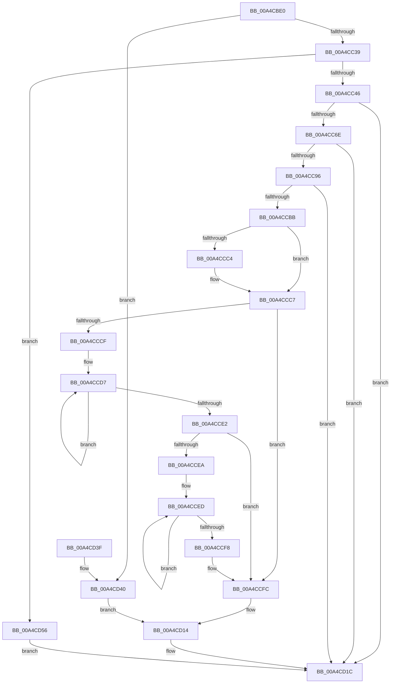

# RtlGetSetBootStatusData

- RVA: `0x00A4CBE0`–`0x00A4CD5D` (길이 `381` bytes)
- VA: `0x0000000140A4CBE0`
- 실행 섹션: `PAGE`
- PDB 이름 있음: `예`; PDB Function 태그: `아니요`
- unwind 정보 RVA: `0x000B04B4`
- 디코드: `106`개 명령, `381/381` bytes 표시
- 미해석 바이트: `0` (있으면 어셈블리에 `.byte`로 보존)

> 이 문서는 커널 이미지의 기계어와 PDB 기호를 분석해 생성했습니다. 4번과 5번은 함수 원형과 자료형을 바이너리 사용 방식에서 추정한 C 해석이며 원본 소스 복구 결과는 아닙니다.

## 1. Dependencies

- 직접 호출 지점: **6**; 고유 호출 대상: **3**
- 직접 호출자로 확인된 함수: **1**
- RIP 상대 이미지 참조: **1**

### Outgoing calls
- `0x00A4CC2C` → [memset](../../text/6C/memset_function_006C6C40.md) (function, `0x006C6C40`)
- `0x00A4CC61` → [RtlpGetSetBootStatusData](RtlpGetSetBootStatusData_function_00A4CD64.md) (function, `0x00A4CD64`)
- `0x00A4CC89` → [RtlpGetSetBootStatusData](RtlpGetSetBootStatusData_function_00A4CD64.md) (function, `0x00A4CD64`)
- `0x00A4CCB2` → [RtlpGetSetBootStatusData](RtlpGetSetBootStatusData_function_00A4CD64.md) (function, `0x00A4CD64`)
- `0x00A4CD17` → [RtlpGetSetBootStatusData](RtlpGetSetBootStatusData_function_00A4CD64.md) (function, `0x00A4CD64`)
- `0x00A4CD23` → [_security_check_cookie](../../text/6A/_security_check_cookie_function_006AC640.md) (function, `0x006AC640`)

### Direct callers
- [PopBootStatSet](PopBootStatSet_function_00A4C77C.md) at `0x00A4C97F`

### Static image references
- `0x00A4CBF8` → RVA `0x00E0A740` (`.data`; read)

## 2. Other-region calls and transfers

- 다른 실행 섹션으로 향하는 call: **2**
  - `0x00A4CC2C` → [memset](../../text/6C/memset_function_006C6C40.md) (`PAGE` → `.text`)
  - `0x00A4CD23` → [_security_check_cookie](../../text/6A/_security_check_cookie_function_006AC640.md) (`PAGE` → `.text`)
- 별도 외부 분기/꼬리 이동을 확인하지 못했습니다.

## 3. Assembly (complete function range)

```asm
00A4CBE0  48 89 5C 24 10                  mov qword ptr [rsp + 0x10], rbx
00A4CBE5  55                              push rbp
00A4CBE6  56                              push rsi
00A4CBE7  57                              push rdi
00A4CBE8  41 56                           push r14
00A4CBEA  41 57                           push r15
00A4CBEC  48 8D 6C 24 E0                  lea rbp, [rsp - 0x20]
00A4CBF1  48 81 EC 20 01 00 00            sub rsp, 0x120
00A4CBF8  48 8B 05 41 DB 3B 00            mov rax, qword ptr [rip + 0x3bdb41]
00A4CBFF  48 33 C4                        xor rax, rsp
00A4CC02  48 89 45 10                     mov qword ptr [rbp + 0x10], rax
00A4CC06  4C 8B 75 78                     mov r14, qword ptr [rbp + 0x78]
00A4CC0A  41 8B F0                        mov esi, r8d
00A4CC0D  83 64 24 34 00                  and dword ptr [rsp + 0x34], 0
00A4CC12  8A DA                           mov bl, dl
00A4CC14  4C 8B F9                        mov r15, rcx
00A4CC17  C6 44 24 30 00                  mov byte ptr [rsp + 0x30], 0
00A4CC1C  33 D2                           xor edx, edx
00A4CC1E  48 8D 4C 24 40                  lea rcx, [rsp + 0x40]
00A4CC23  41 B8 C8 00 00 00               mov r8d, 0xc8
00A4CC29  49 8B F9                        mov rdi, r9
00A4CC2C  E8 0F A0 C7 FF                  call 0x1406c6c40
00A4CC31  84 DB                           test bl, bl
00A4CC33  0F 85 07 01 00 00               jne 0x140a4cd40
00A4CC39  BB 0F 00 00 00                  mov ebx, 0xf
00A4CC3E  3B F3                           cmp esi, ebx
00A4CC40  0F 84 10 01 00 00               je 0x140a4cd56
00A4CC46  48 83 64 24 28 00               and qword ptr [rsp + 0x28], 0
00A4CC4C  4C 8D 4C 24 30                  lea r9, [rsp + 0x30]
00A4CC51  44 8B C3                        mov r8d, ebx
00A4CC54  C7 44 24 20 01 00 00 00         mov dword ptr [rsp + 0x20], 1
00A4CC5C  B2 01                           mov dl, 1
00A4CC5E  49 8B CF                        mov rcx, r15
00A4CC61  E8 FE 00 00 00                  call 0x140a4cd64
00A4CC66  85 C0                           test eax, eax
00A4CC68  0F 88 AE 00 00 00               js 0x140a4cd1c
00A4CC6E  48 83 64 24 28 00               and qword ptr [rsp + 0x28], 0
00A4CC74  4C 8D 4C 24 40                  lea r9, [rsp + 0x40]
00A4CC79  44 8B C6                        mov r8d, esi
00A4CC7C  C7 44 24 20 C8 00 00 00         mov dword ptr [rsp + 0x20], 0xc8
00A4CC84  B2 01                           mov dl, 1
00A4CC86  49 8B CF                        mov rcx, r15
00A4CC89  E8 D6 00 00 00                  call 0x140a4cd64
00A4CC8E  85 C0                           test eax, eax
00A4CC90  0F 88 86 00 00 00               js 0x140a4cd1c
00A4CC96  48 8D 44 24 34                  lea rax, [rsp + 0x34]
00A4CC9B  4C 8B CF                        mov r9, rdi
00A4CC9E  48 89 44 24 28                  mov qword ptr [rsp + 0x28], rax
00A4CCA3  44 8B C6                        mov r8d, esi
00A4CCA6  8B 45 70                        mov eax, dword ptr [rbp + 0x70]
00A4CCA9  33 D2                           xor edx, edx
00A4CCAB  49 8B CF                        mov rcx, r15
00A4CCAE  89 44 24 20                     mov dword ptr [rsp + 0x20], eax
00A4CCB2  E8 AD 00 00 00                  call 0x140a4cd64
00A4CCB7  85 C0                           test eax, eax
00A4CCB9  78 61                           js 0x140a4cd1c
00A4CCBB  8B 4C 24 34                     mov ecx, dword ptr [rsp + 0x34]
00A4CCBF  4D 85 F6                        test r14, r14
00A4CCC2  74 03                           je 0x140a4ccc7
00A4CCC4  41 89 0E                        mov dword ptr [r14], ecx
00A4CCC7  8A 44 24 30                     mov al, byte ptr [rsp + 0x30]
00A4CCCB  85 C9                           test ecx, ecx
00A4CCCD  74 2D                           je 0x140a4ccfc
00A4CCCF  48 8D 54 24 40                  lea rdx, [rsp + 0x40]
00A4CCD4  4C 8B C1                        mov r8, rcx
00A4CCD7  02 02                           add al, byte ptr [rdx]
00A4CCD9  48 FF C2                        inc rdx
00A4CCDC  49 83 E8 01                     sub r8, 1
00A4CCE0  75 F5                           jne 0x140a4ccd7
00A4CCE2  88 44 24 30                     mov byte ptr [rsp + 0x30], al
00A4CCE6  85 C9                           test ecx, ecx
00A4CCE8  74 12                           je 0x140a4ccfc
00A4CCEA  48 8B D1                        mov rdx, rcx
00A4CCED  2A 07                           sub al, byte ptr [rdi]
00A4CCEF  48 FF C7                        inc rdi
00A4CCF2  48 83 EA 01                     sub rdx, 1
00A4CCF6  75 F5                           jne 0x140a4cced
00A4CCF8  88 44 24 30                     mov byte ptr [rsp + 0x30], al
00A4CCFC  48 83 64 24 28 00               and qword ptr [rsp + 0x28], 0
00A4CD02  4C 8D 4C 24 30                  lea r9, [rsp + 0x30]
00A4CD07  33 D2                           xor edx, edx
00A4CD09  C7 44 24 20 01 00 00 00         mov dword ptr [rsp + 0x20], 1
00A4CD11  44 8B C3                        mov r8d, ebx
00A4CD14  49 8B CF                        mov rcx, r15
00A4CD17  E8 48 00 00 00                  call 0x140a4cd64
00A4CD1C  48 8B 4D 10                     mov rcx, qword ptr [rbp + 0x10]
00A4CD20  48 33 CC                        xor rcx, rsp
00A4CD23  E8 18 F9 C5 FF                  call 0x1406ac640
00A4CD28  48 8B 9C 24 58 01 00 00         mov rbx, qword ptr [rsp + 0x158]
00A4CD30  48 81 C4 20 01 00 00            add rsp, 0x120
00A4CD37  41 5F                           pop r15
00A4CD39  41 5E                           pop r14
00A4CD3B  5F                              pop rdi
00A4CD3C  5E                              pop rsi
00A4CD3D  5D                              pop rbp
00A4CD3E  C3                              ret
00A4CD3F  CC                              int3
00A4CD40  8B 45 70                        mov eax, dword ptr [rbp + 0x70]
00A4CD43  4C 8B CF                        mov r9, rdi
00A4CD46  4C 89 74 24 28                  mov qword ptr [rsp + 0x28], r14
00A4CD4B  44 8B C6                        mov r8d, esi
00A4CD4E  89 44 24 20                     mov dword ptr [rsp + 0x20], eax
00A4CD52  B2 01                           mov dl, 1
00A4CD54  EB BE                           jmp 0x140a4cd14
00A4CD56  B8 0D 00 00 C0                  mov eax, 0xc000000d
00A4CD5B  EB BF                           jmp 0x140a4cd1c
```

## 4. C-style interpretation (structured pseudocode)

```c
__int64 __fastcall RtlGetSetBootStatusData(__int64 a1, int a2, int a3, __int64 a4, unsigned int a5, __int64 a6)
{
    __int64 result;
    __int64 v_rdi;
    __int64 v_rsp;
    unsigned __int64 v_stack_m108;
    unsigned int v_stack_m114;
    unsigned __int8 v_stack_m118;
    unsigned __int64 v_stack_m120;
    unsigned int v_stack_m128;
    unsigned __int64 v_stack_m38;
    unsigned __int64 v_stack_m48;
    unsigned __int64 v_stack_p10;
    unsigned int v_stack_p20;
    unsigned __int64 v_stack_p28;

    v_stack_p10 = v_rbx;
    v_rsp = (v_rsp) - (288);
    result = (*(unsigned __int64 *)(v_rip + 3922753)) ^ (v_rsp);
    v_stack_m38 = result;
    v_stack_m118 = 0;
    a2 = 0;
    result = memset(v_stack_m108, a2, 200, a4);
    if ((unsigned __int8)((unsigned __int8)(a2)) != 0) goto loc_00A4CD40;
    if (((unsigned int)((unsigned int)(a3))) == 15) goto loc_00A4CD56;
    v_stack_m128 = 1;
    result = RtlpGetSetBootStatusData(a1, 1, 15, v_stack_m118);
    if (sign_flag) goto loc_00A4CD1C;
    v_stack_m128 = 200;
    result = RtlpGetSetBootStatusData(a1, 1, (unsigned int)((unsigned int)((unsigned int)(a3))), v_stack_m108);
    if (sign_flag) goto loc_00A4CD1C;
    v_stack_m120 = v_stack_m114;
    a2 = 0;
    v_stack_m128 = (unsigned int)((unsigned int)(a5));
    result = RtlpGetSetBootStatusData(a1, a2, (unsigned int)((unsigned int)((unsigned int)(a3))), a4);
    if (sign_flag) goto loc_00A4CD1C;
    if (a6 != 0) {
        *(unsigned int *)(a6) = (unsigned int)((unsigned int)(v_stack_m114));
    }
    if ((unsigned int)((unsigned int)(v_stack_m114)) == 0) goto loc_00A4CCFC;
loc_00A4CCD7:
    result = (unsigned __int8)((v_stack_m118) + (*(unsigned __int8 *)(v_stack_m108)));
    a2 = (v_stack_m108) + 1;
    a3 = ((unsigned int)(v_stack_m114)) - (1);
    if (condition_is_not_equal) goto loc_00A4CCD7;
    v_stack_m118 = (unsigned __int8)(result);
    if ((unsigned int)((unsigned int)(v_stack_m114)) == 0) goto loc_00A4CCFC;
loc_00A4CCED:
    result = (unsigned __int8)((result) - (*(unsigned __int8 *)(a4)));
    v_rdi = (a4) + 1;
    a2 = ((unsigned int)(v_stack_m114)) - (1);
    if (condition_is_not_equal) goto loc_00A4CCED;
    v_stack_m118 = (unsigned __int8)(result);
loc_00A4CCFC:
    a2 = 0;
    v_stack_m128 = 1;
loc_00A4CD14:
    result = RtlpGetSetBootStatusData(a1, a2, 15, v_stack_m118);
loc_00A4CD1C:
    a1 = (v_stack_m38) ^ (v_rsp);
    result = _security_check_cookie(a1, a2, 15, v_stack_m118);
    v_rsp = (v_rsp) + (288);
    return result;
loc_00A4CD40:
    v_stack_p28 = a6;
    v_stack_p20 = (unsigned int)((unsigned int)(a5));
    goto loc_00A4CD14;
loc_00A4CD56:
    goto loc_00A4CD1C;
}
```

## 5. (Beta) C Style

```c
int64_t RtlGetSetBootStatusData(int64_t Arg1, int32_t Arg2, int32_t Arg3, int64_t Arg4, uint32_t Arg5, int64_t Arg6)
{
    int64_t result;
    int64_t local_rdi;
    int64_t local_rsp;
    uint64_t v_stack_m108;
    uint32_t v_stack_m114;
    uint8_t v_stack_m118;
    uint64_t v_stack_m120;
    uint32_t v_stack_m128;
    uint64_t v_stack_m38;
    uint64_t v_stack_m48;
    uint64_t v_stack_p10;
    uint32_t v_stack_p20;
    uint64_t v_stack_p28;

    v_stack_p10 = local_rbx;
    local_rsp = (local_rsp) - (288);
    result = (*(uint64_t *)(v_rip + 0x3BDB41)) ^ (local_rsp);
    v_stack_m38 = result;
    v_stack_m118 = 0;
    Arg2 = 0;
    result = memset(v_stack_m108, Arg2, 200, Arg4);
    if ((uint8_t)((uint8_t)(Arg2)) != 0) goto loc_00A4CD40;
    if (((uint32_t)((uint32_t)(Arg3))) == 15) goto loc_00A4CD56;
    v_stack_m128 = 1;
    result = RtlpGetSetBootStatusData(Arg1, 1, 15, v_stack_m118);
    if (sign_flag) goto loc_00A4CD1C;
    v_stack_m128 = 200;
    result = RtlpGetSetBootStatusData(Arg1, 1, (uint32_t)((uint32_t)((uint32_t)(Arg3))), v_stack_m108);
    if (sign_flag) goto loc_00A4CD1C;
    v_stack_m120 = v_stack_m114;
    Arg2 = 0;
    v_stack_m128 = (uint32_t)((uint32_t)(Arg5));
    result = RtlpGetSetBootStatusData(Arg1, Arg2, (uint32_t)((uint32_t)((uint32_t)(Arg3))), Arg4);
    if (sign_flag) goto loc_00A4CD1C;
    if (Arg6 != 0) {
        *(uint32_t *)(Arg6) = (uint32_t)((uint32_t)(v_stack_m114));
    }
    if ((uint32_t)((uint32_t)(v_stack_m114)) == 0) goto loc_00A4CCFC;
loc_00A4CCD7:
    result = (uint8_t)((v_stack_m118) + (*(uint8_t *)(v_stack_m108)));
    Arg2 = (v_stack_m108) + 1;
    Arg3 = ((uint32_t)(v_stack_m114)) - (1);
    if (condition_is_not_equal) goto loc_00A4CCD7;
    v_stack_m118 = (uint8_t)(result);
    if ((uint32_t)((uint32_t)(v_stack_m114)) == 0) goto loc_00A4CCFC;
loc_00A4CCED:
    result = (uint8_t)((result) - (*(uint8_t *)(Arg4)));
    local_rdi = (Arg4) + 1;
    Arg2 = ((uint32_t)(v_stack_m114)) - (1);
    if (condition_is_not_equal) goto loc_00A4CCED;
    v_stack_m118 = (uint8_t)(result);
loc_00A4CCFC:
    Arg2 = 0;
    v_stack_m128 = 1;
loc_00A4CD14:
    result = RtlpGetSetBootStatusData(Arg1, Arg2, 15, v_stack_m118);
loc_00A4CD1C:
    Arg1 = (v_stack_m38) ^ (local_rsp);
    result = _security_check_cookie(Arg1, Arg2, 15, v_stack_m118);
    local_rsp = (local_rsp) + (288);
    return result;
loc_00A4CD40:
    v_stack_p28 = Arg6;
    v_stack_p20 = (uint32_t)((uint32_t)(Arg5));
    goto loc_00A4CD14;
loc_00A4CD56:
    goto loc_00A4CD1C;
}
```

## 6. Execution-region graph

[열기: 2D/3D 그래프와 함수 탐색 컨트롤 패널](../../../control-panel.html?section=page&rva=0x00A4CBE0&view=graph)

- 2D 그래프는 위에서 아래로 흐르고, 3D 그래프는 빈 공간을 드래그해 회전합니다. Shift+드래그는 이동, 휠은 확대·축소, 함수 노드 선택은 대상 보고서 이동입니다.

### Static fallback


