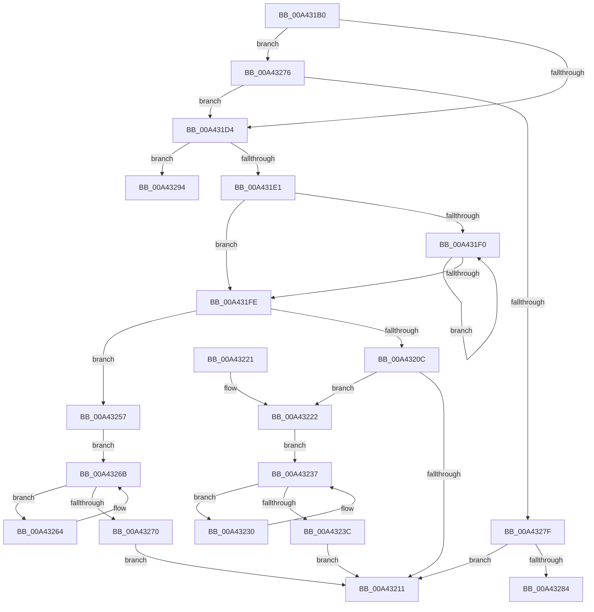

# RtlRemoveUnicodePrefix

- RVA: `0x00A431B0`–`0x00A432A0` (길이 `240` bytes)
- VA: `0x0000000140A431B0`
- 실행 섹션: `PAGE`
- PDB 이름 있음: `예`; PDB Function 태그: `예`
- unwind 정보 RVA: `0x000AEF54`
- 디코드: `70`개 명령, `240/240` bytes 표시
- 미해석 바이트: `0` (있으면 어셈블리에 `.byte`로 보존)

> 이 문서는 커널 이미지의 기계어와 PDB 기호를 분석해 생성했습니다. 4번과 5번은 함수 원형과 자료형을 바이너리 사용 방식에서 추정한 C 해석이며 원본 소스 복구 결과는 아닙니다.

## 1. Dependencies

- 직접 호출 지점: **1**; 고유 호출 대상: **1**
- 직접 호출자로 확인된 함수: **0**
- RIP 상대 이미지 참조: **0**

### Outgoing calls
- `0x00A43202` → [RtlDelete](../../text/38/RtlDelete_function_0038D8B0.md) (function, `0x0038D8B0`)

### Direct callers
- 이 함수 시작 RVA로 연결되는 직접 call은 확인되지 않았습니다. 간접 호출은 완전히 역산할 수 없습니다.

### Static image references
- 디코드된 RIP-relative 메모리 참조가 없습니다.

## 2. Other-region calls and transfers

- 다른 실행 섹션으로 향하는 call: **1**
  - `0x00A43202` → [RtlDelete](../../text/38/RtlDelete_function_0038D8B0.md) (`PAGE` → `.text`)
- call이 아닌 외부 분기/꼬리 이동: **2**
  - `0x00A4328F` → [sub_00B3AC68 + 0x7](../B3/Unknown_function_00B3AC68.md) (`tail-transfer`)
  - `0x00A4329B` → [sub_00B3AC68 + 0x1C](../B3/Unknown_function_00B3AC68.md) (`tail-transfer`)

## 3. Assembly (complete function range)

```asm
00A431B0  48 89 5C 24 08                  mov qword ptr [rsp + 8], rbx
00A431B5  48 89 74 24 10                  mov qword ptr [rsp + 0x10], rsi
00A431BA  57                              push rdi
00A431BB  48 83 EC 20                     sub rsp, 0x20
00A431BF  48 83 61 10 00                  and qword ptr [rcx + 0x10], 0
00A431C4  BE 01 08 00 00                  mov esi, 0x801
00A431C9  0F BF 0A                        movsx ecx, word ptr [rdx]
00A431CC  2B CE                           sub ecx, esi
00A431CE  0F 85 A2 00 00 00               jne 0x140a43276
00A431D4  4C 8B 42 10                     mov r8, qword ptr [rdx + 0x10]
00A431D8  4C 3B C2                        cmp r8, rdx
00A431DB  0F 85 B3 00 00 00               jne 0x140a43294
00A431E1  48 8D 4A 18                     lea rcx, [rdx + 0x18]
00A431E5  48 8B 11                        mov rdx, qword ptr [rcx]
00A431E8  48 8B F9                        mov rdi, rcx
00A431EB  48 3B D1                        cmp rdx, rcx
00A431EE  74 0E                           je 0x140a431fe
00A431F0  48 8B 02                        mov rax, qword ptr [rdx]
00A431F3  48 8B FA                        mov rdi, rdx
00A431F6  48 8B D0                        mov rdx, rax
00A431F9  48 3B C7                        cmp rax, rdi
00A431FC  75 F2                           jne 0x140a431f0
00A431FE  48 8D 5F E8                     lea rbx, [rdi - 0x18]
00A43202  E8 A9 A6 94 FF                  call 0x14038d8b0
00A43207  48 85 C0                        test rax, rax
00A4320A  74 4B                           je 0x140a43257
00A4320C  48 3B F8                        cmp rdi, rax
00A4320F  75 11                           jne 0x140a43222
00A43211  48 8B 5C 24 30                  mov rbx, qword ptr [rsp + 0x30]
00A43216  48 8B 74 24 38                  mov rsi, qword ptr [rsp + 0x38]
00A4321B  48 83 C4 20                     add rsp, 0x20
00A4321F  5F                              pop rdi
00A43220  C3                              ret
00A43221  CC                              int3
00A43222  48 8D 50 E8                     lea rdx, [rax - 0x18]
00A43226  48 8B 43 08                     mov rax, qword ptr [rbx + 8]
00A4322A  48 8B 48 08                     mov rcx, qword ptr [rax + 8]
00A4322E  EB 07                           jmp 0x140a43237
00A43230  48 8B C1                        mov rax, rcx
00A43233  48 8B 49 08                     mov rcx, qword ptr [rcx + 8]
00A43237  48 3B CB                        cmp rcx, rbx
00A4323A  75 F4                           jne 0x140a43230
00A4323C  66 89 32                        mov word ptr [rdx], si
00A4323F  48 89 50 08                     mov qword ptr [rax + 8], rdx
00A43243  48 8B 43 08                     mov rax, qword ptr [rbx + 8]
00A43247  48 89 42 08                     mov qword ptr [rdx + 8], rax
00A4324B  48 83 63 08 00                  and qword ptr [rbx + 8], 0
00A43250  66 C7 03 02 08                  mov word ptr [rbx], 0x802
00A43255  EB BA                           jmp 0x140a43211
00A43257  48 8B 53 08                     mov rdx, qword ptr [rbx + 8]
00A4325B  48 8B C2                        mov rax, rdx
00A4325E  48 8B 4A 08                     mov rcx, qword ptr [rdx + 8]
00A43262  EB 07                           jmp 0x140a4326b
00A43264  48 8B C1                        mov rax, rcx
00A43267  48 8B 49 08                     mov rcx, qword ptr [rcx + 8]
00A4326B  48 3B CB                        cmp rcx, rbx
00A4326E  75 F4                           jne 0x140a43264
00A43270  48 89 50 08                     mov qword ptr [rax + 8], rdx
00A43274  EB 9B                           jmp 0x140a43211
00A43276  83 E9 01                        sub ecx, 1
00A43279  0F 84 55 FF FF FF               je 0x140a431d4
00A4327F  83 F9 01                        cmp ecx, 1
00A43282  75 8D                           jne 0x140a43211
00A43284  4C 8B 42 10                     mov r8, qword ptr [rdx + 0x10]
00A43288  49 8B C0                        mov rax, r8
00A4328B  49 8B 48 10                     mov rcx, qword ptr [r8 + 0x10]
00A4328F  E9 DB 79 0F 00                  jmp 0x140b3ac6f
00A43294  49 8B 40 10                     mov rax, qword ptr [r8 + 0x10]
00A43298  49 8B C8                        mov rcx, r8
00A4329B  E9 E4 79 0F 00                  jmp 0x140b3ac84
```

## 4. C-style interpretation (structured pseudocode)

```c
__int64 __fastcall RtlRemoveUnicodePrefix(__int64 a1, __int64 a2)
{
    __int64 result;
    __int64 v_rsp;
    unsigned __int64 v_stack_p10;
    unsigned __int64 v_stack_p8;

    v_stack_p8 = v_rbx;
    v_stack_p10 = v_rsi;
    v_rsp = (v_rsp) - (32);
    a1 = (unsigned int)(((__int16)(*(unsigned __int16 *)(a2))) - ((unsigned int)((unsigned int)(0x801ULL))));
    if (condition_is_not_equal) goto loc_00A43276;
loc_00A431D4:
    if ((*(unsigned __int64 *)(a2 + 16)) != a2) goto loc_00A43294;
    if ((*(unsigned __int64 *)(a2 + 24)) == (a2 + 24)) goto loc_00A431FE;
loc_00A431F0:
    if ((*(unsigned __int64 *)(*(unsigned __int64 *)(a2 + 24))) != (*(unsigned __int64 *)(a2 + 24))) goto loc_00A431F0;
loc_00A431FE:
    result = RtlDelete(a2 + 24, *(unsigned __int64 *)(*(unsigned __int64 *)(a2 + 24)), *(unsigned __int64 *)(a2 + 16), a4);
    if (result == 0) goto loc_00A43257;
    if ((*(unsigned __int64 *)(a2 + 24)) != result) goto loc_00A43222;
loc_00A43211:
    v_rsp = (v_rsp) + (32);
    return result;
loc_00A43222:
    goto loc_00A43237;
loc_00A43230:
loc_00A43237:
    if ((*(unsigned __int64 *)(*(unsigned __int64 *)(*(unsigned __int64 *)(v_stack_p8 + 8) + 8) + 8)) != v_stack_p8) goto loc_00A43230;
    *(unsigned __int16 *)(result - 24) = (unsigned __int16)(v_stack_p10);
    *(unsigned __int64 *)(*(unsigned __int64 *)(*(unsigned __int64 *)(v_stack_p8 + 8) + 8) + 8) = result - 24;
    *(unsigned __int64 *)(result - 24 + 8) = *(unsigned __int64 *)(v_stack_p8 + 8);
    *(unsigned __int16 *)(v_stack_p8) = 0x802ULL;
    goto loc_00A43211;
loc_00A43257:
    goto loc_00A4326B;
loc_00A43264:
loc_00A4326B:
    if ((*(unsigned __int64 *)(*(unsigned __int64 *)(*(unsigned __int64 *)(v_stack_p8 + 8) + 8) + 8)) != v_stack_p8) goto loc_00A43264;
    *(unsigned __int64 *)(*(unsigned __int64 *)(*(unsigned __int64 *)(v_stack_p8 + 8) + 8) + 8) = *(unsigned __int64 *)(v_stack_p8 + 8);
    goto loc_00A43211;
loc_00A43276:
    a1 = (unsigned int)((*(unsigned __int64 *)(*(unsigned __int64 *)(*(unsigned __int64 *)(v_stack_p8 + 8) + 8) + 8)) - (1));
    if (condition_is_equal) goto loc_00A431D4;
    if (((unsigned int)(a1)) != 1) goto loc_00A43211;
loc_00A43294:
}
```

## 5. (Beta) C Style

```c
int64_t RtlRemoveUnicodePrefix(void *Arg1, void *Arg2)
{
    uint8_t *arg1 = (uint8_t *)Arg1;
    uint8_t *arg2 = (uint8_t *)Arg2;

    int64_t result;
    int64_t local_rsp;
    uint64_t v_stack_p10;
    uint64_t v_stack_p8;

    v_stack_p8 = local_rbx;
    v_stack_p10 = local_rsi;
    local_rsp = (local_rsp) - (32);
    Arg1 = (uint32_t)(((int16_t)(*(uint16_t *)(arg2))) - ((uint32_t)((uint32_t)(0x801ULL))));
    if (condition_is_not_equal) goto loc_00A43276;
loc_00A431D4:
    if ((*(uint64_t *)(arg2 + 0x10)) != Arg2) goto loc_00A43294;
    if ((*(uint64_t *)(arg2 + 0x18)) == (Arg2 + 24)) goto loc_00A431FE;
loc_00A431F0:
    if ((*(uint64_t *)(*(uint64_t *)(arg2 + 0x18))) != (*(uint64_t *)(arg2 + 0x18))) goto loc_00A431F0;
loc_00A431FE:
    result = RtlDelete(Arg2 + 24, *(uint64_t *)(*(uint64_t *)(arg2 + 0x18)), *(uint64_t *)(arg2 + 0x10), a4);
    if (result == 0) goto loc_00A43257;
    if ((*(uint64_t *)(arg2 + 0x18)) != result) goto loc_00A43222;
loc_00A43211:
    local_rsp = (local_rsp) + (32);
    return result;
loc_00A43222:
    goto loc_00A43237;
loc_00A43230:
loc_00A43237:
    if ((*(uint64_t *)(*(uint64_t *)(*(uint64_t *)(v_stack_p8 + 0x8) + 0x8) + 0x8)) != v_stack_p8) goto loc_00A43230;
    *(uint16_t *)(result - 0x18) = (uint16_t)(v_stack_p10);
    *(uint64_t *)(*(uint64_t *)(*(uint64_t *)(v_stack_p8 + 0x8) + 0x8) + 0x8) = result - 24;
    *(uint64_t *)(result - 0x18 + 0x8) = *(uint64_t *)(v_stack_p8 + 0x8);
    *(uint16_t *)(v_stack_p8) = 0x802ULL;
    goto loc_00A43211;
loc_00A43257:
    goto loc_00A4326B;
loc_00A43264:
loc_00A4326B:
    if ((*(uint64_t *)(*(uint64_t *)(*(uint64_t *)(v_stack_p8 + 0x8) + 0x8) + 0x8)) != v_stack_p8) goto loc_00A43264;
    *(uint64_t *)(*(uint64_t *)(*(uint64_t *)(v_stack_p8 + 0x8) + 0x8) + 0x8) = *(uint64_t *)(v_stack_p8 + 0x8);
    goto loc_00A43211;
loc_00A43276:
    Arg1 = (uint32_t)((*(uint64_t *)(*(uint64_t *)(*(uint64_t *)(v_stack_p8 + 0x8) + 0x8) + 0x8)) - (1));
    if (condition_is_equal) goto loc_00A431D4;
    if (((uint32_t)(Arg1)) != 1) goto loc_00A43211;
loc_00A43294:
}
```

### 관측된 메모리 오프셋

구조체 형식이 확인되지 않은 접근은 인자 기준의 오프셋으로만 기록했습니다.

| 기준 인자 | 오프셋 표현 | 폭 (bit) | 접근 |
|---|---:|---:|---|
| `Arg1` | `+ 0x10` | `64` | `R/W` |
| `Arg2` | `+ 0x0` | `16` | `R` |
| `Arg2` | `+ 0x0` | `64` | `R` |
| `Arg2` | `+ 0x10` | `64` | `R` |
| `Arg2` | `+ 0x18` | `64` | `R` |

## 6. Execution-region graph

[열기: 2D/3D 그래프와 함수 탐색 컨트롤 패널](../../../control-panel.html?section=page&rva=0x00A431B0&view=graph)

- 2D 그래프는 위에서 아래로 흐르고, 3D 그래프는 빈 공간을 드래그해 회전합니다. Shift+드래그는 이동, 휠은 확대·축소, 함수 노드 선택은 대상 보고서 이동입니다.

### Static fallback


