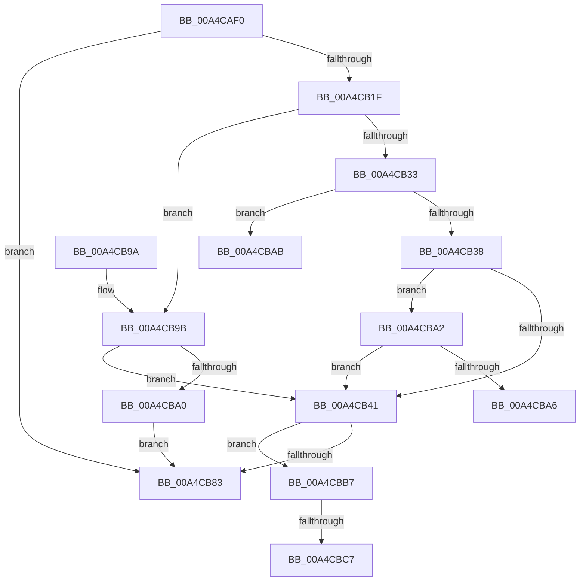

# RtlUnlockBootStatusData

- RVA: `0x00A4CAF0`–`0x00A4CBDA` (길이 `234` bytes)
- VA: `0x0000000140A4CAF0`
- 실행 섹션: `PAGE`
- PDB 이름 있음: `예`; PDB Function 태그: `예`
- unwind 정보 RVA: `0x000B0490`
- 디코드: `61`개 명령, `234/234` bytes 표시
- 미해석 바이트: `0` (있으면 어셈블리에 `.byte`로 보존)

> 이 문서는 커널 이미지의 기계어와 PDB 기호를 분석해 생성했습니다. 4번과 5번은 함수 원형과 자료형을 바이너리 사용 방식에서 추정한 C 해석이며 원본 소스 복구 결과는 아닙니다.

## 1. Dependencies

- 직접 호출 지점: **4**; 고유 호출 대상: **4**
- 직접 호출자로 확인된 함수: **6**
- RIP 상대 이미지 참조: **7**

### Outgoing calls
- `0x00A4CB10` → [RtlpAcquireBootStatusLock](../../text/4B/RtlpAcquireBootStatusLock_function_004B26AC.md) (function, `0x004B26AC`)
- `0x00A4CB79` → [ZwFsControlFile](../../text/6A/ZwFsControlFile_function_006AD7F0.md) (function, `0x006AD7F0`)
- `0x00A4CB83` → [RtlpReleaseBootStatusLock](../../text/4C/RtlpReleaseBootStatusLock_function_004C05D4.md) (function, `0x004C05D4`)
- `0x00A4CBC9` → [ExFreePoolWithTag](../../poolcode/B8/ExFreePoolWithTag_function_00B82870.md) (function, `0x00B82870`)

### Direct callers
- [PopBootStatUnlock](../6F/PopBootStatUnlock_function_006FE704.md) at `0x006FE760`
- [PoClearTransitionMarker](../75/PoClearTransitionMarker_function_00753C88.md) at `0x00753CD0`
- [PopBootStatGet](PopBootStatGet_function_00A4C398.md) at `0x00A4C72A`
- [PopBootStatSet](PopBootStatSet_function_00A4C77C.md) at `0x00A4C9D3`
- [PopBootStatRestoreDefaults](../AC/PopBootStatRestoreDefaults_function_00AC38E8.md) at `0x00AC3A93`
- [PopBootStatCheckIntegrity](../AC/PopBootStatCheckIntegrity_function_00ACDF4C.md) at `0x00ACE159`

### Static image references
- `0x00A4CB15` → RVA `0x00F05C44` (`.data`; read)
- `0x00A4CB24` → RVA `0x00F05C20` (`.data`; read)
- `0x00A4CB2B` → RVA `0x00F05C44` (`.data`; write)
- `0x00A4CB38` → RVA `0x00F05C40` (`.data`; read)
- `0x00A4CBAB` → RVA `0x00F05C28` (`.data`; read)
- `0x00A4CBB7` → RVA `0x00F05C38` (`.data`; read)
- `0x00A4CBCE` → RVA `0x00F05C38` (`.data`; write)

## 2. Other-region calls and transfers

- 다른 실행 섹션으로 향하는 call: **4**
  - `0x00A4CB10` → [RtlpAcquireBootStatusLock](../../text/4B/RtlpAcquireBootStatusLock_function_004B26AC.md) (`PAGE` → `.text`)
  - `0x00A4CB79` → [ZwFsControlFile](../../text/6A/ZwFsControlFile_function_006AD7F0.md) (`PAGE` → `.text`)
  - `0x00A4CB83` → [RtlpReleaseBootStatusLock](../../text/4C/RtlpReleaseBootStatusLock_function_004C05D4.md) (`PAGE` → `.text`)
  - `0x00A4CBC9` → [ExFreePoolWithTag](../../poolcode/B8/ExFreePoolWithTag_function_00B82870.md) (`PAGE` → `POOLCODE`)
- call이 아닌 외부 분기/꼬리 이동: **4**
  - `0x00A4CBA6` → [sub_00B3BCF0](../B3/Unknown_function_00B3BCF0.md) (`tail-transfer`)
  - `0x00A4CBB2` → [sub_00B3BCF0](../B3/Unknown_function_00B3BCF0.md) (`tail-transfer`)
  - `0x00A4CBC1` → [sub_00B3BCF0 + 0x23](../B3/Unknown_function_00B3BCF0.md) (`tail-transfer`)
  - `0x00A4CBD5` → [sub_00B3BCF0 + 0x23](../B3/Unknown_function_00B3BCF0.md) (`tail-transfer`)

## 3. Assembly (complete function range)

```asm
00A4CAF0  48 8B C4                        mov rax, rsp
00A4CAF3  48 89 58 08                     mov qword ptr [rax + 8], rbx
00A4CAF7  48 89 70 18                     mov qword ptr [rax + 0x18], rsi
00A4CAFB  57                              push rdi
00A4CAFC  48 83 EC 60                     sub rsp, 0x60
00A4CB00  0F 57 C0                        xorps xmm0, xmm0
00A4CB03  33 F6                           xor esi, esi
00A4CB05  0F 11 40 E8                     movups xmmword ptr [rax - 0x18], xmm0
00A4CB09  66 89 70 10                     mov word ptr [rax + 0x10], si
00A4CB0D  48 8B D9                        mov rbx, rcx
00A4CB10  E8 97 5B A6 FF                  call 0x1404b26ac
00A4CB15  8B 05 29 91 4B 00               mov eax, dword ptr [rip + 0x4b9129]
00A4CB1B  85 C0                           test eax, eax
00A4CB1D  74 64                           je 0x140a4cb83
00A4CB1F  FF C8                           dec eax
00A4CB21  40 8A FE                        mov dil, sil
00A4CB24  40 38 35 F5 90 4B 00            cmp byte ptr [rip + 0x4b90f5], sil
00A4CB2B  89 05 13 91 4B 00               mov dword ptr [rip + 0x4b9113], eax
00A4CB31  74 68                           je 0x140a4cb9b
00A4CB33  48 85 DB                        test rbx, rbx
00A4CB36  74 73                           je 0x140a4cbab
00A4CB38  40 38 35 01 91 4B 00            cmp byte ptr [rip + 0x4b9101], sil
00A4CB3F  74 61                           je 0x140a4cba2
00A4CB41  89 74 24 48                     mov dword ptr [rsp + 0x48], esi
00A4CB45  48 8D 44 24 78                  lea rax, [rsp + 0x78]
00A4CB4A  48 89 74 24 40                  mov qword ptr [rsp + 0x40], rsi
00A4CB4F  45 33 C9                        xor r9d, r9d
00A4CB52  C7 44 24 38 02 00 00 00         mov dword ptr [rsp + 0x38], 2
00A4CB5A  45 33 C0                        xor r8d, r8d
00A4CB5D  48 89 44 24 30                  mov qword ptr [rsp + 0x30], rax
00A4CB62  33 D2                           xor edx, edx
00A4CB64  48 8D 44 24 50                  lea rax, [rsp + 0x50]
00A4CB69  C7 44 24 28 40 C0 09 00         mov dword ptr [rsp + 0x28], 0x9c040
00A4CB71  48 8B CB                        mov rcx, rbx
00A4CB74  48 89 44 24 20                  mov qword ptr [rsp + 0x20], rax
00A4CB79  E8 72 0C C6 FF                  call 0x1406ad7f0
00A4CB7E  40 84 FF                        test dil, dil
00A4CB81  75 34                           jne 0x140a4cbb7
00A4CB83  E8 4C 3A A7 FF                  call 0x1404c05d4
00A4CB88  4C 8D 5C 24 60                  lea r11, [rsp + 0x60]
00A4CB8D  49 8B 5B 10                     mov rbx, qword ptr [r11 + 0x10]
00A4CB91  49 8B 73 20                     mov rsi, qword ptr [r11 + 0x20]
00A4CB95  49 8B E3                        mov rsp, r11
00A4CB98  5F                              pop rdi
00A4CB99  C3                              ret
00A4CB9A  CC                              int3
00A4CB9B  48 85 DB                        test rbx, rbx
00A4CB9E  75 A1                           jne 0x140a4cb41
00A4CBA0  EB E1                           jmp 0x140a4cb83
00A4CBA2  85 C0                           test eax, eax
00A4CBA4  75 9B                           jne 0x140a4cb41
00A4CBA6  E9 45 F1 0E 00                  jmp 0x140b3bcf0
00A4CBAB  48 8B 1D 76 90 4B 00            mov rbx, qword ptr [rip + 0x4b9076]
00A4CBB2  E9 39 F1 0E 00                  jmp 0x140b3bcf0
00A4CBB7  48 8B 0D 7A 90 4B 00            mov rcx, qword ptr [rip + 0x4b907a]
00A4CBBE  48 85 C9                        test rcx, rcx
00A4CBC1  0F 84 4C F1 0E 00               je 0x140b3bd13
00A4CBC7  33 D2                           xor edx, edx
00A4CBC9  E8 A2 5C 13 00                  call 0x140b82870
00A4CBCE  48 89 35 63 90 4B 00            mov qword ptr [rip + 0x4b9063], rsi
00A4CBD5  E9 39 F1 0E 00                  jmp 0x140b3bd13
```

## 4. C-style interpretation (structured pseudocode)

```c
__int64 __fastcall RtlUnlockBootStatusData(__int64 a1, int a2, int a3, int a4)
{
    __int64 result;
    __int64 v_rsi;
    __int64 v_rsp;
    unsigned __int64 v_stack_m18;
    unsigned int v_stack_m20;
    unsigned __int64 v_stack_m28;
    unsigned int v_stack_m30;
    unsigned __int64 v_stack_m38;
    unsigned int v_stack_m40;
    unsigned __int64 v_stack_m48;
    unsigned __int64 v_stack_m8;
    unsigned __int64 v_stack_p10;

    *(unsigned __int64 *)(v_rsp + 8) = v_rbx;
    *(unsigned __int64 *)(v_rsp + 24) = v_rsi;
    v_rsp = (v_rsp) - (96);
    v_rsi = 0;
    *(unsigned __int64 *)(v_rsp - 24) = v_xmm0;
    *(unsigned __int16 *)(v_rsp + 16) = 0;
    result = RtlpAcquireBootStatusLock(a1, a2, a3, a4);
    if ((unsigned int)((unsigned int)(*(unsigned int *)(v_rip + 4952361))) == 0) goto loc_00A4CB83;
    result = (unsigned int)(((unsigned int)(*(unsigned int *)(v_rip + 4952361))) - 1);
    *(unsigned int *)(v_rip + 4952339) = (unsigned int)(result);
    if ((*(unsigned __int8 *)(v_rip + 4952309)) == 0) goto loc_00A4CB9B;
    if (a1 == 0) goto loc_00A4CBAB;
    if ((*(unsigned __int8 *)(v_rip + 4952321)) == 0) goto loc_00A4CBA2;
loc_00A4CB41:
    v_stack_m20 = 0;
    v_stack_m28 = 0;
    a4 = 0;
    v_stack_m30 = 2;
    a3 = 0;
    v_stack_m38 = v_stack_p10;
    a2 = 0;
    v_stack_m40 = 0x9C040ULL;
    v_stack_m48 = v_stack_m18;
    result = ZwFsControlFile(a1, a2, a3, a4);
    if (0 != 0) goto loc_00A4CBB7;
loc_00A4CB83:
    result = RtlpReleaseBootStatusLock(a1, a2, a3, a4);
    return result;
loc_00A4CB9B:
    if (*(unsigned __int64 *)(v_stack_m8 + 16) != 0) goto loc_00A4CB41;
    goto loc_00A4CB83;
loc_00A4CBA2:
    if ((unsigned int)(result) != 0) goto loc_00A4CB41;
loc_00A4CBAB:
loc_00A4CBB7:
    a2 = 0;
    result = ExFreePoolWithTag(*(unsigned __int64 *)(v_rip + 4952186), a2, a3, a4);
    *(unsigned __int64 *)(v_rip + 4952163) = *(unsigned __int64 *)(v_stack_m8 + 32);
}
```

## 5. (Beta) C Style

```c
int64_t RtlUnlockBootStatusData(int64_t Arg1, int32_t Arg2, int32_t Arg3, int32_t Arg4)
{
    int64_t result;
    int64_t local_rsi;
    int64_t local_rsp;
    uint64_t v_stack_m18;
    uint32_t v_stack_m20;
    uint64_t v_stack_m28;
    uint32_t v_stack_m30;
    uint64_t v_stack_m38;
    uint32_t v_stack_m40;
    uint64_t v_stack_m48;
    uint64_t v_stack_m8;
    uint64_t v_stack_p10;

    *(uint64_t *)(local_rsp + 0x8) = local_rbx;
    *(uint64_t *)(local_rsp + 0x18) = local_rsi;
    local_rsp = (local_rsp) - (96);
    local_rsi = 0;
    *(uint64_t *)(local_rsp - 0x18) = v_xmm0;
    *(uint16_t *)(local_rsp + 0x10) = 0;
    result = RtlpAcquireBootStatusLock(Arg1, Arg2, Arg3, Arg4);
    if ((uint32_t)((uint32_t)(*(uint32_t *)(v_rip + 0x4B9129))) == 0) goto loc_00A4CB83;
    result = (uint32_t)(((uint32_t)(*(uint32_t *)(v_rip + 0x4B9129))) - 1);
    *(uint32_t *)(v_rip + 0x4B9113) = (uint32_t)(result);
    if ((*(uint8_t *)(v_rip + 0x4B90F5)) == 0) goto loc_00A4CB9B;
    if (Arg1 == 0) goto loc_00A4CBAB;
    if ((*(uint8_t *)(v_rip + 0x4B9101)) == 0) goto loc_00A4CBA2;
loc_00A4CB41:
    v_stack_m20 = 0;
    v_stack_m28 = 0;
    Arg4 = 0;
    v_stack_m30 = 2;
    Arg3 = 0;
    v_stack_m38 = v_stack_p10;
    Arg2 = 0;
    v_stack_m40 = 0x9C040ULL;
    v_stack_m48 = v_stack_m18;
    result = ZwFsControlFile(Arg1, Arg2, Arg3, Arg4);
    if (0 != 0) goto loc_00A4CBB7;
loc_00A4CB83:
    result = RtlpReleaseBootStatusLock(Arg1, Arg2, Arg3, Arg4);
    return result;
loc_00A4CB9B:
    if (*(uint64_t *)(v_stack_m8 + 0x10) != 0) goto loc_00A4CB41;
    goto loc_00A4CB83;
loc_00A4CBA2:
    if ((uint32_t)(result) != 0) goto loc_00A4CB41;
loc_00A4CBAB:
loc_00A4CBB7:
    Arg2 = 0;
    result = ExFreePoolWithTag(*(uint64_t *)(v_rip + 0x4B907A), Arg2, Arg3, Arg4);
    *(uint64_t *)(v_rip + 0x4B9063) = *(uint64_t *)(v_stack_m8 + 0x20);
}
```

## 6. Execution-region graph

[열기: 2D/3D 그래프와 함수 탐색 컨트롤 패널](../../../control-panel.html?section=page&rva=0x00A4CAF0&view=graph)

- 2D 그래프는 위에서 아래로 흐르고, 3D 그래프는 빈 공간을 드래그해 회전합니다. Shift+드래그는 이동, 휠은 확대·축소, 함수 노드 선택은 대상 보고서 이동입니다.

### Static fallback


