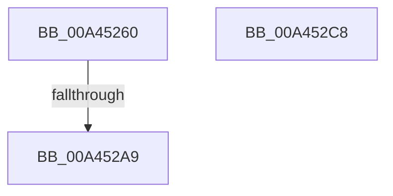

# RtlUpdateSwapReference

- RVA: `0x00A45260`–`0x00A452C9` (길이 `105` bytes)
- VA: `0x0000000140A45260`
- 실행 섹션: `PAGE`
- PDB 이름 있음: `예`; PDB Function 태그: `예`
- unwind 정보 RVA: `0x000AF2D4`
- 디코드: `29`개 명령, `105/105` bytes 표시
- 미해석 바이트: `0` (있으면 어셈블리에 `.byte`로 보존)

> 이 문서는 커널 이미지의 기계어와 PDB 기호를 분석해 생성했습니다. 4번과 5번은 함수 원형과 자료형을 바이너리 사용 방식에서 추정한 C 해석이며 원본 소스 복구 결과는 아닙니다.

## 1. Dependencies

- 직접 호출 지점: **2**; 고유 호출 대상: **2**
- 직접 호출자로 확인된 함수: **4**
- RIP 상대 이미지 참조: **1**

### Outgoing calls
- `0x00A45294` → [memset](../../text/6C/memset_function_006C6C40.md) (function, `0x006C6C40`)
- `0x00A452B0` → [_security_check_cookie](../../text/6A/_security_check_cookie_function_006AC640.md) (function, `0x006AC640`)

### Direct callers
- [RtlpFcBufferManagerUpdateBuffers](RtlpFcBufferManagerUpdateBuffers_function_00A44DB0.md) at `0x00A44E62`
- [CmFcpManagerDrainUsageNotifications](CmFcpManagerDrainUsageNotifications_function_00A451BC.md) at `0x00A451EB`
- [CmFcpManagerPublishFeatureUsageData](../AB/CmFcpManagerPublishFeatureUsageData_function_00ABC468.md) at `0x00ABC59A`
- [CmFcManagerStartRuntimePhase](../../init/C5/CmFcManagerStartRuntimePhase_function_00C5DC70.md) at `0x00C5DFCD`
- [CmFcManagerStartRuntimePhase](../../init/C5/CmFcManagerStartRuntimePhase_function_00C5DC70.md) at `0x00C5E115`

### Static image references
- `0x00A45274` → RVA `0x00E0A740` (`.data`; read)

## 2. Other-region calls and transfers

- 다른 실행 섹션으로 향하는 call: **2**
  - `0x00A45294` → [memset](../../text/6C/memset_function_006C6C40.md) (`PAGE` → `.text`)
  - `0x00A452B0` → [_security_check_cookie](../../text/6A/_security_check_cookie_function_006AC640.md) (`PAGE` → `.text`)
- call이 아닌 외부 분기/꼬리 이동: **1**
  - `0x00A452A3` → [sub_00B3B096](../B3/Unknown_function_00B3B096.md) (`tail-transfer`)

## 3. Assembly (complete function range)

```asm
00A45260  48 89 5C 24 18                  mov qword ptr [rsp + 0x18], rbx
00A45265  55                              push rbp
00A45266  56                              push rsi
00A45267  57                              push rdi
00A45268  48 8D 6C 24 A0                  lea rbp, [rsp - 0x60]
00A4526D  48 81 EC 60 01 00 00            sub rsp, 0x160
00A45274  48 8B 05 C5 54 3C 00            mov rax, qword ptr [rip + 0x3c54c5]
00A4527B  48 33 C4                        xor rax, rsp
00A4527E  48 89 45 50                     mov qword ptr [rbp + 0x50], rax
00A45282  8B FA                           mov edi, edx
00A45284  48 8B F1                        mov rsi, rcx
00A45287  33 D2                           xor edx, edx
00A45289  48 8D 4C 24 48                  lea rcx, [rsp + 0x48]
00A4528E  41 B8 00 01 00 00               mov r8d, 0x100
00A45294  E8 A7 19 C8 FF                  call 0x1406c6c40
00A45299  48 83 E7 01                     and rdi, 1
00A4529D  48 87 3E                        xchg qword ptr [rsi], rdi
00A452A0  48 D1 EF                        shr rdi, 1
00A452A3  0F 85 ED 5D 0F 00               jne 0x140b3b096
00A452A9  48 8B 4D 50                     mov rcx, qword ptr [rbp + 0x50]
00A452AD  48 33 CC                        xor rcx, rsp
00A452B0  E8 8B 73 C6 FF                  call 0x1406ac640
00A452B5  48 8B 9C 24 90 01 00 00         mov rbx, qword ptr [rsp + 0x190]
00A452BD  48 81 C4 60 01 00 00            add rsp, 0x160
00A452C4  5F                              pop rdi
00A452C5  5E                              pop rsi
00A452C6  5D                              pop rbp
00A452C7  C3                              ret
00A452C8  CC                              int3
```

## 4. C-style interpretation (structured pseudocode)

```c
__int64 __fastcall RtlUpdateSwapReference(__int64 a1, int a2)
{
    __int64 result;
    __int64 v_rdi;
    __int64 v_rsp;
    unsigned __int64 v_stack_m130;
    unsigned __int64 v_stack_m28;
    unsigned __int64 v_stack_m78;
    unsigned __int64 v_stack_p18;

    v_stack_p18 = v_rbx;
    v_rsp = (v_rsp) - (352);
    result = (*(unsigned __int64 *)(v_rip + 3953861)) ^ (v_rsp);
    v_stack_m28 = result;
    a2 = 0;
    result = memset(v_stack_m130, a2, 256, a4);
    v_rdi = ((unsigned int)(a2)) & (1);
    v_rdi = (v_rdi) >> (1);
    a1 = (v_stack_m28) ^ (v_rsp);
    result = _security_check_cookie(a1, a2, 256, a4);
    v_rsp = (v_rsp) + (352);
    return result;
}
```

## 5. (Beta) C Style

```c
int64_t RtlUpdateSwapReference(void *Arg1, int32_t Arg2)
{
    uint8_t *arg1 = (uint8_t *)Arg1;

    int64_t result;
    int64_t local_rdi;
    int64_t local_rsp;
    uint64_t v_stack_m130;
    uint64_t v_stack_m28;
    uint64_t v_stack_m78;
    uint64_t v_stack_p18;

    v_stack_p18 = local_rbx;
    local_rsp = (local_rsp) - (352);
    result = (*(uint64_t *)(v_rip + 0x3C54C5)) ^ (local_rsp);
    v_stack_m28 = result;
    Arg2 = 0;
    result = memset(v_stack_m130, Arg2, 256, a4);
    local_rdi = ((uint32_t)(Arg2)) & (1);
    local_rdi = (local_rdi) >> (1);
    Arg1 = (v_stack_m28) ^ (local_rsp);
    result = _security_check_cookie(Arg1, Arg2, 256, a4);
    local_rsp = (local_rsp) + (352);
    return result;
}
```

### 관측된 메모리 오프셋

구조체 형식이 확인되지 않은 접근은 인자 기준의 오프셋으로만 기록했습니다.

| 기준 인자 | 오프셋 표현 | 폭 (bit) | 접근 |
|---|---:|---:|---|
| `Arg1` | `+ 0x0` | `64` | `R/W` |

## 6. Execution-region graph

[열기: 2D/3D 그래프와 함수 탐색 컨트롤 패널](../../../control-panel.html?section=page&rva=0x00A45260&view=graph)

- 2D 그래프는 위에서 아래로 흐르고, 3D 그래프는 빈 공간을 드래그해 회전합니다. Shift+드래그는 이동, 휠은 확대·축소, 함수 노드 선택은 대상 보고서 이동입니다.

### Static fallback


