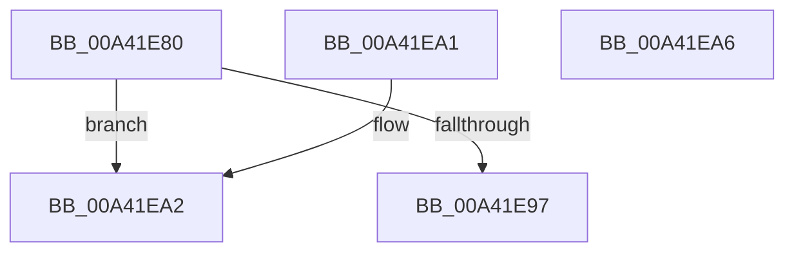

# RtlpCompareRelocation

- RVA: `0x00A41E80`–`0x00A41EA7` (길이 `39` bytes)
- VA: `0x0000000140A41E80`
- 실행 섹션: `PAGE`
- PDB 이름 있음: `예`; PDB Function 태그: `아니요`
- unwind 정보 RVA: `0x000DB714`
- 디코드: `14`개 명령, `39/39` bytes 표시
- 미해석 바이트: `0` (있으면 어셈블리에 `.byte`로 보존)

> 이 문서는 커널 이미지의 기계어와 PDB 기호를 분석해 생성했습니다. 4번과 5번은 함수 원형과 자료형을 바이너리 사용 방식에서 추정한 C 해석이며 원본 소스 복구 결과는 아닙니다.

## 1. Dependencies

- 직접 호출 지점: **0**; 고유 호출 대상: **0**
- 직접 호출자로 확인된 함수: **0**
- RIP 상대 이미지 참조: **0**

### Outgoing calls
- 직접 디코드된 call 명령이 없습니다.

### Direct callers
- 이 함수 시작 RVA로 연결되는 직접 call은 확인되지 않았습니다. 간접 호출은 완전히 역산할 수 없습니다.

### Static image references
- 디코드된 RIP-relative 메모리 참조가 없습니다.

## 2. Other-region calls and transfers

- 다른 실행 섹션으로 향하는 call: **0**
- 별도 외부 분기/꼬리 이동을 확인하지 못했습니다.

## 3. Assembly (complete function range)

```asm
00A41E80  41 B8 FF 0F 00 00               mov r8d, 0xfff
00A41E86  45 8B C8                        mov r9d, r8d
00A41E89  66 44 23 01                     and r8w, word ptr [rcx]
00A41E8D  66 44 23 0A                     and r9w, word ptr [rdx]
00A41E91  66 45 3B C1                     cmp r8w, r9w
00A41E95  72 0B                           jb 0x140a41ea2
00A41E97  33 C0                           xor eax, eax
00A41E99  66 45 3B C1                     cmp r8w, r9w
00A41E9D  0F 97 C0                        seta al
00A41EA0  C3                              ret
00A41EA1  CC                              int3
00A41EA2  83 C8 FF                        or eax, 0xffffffff
00A41EA5  C3                              ret
00A41EA6  CC                              int3
```

## 4. C-style interpretation (structured pseudocode)

```c
__int64 __fastcall RtlpCompareRelocation(__int64 a1, __int64 a2)
{
    __int64 result;

    a3 = (unsigned __int16)(((unsigned int)(0xFFFULL)) & (*(unsigned __int16 *)(a1)));
    a4 = (unsigned __int16)(((unsigned int)((unsigned int)((unsigned int)(0xFFFULL)))) & (*(unsigned __int16 *)(a2)));
    if (((unsigned __int16)(a3)) < ((unsigned __int16)(a4))) goto loc_00A41EA2;
    result = 0;
    result = (((unsigned __int16)(a3)) > ((unsigned __int16)(a4))) ? 1 : 0;
    return result;
loc_00A41EA2:
    result = (unsigned int)((result) | (0xFFFFFFFFULL));
    return result;
}
```

## 5. (Beta) C Style

```c
int64_t RtlpCompareRelocation(void *Arg1, void *Arg2)
{
    uint8_t *arg1 = (uint8_t *)Arg1;
    uint8_t *arg2 = (uint8_t *)Arg2;

    int64_t result;

    a3 = (uint16_t)(((uint32_t)(0xFFFULL)) & (*(uint16_t *)(arg1)));
    a4 = (uint16_t)(((uint32_t)((uint32_t)((uint32_t)(0xFFFULL)))) & (*(uint16_t *)(arg2)));
    if (((uint16_t)(a3)) < ((uint16_t)(a4))) goto loc_00A41EA2;
    result = 0;
    result = (((uint16_t)(a3)) > ((uint16_t)(a4))) ? 1 : 0;
    return result;
loc_00A41EA2:
    result = (uint32_t)((result) | (0xFFFFFFFFULL));
    return result;
}
```

### 관측된 메모리 오프셋

구조체 형식이 확인되지 않은 접근은 인자 기준의 오프셋으로만 기록했습니다.

| 기준 인자 | 오프셋 표현 | 폭 (bit) | 접근 |
|---|---:|---:|---|
| `Arg1` | `+ 0x0` | `16` | `R` |
| `Arg2` | `+ 0x0` | `16` | `R` |

## 6. Execution-region graph

[열기: 2D/3D 그래프와 함수 탐색 컨트롤 패널](../../../control-panel.html?section=page&rva=0x00A41E80&view=graph)

- 2D 그래프는 위에서 아래로 흐르고, 3D 그래프는 빈 공간을 드래그해 회전합니다. Shift+드래그는 이동, 휠은 확대·축소, 함수 노드 선택은 대상 보고서 이동입니다.

### Static fallback


