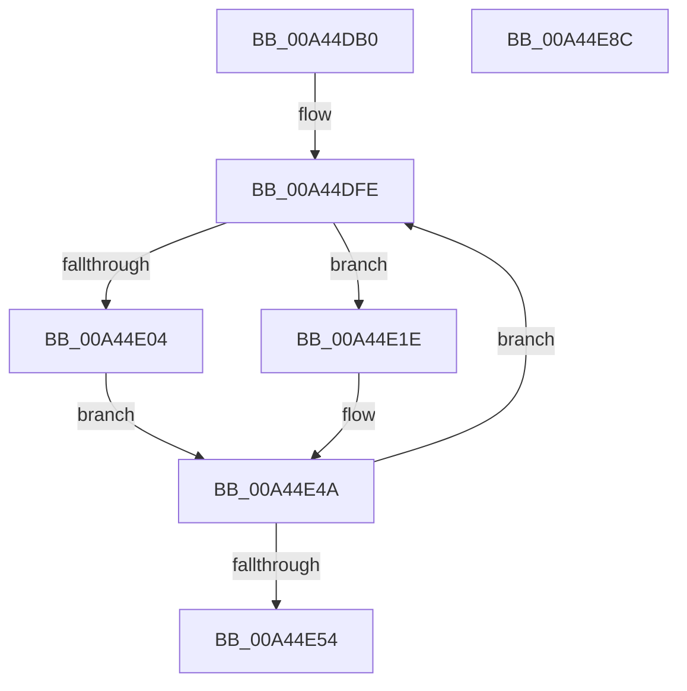

# RtlpFcBufferManagerUpdateBuffers

- RVA: `0x00A44DB0`–`0x00A44E8D` (길이 `221` bytes)
- VA: `0x0000000140A44DB0`
- 실행 섹션: `PAGE`
- PDB 이름 있음: `예`; PDB Function 태그: `아니요`
- unwind 정보 RVA: `0x00060BC4`
- 디코드: `54`개 명령, `221/221` bytes 표시
- 미해석 바이트: `0` (있으면 어셈블리에 `.byte`로 보존)

> 이 문서는 커널 이미지의 기계어와 PDB 기호를 분석해 생성했습니다. 4번과 5번은 함수 원형과 자료형을 바이너리 사용 방식에서 추정한 C 해석이며 원본 소스 복구 결과는 아닙니다.

## 1. Dependencies

- 직접 호출 지점: **2**; 고유 호출 대상: **2**
- 직접 호출자로 확인된 함수: **5**
- RIP 상대 이미지 참조: **0**

### Outgoing calls
- `0x00A44E62` → [RtlUpdateSwapReference](RtlUpdateSwapReference_function_00A45260.md) (function, `0x00A45260`)
- `0x00A44E77` → [RtlpFcInitializeBuffers](../../text/4F/RtlpFcInitializeBuffers_function_004F8240.md) (function, `0x004F8240`)

### Direct callers
- [CmFcManagerOverwriteFeatureConfigurationSection](../7F/CmFcManagerOverwriteFeatureConfigurationSection_function_007F4450.md) at `0x007F4848`
- [CmFcManagerUpdateFeatureConfigurations](../7F/CmFcManagerUpdateFeatureConfigurations_function_007F4CF4.md) at `0x007F51FE`
- [CmFcManagerUpdateFeatureUsageSubscriptions](CmFcManagerUpdateFeatureUsageSubscriptions_function_00A4490C.md) at `0x00A44A95`
- [CmFcManagerStartBootPhase](../../init/C5/CmFcManagerStartBootPhase_function_00C5DB98.md) at `0x00C5DC11`
- [CmFcManagerStartRuntimePhase](../../init/C5/CmFcManagerStartRuntimePhase_function_00C5DC70.md) at `0x00C5DE8E`

### Static image references
- 디코드된 RIP-relative 메모리 참조가 없습니다.

## 2. Other-region calls and transfers

- 다른 실행 섹션으로 향하는 call: **1**
  - `0x00A44E77` → [RtlpFcInitializeBuffers](../../text/4F/RtlpFcInitializeBuffers_function_004F8240.md) (`PAGE` → `.text`)
- 별도 외부 분기/꼬리 이동을 확인하지 못했습니다.

## 3. Assembly (complete function range)

```asm
00A44DB0  48 89 5C 24 08                  mov qword ptr [rsp + 8], rbx
00A44DB5  48 89 74 24 10                  mov qword ptr [rsp + 0x10], rsi
00A44DBA  57                              push rdi
00A44DBB  48 83 EC 20                     sub rsp, 0x20
00A44DBF  48 8B 01                        mov rax, qword ptr [rcx]
00A44DC2  48 8B D9                        mov rbx, rcx
00A44DC5  83 E0 01                        and eax, 1
00A44DC8  48 83 C1 18                     add rcx, 0x18
00A44DCC  8B F8                           mov edi, eax
00A44DCE  4C 8B DA                        mov r11, rdx
00A44DD1  BA 04 00 00 00                  mov edx, 4
00A44DD6  44 8D 48 FF                     lea r9d, [rax - 1]
00A44DDA  48 8D 34 40                     lea rsi, [rax + rax*2]
00A44DDE  41 83 E1 01                     and r9d, 1
00A44DE2  48 C1 E6 05                     shl rsi, 5
00A44DE6  4B 8D 04 49                     lea rax, [r9 + r9*2]
00A44DEA  48 C1 E0 05                     shl rax, 5
00A44DEE  48 03 C8                        add rcx, rax
00A44DF1  48 8D 43 18                     lea rax, [rbx + 0x18]
00A44DF5  48 03 C6                        add rax, rsi
00A44DF8  49 2B C0                        sub rax, r8
00A44DFB  49 2B C8                        sub rcx, r8
00A44DFE  49 83 38 00                     cmp qword ptr [r8], 0
00A44E02  75 1A                           jne 0x140a44e1e
00A44E04  41 0F 10 04 00                  movups xmm0, xmmword ptr [r8 + rax]
00A44E09  42 0F 11 04 01                  movups xmmword ptr [rcx + r8], xmm0
00A44E0E  F2 41 0F 10 4C 00 10            movsd xmm1, qword ptr [r8 + rax + 0x10]
00A44E15  F2 42 0F 11 4C 01 10            movsd qword ptr [rcx + r8 + 0x10], xmm1
00A44E1C  EB 2C                           jmp 0x140a44e4a
00A44E1E  41 0F 10 00                     movups xmm0, xmmword ptr [r8]
00A44E22  42 0F 11 04 01                  movups xmmword ptr [rcx + r8], xmm0
00A44E27  F2 41 0F 10 48 10               movsd xmm1, qword ptr [r8 + 0x10]
00A44E2D  F2 42 0F 11 4C 01 10            movsd qword ptr [rcx + r8 + 0x10], xmm1
00A44E34  41 0F 10 04 00                  movups xmm0, xmmword ptr [r8 + rax]
00A44E39  41 0F 11 00                     movups xmmword ptr [r8], xmm0
00A44E3D  F2 41 0F 10 4C 00 10            movsd xmm1, qword ptr [r8 + rax + 0x10]
00A44E44  F2 41 0F 11 48 10               movsd qword ptr [r8 + 0x10], xmm1
00A44E4A  49 83 C0 18                     add r8, 0x18
00A44E4E  48 83 EA 01                     sub rdx, 1
00A44E52  75 AA                           jne 0x140a44dfe
00A44E54  41 8B D1                        mov edx, r9d
00A44E57  4E 89 9C CB D8 00 00 00         mov qword ptr [rbx + r9*8 + 0xd8], r11
00A44E5F  48 8B CB                        mov rcx, rbx
00A44E62  E8 F9 03 00 00                  call 0x140a45260
00A44E67  48 83 A4 FB D8 00 00 00 00      and qword ptr [rbx + rdi*8 + 0xd8], 0
00A44E70  48 8D 4B 18                     lea rcx, [rbx + 0x18]
00A44E74  48 03 CE                        add rcx, rsi
00A44E77  E8 C4 33 AB FF                  call 0x1404f8240
00A44E7C  48 8B 5C 24 30                  mov rbx, qword ptr [rsp + 0x30]
00A44E81  48 8B 74 24 38                  mov rsi, qword ptr [rsp + 0x38]
00A44E86  48 83 C4 20                     add rsp, 0x20
00A44E8A  5F                              pop rdi
00A44E8B  C3                              ret
00A44E8C  CC                              int3
```

## 4. C-style interpretation (structured pseudocode)

```c
__int64 __fastcall RtlpFcBufferManagerUpdateBuffers(__int64 a1, __int64 a2, __int64 a3)
{
    __int64 result;
    __int64 v_rsi;
    __int64 v_rsp;
    unsigned __int64 v_stack_p10;
    unsigned __int64 v_stack_p8;

    v_stack_p8 = v_rbx;
    v_stack_p10 = v_rsi;
    v_rsp = (v_rsp) - (32);
    result = (unsigned int)((*(unsigned __int64 *)(a1)) & (1));
    a1 = (a1) + (24);
    a4 = (unsigned int)((result - 1) & (1));
    v_rsi = (result + result * 2) << (5);
    result = (a4 + a4 * 2) << (5);
    a1 = (a1) + (result);
    result = (a1 + 24) + (v_rsi);
    result = (result) - (a3);
    a1 = (a1) - (a3);
loc_00A44DFE:
    if ((*(unsigned __int64 *)(a3)) != 0) goto loc_00A44E1E;
    *(unsigned __int64 *)(a1 + a3 * 1) = v_xmm0;
    *(unsigned __int64 *)(a1 + a3 * 1 + 16) = v_xmm1;
    goto loc_00A44E4A;
loc_00A44E1E:
    *(unsigned __int64 *)(a1 + a3 * 1) = v_xmm0;
    *(unsigned __int64 *)(a1 + a3 * 1 + 16) = v_xmm1;
    *(unsigned __int64 *)(a3) = v_xmm0;
    *(unsigned __int64 *)(a3 + 16) = v_xmm1;
loc_00A44E4A:
    a3 = (a3) + (24);
    a2 = (4) - (1);
    if (condition_is_not_equal) goto loc_00A44DFE;
    *(unsigned __int64 *)(a1 + a4 * 8 + 216) = a2;
    result = RtlUpdateSwapReference(a1, (unsigned int)((unsigned int)(a4)), a3, a4);
    a1 = (a1 + 24) + (v_rsi);
    result = RtlpFcInitializeBuffers(a1, (unsigned int)((unsigned int)(a4)), a3, a4);
    v_rsp = (v_rsp) + (32);
    return result;
}
```

## 5. (Beta) C Style

```c
int64_t RtlpFcBufferManagerUpdateBuffers(void *Arg1, int64_t Arg2, void *Arg3)
{
    uint8_t *arg1 = (uint8_t *)Arg1;
    uint8_t *arg3 = (uint8_t *)Arg3;

    int64_t result;
    int64_t local_rsi;
    int64_t local_rsp;
    uint64_t v_stack_p10;
    uint64_t v_stack_p8;

    v_stack_p8 = local_rbx;
    v_stack_p10 = local_rsi;
    local_rsp = (local_rsp) - (32);
    result = (uint32_t)((*(uint64_t *)(arg1)) & (1));
    Arg1 = (Arg1) + (24);
    a4 = (uint32_t)((result - 1) & (1));
    local_rsi = (result + result * 2) << (5);
    result = (a4 + a4 * 2) << (5);
    Arg1 = (Arg1) + (result);
    result = (Arg1 + 24) + (local_rsi);
    result = (result) - (Arg3);
    Arg1 = (Arg1) - (Arg3);
loc_00A44DFE:
    if ((*(uint64_t *)(arg3)) != 0) goto loc_00A44E1E;
    *(uint64_t *)(arg1 + arg3 * 1) = v_xmm0;
    *(uint64_t *)(arg1 + arg3 * 1 + 0x10) = v_xmm1;
    goto loc_00A44E4A;
loc_00A44E1E:
    *(uint64_t *)(arg1 + arg3 * 1) = v_xmm0;
    *(uint64_t *)(arg1 + arg3 * 1 + 0x10) = v_xmm1;
    *(uint64_t *)(arg3) = v_xmm0;
    *(uint64_t *)(arg3 + 0x10) = v_xmm1;
loc_00A44E4A:
    Arg3 = (Arg3) + (24);
    Arg2 = (4) - (1);
    if (condition_is_not_equal) goto loc_00A44DFE;
    *(uint64_t *)(arg1 + a4 * 8 + 0xD8) = Arg2;
    result = RtlUpdateSwapReference(Arg1, (uint32_t)((uint32_t)(a4)), Arg3, a4);
    Arg1 = (Arg1 + 24) + (local_rsi);
    result = RtlpFcInitializeBuffers(Arg1, (uint32_t)((uint32_t)(a4)), Arg3, a4);
    local_rsp = (local_rsp) + (32);
    return result;
}
```

### 관측된 메모리 오프셋

구조체 형식이 확인되지 않은 접근은 인자 기준의 오프셋으로만 기록했습니다.

| 기준 인자 | 오프셋 표현 | 폭 (bit) | 접근 |
|---|---:|---:|---|
| `Arg1` | `+ 0x0` | `64` | `R` |
| `Arg1` | `+ 0x0 + r8*1` | `128` | `R` |
| `Arg1` | `+ 0x10 + r8*1` | `64` | `W` |
| `Arg1` | `+ 0x18` | `64` | `R` |
| `Arg1` | `+ 0xD8 + r9*8` | `64` | `W` |
| `Arg1` | `+ 0xD8 + rdi*8` | `64` | `R/W` |
| `Arg3` | `+ 0x0` | `64` | `R` |
| `Arg3` | `+ 0x0` | `128` | `R` |
| `Arg3` | `+ 0x0 + rax*1` | `128` | `R` |
| `Arg3` | `+ 0x10` | `64` | `R` |
| `Arg3` | `+ 0x10` | `64` | `W` |
| `Arg3` | `+ 0x10 + rax*1` | `64` | `R` |

## 6. Execution-region graph

[열기: 2D/3D 그래프와 함수 탐색 컨트롤 패널](../../../control-panel.html?section=page&rva=0x00A44DB0&view=graph)

- 2D 그래프는 위에서 아래로 흐르고, 3D 그래프는 빈 공간을 드래그해 회전합니다. Shift+드래그는 이동, 휠은 확대·축소, 함수 노드 선택은 대상 보고서 이동입니다.

### Static fallback


