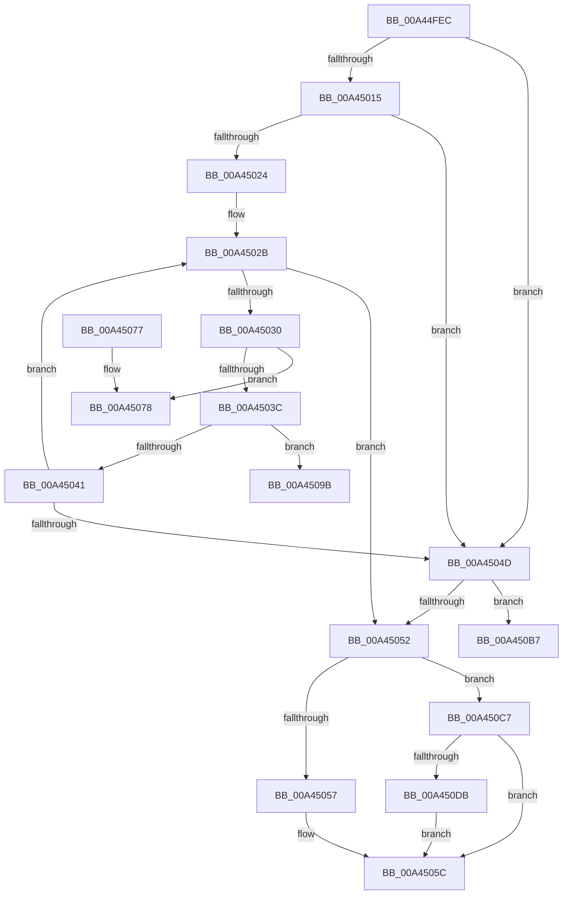

# RtlpFcCalculateRequiredSizeForNewUsageSubscriptionTable

- RVA: `0x00A44FEC`–`0x00A450FC` (길이 `272` bytes)
- VA: `0x0000000140A44FEC`
- 실행 섹션: `PAGE`
- PDB 이름 있음: `예`; PDB Function 태그: `예`
- unwind 정보 RVA: `0x0007827C`
- 디코드: `83`개 명령, `272/272` bytes 표시
- 미해석 바이트: `0` (있으면 어셈블리에 `.byte`로 보존)

> 이 문서는 커널 이미지의 기계어와 PDB 기호를 분석해 생성했습니다. 4번과 5번은 함수 원형과 자료형을 바이너리 사용 방식에서 추정한 C 해석이며 원본 소스 복구 결과는 아닙니다.

## 1. Dependencies

- 직접 호출 지점: **2**; 고유 호출 대상: **2**
- 직접 호출자로 확인된 함수: **1**
- RIP 상대 이미지 참조: **0**

### Outgoing calls
- `0x00A45033` → [RtlpFcCompareUsageSubscriptionToUsageSubscription](../../text/4A/RtlpFcCompareUsageSubscriptionToUsageSubscription_function_004AEEF8.md) (function, `0x004AEEF8`)
- `0x00A450D2` → [RtlULongLongMult](../../text/43/RtlULongLongMult_function_0043E530.md) (function, `0x0043E530`)

### Direct callers
- [RtlpFcUpdateUsageTriggers](RtlpFcUpdateUsageTriggers_function_00A44BB0.md) at `0x00A44C02`

### Static image references
- 디코드된 RIP-relative 메모리 참조가 없습니다.

## 2. Other-region calls and transfers

- 다른 실행 섹션으로 향하는 call: **2**
  - `0x00A45033` → [RtlpFcCompareUsageSubscriptionToUsageSubscription](../../text/4A/RtlpFcCompareUsageSubscriptionToUsageSubscription_function_004AEEF8.md) (`PAGE` → `.text`)
  - `0x00A450D2` → [RtlULongLongMult](../../text/43/RtlULongLongMult_function_0043E530.md) (`PAGE` → `.text`)
- call이 아닌 외부 분기/꼬리 이동: **3**
  - `0x00A45096` → [sub_00B3B070](../B3/Unknown_function_00B3B070.md) (`tail-transfer`)
  - `0x00A450B2` → [sub_00B3B070](../B3/Unknown_function_00B3B070.md) (`tail-transfer`)
  - `0x00A450C2` → [sub_00B3B070 + 0x8](../B3/Unknown_function_00B3B070.md) (`tail-transfer`)

## 3. Assembly (complete function range)

```asm
00A44FEC  48 8B C4                        mov rax, rsp
00A44FEF  48 89 58 08                     mov qword ptr [rax + 8], rbx
00A44FF3  48 89 68 10                     mov qword ptr [rax + 0x10], rbp
00A44FF7  48 89 70 18                     mov qword ptr [rax + 0x18], rsi
00A44FFB  48 89 78 20                     mov qword ptr [rax + 0x20], rdi
00A44FFF  41 56                           push r14
00A45001  48 83 EC 20                     sub rsp, 0x20
00A45005  45 33 D2                        xor r10d, r10d
00A45008  33 DB                           xor ebx, ebx
00A4500A  45 33 DB                        xor r11d, r11d
00A4500D  4C 8B F2                        mov r14, rdx
00A45010  48 85 C9                        test rcx, rcx
00A45013  74 38                           je 0x140a4504d
00A45015  44 8B 11                        mov r10d, dword ptr [rcx]
00A45018  48 8D 79 04                     lea rdi, [rcx + 4]
00A4501C  41 8B EA                        mov ebp, r10d
00A4501F  4D 85 D2                        test r10, r10
00A45022  74 29                           je 0x140a4504d
00A45024  48 8B F2                        mov rsi, rdx
00A45027  48 83 C2 04                     add rdx, 4
00A4502B  4D 3B D8                        cmp r11, r8
00A4502E  73 22                           jae 0x140a45052
00A45030  48 8B CF                        mov rcx, rdi
00A45033  E8 C0 9E A6 FF                  call 0x1404aeef8
00A45038  85 C0                           test eax, eax
00A4503A  74 3C                           je 0x140a45078
00A4503C  83 F8 01                        cmp eax, 1
00A4503F  74 5A                           je 0x140a4509b
00A45041  48 FF C3                        inc rbx
00A45044  48 83 C7 10                     add rdi, 0x10
00A45048  48 3B DD                        cmp rbx, rbp
00A4504B  72 DE                           jb 0x140a4502b
00A4504D  4D 3B D8                        cmp r11, r8
00A45050  72 65                           jb 0x140a450b7
00A45052  4D 85 D2                        test r10, r10
00A45055  75 70                           jne 0x140a450c7
00A45057  4D 21 11                        and qword ptr [r9], r10
00A4505A  33 C0                           xor eax, eax
00A4505C  48 8B 5C 24 30                  mov rbx, qword ptr [rsp + 0x30]
00A45061  48 8B 6C 24 38                  mov rbp, qword ptr [rsp + 0x38]
00A45066  48 8B 74 24 40                  mov rsi, qword ptr [rsp + 0x40]
00A4506B  48 8B 7C 24 48                  mov rdi, qword ptr [rsp + 0x48]
00A45070  48 83 C4 20                     add rsp, 0x20
00A45074  41 5E                           pop r14
00A45076  C3                              ret
00A45077  CC                              int3
00A45078  8B 0E                           mov ecx, dword ptr [rsi]
00A4507A  49 8D 42 FF                     lea rax, [r10 - 1]
00A4507E  48 83 C6 14                     add rsi, 0x14
00A45082  48 FF C3                        inc rbx
00A45085  48 83 C7 10                     add rdi, 0x10
00A45089  49 FF C3                        inc r11
00A4508C  48 83 C2 14                     add rdx, 0x14
00A45090  85 C9                           test ecx, ecx
00A45092  49 0F 44 C2                     cmove rax, r10
00A45096  E9 D5 5F 0F 00                  jmp 0x140b3b070
00A4509B  8B 0E                           mov ecx, dword ptr [rsi]
00A4509D  49 8D 42 01                     lea rax, [r10 + 1]
00A450A1  48 83 C6 14                     add rsi, 0x14
00A450A5  49 FF C3                        inc r11
00A450A8  48 83 C2 14                     add rdx, 0x14
00A450AC  85 C9                           test ecx, ecx
00A450AE  49 0F 45 C2                     cmovne rax, r10
00A450B2  E9 B9 5F 0F 00                  jmp 0x140b3b070
00A450B7  4B 8D 04 9B                     lea rax, [r11 + r11*4]
00A450BB  4D 2B C3                        sub r8, r11
00A450BE  49 8D 14 86                     lea rdx, [r14 + rax*4]
00A450C2  E9 B1 5F 0F 00                  jmp 0x140b3b078
00A450C7  4D 8B C1                        mov r8, r9
00A450CA  BA 10 00 00 00                  mov edx, 0x10
00A450CF  49 8B CA                        mov rcx, r10
00A450D2  E8 59 94 9F FF                  call 0x14043e530
00A450D7  85 C0                           test eax, eax
00A450D9  78 81                           js 0x140a4505c
00A450DB  49 8B 09                        mov rcx, qword ptr [r9]
00A450DE  48 83 CA FF                     or rdx, 0xffffffffffffffff
00A450E2  48 8D 41 04                     lea rax, [rcx + 4]
00A450E6  48 3B C1                        cmp rax, rcx
00A450E9  48 0F 43 D0                     cmovae rdx, rax
00A450ED  1B C0                           sbb eax, eax
00A450EF  25 95 00 00 C0                  and eax, 0xc0000095
00A450F4  49 89 11                        mov qword ptr [r9], rdx
00A450F7  E9 60 FF FF FF                  jmp 0x140a4505c
```

## 4. C-style interpretation (structured pseudocode)

```c
__int64 __fastcall RtlpFcCalculateRequiredSizeForNewUsageSubscriptionTable(__int64 a1, __int64 a2, __int64 a3, __int64 a4)
{
    __int64 result;
    __int64 v_r10;
    __int64 v_r11;
    __int64 v_rbx;
    __int64 v_rdi;
    __int64 v_rsi;
    __int64 v_rsp;
    unsigned __int64 v_stack_p10;
    unsigned __int64 v_stack_p18;
    unsigned __int64 v_stack_p20;
    unsigned __int64 v_stack_p8;

    *(unsigned __int64 *)(v_rsp + 8) = v_rbx;
    *(unsigned __int64 *)(v_rsp + 16) = v_rbp;
    *(unsigned __int64 *)(v_rsp + 24) = v_rsi;
    *(unsigned __int64 *)(v_rsp + 32) = v_rdi;
    v_rsp = (v_rsp) - (32);
    v_r10 = 0;
    v_rbx = 0;
    v_r11 = 0;
    if (a1 == 0) goto loc_00A4504D;
    if ((unsigned int)(*(unsigned int *)(a1)) == 0) goto loc_00A4504D;
    a2 = (a2) + (4);
loc_00A4502B:
    if (0 >= a3) goto loc_00A45052;
    result = RtlpFcCompareUsageSubscriptionToUsageSubscription(a1 + 4, a2, a3, a4);
    if ((unsigned int)(result) == 0) goto loc_00A45078;
    if (((unsigned int)(result)) == 1) goto loc_00A4509B;
    v_rbx = (v_rbx) + 1;
    v_rdi = (a1 + 4) + (16);
    if (v_rbx < ((unsigned int)((unsigned int)((unsigned int)(*(unsigned int *)(a1)))))) goto loc_00A4502B;
loc_00A4504D:
    if (0 < a3) goto loc_00A450B7;
loc_00A45052:
    if ((unsigned int)(*(unsigned int *)(a1)) != 0) goto loc_00A450C7;
    result = 0;
loc_00A4505C:
    v_rsp = (v_rsp) + (32);
    return result;
loc_00A45078:
    v_rsi = (v_stack_p18) + (20);
    v_rbx = (v_stack_p8) + 1;
    v_rdi = (v_stack_p20) + (16);
    v_r11 = (v_r11) + 1;
    a2 = (a2) + (20);
    result = (unsigned int)(*(unsigned int *)(a1)) - 1;
    if ((unsigned int)((unsigned int)(*(unsigned int *)(v_stack_p18))) == 0) { result = (unsigned int)(*(unsigned int *)(a1)); }
loc_00A4509B:
    v_rsi = (v_rsi) + (20);
    v_r11 = (v_r11) + 1;
    a2 = (a2) + (20);
    result = (unsigned int)(*(unsigned int *)(a1)) + 1;
    if ((unsigned int)((unsigned int)(*(unsigned int *)(v_rsi))) != 0) { result = (unsigned int)(*(unsigned int *)(a1)); }
loc_00A450B7:
    a3 = (a3) - (v_r11);
loc_00A450C7:
    result = RtlULongLongMult((unsigned int)(*(unsigned int *)(a1)), 16, a4, a4);
    if (sign_flag) goto loc_00A4505C;
    a2 = (16) | (-1);
    if ((*(unsigned __int64 *)(a4) + 4) >= (*(unsigned __int64 *)(a4))) { a2 = *(unsigned __int64 *)(a4) + 4; }
    result = (unsigned int)((*(unsigned __int64 *)(a4) + 4) & (0xC0000095ULL));
    *(unsigned __int64 *)(a4) = a2;
    goto loc_00A4505C;
}
```

## 5. (Beta) C Style

```c
int64_t RtlpFcCalculateRequiredSizeForNewUsageSubscriptionTable(int64_t Arg1, void *Arg2, int64_t Arg3, int64_t Arg4)
{
    uint8_t *arg2 = (uint8_t *)Arg2;

    int64_t result;
    int64_t local_r10;
    int64_t local_r11;
    int64_t local_rbx;
    int64_t local_rdi;
    int64_t local_rsi;
    int64_t local_rsp;
    uint64_t v_stack_p10;
    uint64_t v_stack_p18;
    uint64_t v_stack_p20;
    uint64_t v_stack_p8;

    *(uint64_t *)(local_rsp + 0x8) = local_rbx;
    *(uint64_t *)(local_rsp + 0x10) = local_rbp;
    *(uint64_t *)(local_rsp + 0x18) = local_rsi;
    *(uint64_t *)(local_rsp + 0x20) = local_rdi;
    local_rsp = (local_rsp) - (32);
    local_r10 = 0;
    local_rbx = 0;
    local_r11 = 0;
    if (Arg1 == 0) goto loc_00A4504D;
    if ((uint32_t)(*(uint32_t *)(Arg1)) == 0) goto loc_00A4504D;
    Arg2 = (Arg2) + (4);
loc_00A4502B:
    if (0 >= Arg3) goto loc_00A45052;
    result = RtlpFcCompareUsageSubscriptionToUsageSubscription(Arg1 + 4, Arg2, Arg3, Arg4);
    if ((uint32_t)(result) == 0) goto loc_00A45078;
    if (((uint32_t)(result)) == 1) goto loc_00A4509B;
    local_rbx = (local_rbx) + 1;
    local_rdi = (Arg1 + 4) + (16);
    if (local_rbx < ((uint32_t)((uint32_t)((uint32_t)(*(uint32_t *)(Arg1)))))) goto loc_00A4502B;
loc_00A4504D:
    if (0 < Arg3) goto loc_00A450B7;
loc_00A45052:
    if ((uint32_t)(*(uint32_t *)(Arg1)) != 0) goto loc_00A450C7;
    result = 0;
loc_00A4505C:
    local_rsp = (local_rsp) + (32);
    return result;
loc_00A45078:
    local_rsi = (v_stack_p18) + (20);
    local_rbx = (v_stack_p8) + 1;
    local_rdi = (v_stack_p20) + (16);
    local_r11 = (local_r11) + 1;
    Arg2 = (Arg2) + (20);
    result = (uint32_t)(*(uint32_t *)(Arg1)) - 1;
    if ((uint32_t)((uint32_t)(*(uint32_t *)(v_stack_p18))) == 0) { result = (uint32_t)(*(uint32_t *)(Arg1)); }
loc_00A4509B:
    local_rsi = (local_rsi) + (20);
    local_r11 = (local_r11) + 1;
    Arg2 = (Arg2) + (20);
    result = (uint32_t)(*(uint32_t *)(Arg1)) + 1;
    if ((uint32_t)((uint32_t)(*(uint32_t *)(local_rsi))) != 0) { result = (uint32_t)(*(uint32_t *)(Arg1)); }
loc_00A450B7:
    Arg3 = (Arg3) - (local_r11);
loc_00A450C7:
    result = RtlULongLongMult((uint32_t)(*(uint32_t *)(Arg1)), 16, Arg4, Arg4);
    if (sign_flag) goto loc_00A4505C;
    Arg2 = (16) | (-1);
    if ((*(uint64_t *)(Arg4) + 4) >= (*(uint64_t *)(Arg4))) { Arg2 = *(uint64_t *)(Arg4) + 4; }
    result = (uint32_t)((*(uint64_t *)(Arg4) + 4) & (0xC0000095ULL));
    *(void **)(Arg4) = Arg2;
    goto loc_00A4505C;
}
```

### 관측된 메모리 오프셋

구조체 형식이 확인되지 않은 접근은 인자 기준의 오프셋으로만 기록했습니다.

| 기준 인자 | 오프셋 표현 | 폭 (bit) | 접근 |
|---|---:|---:|---|
| `Arg2` | `+ 0x0` | `32` | `R` |
| `Arg2` | `+ 0x0 + rax*4` | `64` | `R` |

## 6. Execution-region graph

[열기: 2D/3D 그래프와 함수 탐색 컨트롤 패널](../../../control-panel.html?section=page&rva=0x00A44FEC&view=graph)

- 2D 그래프는 위에서 아래로 흐르고, 3D 그래프는 빈 공간을 드래그해 회전합니다. Shift+드래그는 이동, 휠은 확대·축소, 함수 노드 선택은 대상 보고서 이동입니다.

### Static fallback


