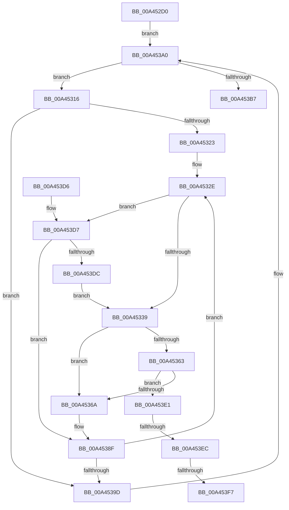

# RtlpFcDrainDelayedUsageReportBuffer

- RVA: `0x00A452D0`–`0x00A453FC` (길이 `300` bytes)
- VA: `0x0000000140A452D0`
- 실행 섹션: `PAGE`
- PDB 이름 있음: `예`; PDB Function 태그: `예`
- unwind 정보 RVA: `0x000AF304`
- 디코드: `86`개 명령, `300/300` bytes 표시
- 미해석 바이트: `0` (있으면 어셈블리에 `.byte`로 보존)

> 이 문서는 커널 이미지의 기계어와 PDB 기호를 분석해 생성했습니다. 4번과 5번은 함수 원형과 자료형을 바이너리 사용 방식에서 추정한 C 해석이며 원본 소스 복구 결과는 아닙니다.

## 1. Dependencies

- 직접 호출 지점: **2**; 고유 호출 대상: **2**
- 직접 호출자로 확인된 함수: **1**
- RIP 상대 이미지 참조: **0**

### Outgoing calls
- `0x00A45350` → [RtlpFcSendFeatureUsageNotifications](RtlpFcSendFeatureUsageNotifications_function_00A45404.md) (function, `0x00A45404`)
- `0x00A453AA` → [RtlFindNextForwardRunSet](../../text/43/RtlFindNextForwardRunSet_function_0043F230.md) (function, `0x0043F230`)

### Direct callers
- [CmFcpManagerDrainUsageNotifications](CmFcpManagerDrainUsageNotifications_function_00A451BC.md) at `0x00A4522B`

### Static image references
- 디코드된 RIP-relative 메모리 참조가 없습니다.

## 2. Other-region calls and transfers

- 다른 실행 섹션으로 향하는 call: **1**
  - `0x00A453AA` → [RtlFindNextForwardRunSet](../../text/43/RtlFindNextForwardRunSet_function_0043F230.md) (`PAGE` → `.text`)
- call이 아닌 외부 분기/꼬리 이동: **3**
  - `0x00A453E6` → [sub_00B3B152](../B3/Unknown_function_00B3B152.md) (`tail-transfer`)
  - `0x00A453F1` → [sub_00B3B152](../B3/Unknown_function_00B3B152.md) (`tail-transfer`)
  - `0x00A453F7` → [sub_00B3B152](../B3/Unknown_function_00B3B152.md) (`tail-transfer`)

## 3. Assembly (complete function range)

```asm
00A452D0  48 8B C4                        mov rax, rsp
00A452D3  48 89 58 10                     mov qword ptr [rax + 0x10], rbx
00A452D7  4C 89 48 20                     mov qword ptr [rax + 0x20], r9
00A452DB  4C 89 40 18                     mov qword ptr [rax + 0x18], r8
00A452DF  55                              push rbp
00A452E0  56                              push rsi
00A452E1  57                              push rdi
00A452E2  41 54                           push r12
00A452E4  41 55                           push r13
00A452E6  41 56                           push r14
00A452E8  41 57                           push r15
00A452EA  48 83 EC 30                     sub rsp, 0x30
00A452EE  83 60 08 00                     and dword ptr [rax + 8], 0
00A452F2  4C 8D 61 08                     lea r12, [rcx + 8]
00A452F6  48 C7 40 B8 40 00 00 00         mov qword ptr [rax - 0x48], 0x40
00A452FE  33 ED                           xor ebp, ebp
00A45300  48 83 60 BC 00                  and qword ptr [rax - 0x44], 0
00A45305  44 8A EA                        mov r13b, dl
00A45308  33 D2                           xor edx, edx
00A4530A  4C 89 60 C0                     mov qword ptr [rax - 0x40], r12
00A4530E  48 8B F1                        mov rsi, rcx
00A45311  E9 8A 00 00 00                  jmp 0x140a453a0
00A45316  8B 7C 24 70                     mov edi, dword ptr [rsp + 0x70]
00A4531A  44 8D 3C 07                     lea r15d, [rdi + rax]
00A4531E  41 3B FF                        cmp edi, r15d
00A45321  73 7A                           jae 0x140a4539d
00A45323  48 8D 1C 7F                     lea rbx, [rdi + rdi*2]
00A45327  44 8B F7                        mov r14d, edi
00A4532A  48 C1 E3 02                     shl rbx, 2
00A4532E  83 7C 33 10 00                  cmp dword ptr [rbx + rsi + 0x10], 0
00A45333  0F 87 9E 00 00 00               ja 0x140a453d7
00A45339  4C 8B 84 24 88 00 00 00         mov r8, qword ptr [rsp + 0x88]
00A45341  48 8D 4E 14                     lea rcx, [rsi + 0x14]
00A45345  48 8B 94 24 80 00 00 00         mov rdx, qword ptr [rsp + 0x80]
00A4534D  48 03 CB                        add rcx, rbx
00A45350  E8 AF 00 00 00                  call 0x140a45404
00A45355  8B 4C 33 10                     mov ecx, dword ptr [rbx + rsi + 0x10]
00A45359  FF C1                           inc ecx
00A4535B  89 4C 33 10                     mov dword ptr [rbx + rsi + 0x10], ecx
00A4535F  85 C0                           test eax, eax
00A45361  79 07                           jns 0x140a4536a
00A45363  3D 25 02 00 C0                  cmp eax, 0xc0000225
00A45368  75 77                           jne 0x140a453e1
00A4536A  33 C0                           xor eax, eax
00A4536C  4D 8B C6                        mov r8, r14
00A4536F  48 89 44 33 10                  mov qword ptr [rbx + rsi + 0x10], rax
00A45374  89 44 33 18                     mov dword ptr [rbx + rsi + 0x18], eax
00A45378  8B C7                           mov eax, edi
00A4537A  49 C1 E8 03                     shr r8, 3
00A4537E  83 E0 07                        and eax, 7
00A45381  43 0F BE 0C 20                  movsx ecx, byte ptr [r8 + r12]
00A45386  0F B3 C1                        btr ecx, eax
00A45389  43 88 0C 20                     mov byte ptr [r8 + r12], cl
00A4538D  FF 0E                           dec dword ptr [rsi]
00A4538F  FF C7                           inc edi
00A45391  49 FF C6                        inc r14
00A45394  48 83 C3 0C                     add rbx, 0xc
00A45398  41 3B FF                        cmp edi, r15d
00A4539B  72 91                           jb 0x140a4532e
00A4539D  41 8B D7                        mov edx, r15d
00A453A0  4C 8D 44 24 70                  lea r8, [rsp + 0x70]
00A453A5  48 8D 4C 24 20                  lea rcx, [rsp + 0x20]
00A453AA  E8 81 9E 9F FF                  call 0x14043f230
00A453AF  85 C0                           test eax, eax
00A453B1  0F 85 5F FF FF FF               jne 0x140a45316
00A453B7  48 8B 84 24 90 00 00 00         mov rax, qword ptr [rsp + 0x90]
00A453BF  48 8B 5C 24 78                  mov rbx, qword ptr [rsp + 0x78]
00A453C4  89 28                           mov dword ptr [rax], ebp
00A453C6  48 83 C4 30                     add rsp, 0x30
00A453CA  41 5F                           pop r15
00A453CC  41 5E                           pop r14
00A453CE  41 5D                           pop r13
00A453D0  41 5C                           pop r12
00A453D2  5F                              pop rdi
00A453D3  5E                              pop rsi
00A453D4  5D                              pop rbp
00A453D5  C3                              ret
00A453D6  CC                              int3
00A453D7  45 84 ED                        test r13b, r13b
00A453DA  74 B3                           je 0x140a4538f
00A453DC  E9 58 FF FF FF                  jmp 0x140a45339
00A453E1  3D 17 00 00 C0                  cmp eax, 0xc0000017
00A453E6  0F 84 66 5D 0F 00               je 0x140b3b152
00A453EC  3D 9A 00 00 C0                  cmp eax, 0xc000009a
00A453F1  0F 85 5B 5D 0F 00               jne 0x140b3b152
00A453F7  E9 56 5D 0F 00                  jmp 0x140b3b152
```

## 4. C-style interpretation (structured pseudocode)

```c
__int64 __fastcall RtlpFcDrainDelayedUsageReportBuffer(__int64 a1, int a2, __int64 a3, __int64 a4, __int64 a5)
{
    __int64 result;
    __int64 v_r14;
    __int64 v_rbp;
    __int64 v_rbx;
    __int64 v_rdi;
    __int64 v_rsp;
    unsigned __int64 v_stack_m48;
    unsigned __int64 v_stack_p10;
    unsigned __int64 v_stack_p18;
    unsigned __int64 v_stack_p20;
    unsigned int v_stack_p8;

    *(unsigned __int64 *)(v_rsp + 16) = v_rbx;
    *(unsigned __int64 *)(v_rsp + 32) = a4;
    *(unsigned __int64 *)(v_rsp + 24) = a3;
    v_rsp = (v_rsp) - (48);
    *(unsigned __int64 *)(v_rsp - 72) = 64;
    v_rbp = 0;
    a2 = 0;
    *(unsigned __int64 *)(v_rsp - 64) = a1 + 8;
    goto loc_00A453A0;
loc_00A45316:
    if (((unsigned int)((unsigned int)(v_stack_p8))) >= ((unsigned int)((unsigned int)(v_stack_p8) + v_rsp * 1))) goto loc_00A4539D;
    v_rbx = ((unsigned int)(v_stack_p8) + (unsigned int)(v_stack_p8) * 2) << (2);
loc_00A4532E:
    if ((*(unsigned int *)(v_rbx + a1 * 1 + 16)) > 0) goto loc_00A453D7;
loc_00A45339:
    a1 = (a1 + 20) + (v_rbx);
    result = RtlpFcSendFeatureUsageNotifications(a1, v_stack_p18, v_stack_p20, a4);
    a1 = (unsigned int)(((unsigned int)(*(unsigned int *)(v_rbx + a1 * 1 + 16))) + 1);
    *(unsigned int *)(v_rbx + a1 * 1 + 16) = (unsigned int)(a1);
    if (!sign_flag) goto loc_00A4536A;
    if (((unsigned int)(result)) != 0xC0000225ULL) goto loc_00A453E1;
loc_00A4536A:
    result = 0;
    *(unsigned __int64 *)(v_rbx + a1 * 1 + 16) = 0;
    *(unsigned int *)(v_rbx + a1 * 1 + 24) = 0;
    a3 = ((unsigned int)((unsigned int)((unsigned int)(v_stack_p8)))) >> (3);
    result = (unsigned int)(((unsigned int)((unsigned int)((unsigned int)(v_stack_p8)))) & (7));
    *(unsigned __int8 *)(a3 + a1 + 8 * 1) = (unsigned __int8)((__int8)(*(unsigned __int8 *)(a3 + a1 + 8 * 1)));
loc_00A4538F:
    v_rdi = (unsigned int)(((unsigned int)(v_stack_p8)) + 1);
    v_r14 = ((unsigned int)((unsigned int)((unsigned int)(v_stack_p8)))) + 1;
    v_rbx = (v_rbx) + (12);
    if (((unsigned int)(v_rdi)) < ((unsigned int)((unsigned int)(v_stack_p8) + v_rsp * 1))) goto loc_00A4532E;
loc_00A4539D:
loc_00A453A0:
    result = RtlFindNextForwardRunSet(v_stack_m48, (unsigned int)((unsigned int)((unsigned int)(v_stack_p8) + v_rsp * 1)), v_stack_p8, a4);
    if ((unsigned int)(result) != 0) goto loc_00A45316;
    *(unsigned int *)(a5) = 0;
    v_rsp = (v_rsp) + (48);
    return a5;
loc_00A453D7:
    if ((unsigned __int8)((unsigned __int8)(a2)) == 0) goto loc_00A4538F;
    goto loc_00A45339;
loc_00A453E1:
}
```

## 5. (Beta) C Style

```c
void *RtlpFcDrainDelayedUsageReportBuffer(void *Arg1, int32_t Arg2, int64_t Arg3, int64_t Arg4, void *Arg5)
{
    uint8_t *arg1 = (uint8_t *)Arg1;
    uint8_t *arg5 = (uint8_t *)Arg5;

    int64_t result;
    int64_t local_r14;
    int64_t local_rbp;
    int64_t local_rbx;
    int64_t local_rdi;
    int64_t local_rsp;
    uint64_t v_stack_m48;
    uint64_t v_stack_p10;
    uint64_t v_stack_p18;
    uint64_t v_stack_p20;
    uint32_t v_stack_p8;

    *(uint64_t *)(local_rsp + 0x10) = local_rbx;
    *(uint64_t *)(local_rsp + 0x20) = Arg4;
    *(uint64_t *)(local_rsp + 0x18) = Arg3;
    local_rsp = (local_rsp) - (48);
    *(uint64_t *)(local_rsp - 0x48) = 64;
    local_rbp = 0;
    Arg2 = 0;
    *(void **)(local_rsp - 0x40) = Arg1 + 8;
    goto loc_00A453A0;
loc_00A45316:
    if (((uint32_t)((uint32_t)(v_stack_p8))) >= ((uint32_t)((uint32_t)(v_stack_p8) + local_rsp * 1))) goto loc_00A4539D;
    local_rbx = ((uint32_t)(v_stack_p8) + (uint32_t)(v_stack_p8) * 2) << (2);
loc_00A4532E:
    if ((*(uint32_t *)(local_rbx + arg1 * 1 + 0x10)) > 0) goto loc_00A453D7;
loc_00A45339:
    Arg1 = (Arg1 + 20) + (local_rbx);
    result = RtlpFcSendFeatureUsageNotifications(Arg1, v_stack_p18, v_stack_p20, Arg4);
    Arg1 = (uint32_t)(((uint32_t)(*(uint32_t *)(local_rbx + arg1 * 1 + 0x10))) + 1);
    *(uint32_t *)(local_rbx + arg1 * 1 + 0x10) = (uint32_t)(Arg1);
    if (!sign_flag) goto loc_00A4536A;
    if (((uint32_t)(result)) != 0xC0000225ULL) goto loc_00A453E1;
loc_00A4536A:
    result = 0;
    *(uint64_t *)(local_rbx + arg1 * 1 + 0x10) = 0;
    *(uint32_t *)(local_rbx + arg1 * 1 + 0x18) = 0;
    Arg3 = ((uint32_t)((uint32_t)((uint32_t)(v_stack_p8)))) >> (3);
    result = (uint32_t)(((uint32_t)((uint32_t)((uint32_t)(v_stack_p8)))) & (7));
    *(uint8_t *)(Arg3 + arg1 + 0x8 * 1) = (uint8_t)((int8_t)(*(uint8_t *)(Arg3 + arg1 + 0x8 * 1)));
loc_00A4538F:
    local_rdi = (uint32_t)(((uint32_t)(v_stack_p8)) + 1);
    local_r14 = ((uint32_t)((uint32_t)((uint32_t)(v_stack_p8)))) + 1;
    local_rbx = (local_rbx) + (12);
    if (((uint32_t)(local_rdi)) < ((uint32_t)((uint32_t)(v_stack_p8) + local_rsp * 1))) goto loc_00A4532E;
loc_00A4539D:
loc_00A453A0:
    result = RtlFindNextForwardRunSet(v_stack_m48, (uint32_t)((uint32_t)((uint32_t)(v_stack_p8) + local_rsp * 1)), v_stack_p8, Arg4);
    if ((uint32_t)(result) != 0) goto loc_00A45316;
    *(uint32_t *)(arg5) = 0;
    local_rsp = (local_rsp) + (48);
    return Arg5;
loc_00A453D7:
    if ((uint8_t)((uint8_t)(Arg2)) == 0) goto loc_00A4538F;
    goto loc_00A45339;
loc_00A453E1:
}
```

### 관측된 메모리 오프셋

구조체 형식이 확인되지 않은 접근은 인자 기준의 오프셋으로만 기록했습니다.

| 기준 인자 | 오프셋 표현 | 폭 (bit) | 접근 |
|---|---:|---:|---|
| `Arg1` | `+ 0x0` | `32` | `R/W` |
| `Arg1` | `+ 0x8` | `64` | `R` |
| `Arg1` | `+ 0x14` | `64` | `R` |
| `Arg5` | `+ 0x0` | `32` | `W` |

## 6. Execution-region graph

[열기: 2D/3D 그래프와 함수 탐색 컨트롤 패널](../../../control-panel.html?section=page&rva=0x00A452D0&view=graph)

- 2D 그래프는 위에서 아래로 흐르고, 3D 그래프는 빈 공간을 드래그해 회전합니다. Shift+드래그는 이동, 휠은 확대·축소, 함수 노드 선택은 대상 보고서 이동입니다.

### Static fallback


