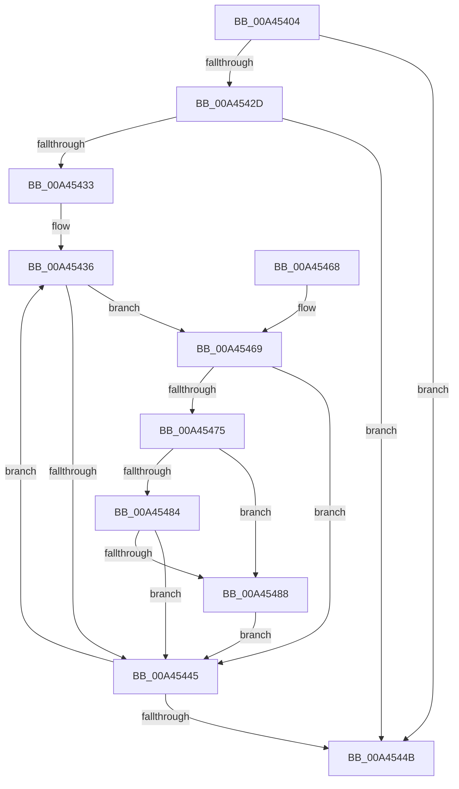

# RtlpFcSendFeatureUsageNotifications

- RVA: `0x00A45404`–`0x00A4549E` (길이 `154` bytes)
- VA: `0x0000000140A45404`
- 실행 섹션: `PAGE`
- PDB 이름 있음: `예`; PDB Function 태그: `아니요`
- unwind 정보 RVA: `0x0007EC48`
- 디코드: `49`개 명령, `154/154` bytes 표시
- 미해석 바이트: `0` (있으면 어셈블리에 `.byte`로 보존)

> 이 문서는 커널 이미지의 기계어와 PDB 기호를 분석해 생성했습니다. 4번과 5번은 함수 원형과 자료형을 바이너리 사용 방식에서 추정한 C 해석이며 원본 소스 복구 결과는 아닙니다.

## 1. Dependencies

- 직접 호출 지점: **1**; 고유 호출 대상: **1**
- 직접 호출자로 확인된 함수: **1**
- RIP 상대 이미지 참조: **0**

### Outgoing calls
- `0x00A45492` → [RtlpFcNotifyFeatureUsageTarget](../70/RtlpFcNotifyFeatureUsageTarget_function_00702268.md) (function, `0x00702268`)

### Direct callers
- [RtlpFcDrainDelayedUsageReportBuffer](RtlpFcDrainDelayedUsageReportBuffer_function_00A452D0.md) at `0x00A45350`

### Static image references
- 디코드된 RIP-relative 메모리 참조가 없습니다.

## 2. Other-region calls and transfers

- 다른 실행 섹션으로 향하는 call: **0**
- 별도 외부 분기/꼬리 이동을 확인하지 못했습니다.

## 3. Assembly (complete function range)

```asm
00A45404  48 8B C4                        mov rax, rsp
00A45407  48 89 58 08                     mov qword ptr [rax + 8], rbx
00A4540B  48 89 68 10                     mov qword ptr [rax + 0x10], rbp
00A4540F  48 89 70 18                     mov qword ptr [rax + 0x18], rsi
00A45413  48 89 78 20                     mov qword ptr [rax + 0x20], rdi
00A45417  41 56                           push r14
00A45419  48 83 EC 20                     sub rsp, 0x20
00A4541D  48 8B FA                        mov rdi, rdx
00A45420  4C 8B F1                        mov r14, rcx
00A45423  BB 25 02 00 C0                  mov ebx, 0xc0000225
00A45428  4D 85 C0                        test r8, r8
00A4542B  74 1E                           je 0x140a4544b
00A4542D  33 F6                           xor esi, esi
00A4542F  39 32                           cmp dword ptr [rdx], esi
00A45431  76 18                           jbe 0x140a4544b
00A45433  8D 6E 01                        lea ebp, [rsi + 1]
00A45436  41 8B 06                        mov eax, dword ptr [r14]
00A45439  8B CE                           mov ecx, esi
00A4543B  48 C1 E1 04                     shl rcx, 4
00A4543F  39 44 39 04                     cmp dword ptr [rcx + rdi + 4], eax
00A45443  74 24                           je 0x140a45469
00A45445  03 F5                           add esi, ebp
00A45447  3B 37                           cmp esi, dword ptr [rdi]
00A45449  72 EB                           jb 0x140a45436
00A4544B  48 8B 6C 24 38                  mov rbp, qword ptr [rsp + 0x38]
00A45450  8B C3                           mov eax, ebx
00A45452  48 8B 5C 24 30                  mov rbx, qword ptr [rsp + 0x30]
00A45457  48 8B 74 24 40                  mov rsi, qword ptr [rsp + 0x40]
00A4545C  48 8B 7C 24 48                  mov rdi, qword ptr [rsp + 0x48]
00A45461  48 83 C4 20                     add rsp, 0x20
00A45465  41 5E                           pop r14
00A45467  C3                              ret
00A45468  CC                              int3
00A45469  41 0F B7 46 04                  movzx eax, word ptr [r14 + 4]
00A4546E  66 39 44 39 08                  cmp word ptr [rcx + rdi + 8], ax
00A45473  75 D0                           jne 0x140a45445
00A45475  41 0F B7 56 06                  movzx edx, word ptr [r14 + 6]
00A4547A  66 23 D5                        and dx, bp
00A4547D  40 84 6C 39 0A                  test byte ptr [rcx + rdi + 0xa], bpl
00A45482  74 04                           je 0x140a45488
00A45484  84 D2                           test dl, dl
00A45486  74 BD                           je 0x140a45445
00A45488  48 8D 57 0C                     lea rdx, [rdi + 0xc]
00A4548C  48 03 D1                        add rdx, rcx
00A4548F  49 8B CE                        mov rcx, r14
00A45492  E8 D1 CD CB FF                  call 0x140702268
00A45497  85 C0                           test eax, eax
00A45499  0F 49 D8                        cmovns ebx, eax
00A4549C  EB A7                           jmp 0x140a45445
```

## 4. C-style interpretation (structured pseudocode)

```c
__int64 __fastcall RtlpFcSendFeatureUsageNotifications(__int64 a1, __int64 a2, __int64 a3)
{
    __int64 result;
    __int64 v_rbx;
    __int64 v_rsi;
    __int64 v_rsp;
    unsigned __int64 v_stack_p10;
    unsigned __int64 v_stack_p18;
    unsigned __int64 v_stack_p20;
    unsigned __int64 v_stack_p8;

    *(unsigned __int64 *)(v_rsp + 8) = v_rbx;
    *(unsigned __int64 *)(v_rsp + 16) = v_rbp;
    *(unsigned __int64 *)(v_rsp + 24) = v_rsi;
    *(unsigned __int64 *)(v_rsp + 32) = v_rdi;
    v_rsp = (v_rsp) - (32);
    if (a3 == 0) goto loc_00A4544B;
    v_rsi = 0;
    if ((*(unsigned int *)(a2)) <= 0) goto loc_00A4544B;
loc_00A45436:
    a1 = (0) << (4);
    if ((*(unsigned int *)(a1 + a2 * 1 + 4)) == ((unsigned int)((unsigned int)(*(unsigned int *)(a1))))) goto loc_00A45469;
loc_00A45445:
    v_rsi = (unsigned int)((v_rsi) + ((unsigned int)(v_rsi + 1)));
    if (((unsigned int)(v_rsi)) < (*(unsigned int *)(a2))) goto loc_00A45436;
loc_00A4544B:
    v_rsp = (v_rsp) + (32);
    return (unsigned int)((unsigned int)((unsigned int)(0xC0000225ULL)));
loc_00A45469:
    if ((*(unsigned __int16 *)(a1 + v_stack_p20 * 1 + 8)) != ((unsigned __int16)(*(unsigned __int16 *)(a1 + 4)))) goto loc_00A45445;
    a2 = (unsigned __int16)((*(unsigned __int16 *)(a1 + 6)) & ((unsigned __int16)(v_stack_p10)));
    if (((*(unsigned __int8 *)(a1 + v_stack_p20 * 1 + 10)) & ((unsigned __int8)(v_stack_p10))) == 0) goto loc_00A45488;
    if ((unsigned __int8)(a2) == 0) goto loc_00A45445;
loc_00A45488:
    a2 = (v_stack_p20 + 12) + (a1);
    result = RtlpFcNotifyFeatureUsageTarget(a1, a2, a3, a4);
    v_rbx = v_stack_p8;
    if (!sign_flag) { v_rbx = (unsigned int)(result); }
    goto loc_00A45445;
}
```

## 5. (Beta) C Style

```c
int64_t RtlpFcSendFeatureUsageNotifications(void *Arg1, void *Arg2, int64_t Arg3)
{
    uint8_t *arg1 = (uint8_t *)Arg1;
    uint8_t *arg2 = (uint8_t *)Arg2;

    int64_t result;
    int64_t local_rbx;
    int64_t local_rsi;
    int64_t local_rsp;
    uint64_t v_stack_p10;
    uint64_t v_stack_p18;
    uint64_t v_stack_p20;
    uint64_t v_stack_p8;

    *(uint64_t *)(local_rsp + 0x8) = local_rbx;
    *(uint64_t *)(local_rsp + 0x10) = local_rbp;
    *(uint64_t *)(local_rsp + 0x18) = local_rsi;
    *(uint64_t *)(local_rsp + 0x20) = local_rdi;
    local_rsp = (local_rsp) - (32);
    if (Arg3 == 0) goto loc_00A4544B;
    local_rsi = 0;
    if ((*(uint32_t *)(arg2)) <= 0) goto loc_00A4544B;
loc_00A45436:
    Arg1 = (0) << (4);
    if ((*(uint32_t *)(arg1 + arg2 * 1 + 0x4)) == ((uint32_t)((uint32_t)(*(uint32_t *)(arg1))))) goto loc_00A45469;
loc_00A45445:
    local_rsi = (uint32_t)((local_rsi) + ((uint32_t)(local_rsi + 1)));
    if (((uint32_t)(local_rsi)) < (*(uint32_t *)(arg2))) goto loc_00A45436;
loc_00A4544B:
    local_rsp = (local_rsp) + (32);
    return (uint32_t)((uint32_t)((uint32_t)(0xC0000225ULL)));
loc_00A45469:
    if ((*(uint16_t *)(arg1 + v_stack_p20 * 1 + 0x8)) != ((uint16_t)(*(uint16_t *)(arg1 + 0x4)))) goto loc_00A45445;
    Arg2 = (uint16_t)((*(uint16_t *)(arg1 + 0x6)) & ((uint16_t)(v_stack_p10)));
    if (((*(uint8_t *)(arg1 + v_stack_p20 * 1 + 0xA)) & ((uint8_t)(v_stack_p10))) == 0) goto loc_00A45488;
    if ((uint8_t)(Arg2) == 0) goto loc_00A45445;
loc_00A45488:
    Arg2 = (v_stack_p20 + 12) + (Arg1);
    result = RtlpFcNotifyFeatureUsageTarget(Arg1, Arg2, Arg3, a4);
    local_rbx = v_stack_p8;
    if (!sign_flag) { local_rbx = (uint32_t)(result); }
    goto loc_00A45445;
}
```

### 관측된 메모리 오프셋

구조체 형식이 확인되지 않은 접근은 인자 기준의 오프셋으로만 기록했습니다.

| 기준 인자 | 오프셋 표현 | 폭 (bit) | 접근 |
|---|---:|---:|---|
| `Arg1` | `+ 0x0` | `32` | `R` |
| `Arg1` | `+ 0x4` | `16` | `R` |
| `Arg1` | `+ 0x6` | `16` | `R` |
| `Arg2` | `+ 0x0` | `32` | `R` |
| `Arg2` | `+ 0xC` | `64` | `R` |

## 6. Execution-region graph

[열기: 2D/3D 그래프와 함수 탐색 컨트롤 패널](../../../control-panel.html?section=page&rva=0x00A45404&view=graph)

- 2D 그래프는 위에서 아래로 흐르고, 3D 그래프는 빈 공간을 드래그해 회전합니다. Shift+드래그는 이동, 휠은 확대·축소, 함수 노드 선택은 대상 보고서 이동입니다.

### Static fallback


