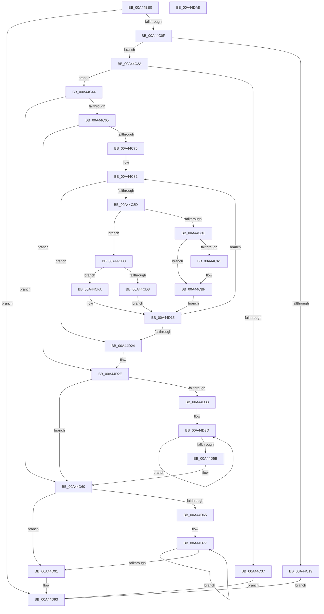

# RtlpFcUpdateUsageTriggers

- RVA: `0x00A44BB0`–`0x00A44DA9` (길이 `505` bytes)
- VA: `0x0000000140A44BB0`
- 실행 섹션: `PAGE`
- PDB 이름 있음: `예`; PDB Function 태그: `아니요`
- unwind 정보 RVA: `0x000AF26C`
- 디코드: `143`개 명령, `505/505` bytes 표시
- 미해석 바이트: `0` (있으면 어셈블리에 `.byte`로 보존)

> 이 문서는 커널 이미지의 기계어와 PDB 기호를 분석해 생성했습니다. 4번과 5번은 함수 원형과 자료형을 바이너리 사용 방식에서 추정한 C 해석이며 원본 소스 복구 결과는 아닙니다.

## 1. Dependencies

- 직접 호출 지점: **5**; 고유 호출 대상: **4**
- 직접 호출자로 확인된 함수: **2**
- RIP 상대 이미지 참조: **1**

### Outgoing calls
- `0x00A44BEF` → [qsort](../../text/50/qsort_function_005009F0.md) (function, `0x005009F0`)
- `0x00A44C02` → [RtlpFcCalculateRequiredSizeForNewUsageSubscriptionTable](RtlpFcCalculateRequiredSizeForNewUsageSubscriptionTable_function_00A44FEC.md) (function, `0x00A44FEC`)
- `0x00A44C93` → [RtlpFcCompareUsageSubscriptionToUsageSubscription](../../text/4A/RtlpFcCompareUsageSubscriptionToUsageSubscription_function_004AEEF8.md) (function, `0x004AEEF8`)
- `0x00A44CE3` → [RtlpFcAddUsageSubscriptionFromUpdate](../70/RtlpFcAddUsageSubscriptionFromUpdate_function_00705B20.md) (function, `0x00705B20`)
- `0x00A44D82` → [RtlpFcAddUsageSubscriptionFromUpdate](../70/RtlpFcAddUsageSubscriptionFromUpdate_function_00705B20.md) (function, `0x00705B20`)

### Direct callers
- [CmFcManagerUpdateFeatureUsageSubscriptions](CmFcManagerUpdateFeatureUsageSubscriptions_function_00A4490C.md) at `0x00A44A02`
- [sub_00B3AEBA](../B3/Unknown_function_00B3AEBA.md) at `0x00B3AF1C`

### Static image references
- `0x00A44BD9` → RVA `0x00AD3490` (`RtlpFcCompareUsageSubscriptionUpdates`; read)

## 2. Other-region calls and transfers

- 다른 실행 섹션으로 향하는 call: **2**
  - `0x00A44BEF` → [qsort](../../text/50/qsort_function_005009F0.md) (`PAGE` → `.text`)
  - `0x00A44C93` → [RtlpFcCompareUsageSubscriptionToUsageSubscription](../../text/4A/RtlpFcCompareUsageSubscriptionToUsageSubscription_function_004AEEF8.md) (`PAGE` → `.text`)
- 별도 외부 분기/꼬리 이동을 확인하지 못했습니다.

## 3. Assembly (complete function range)

```asm
00A44BB0  48 8B C4                        mov rax, rsp
00A44BB3  48 89 58 08                     mov qword ptr [rax + 8], rbx
00A44BB7  4C 89 40 18                     mov qword ptr [rax + 0x18], r8
00A44BBB  48 89 50 10                     mov qword ptr [rax + 0x10], rdx
00A44BBF  55                              push rbp
00A44BC0  56                              push rsi
00A44BC1  57                              push rdi
00A44BC2  41 54                           push r12
00A44BC4  41 55                           push r13
00A44BC6  41 56                           push r14
00A44BC8  41 57                           push r15
00A44BCA  48 83 EC 20                     sub rsp, 0x20
00A44BCE  48 83 60 10 00                  and qword ptr [rax + 0x10], 0
00A44BD3  49 8B E9                        mov rbp, r9
00A44BD6  4D 8B E8                        mov r13, r8
00A44BD9  4C 8D 0D B0 E8 08 00            lea r9, [rip + 0x8e8b0]
00A44BE0  4C 8B E1                        mov r12, rcx
00A44BE3  48 8B D5                        mov rdx, rbp
00A44BE6  49 8B CD                        mov rcx, r13
00A44BE9  41 B8 14 00 00 00               mov r8d, 0x14
00A44BEF  E8 FC BD AB FF                  call 0x1405009f0
00A44BF4  4C 8D 4C 24 68                  lea r9, [rsp + 0x68]
00A44BF9  4C 8B C5                        mov r8, rbp
00A44BFC  49 8B D5                        mov rdx, r13
00A44BFF  49 8B CC                        mov rcx, r12
00A44C02  E8 E5 03 00 00                  call 0x140a44fec
00A44C07  85 C0                           test eax, eax
00A44C09  0F 88 84 01 00 00               js 0x140a44d93
00A44C0F  48 8B 4C 24 68                  mov rcx, qword ptr [rsp + 0x68]
00A44C14  48 85 C9                        test rcx, rcx
00A44C17  75 11                           jne 0x140a44c2a
00A44C19  48 8B 8C 24 88 00 00 00         mov rcx, qword ptr [rsp + 0x88]
00A44C21  48 83 21 00                     and qword ptr [rcx], 0
00A44C25  E9 69 01 00 00                  jmp 0x140a44d93
00A44C2A  48 8B 84 24 88 00 00 00         mov rax, qword ptr [rsp + 0x88]
00A44C32  48 3B 08                        cmp rcx, qword ptr [rax]
00A44C35  76 0D                           jbe 0x140a44c44
00A44C37  48 89 08                        mov qword ptr [rax], rcx
00A44C3A  B8 05 00 00 80                  mov eax, 0x80000005
00A44C3F  E9 4F 01 00 00                  jmp 0x140a44d93
00A44C44  48 8B 9C 24 80 00 00 00         mov rbx, qword ptr [rsp + 0x80]
00A44C4C  33 FF                           xor edi, edi
00A44C4E  33 F6                           xor esi, esi
00A44C50  83 23 00                        and dword ptr [rbx], 0
00A44C53  4C 8D 43 04                     lea r8, [rbx + 4]
00A44C57  4C 89 44 24 68                  mov qword ptr [rsp + 0x68], r8
00A44C5C  4D 85 E4                        test r12, r12
00A44C5F  0F 84 FB 00 00 00               je 0x140a44d60
00A44C65  41 8B 04 24                     mov eax, dword ptr [r12]
00A44C69  49 8D 54 24 04                  lea rdx, [r12 + 4]
00A44C6E  85 C0                           test eax, eax
00A44C70  0F 84 B8 00 00 00               je 0x140a44d2e
00A44C76  4D 8B FD                        mov r15, r13
00A44C79  8B C8                           mov ecx, eax
00A44C7B  49 83 C5 04                     add r13, 4
00A44C7F  4C 8B F2                        mov r14, rdx
00A44C82  8B C1                           mov eax, ecx
00A44C84  48 3B F5                        cmp rsi, rbp
00A44C87  0F 83 97 00 00 00               jae 0x140a44d24
00A44C8D  49 8B D5                        mov rdx, r13
00A44C90  49 8B CE                        mov rcx, r14
00A44C93  E8 60 A2 A6 FF                  call 0x1404aeef8
00A44C98  85 C0                           test eax, eax
00A44C9A  75 37                           jne 0x140a44cd3
00A44C9C  41 39 07                        cmp dword ptr [r15], eax
00A44C9F  75 1E                           jne 0x140a44cbf
00A44CA1  41 0F 10 06                     movups xmm0, xmmword ptr [r14]
00A44CA5  F3 41 0F 7F 00                  movdqu xmmword ptr [r8], xmm0
00A44CAA  41 0F B7 47 0A                  movzx eax, word ptr [r15 + 0xa]
00A44CAF  66 41 89 40 06                  mov word ptr [r8 + 6], ax
00A44CB4  49 83 C0 10                     add r8, 0x10
00A44CB8  FF 03                           inc dword ptr [rbx]
00A44CBA  4C 89 44 24 68                  mov qword ptr [rsp + 0x68], r8
00A44CBF  48 FF C7                        inc rdi
00A44CC2  49 83 C6 10                     add r14, 0x10
00A44CC6  48 FF C6                        inc rsi
00A44CC9  49 83 C7 14                     add r15, 0x14
00A44CCD  49 83 C5 14                     add r13, 0x14
00A44CD1  EB 42                           jmp 0x140a44d15
00A44CD3  83 F8 01                        cmp eax, 1
00A44CD6  75 22                           jne 0x140a44cfa
00A44CD8  4C 8D 44 24 68                  lea r8, [rsp + 0x68]
00A44CDD  48 8B D3                        mov rdx, rbx
00A44CE0  49 8B CF                        mov rcx, r15
00A44CE3  E8 38 0E CC FF                  call 0x140705b20
00A44CE8  4C 8B 44 24 68                  mov r8, qword ptr [rsp + 0x68]
00A44CED  48 FF C6                        inc rsi
00A44CF0  49 83 C7 14                     add r15, 0x14
00A44CF4  49 83 C5 14                     add r13, 0x14
00A44CF8  EB 1B                           jmp 0x140a44d15
00A44CFA  41 0F 10 06                     movups xmm0, xmmword ptr [r14]
00A44CFE  48 FF C7                        inc rdi
00A44D01  F3 41 0F 7F 00                  movdqu xmmword ptr [r8], xmm0
00A44D06  FF 03                           inc dword ptr [rbx]
00A44D08  49 83 C0 10                     add r8, 0x10
00A44D0C  4C 89 44 24 68                  mov qword ptr [rsp + 0x68], r8
00A44D11  49 83 C6 10                     add r14, 0x10
00A44D15  41 8B 0C 24                     mov ecx, dword ptr [r12]
00A44D19  8B C1                           mov eax, ecx
00A44D1B  48 3B F9                        cmp rdi, rcx
00A44D1E  0F 82 5E FF FF FF               jb 0x140a44c82
00A44D24  4C 8B 6C 24 70                  mov r13, qword ptr [rsp + 0x70]
00A44D29  49 8D 54 24 04                  lea rdx, [r12 + 4]
00A44D2E  48 3B F8                        cmp rdi, rax
00A44D31  73 2D                           jae 0x140a44d60
00A44D33  48 8B CF                        mov rcx, rdi
00A44D36  48 C1 E1 04                     shl rcx, 4
00A44D3A  48 03 CA                        add rcx, rdx
00A44D3D  0F 10 01                        movups xmm0, xmmword ptr [rcx]
00A44D40  48 FF C7                        inc rdi
00A44D43  48 8D 49 10                     lea rcx, [rcx + 0x10]
00A44D47  F3 41 0F 7F 00                  movdqu xmmword ptr [r8], xmm0
00A44D4C  FF 03                           inc dword ptr [rbx]
00A44D4E  49 83 C0 10                     add r8, 0x10
00A44D52  41 8B 04 24                     mov eax, dword ptr [r12]
00A44D56  48 3B F8                        cmp rdi, rax
00A44D59  72 E2                           jb 0x140a44d3d
00A44D5B  4C 89 44 24 68                  mov qword ptr [rsp + 0x68], r8
00A44D60  48 3B F5                        cmp rsi, rbp
00A44D63  73 2C                           jae 0x140a44d91
00A44D65  48 8D 04 B6                     lea rax, [rsi + rsi*4]
00A44D69  48 8D 3C 85 00 00 00 00         lea rdi, [rax*4]
00A44D71  49 03 FD                        add rdi, r13
00A44D74  48 2B EE                        sub rbp, rsi
00A44D77  4C 8D 44 24 68                  lea r8, [rsp + 0x68]
00A44D7C  48 8B D3                        mov rdx, rbx
00A44D7F  48 8B CF                        mov rcx, rdi
00A44D82  E8 99 0D CC FF                  call 0x140705b20
00A44D87  48 83 C7 14                     add rdi, 0x14
00A44D8B  48 83 ED 01                     sub rbp, 1
00A44D8F  75 E6                           jne 0x140a44d77
00A44D91  33 C0                           xor eax, eax
00A44D93  48 8B 5C 24 60                  mov rbx, qword ptr [rsp + 0x60]
00A44D98  48 83 C4 20                     add rsp, 0x20
00A44D9C  41 5F                           pop r15
00A44D9E  41 5E                           pop r14
00A44DA0  41 5D                           pop r13
00A44DA2  41 5C                           pop r12
00A44DA4  5F                              pop rdi
00A44DA5  5E                              pop rsi
00A44DA6  5D                              pop rbp
00A44DA7  C3                              ret
00A44DA8  CC                              int3
```

## 4. C-style interpretation (structured pseudocode)

```c
__int64 __fastcall RtlpFcUpdateUsageTriggers(__int64 a1, __int64 a2, __int64 a3, __int64 a4, __int64 a5, __int64 a6)
{
    __int64 result;
    __int64 v_r13;
    __int64 v_r14;
    __int64 v_r15;
    __int64 v_rbp;
    __int64 v_rdi;
    __int64 v_rsi;
    __int64 v_rsp;
    unsigned __int64 v_stack_p10;
    unsigned __int64 v_stack_p18;
    unsigned __int64 v_stack_p8;

    *(unsigned __int64 *)(v_rsp + 8) = v_rbx;
    *(unsigned __int64 *)(v_rsp + 24) = a3;
    *(unsigned __int64 *)(v_rsp + 16) = a2;
    v_rsp = (v_rsp) - (32);
    result = qsort(a3, a4, 20, v_rip + 583856);
    result = RtlpFcCalculateRequiredSizeForNewUsageSubscriptionTable(a1, a3, a4, v_stack_p10);
    if (sign_flag) goto loc_00A44D93;
    if (v_stack_p10 != 0) goto loc_00A44C2A;
    goto loc_00A44D93;
loc_00A44C2A:
    if (a6 <= (*(unsigned __int64 *)(a6))) goto loc_00A44C44;
    *(unsigned __int64 *)(a6) = a6;
    goto loc_00A44D93;
loc_00A44C44:
    v_rdi = 0;
    v_rsi = 0;
    v_stack_p10 = a5 + 4;
    if (a1 == 0) goto loc_00A44D60;
    if ((unsigned int)((unsigned int)(*(unsigned int *)(a1))) == 0) goto loc_00A44D2E;
    v_r13 = (a3) + (4);
loc_00A44C82:
    if (0 >= a4) goto loc_00A44D24;
    result = RtlpFcCompareUsageSubscriptionToUsageSubscription(a1 + 4, v_r13, a5 + 4, v_stack_p10);
    if ((unsigned int)(result) != 0) goto loc_00A44CD3;
    if ((*(unsigned int *)(a3)) == ((unsigned int)(result))) {
        *(unsigned __int64 *)(a5 + 4) = v_xmm0;
        result = *(unsigned __int16 *)(a3 + 10);
        *(unsigned __int16 *)(a5 + 4 + 6) = (unsigned __int16)(result);
        a3 = (a5 + 4) + (16);
        v_stack_p10 = a3;
    }
    v_rdi = (v_rdi) + 1;
    v_r14 = (a1 + 4) + (16);
    v_rsi = (v_rsi) + 1;
    v_r15 = (a3) + (20);
    v_r13 = (v_r13) + (20);
    goto loc_00A44D15;
loc_00A44CD3:
    if (((unsigned int)(result)) != 1) goto loc_00A44CFA;
    result = RtlpFcAddUsageSubscriptionFromUpdate(v_r15, a5, v_stack_p10, v_stack_p10);
    v_rsi = (v_rsi) + 1;
    v_r15 = (v_r15) + (20);
    v_r13 = (v_r13) + (20);
    goto loc_00A44D15;
loc_00A44CFA:
    v_rdi = (v_rdi) + 1;
    *(unsigned __int64 *)(v_stack_p10) = v_xmm0;
    a3 = (v_stack_p10) + (16);
    v_stack_p10 = a3;
    v_r14 = (v_r14) + (16);
loc_00A44D15:
    if (v_rdi < ((unsigned int)(*(unsigned int *)(a1)))) goto loc_00A44C82;
loc_00A44D24:
loc_00A44D2E:
    if (v_rdi >= ((unsigned int)((unsigned int)((unsigned int)(*(unsigned int *)(a1)))))) goto loc_00A44D60;
    a1 = (v_rdi) << (4);
    a1 = (a1) + (a1 + 4);
loc_00A44D3D:
    v_rdi = (v_rdi) + 1;
    *(unsigned __int64 *)(a3) = v_xmm0;
    a3 = (a3) + (16);
    if (v_rdi < ((unsigned int)(*(unsigned int *)(a1)))) goto loc_00A44D3D;
    v_stack_p10 = a3;
loc_00A44D60:
    if (v_rsi >= a4) goto loc_00A44D91;
    v_rdi = (v_rsi + v_rsi * 4 * 4) + (v_stack_p18);
    v_rbp = (a4) - (v_rsi);
loc_00A44D77:
    result = RtlpFcAddUsageSubscriptionFromUpdate(v_rdi, a5, v_stack_p10, v_stack_p10);
    v_rdi = (v_rdi) + (20);
    v_rbp = (v_rbp) - (1);
    if (condition_is_not_equal) goto loc_00A44D77;
loc_00A44D91:
    result = 0;
loc_00A44D93:
    v_rsp = (v_rsp) + (32);
    return result;
}
```

## 5. (Beta) C Style

```c
int64_t RtlpFcUpdateUsageTriggers(int64_t Arg1, int64_t Arg2, void *Arg3, int64_t Arg4, void *Arg5, void *Arg6)
{
    uint8_t *arg3 = (uint8_t *)Arg3;
    uint8_t *arg5 = (uint8_t *)Arg5;
    uint8_t *arg6 = (uint8_t *)Arg6;

    int64_t result;
    int64_t local_r13;
    int64_t local_r14;
    int64_t local_r15;
    int64_t local_rbp;
    int64_t local_rdi;
    int64_t local_rsi;
    int64_t local_rsp;
    uint64_t v_stack_p10;
    uint64_t v_stack_p18;
    uint64_t v_stack_p8;

    *(uint64_t *)(local_rsp + 0x8) = local_rbx;
    *(void **)(local_rsp + 0x18) = Arg3;
    *(uint64_t *)(local_rsp + 0x10) = Arg2;
    local_rsp = (local_rsp) - (32);
    result = qsort(Arg3, Arg4, 20, v_rip + 583856);
    result = RtlpFcCalculateRequiredSizeForNewUsageSubscriptionTable(Arg1, Arg3, Arg4, v_stack_p10);
    if (sign_flag) goto loc_00A44D93;
    if (v_stack_p10 != 0) goto loc_00A44C2A;
    goto loc_00A44D93;
loc_00A44C2A:
    if (Arg6 <= (*(uint64_t *)(arg6))) goto loc_00A44C44;
    *(void **)(arg6) = Arg6;
    goto loc_00A44D93;
loc_00A44C44:
    local_rdi = 0;
    local_rsi = 0;
    v_stack_p10 = Arg5 + 4;
    if (Arg1 == 0) goto loc_00A44D60;
    if ((uint32_t)((uint32_t)(*(uint32_t *)(Arg1))) == 0) goto loc_00A44D2E;
    local_r13 = (Arg3) + (4);
loc_00A44C82:
    if (0 >= Arg4) goto loc_00A44D24;
    result = RtlpFcCompareUsageSubscriptionToUsageSubscription(Arg1 + 4, local_r13, Arg5 + 4, v_stack_p10);
    if ((uint32_t)(result) != 0) goto loc_00A44CD3;
    if ((*(uint32_t *)(arg3)) == ((uint32_t)(result))) {
        *(uint64_t *)(arg5 + 0x4) = v_xmm0;
        result = *(uint16_t *)(arg3 + 0xA);
        *(uint16_t *)(arg5 + 0x4 + 0x6) = (uint16_t)(result);
        Arg3 = (Arg5 + 4) + (16);
        v_stack_p10 = Arg3;
    }
    local_rdi = (local_rdi) + 1;
    local_r14 = (Arg1 + 4) + (16);
    local_rsi = (local_rsi) + 1;
    local_r15 = (Arg3) + (20);
    local_r13 = (local_r13) + (20);
    goto loc_00A44D15;
loc_00A44CD3:
    if (((uint32_t)(result)) != 1) goto loc_00A44CFA;
    result = RtlpFcAddUsageSubscriptionFromUpdate(local_r15, Arg5, v_stack_p10, v_stack_p10);
    local_rsi = (local_rsi) + 1;
    local_r15 = (local_r15) + (20);
    local_r13 = (local_r13) + (20);
    goto loc_00A44D15;
loc_00A44CFA:
    local_rdi = (local_rdi) + 1;
    *(uint64_t *)(v_stack_p10) = v_xmm0;
    Arg3 = (v_stack_p10) + (16);
    v_stack_p10 = Arg3;
    local_r14 = (local_r14) + (16);
loc_00A44D15:
    if (local_rdi < ((uint32_t)(*(uint32_t *)(Arg1)))) goto loc_00A44C82;
loc_00A44D24:
loc_00A44D2E:
    if (local_rdi >= ((uint32_t)((uint32_t)((uint32_t)(*(uint32_t *)(Arg1)))))) goto loc_00A44D60;
    Arg1 = (local_rdi) << (4);
    Arg1 = (Arg1) + (Arg1 + 4);
loc_00A44D3D:
    local_rdi = (local_rdi) + 1;
    *(uint64_t *)(arg3) = v_xmm0;
    Arg3 = (Arg3) + (16);
    if (local_rdi < ((uint32_t)(*(uint32_t *)(Arg1)))) goto loc_00A44D3D;
    v_stack_p10 = Arg3;
loc_00A44D60:
    if (local_rsi >= Arg4) goto loc_00A44D91;
    local_rdi = (local_rsi + local_rsi * 4 * 4) + (v_stack_p18);
    local_rbp = (Arg4) - (local_rsi);
loc_00A44D77:
    result = RtlpFcAddUsageSubscriptionFromUpdate(local_rdi, Arg5, v_stack_p10, v_stack_p10);
    local_rdi = (local_rdi) + (20);
    local_rbp = (local_rbp) - (1);
    if (condition_is_not_equal) goto loc_00A44D77;
loc_00A44D91:
    result = 0;
loc_00A44D93:
    local_rsp = (local_rsp) + (32);
    return result;
}
```

### 관측된 메모리 오프셋

구조체 형식이 확인되지 않은 접근은 인자 기준의 오프셋으로만 기록했습니다.

| 기준 인자 | 오프셋 표현 | 폭 (bit) | 접근 |
|---|---:|---:|---|
| `Arg3` | `+ 0x0` | `32` | `R` |
| `Arg3` | `+ 0xA` | `16` | `R` |
| `Arg5` | `+ 0x0` | `32` | `R/W` |
| `Arg5` | `+ 0x4` | `64` | `R` |
| `Arg6` | `+ 0x0` | `64` | `R` |
| `Arg6` | `+ 0x0` | `64` | `R/W` |
| `Arg6` | `+ 0x0` | `64` | `W` |

## 6. Execution-region graph

[열기: 2D/3D 그래프와 함수 탐색 컨트롤 패널](../../../control-panel.html?section=page&rva=0x00A44BB0&view=graph)

- 2D 그래프는 위에서 아래로 흐르고, 3D 그래프는 빈 공간을 드래그해 회전합니다. Shift+드래그는 이동, 휠은 확대·축소, 함수 노드 선택은 대상 보고서 이동입니다.

### Static fallback


