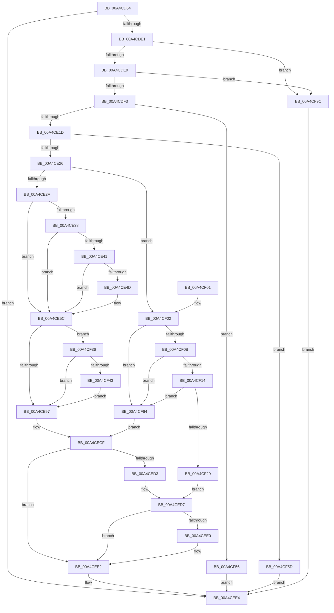

# RtlpGetSetBootStatusData

- RVA: `0x00A4CD64`–`0x00A4CFA6` (길이 `578` bytes)
- VA: `0x0000000140A4CD64`
- 실행 섹션: `PAGE`
- PDB 이름 있음: `예`; PDB Function 태그: `아니요`
- unwind 정보 RVA: `0x000B04D8`
- 디코드: `149`개 명령, `578/578` bytes 표시
- 미해석 바이트: `0` (있으면 어셈블리에 `.byte`로 보존)

> 이 문서는 커널 이미지의 기계어와 PDB 기호를 분석해 생성했습니다. 4번과 5번은 함수 원형과 자료형을 바이너리 사용 방식에서 추정한 C 해석이며 원본 소스 복구 결과는 아닙니다.

## 1. Dependencies

- 직접 호출 지점: **7**; 고유 호출 대상: **5**
- 직접 호출자로 확인된 함수: **2**
- RIP 상대 이미지 참조: **5**

### Outgoing calls
- `0x00A4CDD4` → [ZwReadFile](../../text/6A/ZwReadFile_function_006AD190.md) (function, `0x006AD190`)
- `0x00A4CE57` → [memcpy](../../text/6C/memcpy_function_006C6840.md) (function, `0x006C6840`)
- `0x00A4CE88` → [ZwWriteFile](../../text/6A/ZwWriteFile_function_006AD1D0.md) (function, `0x006AD1D0`)
- `0x00A4CECA` → [ZwPowerInformation](../../text/6A/ZwPowerInformation_function_006ADCB0.md) (function, `0x006ADCB0`)
- `0x00A4CF2D` → [memcpy](../../text/6C/memcpy_function_006C6840.md) (function, `0x006C6840`)
- `0x00A4CF4A` → [ZwFlushBuffersFile](../../text/6A/ZwFlushBuffersFile_function_006ADA30.md) (function, `0x006ADA30`)
- `0x00A4CF90` → [ZwReadFile](../../text/6A/ZwReadFile_function_006AD190.md) (function, `0x006AD190`)

### Direct callers
- [PopBootStatGet](PopBootStatGet_function_00A4C398.md) at `0x00A4C663`
- [RtlGetSetBootStatusData](RtlGetSetBootStatusData_function_00A4CBE0.md) at `0x00A4CC61`
- [RtlGetSetBootStatusData](RtlGetSetBootStatusData_function_00A4CBE0.md) at `0x00A4CC89`
- [RtlGetSetBootStatusData](RtlGetSetBootStatusData_function_00A4CBE0.md) at `0x00A4CCB2`
- [RtlGetSetBootStatusData](RtlGetSetBootStatusData_function_00A4CBE0.md) at `0x00A4CD17`

### Static image references
- `0x00A4CDF7` → RVA `0x0001BBA0` (`.rdata`; read)
- `0x00A4CE2F` → RVA `0x00F05C20` (`.data`; read)
- `0x00A4CE38` → RVA `0x00F05C28` (`.data`; read)
- `0x00A4CE41` → RVA `0x00F05C38` (`.data`; read)
- `0x00A4CF36` → RVA `0x00F05C30` (`.data`; read)

## 2. Other-region calls and transfers

- 다른 실행 섹션으로 향하는 call: **7**
  - `0x00A4CDD4` → [ZwReadFile](../../text/6A/ZwReadFile_function_006AD190.md) (`PAGE` → `.text`)
  - `0x00A4CE57` → [memcpy](../../text/6C/memcpy_function_006C6840.md) (`PAGE` → `.text`)
  - `0x00A4CE88` → [ZwWriteFile](../../text/6A/ZwWriteFile_function_006AD1D0.md) (`PAGE` → `.text`)
  - `0x00A4CECA` → [ZwPowerInformation](../../text/6A/ZwPowerInformation_function_006ADCB0.md) (`PAGE` → `.text`)
  - `0x00A4CF2D` → [memcpy](../../text/6C/memcpy_function_006C6840.md) (`PAGE` → `.text`)
  - `0x00A4CF4A` → [ZwFlushBuffersFile](../../text/6A/ZwFlushBuffersFile_function_006ADA30.md) (`PAGE` → `.text`)
  - `0x00A4CF90` → [ZwReadFile](../../text/6A/ZwReadFile_function_006AD190.md) (`PAGE` → `.text`)
- 별도 외부 분기/꼬리 이동을 확인하지 못했습니다.

## 3. Assembly (complete function range)

```asm
00A4CD64  4C 8B DC                        mov r11, rsp
00A4CD67  49 89 5B 08                     mov qword ptr [r11 + 8], rbx
00A4CD6B  49 89 73 10                     mov qword ptr [r11 + 0x10], rsi
00A4CD6F  49 89 7B 18                     mov qword ptr [r11 + 0x18], rdi
00A4CD73  4D 89 73 20                     mov qword ptr [r11 + 0x20], r14
00A4CD77  55                              push rbp
00A4CD78  49 8D 6B B1                     lea rbp, [r11 - 0x4f]
00A4CD7C  48 81 EC A0 00 00 00            sub rsp, 0xa0
00A4CD83  49 83 63 98 00                  and qword ptr [r11 - 0x68], 0
00A4CD88  48 8D 45 FF                     lea rax, [rbp - 1]
00A4CD8C  83 65 F7 00                     and dword ptr [rbp - 9], 0
00A4CD90  4D 8B F1                        mov r14, r9
00A4CD93  48 83 65 FF 00                  and qword ptr [rbp - 1], 0
00A4CD98  40 8A FA                        mov dil, dl
00A4CD9B  49 89 43 90                     mov qword ptr [r11 - 0x70], rax
00A4CD9F  0F 57 C0                        xorps xmm0, xmm0
00A4CDA2  48 8D 45 F7                     lea rax, [rbp - 9]
00A4CDA6  C7 44 24 30 04 00 00 00         mov dword ptr [rsp + 0x30], 4
00A4CDAE  49 89 43 80                     mov qword ptr [r11 - 0x80], rax
00A4CDB2  0F 57 C9                        xorps xmm1, xmm1
00A4CDB5  48 8D 45 07                     lea rax, [rbp + 7]
00A4CDB9  49 63 D8                        movsxd rbx, r8d
00A4CDBC  45 33 C9                        xor r9d, r9d
00A4CDBF  48 89 44 24 20                  mov qword ptr [rsp + 0x20], rax
00A4CDC4  45 33 C0                        xor r8d, r8d
00A4CDC7  33 D2                           xor edx, edx
00A4CDC9  48 8B F1                        mov rsi, rcx
00A4CDCC  0F 11 45 07                     movups xmmword ptr [rbp + 7], xmm0
00A4CDD0  0F 11 4D 17                     movups xmmword ptr [rbp + 0x17], xmm1
00A4CDD4  E8 B7 03 C6 FF                  call 0x1406ad190
00A4CDD9  85 C0                           test eax, eax
00A4CDDB  0F 88 03 01 00 00               js 0x140a4cee4
00A4CDE1  85 DB                           test ebx, ebx
00A4CDE3  0F 88 B3 01 00 00               js 0x140a4cf9c
00A4CDE9  48 83 FB 13                     cmp rbx, 0x13
00A4CDED  0F 83 A9 01 00 00               jae 0x140a4cf9c
00A4CDF3  83 65 03 00                     and dword ptr [rbp + 3], 0
00A4CDF7  48 8D 0D A2 ED 5C FF            lea rcx, [rip - 0xa3125e]
00A4CDFE  8B 14 D9                        mov edx, dword ptr [rcx + rbx*8]
00A4CE01  8B 44 D9 04                     mov eax, dword ptr [rcx + rbx*8 + 4]
00A4CE05  89 55 FF                        mov dword ptr [rbp - 1], edx
00A4CE08  8B D8                           mov ebx, eax
00A4CE0A  48 8B 4D FF                     mov rcx, qword ptr [rbp - 1]
00A4CE0E  48 03 C8                        add rcx, rax
00A4CE11  8B 45 F7                        mov eax, dword ptr [rbp - 9]
00A4CE14  48 3B C8                        cmp rcx, rax
00A4CE17  0F 87 39 01 00 00               ja 0x140a4cf56
00A4CE1D  39 5D 77                        cmp dword ptr [rbp + 0x77], ebx
00A4CE20  0F 82 37 01 00 00               jb 0x140a4cf5d
00A4CE26  40 84 FF                        test dil, dil
00A4CE29  0F 85 D3 00 00 00               jne 0x140a4cf02
00A4CE2F  40 38 3D EA 8D 4B 00            cmp byte ptr [rip + 0x4b8dea], dil
00A4CE36  74 24                           je 0x140a4ce5c
00A4CE38  48 39 35 E9 8D 4B 00            cmp qword ptr [rip + 0x4b8de9], rsi
00A4CE3F  75 1B                           jne 0x140a4ce5c
00A4CE41  48 8B 05 F0 8D 4B 00            mov rax, qword ptr [rip + 0x4b8df0]
00A4CE48  48 85 C0                        test rax, rax
00A4CE4B  74 0F                           je 0x140a4ce5c
00A4CE4D  48 8D 0C 10                     lea rcx, [rax + rdx]
00A4CE51  44 8B C3                        mov r8d, ebx
00A4CE54  49 8B D6                        mov rdx, r14
00A4CE57  E8 E4 99 C7 FF                  call 0x1406c6840
00A4CE5C  48 83 64 24 40 00               and qword ptr [rsp + 0x40], 0
00A4CE62  48 8D 45 FF                     lea rax, [rbp - 1]
00A4CE66  48 89 44 24 38                  mov qword ptr [rsp + 0x38], rax
00A4CE6B  45 33 C9                        xor r9d, r9d
00A4CE6E  89 5C 24 30                     mov dword ptr [rsp + 0x30], ebx
00A4CE72  48 8D 45 07                     lea rax, [rbp + 7]
00A4CE76  4C 89 74 24 28                  mov qword ptr [rsp + 0x28], r14
00A4CE7B  45 33 C0                        xor r8d, r8d
00A4CE7E  33 D2                           xor edx, edx
00A4CE80  48 89 44 24 20                  mov qword ptr [rsp + 0x20], rax
00A4CE85  48 8B CE                        mov rcx, rsi
00A4CE88  E8 43 03 C6 FF                  call 0x1406ad1d0
00A4CE8D  8B F8                           mov edi, eax
00A4CE8F  85 C0                           test eax, eax
00A4CE91  0F 89 9F 00 00 00               jns 0x140a4cf36
00A4CE97  48 8B 45 FF                     mov rax, qword ptr [rbp - 1]
00A4CE9B  48 8D 55 27                     lea rdx, [rbp + 0x27]
00A4CE9F  83 64 24 20 00                  and dword ptr [rsp + 0x20], 0
00A4CEA4  33 C9                           xor ecx, ecx
00A4CEA6  45 33 C9                        xor r9d, r9d
00A4CEA9  4C 89 75 27                     mov qword ptr [rbp + 0x27], r14
00A4CEAD  83 C9 01                        or ecx, 1
00A4CEB0  48 89 5D 2F                     mov qword ptr [rbp + 0x2f], rbx
00A4CEB4  89 4D 43                        mov dword ptr [rbp + 0x43], ecx
00A4CEB7  48 89 45 37                     mov qword ptr [rbp + 0x37], rax
00A4CEBB  45 8D 41 20                     lea r8d, [r9 + 0x20]
00A4CEBF  C7 45 3F 01 00 00 00            mov dword ptr [rbp + 0x3f], 1
00A4CEC6  41 8D 49 5E                     lea ecx, [r9 + 0x5e]
00A4CECA  E8 E1 0D C6 FF                  call 0x1406adcb0
00A4CECF  85 FF                           test edi, edi
00A4CED1  78 0F                           js 0x140a4cee2
00A4CED3  48 8B 5D 0F                     mov rbx, qword ptr [rbp + 0xf]
00A4CED7  48 8B 45 7F                     mov rax, qword ptr [rbp + 0x7f]
00A4CEDB  48 85 C0                        test rax, rax
00A4CEDE  74 02                           je 0x140a4cee2
00A4CEE0  89 18                           mov dword ptr [rax], ebx
00A4CEE2  8B C7                           mov eax, edi
00A4CEE4  4C 8D 9C 24 A0 00 00 00         lea r11, [rsp + 0xa0]
00A4CEEC  49 8B 5B 10                     mov rbx, qword ptr [r11 + 0x10]
00A4CEF0  49 8B 73 18                     mov rsi, qword ptr [r11 + 0x18]
00A4CEF4  49 8B 7B 20                     mov rdi, qword ptr [r11 + 0x20]
00A4CEF8  4D 8B 73 28                     mov r14, qword ptr [r11 + 0x28]
00A4CEFC  49 8B E3                        mov rsp, r11
00A4CEFF  5D                              pop rbp
00A4CF00  C3                              ret
00A4CF01  CC                              int3
00A4CF02  80 3D 17 8D 4B 00 00            cmp byte ptr [rip + 0x4b8d17], 0
00A4CF09  74 59                           je 0x140a4cf64
00A4CF0B  48 39 35 16 8D 4B 00            cmp qword ptr [rip + 0x4b8d16], rsi
00A4CF12  75 50                           jne 0x140a4cf64
00A4CF14  48 8B 05 1D 8D 4B 00            mov rax, qword ptr [rip + 0x4b8d1d]
00A4CF1B  48 85 C0                        test rax, rax
00A4CF1E  74 44                           je 0x140a4cf64
00A4CF20  48 03 D0                        add rdx, rax
00A4CF23  48 89 5D 0F                     mov qword ptr [rbp + 0xf], rbx
00A4CF27  4C 8B C3                        mov r8, rbx
00A4CF2A  49 8B CE                        mov rcx, r14
00A4CF2D  E8 0E 99 C7 FF                  call 0x1406c6840
00A4CF32  33 FF                           xor edi, edi
00A4CF34  EB A1                           jmp 0x140a4ced7
00A4CF36  80 3D F3 8C 4B 00 00            cmp byte ptr [rip + 0x4b8cf3], 0
00A4CF3D  0F 85 54 FF FF FF               jne 0x140a4ce97
00A4CF43  48 8D 55 17                     lea rdx, [rbp + 0x17]
00A4CF47  48 8B CE                        mov rcx, rsi
00A4CF4A  E8 E1 0A C6 FF                  call 0x1406ada30
00A4CF4F  8B F8                           mov edi, eax
00A4CF51  E9 41 FF FF FF                  jmp 0x140a4ce97
00A4CF56  B8 59 00 00 C0                  mov eax, 0xc0000059
00A4CF5B  EB 87                           jmp 0x140a4cee4
00A4CF5D  B8 23 00 00 C0                  mov eax, 0xc0000023
00A4CF62  EB 80                           jmp 0x140a4cee4
00A4CF64  48 83 64 24 40 00               and qword ptr [rsp + 0x40], 0
00A4CF6A  48 8D 45 FF                     lea rax, [rbp - 1]
00A4CF6E  48 89 44 24 38                  mov qword ptr [rsp + 0x38], rax
00A4CF73  45 33 C9                        xor r9d, r9d
00A4CF76  89 5C 24 30                     mov dword ptr [rsp + 0x30], ebx
00A4CF7A  48 8D 45 07                     lea rax, [rbp + 7]
00A4CF7E  4C 89 74 24 28                  mov qword ptr [rsp + 0x28], r14
00A4CF83  45 33 C0                        xor r8d, r8d
00A4CF86  33 D2                           xor edx, edx
00A4CF88  48 89 44 24 20                  mov qword ptr [rsp + 0x20], rax
00A4CF8D  48 8B CE                        mov rcx, rsi
00A4CF90  E8 FB 01 C6 FF                  call 0x1406ad190
00A4CF95  8B F8                           mov edi, eax
00A4CF97  E9 33 FF FF FF                  jmp 0x140a4cecf
00A4CF9C  B8 0D 00 00 C0                  mov eax, 0xc000000d
00A4CFA1  E9 3E FF FF FF                  jmp 0x140a4cee4
```

## 4. C-style interpretation (structured pseudocode)

```c
__int64 __fastcall RtlpGetSetBootStatusData(__int64 a1, int a2, int a3, __int64 a4)
{
    __int64 result;
    __int64 v_rdi;
    __int64 v_rsp;
    unsigned __int64 v_stack_m60;
    unsigned __int64 v_stack_m68;
    unsigned __int64 v_stack_m70;
    unsigned int v_stack_m78;
    unsigned __int64 v_stack_m8;
    unsigned __int64 v_stack_m80;
    unsigned __int64 v_stack_m88;

    *(unsigned __int64 *)(v_rsp + 8) = v_rbx;
    *(unsigned __int64 *)(v_rsp + 16) = v_rsi;
    *(unsigned __int64 *)(v_rsp + 24) = v_rdi;
    *(unsigned __int64 *)(v_rsp + 32) = v_r14;
    v_rsp = (v_rsp) - (160);
    *(unsigned __int64 *)(v_rsp - 112) = v_rsp - 79 - 1;
    v_stack_m78 = 4;
    *(unsigned __int64 *)(v_rsp - 128) = v_rsp - 79 - 9;
    a4 = 0;
    v_stack_m88 = v_rsp - 79 + 7;
    a3 = 0;
    a2 = 0;
    *(unsigned __int64 *)(v_rsp - 79 + 7) = v_xmm0;
    *(unsigned __int64 *)(v_rsp - 79 + 23) = v_xmm1;
    result = ZwReadFile(a1, a2, a3, a4);
    if (sign_flag) goto loc_00A4CEE4;
    if (sign_flag) goto loc_00A4CF9C;
    if (((int)(a3)) >= 19) goto loc_00A4CF9C;
    *(unsigned int *)(v_rsp - 79 - 1) = (unsigned int)((unsigned int)(*(unsigned int *)(v_rip - 10687070 + (int)(a3) * 8)));
    a1 = (*(unsigned __int64 *)(v_rsp - 79 - 1)) + ((unsigned int)(*(unsigned int *)(v_rip - 10687070 + (int)(a3) * 8 + 4)));
    if (a1 > ((unsigned int)(*(unsigned int *)(v_rsp - 79 - 9)))) goto loc_00A4CF56;
    if ((*(unsigned int *)(v_rsp - 79 + 119)) < ((unsigned int)((unsigned int)((unsigned int)((unsigned int)(*(unsigned int *)(v_rip - 10687070 + (int)(a3) * 8 + 4))))))) goto loc_00A4CF5D;
    if ((unsigned __int8)((unsigned __int8)(a2)) != 0) goto loc_00A4CF02;
    if ((*(unsigned __int8 *)(v_rip + 4951530)) == ((unsigned __int8)((unsigned __int8)(a2)))) goto loc_00A4CE5C;
    if ((*(unsigned __int64 *)(v_rip + 4951529)) != a1) goto loc_00A4CE5C;
    result = *(unsigned __int64 *)(v_rip + 4951536);
    if (*(unsigned __int64 *)(v_rip + 4951536) != 0) {
        a1 = *(unsigned __int64 *)(v_rip + 4951536) + (unsigned int)(*(unsigned int *)(v_rip - 10687070 + (int)(a3) * 8)) * 1;
        a3 = (unsigned int)((unsigned int)((unsigned int)((unsigned int)(*(unsigned int *)(v_rip - 10687070 + (int)(a3) * 8 + 4)))));
        a2 = 0;
        result = memcpy(a1, a2, a3, a4);
    }
    v_stack_m70 = v_rsp - 79 - 1;
    a4 = 0;
    v_stack_m78 = (unsigned int)((unsigned int)((unsigned int)((unsigned int)(*(unsigned int *)(v_rip - 10687070 + (int)(a3) * 8 + 4)))));
    v_stack_m80 = 0;
    a3 = 0;
    a2 = 0;
    v_stack_m88 = v_rsp - 79 + 7;
    result = ZwWriteFile(a1, a2, a3, a4);
    if (!sign_flag) goto loc_00A4CF36;
loc_00A4CE97:
    a1 = 0;
    a4 = 0;
    *(unsigned __int64 *)(v_rsp - 79 + 39) = 0;
    a1 = (unsigned int)((a1) | (1));
    *(unsigned __int64 *)(v_rsp - 79 + 47) = (unsigned int)((unsigned int)((unsigned int)(*(unsigned int *)(v_rip - 10687070 + (int)(a3) * 8 + 4))));
    *(unsigned int *)(v_rsp - 79 + 67) = (unsigned int)(a1);
    *(unsigned __int64 *)(v_rsp - 79 + 55) = *(unsigned __int64 *)(v_rsp - 79 - 1);
    *(unsigned int *)(v_rsp - 79 + 63) = 1;
    result = ZwPowerInformation(a4 + 94, v_rsp - 79 + 39, a4 + 32, a4);
loc_00A4CECF:
    if (sign_flag) goto loc_00A4CEE2;
loc_00A4CED7:
    if (*(unsigned __int64 *)(v_rsp - 79 + 127) != 0) {
        *(unsigned int *)(*(unsigned __int64 *)(v_rsp - 79 + 127)) = (unsigned int)(*(unsigned __int64 *)(v_rsp - 79 + 15));
    }
loc_00A4CEE4:
    return (unsigned int)((unsigned int)((unsigned int)((unsigned int)(result))));
loc_00A4CF02:
    if ((*(unsigned __int8 *)(v_rip + 4951319)) == 0) goto loc_00A4CF64;
    if ((*(unsigned __int64 *)(v_rip + 4951318)) != (*(unsigned __int64 *)(v_stack_m8 + 24))) goto loc_00A4CF64;
    if (*(unsigned __int64 *)(v_rip + 4951325) == 0) goto loc_00A4CF64;
    a2 = (v_rsp - 79 + 39) + (*(unsigned __int64 *)(v_rip + 4951325));
    *(unsigned __int64 *)(v_rsp - 79 + 15) = *(unsigned __int64 *)(v_stack_m8 + 16);
    result = memcpy(*(unsigned __int64 *)(v_stack_m8 + 40), a2, *(unsigned __int64 *)(v_stack_m8 + 16), a4);
    v_rdi = 0;
    goto loc_00A4CED7;
loc_00A4CF36:
    if ((*(unsigned __int8 *)(v_rip + 4951283)) != 0) goto loc_00A4CE97;
    result = ZwFlushBuffersFile(*(unsigned __int64 *)(v_stack_m8 + 24), v_rsp - 79 + 23, *(unsigned __int64 *)(v_stack_m8 + 16), a4);
    goto loc_00A4CE97;
loc_00A4CF56:
    goto loc_00A4CEE4;
loc_00A4CF5D:
    goto loc_00A4CEE4;
loc_00A4CF64:
    v_stack_m68 = v_rsp - 79 - 1;
    a4 = 0;
    v_stack_m70 = (unsigned int)(*(unsigned __int64 *)(v_stack_m8 + 16));
    v_stack_m78 = *(unsigned __int64 *)(v_stack_m8 + 40);
    a3 = 0;
    a2 = 0;
    v_stack_m80 = v_rsp - 79 + 7;
    result = ZwReadFile(*(unsigned __int64 *)(v_stack_m8 + 24), a2, a3, a4);
    goto loc_00A4CECF;
loc_00A4CF9C:
    goto loc_00A4CEE4;
}
```

## 5. (Beta) C Style

```c
int64_t RtlpGetSetBootStatusData(int64_t Arg1, int32_t Arg2, int32_t Arg3, int64_t Arg4)
{
    int64_t result;
    int64_t local_rdi;
    int64_t local_rsp;
    uint64_t v_stack_m60;
    uint64_t v_stack_m68;
    uint64_t v_stack_m70;
    uint32_t v_stack_m78;
    uint64_t v_stack_m8;
    uint64_t v_stack_m80;
    uint64_t v_stack_m88;

    *(uint64_t *)(local_rsp + 0x8) = local_rbx;
    *(uint64_t *)(local_rsp + 0x10) = local_rsi;
    *(uint64_t *)(local_rsp + 0x18) = local_rdi;
    *(uint64_t *)(local_rsp + 0x20) = local_r14;
    local_rsp = (local_rsp) - (160);
    *(uint64_t *)(local_rsp - 0x70) = local_rsp - 79 - 1;
    v_stack_m78 = 4;
    *(uint64_t *)(local_rsp - 0x80) = local_rsp - 79 - 9;
    Arg4 = 0;
    v_stack_m88 = local_rsp - 79 + 7;
    Arg3 = 0;
    Arg2 = 0;
    *(uint64_t *)(local_rsp - 0x4F + 0x7) = v_xmm0;
    *(uint64_t *)(local_rsp - 0x4F + 0x17) = v_xmm1;
    result = ZwReadFile(Arg1, Arg2, Arg3, Arg4);
    if (sign_flag) goto loc_00A4CEE4;
    if (sign_flag) goto loc_00A4CF9C;
    if (((int32_t)(Arg3)) >= 19) goto loc_00A4CF9C;
    *(uint32_t *)(local_rsp - 0x4F - 0x1) = (uint32_t)((uint32_t)(*(uint32_t *)(v_rip - 0xA3125E + (int32_t)(Arg3) * 8)));
    Arg1 = (*(uint64_t *)(local_rsp - 0x4F - 0x1)) + ((uint32_t)(*(uint32_t *)(v_rip - 0xA3125E + (int32_t)(Arg3) * 8 + 0x4)));
    if (Arg1 > ((uint32_t)(*(uint32_t *)(local_rsp - 0x4F - 0x9)))) goto loc_00A4CF56;
    if ((*(uint32_t *)(local_rsp - 0x4F + 0x77)) < ((uint32_t)((uint32_t)((uint32_t)((uint32_t)(*(uint32_t *)(v_rip - 0xA3125E + (int32_t)(Arg3) * 8 + 0x4))))))) goto loc_00A4CF5D;
    if ((uint8_t)((uint8_t)(Arg2)) != 0) goto loc_00A4CF02;
    if ((*(uint8_t *)(v_rip + 0x4B8DEA)) == ((uint8_t)((uint8_t)(Arg2)))) goto loc_00A4CE5C;
    if ((*(uint64_t *)(v_rip + 0x4B8DE9)) != Arg1) goto loc_00A4CE5C;
    result = *(uint64_t *)(v_rip + 0x4B8DF0);
    if (*(uint64_t *)(v_rip + 0x4B8DF0) != 0) {
        Arg1 = *(uint64_t *)(v_rip + 0x4B8DF0) + (uint32_t)(*(uint32_t *)(v_rip - 0xA3125E + (int32_t)(Arg3) * 8)) * 1;
        Arg3 = (uint32_t)((uint32_t)((uint32_t)((uint32_t)(*(uint32_t *)(v_rip - 0xA3125E + (int32_t)(Arg3) * 8 + 0x4)))));
        Arg2 = 0;
        result = memcpy(Arg1, Arg2, Arg3, Arg4);
    }
    v_stack_m70 = local_rsp - 79 - 1;
    Arg4 = 0;
    v_stack_m78 = (uint32_t)((uint32_t)((uint32_t)((uint32_t)(*(uint32_t *)(v_rip - 0xA3125E + (int32_t)(Arg3) * 8 + 0x4)))));
    v_stack_m80 = 0;
    Arg3 = 0;
    Arg2 = 0;
    v_stack_m88 = local_rsp - 79 + 7;
    result = ZwWriteFile(Arg1, Arg2, Arg3, Arg4);
    if (!sign_flag) goto loc_00A4CF36;
loc_00A4CE97:
    Arg1 = 0;
    Arg4 = 0;
    *(uint64_t *)(local_rsp - 0x4F + 0x27) = 0;
    Arg1 = (uint32_t)((Arg1) | (1));
    *(uint64_t *)(local_rsp - 0x4F + 0x2F) = (uint32_t)((uint32_t)((uint32_t)(*(uint32_t *)(v_rip - 0xA3125E + (int32_t)(Arg3) * 8 + 0x4))));
    *(uint32_t *)(local_rsp - 0x4F + 0x43) = (uint32_t)(Arg1);
    *(uint64_t *)(local_rsp - 0x4F + 0x37) = *(uint64_t *)(local_rsp - 0x4F - 0x1);
    *(uint32_t *)(local_rsp - 0x4F + 0x3F) = 1;
    result = ZwPowerInformation(Arg4 + 94, local_rsp - 79 + 39, Arg4 + 32, Arg4);
loc_00A4CECF:
    if (sign_flag) goto loc_00A4CEE2;
loc_00A4CED7:
    if (*(uint64_t *)(local_rsp - 0x4F + 0x7F) != 0) {
        *(uint32_t *)(*(uint64_t *)(local_rsp - 0x4F + 0x7F)) = (uint32_t)(*(uint64_t *)(local_rsp - 0x4F + 0xF));
    }
loc_00A4CEE4:
    return (uint32_t)((uint32_t)((uint32_t)((uint32_t)(result))));
loc_00A4CF02:
    if ((*(uint8_t *)(v_rip + 0x4B8D17)) == 0) goto loc_00A4CF64;
    if ((*(uint64_t *)(v_rip + 0x4B8D16)) != (*(uint64_t *)(v_stack_m8 + 0x18))) goto loc_00A4CF64;
    if (*(uint64_t *)(v_rip + 0x4B8D1D) == 0) goto loc_00A4CF64;
    Arg2 = (local_rsp - 79 + 39) + (*(uint64_t *)(v_rip + 0x4B8D1D));
    *(uint64_t *)(local_rsp - 0x4F + 0xF) = *(uint64_t *)(v_stack_m8 + 0x10);
    result = memcpy(*(uint64_t *)(v_stack_m8 + 0x28), Arg2, *(uint64_t *)(v_stack_m8 + 0x10), Arg4);
    local_rdi = 0;
    goto loc_00A4CED7;
loc_00A4CF36:
    if ((*(uint8_t *)(v_rip + 0x4B8CF3)) != 0) goto loc_00A4CE97;
    result = ZwFlushBuffersFile(*(uint64_t *)(v_stack_m8 + 0x18), local_rsp - 79 + 23, *(uint64_t *)(v_stack_m8 + 0x10), Arg4);
    goto loc_00A4CE97;
loc_00A4CF56:
    goto loc_00A4CEE4;
loc_00A4CF5D:
    goto loc_00A4CEE4;
loc_00A4CF64:
    v_stack_m68 = local_rsp - 79 - 1;
    Arg4 = 0;
    v_stack_m70 = (uint32_t)(*(uint64_t *)(v_stack_m8 + 0x10));
    v_stack_m78 = *(uint64_t *)(v_stack_m8 + 0x28);
    Arg3 = 0;
    Arg2 = 0;
    v_stack_m80 = local_rsp - 79 + 7;
    result = ZwReadFile(*(uint64_t *)(v_stack_m8 + 0x18), Arg2, Arg3, Arg4);
    goto loc_00A4CECF;
loc_00A4CF9C:
    goto loc_00A4CEE4;
}
```

## 6. Execution-region graph

[열기: 2D/3D 그래프와 함수 탐색 컨트롤 패널](../../../control-panel.html?section=page&rva=0x00A4CD64&view=graph)

- 2D 그래프는 위에서 아래로 흐르고, 3D 그래프는 빈 공간을 드래그해 회전합니다. Shift+드래그는 이동, 휠은 확대·축소, 함수 노드 선택은 대상 보고서 이동입니다.

### Static fallback


