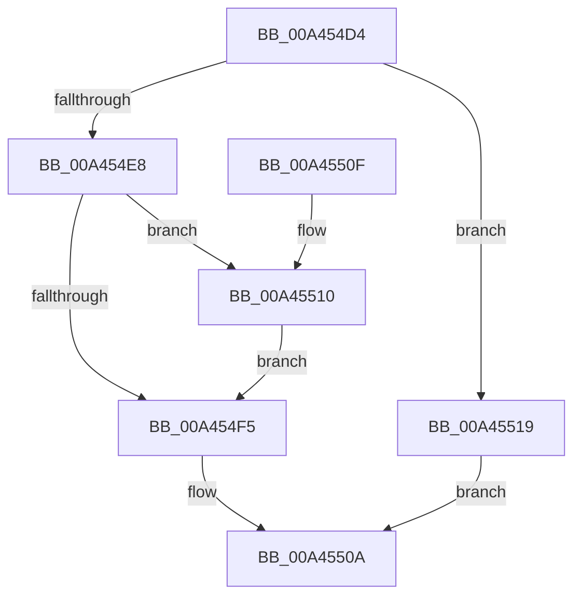

# SeCodeIntegrityQueryInformation

- RVA: `0x00A454D4`–`0x00A45520` (길이 `76` bytes)
- VA: `0x0000000140A454D4`
- 실행 섹션: `PAGE`
- PDB 이름 있음: `예`; PDB Function 태그: `아니요`
- unwind 정보 RVA: `0x000AF39C`
- 디코드: `21`개 명령, `76/76` bytes 표시
- 미해석 바이트: `0` (있으면 어셈블리에 `.byte`로 보존)

> 이 문서는 커널 이미지의 기계어와 PDB 기호를 분석해 생성했습니다. 4번과 5번은 함수 원형과 자료형을 바이너리 사용 방식에서 추정한 C 해석이며 원본 소스 복구 결과는 아닙니다.

## 1. Dependencies

- 직접 호출 지점: **1**; 고유 호출 대상: **1**
- 직접 호출자로 확인된 함수: **1**
- RIP 상대 이미지 참조: **3**

### Outgoing calls
- `0x00A45505` → [guard_dispatch_icall](../../text/6B/guard_dispatch_icall_function_006BAAD0.md) (function, `0x006BAAD0`)

### Direct callers
- [ExpQuerySystemInformation](../A5/ExpQuerySystemInformation_function_00A57858.md) at `0x00A59315`

### Static image references
- `0x00A454D8` → RVA `0x00F04E58` (`.data`; read)
- `0x00A454E8` → RVA `0x00170000` (`PROTDATA`; read)
- `0x00A45510` → RVA `0x00E67D70` (`.data`; read)

## 2. Other-region calls and transfers

- 다른 실행 섹션으로 향하는 call: **1**
  - `0x00A45505` → [guard_dispatch_icall](../../text/6B/guard_dispatch_icall_function_006BAAD0.md) (`PAGE` → `.text`)
- 별도 외부 분기/꼬리 이동을 확인하지 못했습니다.

## 3. Assembly (complete function range)

```asm
00A454D4  48 83 EC 38                     sub rsp, 0x38
00A454D8  48 83 3D 78 F9 4B 00 00         cmp qword ptr [rip + 0x4bf978], 0
00A454E0  4D 8B C8                        mov r9, r8
00A454E3  4C 8B D1                        mov r10, rcx
00A454E6  74 31                           je 0x140a45519
00A454E8  0F B6 05 11 AB 72 FF            movzx eax, byte ptr [rip - 0x8d54ef]
00A454EF  8B C8                           mov ecx, eax
00A454F1  84 C0                           test al, al
00A454F3  74 1B                           je 0x140a45510
00A454F5  48 8B 05 5C F9 4B 00            mov rax, qword ptr [rip + 0x4bf95c]
00A454FC  85 C9                           test ecx, ecx
00A454FE  49 8B CA                        mov rcx, r10
00A45501  41 0F 95 C0                     setne r8b
00A45505  E8 C6 55 C7 FF                  call 0x1406baad0
00A4550A  48 83 C4 38                     add rsp, 0x38
00A4550E  C3                              ret
00A4550F  CC                              int3
00A45510  0F B6 0D 59 28 42 00            movzx ecx, byte ptr [rip + 0x422859]
00A45517  EB DC                           jmp 0x140a454f5
00A45519  B8 01 00 00 C0                  mov eax, 0xc0000001
00A4551E  EB EA                           jmp 0x140a4550a
```

## 4. C-style interpretation (structured pseudocode)

```c
__int64 __fastcall SeCodeIntegrityQueryInformation(__int64 a1, __int64 a2, __int64 a3)
{
    __int64 result;
    __int64 v_rsp;

    v_rsp = (v_rsp) - (56);
    if ((*(unsigned __int64 *)(v_rip + 4979064)) == 0) goto loc_00A45519;
    if ((unsigned __int8)(*(unsigned __int8 *)(v_rip - 9262319)) == 0) goto loc_00A45510;
loc_00A454F5:
    a3 = ((unsigned int)((unsigned int)((unsigned int)(*(unsigned __int8 *)(v_rip - 9262319)))) != 0) ? 1 : 0;
    result = guard_dispatch_icall(a1, a2, a3, a3);
loc_00A4550A:
    v_rsp = (v_rsp) + (56);
    return result;
loc_00A45510:
    goto loc_00A454F5;
loc_00A45519:
    goto loc_00A4550A;
}
```

## 5. (Beta) C Style

```c
int64_t SeCodeIntegrityQueryInformation(int64_t Arg1, int64_t Arg2, int64_t Arg3)
{
    int64_t result;
    int64_t local_rsp;

    local_rsp = (local_rsp) - (56);
    if ((*(uint64_t *)(v_rip + 0x4BF978)) == 0) goto loc_00A45519;
    if ((uint8_t)(*(uint8_t *)(v_rip - 0x8D54EF)) == 0) goto loc_00A45510;
loc_00A454F5:
    Arg3 = ((uint32_t)((uint32_t)((uint32_t)(*(uint8_t *)(v_rip - 0x8D54EF)))) != 0) ? 1 : 0;
    result = guard_dispatch_icall(Arg1, Arg2, Arg3, Arg3);
loc_00A4550A:
    local_rsp = (local_rsp) + (56);
    return result;
loc_00A45510:
    goto loc_00A454F5;
loc_00A45519:
    goto loc_00A4550A;
}
```

## 6. Execution-region graph

[열기: 2D/3D 그래프와 함수 탐색 컨트롤 패널](../../../control-panel.html?section=page&rva=0x00A454D4&view=graph)

- 2D 그래프는 위에서 아래로 흐르고, 3D 그래프는 빈 공간을 드래그해 회전합니다. Shift+드래그는 이동, 휠은 확대·축소, 함수 노드 선택은 대상 보고서 이동입니다.

### Static fallback


