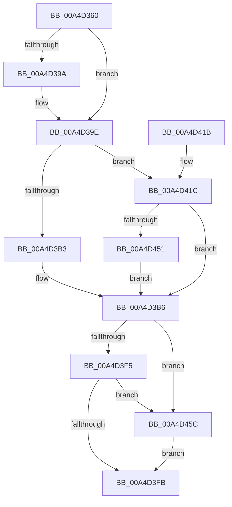

# SeCreateClientSecurityFromSubjectContext

- RVA: `0x00A4D360`–`0x00A4D46B` (길이 `267` bytes)
- VA: `0x0000000140A4D360`
- 실행 섹션: `PAGE`
- PDB 이름 있음: `예`; PDB Function 태그: `아니요`
- unwind 정보 RVA: `0x000B055C`
- 디코드: `76`개 명령, `267/267` bytes 표시
- 미해석 바이트: `0` (있으면 어셈블리에 `.byte`로 보존)

> 이 문서는 커널 이미지의 기계어와 PDB 기호를 분석해 생성했습니다. 4번과 5번은 함수 원형과 자료형을 바이너리 사용 방식에서 추정한 C 해석이며 원본 소스 복구 결과는 아닙니다.

## 1. Dependencies

- 직접 호출 지점: **4**; 고유 호출 대상: **4**
- 직접 호출자로 확인된 함수: **0**
- RIP 상대 이미지 참조: **0**

### Outgoing calls
- `0x00A4D3A6` → [ObfReferenceObjectWithTag](../../text/21/ObfReferenceObjectWithTag_function_00210710.md) (function, `0x00210710`)
- `0x00A4D3EA` → [SepCreateClientSecurityEx](../89/SepCreateClientSecurityEx_function_00891C90.md) (function, `0x00891C90`)
- `0x00A4D43E` → [RtlSidDominatesForTrust](../../text/3E/RtlSidDominatesForTrust_function_003EDFE0.md) (function, `0x003EDFE0`)
- `0x00A4D464` → [ObfDereferenceObjectWithTag](../../text/2F/ObfDereferenceObjectWithTag_function_002F78E0.md) (function, `0x002F78E0`)

### Direct callers
- 이 함수 시작 RVA로 연결되는 직접 call은 확인되지 않았습니다. 간접 호출은 완전히 역산할 수 없습니다.

### Static image references
- 디코드된 RIP-relative 메모리 참조가 없습니다.

## 2. Other-region calls and transfers

- 다른 실행 섹션으로 향하는 call: **3**
  - `0x00A4D3A6` → [ObfReferenceObjectWithTag](../../text/21/ObfReferenceObjectWithTag_function_00210710.md) (`PAGE` → `.text`)
  - `0x00A4D43E` → [RtlSidDominatesForTrust](../../text/3E/RtlSidDominatesForTrust_function_003EDFE0.md) (`PAGE` → `.text`)
  - `0x00A4D464` → [ObfDereferenceObjectWithTag](../../text/2F/ObfDereferenceObjectWithTag_function_002F78E0.md) (`PAGE` → `.text`)
- 별도 외부 분기/꼬리 이동을 확인하지 못했습니다.

## 3. Assembly (complete function range)

```asm
00A4D360  48 8B C4                        mov rax, rsp
00A4D363  48 89 58 10                     mov qword ptr [rax + 0x10], rbx
00A4D367  48 89 68 18                     mov qword ptr [rax + 0x18], rbp
00A4D36B  48 89 70 20                     mov qword ptr [rax + 0x20], rsi
00A4D36F  57                              push rdi
00A4D370  41 54                           push r12
00A4D372  41 55                           push r13
00A4D374  41 56                           push r14
00A4D376  41 57                           push r15
00A4D378  48 83 EC 60                     sub rsp, 0x60
00A4D37C  48 8B 19                        mov rbx, qword ptr [rcx]
00A4D37F  45 33 F6                        xor r14d, r14d
00A4D382  45 32 FF                        xor r15b, r15b
00A4D385  44 88 70 08                     mov byte ptr [rax + 8], r14b
00A4D389  4D 8B E1                        mov r12, r9
00A4D38C  45 8A E8                        mov r13b, r8b
00A4D38F  48 8B F2                        mov rsi, rdx
00A4D392  48 8B F9                        mov rdi, rcx
00A4D395  48 85 DB                        test rbx, rbx
00A4D398  75 04                           jne 0x140a4d39e
00A4D39A  48 8B 59 10                     mov rbx, qword ptr [rcx + 0x10]
00A4D39E  BA 53 65 43 63                  mov edx, 0x63436553
00A4D3A3  48 8B CB                        mov rcx, rbx
00A4D3A6  E8 65 33 7C FF                  call 0x140210710
00A4D3AB  48 8B 17                        mov rdx, qword ptr [rdi]
00A4D3AE  48 85 D2                        test rdx, rdx
00A4D3B1  75 69                           jne 0x140a4d41c
00A4D3B3  8D 6A 01                        lea ebp, [rdx + 1]
00A4D3B6  8B 47 08                        mov eax, dword ptr [rdi + 8]
00A4D3B9  44 8B CD                        mov r9d, ebp
00A4D3BC  4C 89 64 24 50                  mov qword ptr [rsp + 0x50], r12
00A4D3C1  45 8A C5                        mov r8b, r13b
00A4D3C4  4C 89 74 24 48                  mov qword ptr [rsp + 0x48], r14
00A4D3C9  48 8B D6                        mov rdx, rsi
00A4D3CC  44 88 7C 24 40                  mov byte ptr [rsp + 0x40], r15b
00A4D3D1  45 33 F6                        xor r14d, r14d
00A4D3D4  4C 89 74 24 38                  mov qword ptr [rsp + 0x38], r14
00A4D3D9  48 8B CB                        mov rcx, rbx
00A4D3DC  44 88 74 24 30                  mov byte ptr [rsp + 0x30], r14b
00A4D3E1  89 44 24 28                     mov dword ptr [rsp + 0x28], eax
00A4D3E5  44 88 74 24 20                  mov byte ptr [rsp + 0x20], r14b
00A4D3EA  E8 A1 48 E4 FF                  call 0x140891c90
00A4D3EF  8B F8                           mov edi, eax
00A4D3F1  85 C0                           test eax, eax
00A4D3F3  78 67                           js 0x140a4d45c
00A4D3F5  44 38 76 08                     cmp byte ptr [rsi + 8], r14b
00A4D3F9  74 61                           je 0x140a4d45c
00A4D3FB  4C 8D 5C 24 60                  lea r11, [rsp + 0x60]
00A4D400  8B C7                           mov eax, edi
00A4D402  49 8B 5B 38                     mov rbx, qword ptr [r11 + 0x38]
00A4D406  49 8B 6B 40                     mov rbp, qword ptr [r11 + 0x40]
00A4D40A  49 8B 73 48                     mov rsi, qword ptr [r11 + 0x48]
00A4D40E  49 8B E3                        mov rsp, r11
00A4D411  41 5F                           pop r15
00A4D413  41 5E                           pop r14
00A4D415  41 5D                           pop r13
00A4D417  41 5C                           pop r12
00A4D419  5F                              pop rdi
00A4D41A  C3                              ret
00A4D41B  CC                              int3
00A4D41C  48 8B 47 10                     mov rax, qword ptr [rdi + 0x10]
00A4D420  4C 8D 84 24 90 00 00 00         lea r8, [rsp + 0x90]
00A4D428  48 8B 92 50 04 00 00            mov rdx, qword ptr [rdx + 0x450]
00A4D42F  BD 02 00 00 00                  mov ebp, 2
00A4D434  4C 8B 98 50 04 00 00            mov r11, qword ptr [rax + 0x450]
00A4D43B  49 8B CB                        mov rcx, r11
00A4D43E  E8 9D 0B 9A FF                  call 0x1403edfe0
00A4D443  44 38 B4 24 90 00 00 00         cmp byte ptr [rsp + 0x90], r14b
00A4D44B  0F 85 65 FF FF FF               jne 0x140a4d3b6
00A4D451  41 B7 01                        mov r15b, 1
00A4D454  4D 8B F3                        mov r14, r11
00A4D457  E9 5A FF FF FF                  jmp 0x140a4d3b6
00A4D45C  BA 53 65 43 63                  mov edx, 0x63436553
00A4D461  48 8B CB                        mov rcx, rbx
00A4D464  E8 77 A4 8A FF                  call 0x1402f78e0
00A4D469  EB 90                           jmp 0x140a4d3fb
```

## 4. C-style interpretation (structured pseudocode)

```c
__int64 __fastcall SeCreateClientSecurityFromSubjectContext(__int64 a1, __int64 a2, unsigned __int8 a3, __int64 a4)
{
    __int64 result;
    __int64 v_r14;
    __int64 v_r15;
    __int64 v_rbx;
    __int64 v_rsp;
    unsigned __int64 v_stack_m28;
    unsigned __int64 v_stack_m38;
    unsigned __int64 v_stack_m40;
    unsigned __int8 v_stack_m48;
    unsigned __int64 v_stack_m50;
    unsigned __int8 v_stack_m58;
    unsigned int v_stack_m60;
    unsigned __int8 v_stack_m68;
    unsigned __int64 v_stack_p30;

    *(unsigned __int64 *)(v_rsp + 16) = v_rbx;
    *(unsigned __int64 *)(v_rsp + 24) = v_rbp;
    *(unsigned __int64 *)(v_rsp + 32) = v_rsi;
    v_rsp = (v_rsp) - (96);
    v_r14 = 0;
    v_r15 = 0;
    *(unsigned __int8 *)(v_rsp + 8) = 0;
    v_rbx = *(unsigned __int64 *)(a1);
    if (*(unsigned __int64 *)(a1) == 0) {
        v_rbx = *(unsigned __int64 *)(a1 + 16);
    }
    result = ObfReferenceObjectWithTag(v_rbx, (unsigned int)(0x63436553ULL), a3, a4);
    if (*(unsigned __int64 *)(a1) != 0) goto loc_00A4D41C;
loc_00A4D3B6:
    v_stack_m38 = a4;
    v_stack_m40 = 0;
    v_stack_m48 = 0;
    v_r14 = 0;
    v_stack_m50 = 0;
    v_stack_m58 = 0;
    v_stack_m60 = (unsigned int)((unsigned int)(*(unsigned int *)(a1 + 8)));
    v_stack_m68 = 0;
    result = SepCreateClientSecurityEx(v_rbx, a2, a3, (unsigned int)((unsigned int)(*(unsigned __int64 *)(a1) + 1)));
    if (sign_flag) goto loc_00A4D45C;
    if ((*(unsigned __int8 *)(a2 + 8)) == 0) goto loc_00A4D45C;
loc_00A4D3FB:
    return (unsigned int)((unsigned int)((unsigned int)((unsigned int)(result))));
loc_00A4D41C:
    result = RtlSidDominatesForTrust(*(unsigned __int64 *)(*(unsigned __int64 *)((unsigned int)((unsigned int)(result)) + 16) + 1104), *(unsigned __int64 *)(a2 + 1104), v_stack_p30, (unsigned int)((unsigned int)(*(unsigned __int64 *)(a1) + 1)));
    if (v_stack_p30 != 0) goto loc_00A4D3B6;
    goto loc_00A4D3B6;
loc_00A4D45C:
    result = ObfDereferenceObjectWithTag(*(unsigned __int64 *)(v_stack_m28 + 56), (unsigned int)(0x63436553ULL), v_stack_p30, (unsigned int)((unsigned int)(*(unsigned __int64 *)(a1) + 1)));
    goto loc_00A4D3FB;
}
```

## 5. (Beta) C Style

```c
int64_t SeCreateClientSecurityFromSubjectContext(void *Arg1, void *Arg2, uint8_t Arg3, int64_t Arg4)
{
    uint8_t *arg1 = (uint8_t *)Arg1;
    uint8_t *arg2 = (uint8_t *)Arg2;

    int64_t result;
    int64_t local_r14;
    int64_t local_r15;
    int64_t local_rbx;
    int64_t local_rsp;
    uint64_t v_stack_m28;
    uint64_t v_stack_m38;
    uint64_t v_stack_m40;
    uint8_t v_stack_m48;
    uint64_t v_stack_m50;
    uint8_t v_stack_m58;
    uint32_t v_stack_m60;
    uint8_t v_stack_m68;
    uint64_t v_stack_p30;

    *(uint64_t *)(local_rsp + 0x10) = local_rbx;
    *(uint64_t *)(local_rsp + 0x18) = local_rbp;
    *(uint64_t *)(local_rsp + 0x20) = local_rsi;
    local_rsp = (local_rsp) - (96);
    local_r14 = 0;
    local_r15 = 0;
    *(uint8_t *)(local_rsp + 0x8) = 0;
    local_rbx = *(uint64_t *)(arg1);
    if (*(uint64_t *)(arg1) == 0) {
        local_rbx = *(uint64_t *)(arg1 + 0x10);
    }
    result = ObfReferenceObjectWithTag(local_rbx, (uint32_t)(0x63436553ULL), Arg3, Arg4);
    if (*(uint64_t *)(arg1) != 0) goto loc_00A4D41C;
loc_00A4D3B6:
    v_stack_m38 = Arg4;
    v_stack_m40 = 0;
    v_stack_m48 = 0;
    local_r14 = 0;
    v_stack_m50 = 0;
    v_stack_m58 = 0;
    v_stack_m60 = (uint32_t)((uint32_t)(*(uint32_t *)(arg1 + 0x8)));
    v_stack_m68 = 0;
    result = SepCreateClientSecurityEx(local_rbx, Arg2, Arg3, (uint32_t)((uint32_t)(*(uint64_t *)(arg1) + 1)));
    if (sign_flag) goto loc_00A4D45C;
    if ((*(uint8_t *)(arg2 + 0x8)) == 0) goto loc_00A4D45C;
loc_00A4D3FB:
    return (uint32_t)((uint32_t)((uint32_t)((uint32_t)(result))));
loc_00A4D41C:
    result = RtlSidDominatesForTrust(*(uint64_t *)(*(uint64_t *)((uint32_t)((uint32_t)(result)) + 0x10) + 0x450), *(uint64_t *)(arg2 + 0x450), v_stack_p30, (uint32_t)((uint32_t)(*(uint64_t *)(arg1) + 1)));
    if (v_stack_p30 != 0) goto loc_00A4D3B6;
    goto loc_00A4D3B6;
loc_00A4D45C:
    result = ObfDereferenceObjectWithTag(*(uint64_t *)(v_stack_m28 + 0x38), (uint32_t)(0x63436553ULL), v_stack_p30, (uint32_t)((uint32_t)(*(uint64_t *)(arg1) + 1)));
    goto loc_00A4D3FB;
}
```

### 관측된 메모리 오프셋

구조체 형식이 확인되지 않은 접근은 인자 기준의 오프셋으로만 기록했습니다.

| 기준 인자 | 오프셋 표현 | 폭 (bit) | 접근 |
|---|---:|---:|---|
| `Arg1` | `+ 0x0` | `64` | `R` |
| `Arg1` | `+ 0x8` | `32` | `R` |
| `Arg1` | `+ 0x10` | `64` | `R` |
| `Arg2` | `+ 0x8` | `8` | `R` |

## 6. Execution-region graph

[열기: 2D/3D 그래프와 함수 탐색 컨트롤 패널](../../../control-panel.html?section=page&rva=0x00A4D360&view=graph)

- 2D 그래프는 위에서 아래로 흐르고, 3D 그래프는 빈 공간을 드래그해 회전합니다. Shift+드래그는 이동, 휠은 확대·축소, 함수 노드 선택은 대상 보고서 이동입니다.

### Static fallback


