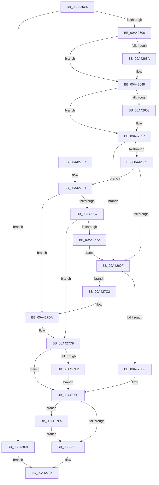

# SepAddLuidToIndexEntry

- RVA: `0x00A425C0`–`0x00A4280B` (길이 `587` bytes)
- VA: `0x0000000140A425C0`
- 실행 섹션: `PAGE`
- PDB 이름 있음: `예`; PDB Function 태그: `아니요`
- unwind 정보 RVA: `0x000AED28`
- 디코드: `161`개 명령, `587/587` bytes 표시
- 미해석 바이트: `0` (있으면 어셈블리에 `.byte`로 보존)

> 이 문서는 커널 이미지의 기계어와 PDB 기호를 분석해 생성했습니다. 4번과 5번은 함수 원형과 자료형을 바이너리 사용 방식에서 추정한 C 해석이며 원본 소스 복구 결과는 아닙니다.

## 1. Dependencies

- 직접 호출 지점: **20**; 고유 호출 대상: **15**
- 직접 호출자로 확인된 함수: **1**
- RIP 상대 이미지 참조: **1**

### Outgoing calls
- `0x00A425F5` → [ExAllocatePool2](../../poolcode/B8/ExAllocatePool2_function_00B820F0.md) (function, `0x00B820F0`)
- `0x00A4262A` → [KeAbPreAcquire](../../text/21/KeAbPreAcquire_function_00210230.md) (function, `0x00210230`)
- `0x00A42643` → [ExfAcquirePushLockExclusiveEx](../../text/20/ExfAcquirePushLockExclusiveEx_function_0020FC90.md) (function, `0x0020FC90`)
- `0x00A42674` → [RtlFindClearBitsAndSet](../../text/3E/RtlFindClearBitsAndSet_function_003E0CD0.md) (function, `0x003E0CD0`)
- `0x00A42682` → [SepCleanupMarkedForDeletionEntries](../../text/2E/SepCleanupMarkedForDeletionEntries_function_002EEC84.md) (function, `0x002EEC84`)
- `0x00A42690` → [RtlFindClearBitsAndSet](../../text/3E/RtlFindClearBitsAndSet_function_003E0CD0.md) (function, `0x003E0CD0`)
- `0x00A426D2` → [RtlInsertEntryHashTable](../../text/43/RtlInsertEntryHashTable_function_00437660.md) (function, `0x00437660`)
- `0x00A426EB` → [SepInitSingletonEntry](../../text/2E/SepInitSingletonEntry_function_002EEF64.md) (function, `0x002EEF64`)
- `0x00A4271B` → [KeAbPostRelease](../../text/2E/KeAbPostRelease_function_002E1600.md) (function, `0x002E1600`)
- `0x00A42720` → [KeLeaveCriticalRegion](../../text/25/KeLeaveCriticalRegion_function_0025D8B0.md) (function, `0x0025D8B0`)
- `0x00A42740` → [RtlNumberOfSetBits](../../text/43/RtlNumberOfSetBits_function_00433F70.md) (function, `0x00433F70`)
- `0x00A4275A` → [ExAllocatePool2](../../poolcode/B8/ExAllocatePool2_function_00B820F0.md) (function, `0x00B820F0`)
- `0x00A42767` → [SepExpandSingletonArrays](../../text/4B/SepExpandSingletonArrays_function_004BFCE0.md) (function, `0x004BFCE0`)
- `0x00A42779` → [ExFreePoolWithTag](../../poolcode/B8/ExFreePoolWithTag_function_00B82870.md) (function, `0x00B82870`)
- `0x00A4278E` → [RtlClearAllBits](../../text/45/RtlClearAllBits_function_00450230.md) (function, `0x00450230`)
- `0x00A4279B` → [RtlSetBits](../../text/3E/RtlSetBits_function_003E1610.md) (function, `0x003E1610`)
- `0x00A427A9` → [RtlFindClearBitsAndSet](../../text/3E/RtlFindClearBitsAndSet_function_003E0CD0.md) (function, `0x003E0CD0`)
- `0x00A427B8` → [ExfTryToWakePushLock](../../text/26/ExfTryToWakePushLock_function_00265DD0.md) (function, `0x00265DD0`)
- `0x00A427E4` → [ExFreePoolWithTag](../../poolcode/B8/ExFreePoolWithTag_function_00B82870.md) (function, `0x00B82870`)
- `0x00A427F7` → [ExFreePoolWithTag](../../poolcode/B8/ExFreePoolWithTag_function_00B82870.md) (function, `0x00B82870`)

### Direct callers
- [SepSetProcessUniqueAttribute](SepSetProcessUniqueAttribute_function_00A424C8.md) at `0x00A42520`

### Static image references
- `0x00A42620` → RVA `0x00FD8068` (`PAGEDATA`; read)

## 2. Other-region calls and transfers

- 다른 실행 섹션으로 향하는 call: **20**
  - `0x00A425F5` → [ExAllocatePool2](../../poolcode/B8/ExAllocatePool2_function_00B820F0.md) (`PAGE` → `POOLCODE`)
  - `0x00A4262A` → [KeAbPreAcquire](../../text/21/KeAbPreAcquire_function_00210230.md) (`PAGE` → `.text`)
  - `0x00A42643` → [ExfAcquirePushLockExclusiveEx](../../text/20/ExfAcquirePushLockExclusiveEx_function_0020FC90.md) (`PAGE` → `.text`)
  - `0x00A42674` → [RtlFindClearBitsAndSet](../../text/3E/RtlFindClearBitsAndSet_function_003E0CD0.md) (`PAGE` → `.text`)
  - `0x00A42682` → [SepCleanupMarkedForDeletionEntries](../../text/2E/SepCleanupMarkedForDeletionEntries_function_002EEC84.md) (`PAGE` → `.text`)
  - `0x00A42690` → [RtlFindClearBitsAndSet](../../text/3E/RtlFindClearBitsAndSet_function_003E0CD0.md) (`PAGE` → `.text`)
  - `0x00A426D2` → [RtlInsertEntryHashTable](../../text/43/RtlInsertEntryHashTable_function_00437660.md) (`PAGE` → `.text`)
  - `0x00A426EB` → [SepInitSingletonEntry](../../text/2E/SepInitSingletonEntry_function_002EEF64.md) (`PAGE` → `.text`)
  - `0x00A4271B` → [KeAbPostRelease](../../text/2E/KeAbPostRelease_function_002E1600.md) (`PAGE` → `.text`)
  - `0x00A42720` → [KeLeaveCriticalRegion](../../text/25/KeLeaveCriticalRegion_function_0025D8B0.md) (`PAGE` → `.text`)
  - `0x00A42740` → [RtlNumberOfSetBits](../../text/43/RtlNumberOfSetBits_function_00433F70.md) (`PAGE` → `.text`)
  - `0x00A4275A` → [ExAllocatePool2](../../poolcode/B8/ExAllocatePool2_function_00B820F0.md) (`PAGE` → `POOLCODE`)
  - `0x00A42767` → [SepExpandSingletonArrays](../../text/4B/SepExpandSingletonArrays_function_004BFCE0.md) (`PAGE` → `.text`)
  - `0x00A42779` → [ExFreePoolWithTag](../../poolcode/B8/ExFreePoolWithTag_function_00B82870.md) (`PAGE` → `POOLCODE`)
  - `0x00A4278E` → [RtlClearAllBits](../../text/45/RtlClearAllBits_function_00450230.md) (`PAGE` → `.text`)
  - `0x00A4279B` → [RtlSetBits](../../text/3E/RtlSetBits_function_003E1610.md) (`PAGE` → `.text`)
  - `0x00A427A9` → [RtlFindClearBitsAndSet](../../text/3E/RtlFindClearBitsAndSet_function_003E0CD0.md) (`PAGE` → `.text`)
  - `0x00A427B8` → [ExfTryToWakePushLock](../../text/26/ExfTryToWakePushLock_function_00265DD0.md) (`PAGE` → `.text`)
  - `0x00A427E4` → [ExFreePoolWithTag](../../poolcode/B8/ExFreePoolWithTag_function_00B82870.md) (`PAGE` → `POOLCODE`)
  - `0x00A427F7` → [ExFreePoolWithTag](../../poolcode/B8/ExFreePoolWithTag_function_00B82870.md) (`PAGE` → `POOLCODE`)
- 별도 외부 분기/꼬리 이동을 확인하지 못했습니다.

## 3. Assembly (complete function range)

```asm
00A425C0  48 89 5C 24 20                  mov qword ptr [rsp + 0x20], rbx
00A425C5  48 89 54 24 10                  mov qword ptr [rsp + 0x10], rdx
00A425CA  48 89 4C 24 08                  mov qword ptr [rsp + 8], rcx
00A425CF  55                              push rbp
00A425D0  56                              push rsi
00A425D1  57                              push rdi
00A425D2  41 54                           push r12
00A425D4  41 55                           push r13
00A425D6  41 56                           push r14
00A425D8  41 57                           push r15
00A425DA  48 83 EC 20                     sub rsp, 0x20
00A425DE  49 83 20 00                     and qword ptr [r8], 0
00A425E2  4D 8B E8                        mov r13, r8
00A425E5  41 B8 53 65 44 74               mov r8d, 0x74446553
00A425EB  BA 38 00 00 00                  mov edx, 0x38
00A425F0  B9 00 01 00 00                  mov ecx, 0x100
00A425F5  E8 F6 FA 13 00                  call 0x140b820f0
00A425FA  48 8B E8                        mov rbp, rax
00A425FD  48 85 C0                        test rax, rax
00A42600  0F 84 FB 01 00 00               je 0x140a42801
00A42606  65 48 8B 04 25 88 01 00 00      mov rax, qword ptr gs:[0x188]
00A4260F  48 83 CB FF                     or rbx, 0xffffffffffffffff
00A42613  45 33 C0                        xor r8d, r8d
00A42616  33 D2                           xor edx, edx
00A42618  66 01 98 E4 01 00 00            add word ptr [rax + 0x1e4], bx
00A4261F  90                              nop
00A42620  48 8B 3D 41 5A 59 00            mov rdi, qword ptr [rip + 0x595a41]
00A42627  48 8B CF                        mov rcx, rdi
00A4262A  E8 01 DC 7C FF                  call 0x140210230
00A4262F  F0 48 0F BA 2F 00               lock bts qword ptr [rdi], 0
00A42635  48 8B F0                        mov rsi, rax
00A42638  73 0E                           jae 0x140a42648
00A4263A  4C 8B C7                        mov r8, rdi
00A4263D  48 8B D0                        mov rdx, rax
00A42640  48 8B CF                        mov rcx, rdi
00A42643  E8 48 D6 7C FF                  call 0x14020fc90
00A42648  41 BF 01 00 00 00               mov r15d, 1
00A4264E  48 85 F6                        test rsi, rsi
00A42651  74 04                           je 0x140a42657
00A42653  44 88 7E 0A                     mov byte ptr [rsi + 0xa], r15b
00A42657  48 8B 05 0A 5A 59 00            mov rax, qword ptr [rip + 0x595a0a]
00A4265E  45 33 C0                        xor r8d, r8d
00A42661  41 8B D7                        mov edx, r15d
00A42664  48 8B 48 08                     mov rcx, qword ptr [rax + 8]
00A42668  4C 8D 60 10                     lea r12, [rax + 0x10]
00A4266C  48 89 4C 24 70                  mov qword ptr [rsp + 0x70], rcx
00A42671  49 8B CC                        mov rcx, r12
00A42674  E8 57 E6 99 FF                  call 0x1403e0cd0
00A42679  83 CF FF                        or edi, 0xffffffff
00A4267C  8B F0                           mov esi, eax
00A4267E  3B C7                           cmp eax, edi
00A42680  75 1D                           jne 0x140a4269f
00A42682  E8 FD C5 8A FF                  call 0x1402eec84
00A42687  45 33 C0                        xor r8d, r8d
00A4268A  41 8B D7                        mov edx, r15d
00A4268D  49 8B CC                        mov rcx, r12
00A42690  E8 3B E6 99 FF                  call 0x1403e0cd0
00A42695  8B F0                           mov esi, eax
00A42697  3B C7                           cmp eax, edi
00A42699  0F 84 9E 00 00 00               je 0x140a4273d
00A4269F  48 8B 4C 24 60                  mov rcx, qword ptr [rsp + 0x60]
00A426A4  48 8B D5                        mov rdx, rbp
00A426A7  4C 89 7D 18                     mov qword ptr [rbp + 0x18], r15
00A426AB  44 8B F6                        mov r14d, esi
00A426AE  4C 89 75 28                     mov qword ptr [rbp + 0x28], r14
00A426B2  48 8B 01                        mov rax, qword ptr [rcx]
00A426B5  48 89 45 20                     mov qword ptr [rbp + 0x20], rax
00A426B9  C6 45 30 00                     mov byte ptr [rbp + 0x30], 0
00A426BD  48 8B 01                        mov rax, qword ptr [rcx]
00A426C0  48 8B 4C 24 70                  mov rcx, qword ptr [rsp + 0x70]
00A426C5  48 85 C0                        test rax, rax
00A426C8  4C 0F 45 F8                     cmovne r15, rax
00A426CC  45 33 C9                        xor r9d, r9d
00A426CF  4D 8B C7                        mov r8, r15
00A426D2  E8 89 4F 9F FF                  call 0x140437660
00A426D7  84 C0                           test al, al
00A426D9  0F 84 E3 00 00 00               je 0x140a427c2
00A426DF  48 8B 54 24 60                  mov rdx, qword ptr [rsp + 0x60]
00A426E4  33 FF                           xor edi, edi
00A426E6  8B CE                           mov ecx, esi
00A426E8  48 8B 12                        mov rdx, qword ptr [rdx]
00A426EB  E8 74 C8 8A FF                  call 0x1402eef64
00A426F0  48 8B 4C 24 68                  mov rcx, qword ptr [rsp + 0x68]
00A426F5  48 8B 45 28                     mov rax, qword ptr [rbp + 0x28]
00A426F9  49 89 6D 00                     mov qword ptr [r13], rbp
00A426FD  48 89 01                        mov qword ptr [rcx], rax
00A42700  48 8B 35 61 59 59 00            mov rsi, qword ptr [rip + 0x595961]
00A42707  F0 48 0F C1 1E                  lock xadd qword ptr [rsi], rbx
00A4270C  80 E3 06                        and bl, 6
00A4270F  80 FB 02                        cmp bl, 2
00A42712  0F 84 9D 00 00 00               je 0x140a427b5
00A42718  48 8B CE                        mov rcx, rsi
00A4271B  E8 E0 EE 89 FF                  call 0x1402e1600
00A42720  E8 8B B1 81 FF                  call 0x14025d8b0
00A42725  48 8B 5C 24 78                  mov rbx, qword ptr [rsp + 0x78]
00A4272A  8B C7                           mov eax, edi
00A4272C  48 83 C4 20                     add rsp, 0x20
00A42730  41 5F                           pop r15
00A42732  41 5E                           pop r14
00A42734  41 5D                           pop r13
00A42736  41 5C                           pop r12
00A42738  5F                              pop rdi
00A42739  5E                              pop rsi
00A4273A  5D                              pop rbp
00A4273B  C3                              ret
00A4273C  CC                              int3
00A4273D  49 8B CC                        mov rcx, r12
00A42740  E8 2B 18 9F FF                  call 0x140433f70
00A42745  B9 00 01 00 00                  mov ecx, 0x100
00A4274A  41 B8 53 65 44 74               mov r8d, 0x74446553
00A42750  44 8B F0                        mov r14d, eax
00A42753  8D 50 40                        lea edx, [rax + 0x40]
00A42756  48 C1 EA 03                     shr rdx, 3
00A4275A  E8 91 F9 13 00                  call 0x140b820f0
00A4275F  48 8B F0                        mov rsi, rax
00A42762  48 85 C0                        test rax, rax
00A42765  74 73                           je 0x140a427da
00A42767  E8 74 D5 A7 FF                  call 0x1404bfce0
00A4276C  8B F8                           mov edi, eax
00A4276E  85 C0                           test eax, eax
00A42770  78 6D                           js 0x140a427df
00A42772  49 8B 4C 24 08                  mov rcx, qword ptr [r12 + 8]
00A42777  33 D2                           xor edx, edx
00A42779  E8 F2 00 14 00                  call 0x140b82870
00A4277E  41 8D 46 40                     lea eax, [r14 + 0x40]
00A42782  49 89 74 24 08                  mov qword ptr [r12 + 8], rsi
00A42787  49 8B CC                        mov rcx, r12
00A4278A  41 89 04 24                     mov dword ptr [r12], eax
00A4278E  E8 9D DA A0 FF                  call 0x140450230
00A42793  45 8B C6                        mov r8d, r14d
00A42796  33 D2                           xor edx, edx
00A42798  49 8B CC                        mov rcx, r12
00A4279B  E8 70 EE 99 FF                  call 0x1403e1610
00A427A0  45 33 C0                        xor r8d, r8d
00A427A3  41 8B D7                        mov edx, r15d
00A427A6  49 8B CC                        mov rcx, r12
00A427A9  E8 22 E5 99 FF                  call 0x1403e0cd0
00A427AE  8B F0                           mov esi, eax
00A427B0  E9 EA FE FF FF                  jmp 0x140a4269f
00A427B5  48 8B CE                        mov rcx, rsi
00A427B8  E8 13 36 82 FF                  call 0x140265dd0
00A427BD  E9 56 FF FF FF                  jmp 0x140a42718
00A427C2  49 C1 EE 03                     shr r14, 3
00A427C6  83 E6 07                        and esi, 7
00A427C9  4D 03 74 24 08                  add r14, qword ptr [r12 + 8]
00A427CE  41 0F BE 06                     movsx eax, byte ptr [r14]
00A427D2  0F B3 F0                        btr eax, esi
00A427D5  41 88 06                        mov byte ptr [r14], al
00A427D8  33 F6                           xor esi, esi
00A427DA  BF 17 00 00 C0                  mov edi, 0xc0000017
00A427DF  33 D2                           xor edx, edx
00A427E1  48 8B CD                        mov rcx, rbp
00A427E4  E8 87 00 14 00                  call 0x140b82870
00A427E9  48 85 F6                        test rsi, rsi
00A427EC  0F 84 0E FF FF FF               je 0x140a42700
00A427F2  33 D2                           xor edx, edx
00A427F4  48 8B CE                        mov rcx, rsi
00A427F7  E8 74 00 14 00                  call 0x140b82870
00A427FC  E9 FF FE FF FF                  jmp 0x140a42700
00A42801  BF 17 00 00 C0                  mov edi, 0xc0000017
00A42806  E9 1A FF FF FF                  jmp 0x140a42725
```

## 4. C-style interpretation (structured pseudocode)

```c
__int64 __fastcall SepAddLuidToIndexEntry(__int64 a1, __int64 a2, __int64 a3, int a4)
{
    __int64 result;
    __int64 v_r14;
    __int64 v_r15;
    __int64 v_rbx;
    __int64 v_rdi;
    __int64 v_rsi;
    __int64 v_rsp;
    unsigned __int64 v_stack_p10;
    unsigned __int64 v_stack_p18;
    unsigned __int64 v_stack_p20;
    unsigned __int64 v_stack_p8;

    v_stack_p20 = v_rbx;
    v_stack_p10 = a2;
    v_stack_p8 = a1;
    v_rsp = (v_rsp) - (32);
    result = ExAllocatePool2(256, 56, (unsigned int)(0x74446553ULL), a4);
    if (result == 0) goto loc_00A42801;
    v_rbx = (v_rbx) | (-1);
    a3 = 0;
    a2 = 0;
    result = KeAbPreAcquire(*(unsigned __int64 *)(v_rip + 5855809), a2, a3, a4);
    if (!(condition_is_above_or_equal)) {
        a3 = *(unsigned __int64 *)(v_rip + 5855809);
        a2 = result;
        a1 = *(unsigned __int64 *)(v_rip + 5855809);
        result = ExfAcquirePushLockExclusiveEx(a1, a2, a3, a4);
    }
    if (result != 0) {
        *(unsigned __int8 *)(result + 10) = 1;
    }
    a3 = 0;
    v_stack_p18 = *(unsigned __int64 *)(*(unsigned __int64 *)(v_rip + 5855754) + 8);
    result = RtlFindClearBitsAndSet(*(unsigned __int64 *)(v_rip + 5855754) + 16, 1, a3, a4);
    v_rdi = (unsigned int)((*(unsigned __int64 *)(v_rip + 5855809)) | (0xFFFFFFFFULL));
    if (((unsigned int)(result)) != ((unsigned int)(v_rdi))) goto loc_00A4269F;
    result = SepCleanupMarkedForDeletionEntries(*(unsigned __int64 *)(v_rip + 5855754) + 16, 1, a3, a4);
    a3 = 0;
    result = RtlFindClearBitsAndSet(*(unsigned __int64 *)(v_rip + 5855754) + 16, 1, a3, a4);
    if (((unsigned int)(result)) == ((unsigned int)(v_rdi))) goto loc_00A4273D;
loc_00A4269F:
    *(unsigned __int64 *)(result + 24) = 1;
    *(unsigned __int64 *)(result + 40) = (unsigned int)((unsigned int)((unsigned int)((unsigned int)(result))));
    *(unsigned __int64 *)(result + 32) = *(unsigned __int64 *)(v_stack_p8);
    *(unsigned __int8 *)(result + 48) = 0;
    v_r15 = 1;
    if (*(unsigned __int64 *)(v_stack_p8) != 0) { v_r15 = *(unsigned __int64 *)(v_stack_p8); }
    a4 = 0;
    result = RtlInsertEntryHashTable(v_stack_p18, result, v_r15, a4);
    if ((unsigned __int8)(result) == 0) goto loc_00A427C2;
    v_rdi = 0;
    result = SepInitSingletonEntry((unsigned int)((unsigned int)((unsigned int)((unsigned int)(result)))), *(unsigned __int64 *)(v_stack_p8), v_r15, a4);
    *(unsigned __int64 *)(a3) = result;
    *(unsigned __int64 *)(v_stack_p10) = *(unsigned __int64 *)(result + 40);
loc_00A42700:
    v_rbx = (unsigned __int8)((v_rbx) & (6));
    if (((unsigned __int8)(v_rbx)) == 2) goto loc_00A427B5;
loc_00A42718:
    result = KeAbPostRelease(*(unsigned __int64 *)(v_rip + 5855585), *(unsigned __int64 *)(v_stack_p8), v_r15, a4);
    result = KeLeaveCriticalRegion(*(unsigned __int64 *)(v_rip + 5855585), *(unsigned __int64 *)(v_stack_p8), v_r15, a4);
loc_00A42725:
    v_rsp = (v_rsp) + (32);
    return 0;
loc_00A4273D:
    result = RtlNumberOfSetBits(*(unsigned __int64 *)(v_rip + 5855754) + 16, *(unsigned __int64 *)(v_stack_p8), v_r15, a4);
    a2 = (result + 64) >> (3);
    result = ExAllocatePool2(256, a2, (unsigned int)(0x74446553ULL), a4);
    if (result == 0) goto loc_00A427DA;
    result = SepExpandSingletonArrays(256, a2, (unsigned int)(0x74446553ULL), a4);
    if (sign_flag) goto loc_00A427DF;
    a2 = 0;
    result = ExFreePoolWithTag(*(unsigned __int64 *)(*(unsigned __int64 *)(v_rip + 5855754) + 16 + 8), a2, (unsigned int)(0x74446553ULL), a4);
    *(unsigned __int64 *)(*(unsigned __int64 *)(v_rip + 5855754) + 16 + 8) = result;
    *(unsigned int *)(*(unsigned __int64 *)(v_rip + 5855754) + 16) = (unsigned int)((unsigned int)((unsigned int)(result)) + 64);
    result = RtlClearAllBits(*(unsigned __int64 *)(v_rip + 5855754) + 16, a2, (unsigned int)(0x74446553ULL), a4);
    a2 = 0;
    result = RtlSetBits(*(unsigned __int64 *)(v_rip + 5855754) + 16, a2, (unsigned int)((unsigned int)((unsigned int)((unsigned int)(result)))), a4);
    a3 = 0;
    result = RtlFindClearBitsAndSet(*(unsigned __int64 *)(v_rip + 5855754) + 16, (unsigned int)((unsigned int)(v_r15)), a3, a4);
    goto loc_00A4269F;
loc_00A427B5:
    result = ExfTryToWakePushLock((unsigned int)((unsigned int)(result)), (unsigned int)((unsigned int)(v_r15)), a3, a4);
    goto loc_00A42718;
loc_00A427C2:
    v_r14 = ((unsigned int)((unsigned int)(result))) >> (3);
    v_rsi = (unsigned int)(((unsigned int)((unsigned int)(result))) & (7));
    v_r14 = (v_r14) + (*(unsigned __int64 *)(*(unsigned __int64 *)(v_rip + 5855754) + 16 + 8));
    *(unsigned __int8 *)(v_r14) = (unsigned __int8)((__int8)(*(unsigned __int8 *)(v_r14)));
    v_rsi = 0;
loc_00A427DA:
loc_00A427DF:
    a2 = 0;
    result = ExFreePoolWithTag(result, a2, a3, a4);
    if (0 == 0) goto loc_00A42700;
    a2 = 0;
    result = ExFreePoolWithTag(0, a2, a3, a4);
    goto loc_00A42700;
loc_00A42801:
    goto loc_00A42725;
}
```

## 5. (Beta) C Style

```c
int64_t SepAddLuidToIndexEntry(int64_t Arg1, int64_t Arg2, void *Arg3, int32_t Arg4)
{
    uint8_t *arg3 = (uint8_t *)Arg3;

    int64_t result;
    int64_t local_r14;
    int64_t local_r15;
    int64_t local_rbx;
    int64_t local_rdi;
    int64_t local_rsi;
    int64_t local_rsp;
    uint64_t v_stack_p10;
    uint64_t v_stack_p18;
    uint64_t v_stack_p20;
    uint64_t v_stack_p8;

    v_stack_p20 = local_rbx;
    v_stack_p10 = Arg2;
    v_stack_p8 = Arg1;
    local_rsp = (local_rsp) - (32);
    result = ExAllocatePool2(256, 56, (uint32_t)(0x74446553ULL), Arg4);
    if (result == 0) goto loc_00A42801;
    local_rbx = (local_rbx) | (-1);
    Arg3 = 0;
    Arg2 = 0;
    result = KeAbPreAcquire(*(uint64_t *)(v_rip + 0x595A41), Arg2, Arg3, Arg4);
    if (!(condition_is_above_or_equal)) {
        Arg3 = *(uint64_t *)(v_rip + 0x595A41);
        Arg2 = result;
        Arg1 = *(uint64_t *)(v_rip + 0x595A41);
        result = ExfAcquirePushLockExclusiveEx(Arg1, Arg2, Arg3, Arg4);
    }
    if (result != 0) {
        *(uint8_t *)(result + 0xA) = 1;
    }
    Arg3 = 0;
    v_stack_p18 = *(uint64_t *)(*(uint64_t *)(v_rip + 0x595A0A) + 0x8);
    result = RtlFindClearBitsAndSet(*(uint64_t *)(v_rip + 0x595A0A) + 16, 1, Arg3, Arg4);
    local_rdi = (uint32_t)((*(uint64_t *)(v_rip + 0x595A41)) | (0xFFFFFFFFULL));
    if (((uint32_t)(result)) != ((uint32_t)(local_rdi))) goto loc_00A4269F;
    result = SepCleanupMarkedForDeletionEntries(*(uint64_t *)(v_rip + 0x595A0A) + 16, 1, Arg3, Arg4);
    Arg3 = 0;
    result = RtlFindClearBitsAndSet(*(uint64_t *)(v_rip + 0x595A0A) + 16, 1, Arg3, Arg4);
    if (((uint32_t)(result)) == ((uint32_t)(local_rdi))) goto loc_00A4273D;
loc_00A4269F:
    *(uint64_t *)(result + 0x18) = 1;
    *(uint64_t *)(result + 0x28) = (uint32_t)((uint32_t)((uint32_t)((uint32_t)(result))));
    *(uint64_t *)(result + 0x20) = *(uint64_t *)(v_stack_p8);
    *(uint8_t *)(result + 0x30) = 0;
    local_r15 = 1;
    if (*(uint64_t *)(v_stack_p8) != 0) { local_r15 = *(uint64_t *)(v_stack_p8); }
    Arg4 = 0;
    result = RtlInsertEntryHashTable(v_stack_p18, result, local_r15, Arg4);
    if ((uint8_t)(result) == 0) goto loc_00A427C2;
    local_rdi = 0;
    result = SepInitSingletonEntry((uint32_t)((uint32_t)((uint32_t)((uint32_t)(result)))), *(uint64_t *)(v_stack_p8), local_r15, Arg4);
    *(uint64_t *)(arg3) = result;
    *(uint64_t *)(v_stack_p10) = *(uint64_t *)(result + 0x28);
loc_00A42700:
    local_rbx = (uint8_t)((local_rbx) & (6));
    if (((uint8_t)(local_rbx)) == 2) goto loc_00A427B5;
loc_00A42718:
    result = KeAbPostRelease(*(uint64_t *)(v_rip + 0x595961), *(uint64_t *)(v_stack_p8), local_r15, Arg4);
    result = KeLeaveCriticalRegion(*(uint64_t *)(v_rip + 0x595961), *(uint64_t *)(v_stack_p8), local_r15, Arg4);
loc_00A42725:
    local_rsp = (local_rsp) + (32);
    return 0;
loc_00A4273D:
    result = RtlNumberOfSetBits(*(uint64_t *)(v_rip + 0x595A0A) + 16, *(uint64_t *)(v_stack_p8), local_r15, Arg4);
    Arg2 = (result + 64) >> (3);
    result = ExAllocatePool2(256, Arg2, (uint32_t)(0x74446553ULL), Arg4);
    if (result == 0) goto loc_00A427DA;
    result = SepExpandSingletonArrays(256, Arg2, (uint32_t)(0x74446553ULL), Arg4);
    if (sign_flag) goto loc_00A427DF;
    Arg2 = 0;
    result = ExFreePoolWithTag(*(uint64_t *)(*(uint64_t *)(v_rip + 0x595A0A) + 0x10 + 0x8), Arg2, (uint32_t)(0x74446553ULL), Arg4);
    *(uint64_t *)(*(uint64_t *)(v_rip + 0x595A0A) + 0x10 + 0x8) = result;
    *(uint32_t *)(*(uint64_t *)(v_rip + 0x595A0A) + 0x10) = (uint32_t)((uint32_t)((uint32_t)(result)) + 64);
    result = RtlClearAllBits(*(uint64_t *)(v_rip + 0x595A0A) + 16, Arg2, (uint32_t)(0x74446553ULL), Arg4);
    Arg2 = 0;
    result = RtlSetBits(*(uint64_t *)(v_rip + 0x595A0A) + 16, Arg2, (uint32_t)((uint32_t)((uint32_t)((uint32_t)(result)))), Arg4);
    Arg3 = 0;
    result = RtlFindClearBitsAndSet(*(uint64_t *)(v_rip + 0x595A0A) + 16, (uint32_t)((uint32_t)(local_r15)), Arg3, Arg4);
    goto loc_00A4269F;
loc_00A427B5:
    result = ExfTryToWakePushLock((uint32_t)((uint32_t)(result)), (uint32_t)((uint32_t)(local_r15)), Arg3, Arg4);
    goto loc_00A42718;
loc_00A427C2:
    local_r14 = ((uint32_t)((uint32_t)(result))) >> (3);
    local_rsi = (uint32_t)(((uint32_t)((uint32_t)(result))) & (7));
    local_r14 = (local_r14) + (*(uint64_t *)(*(uint64_t *)(v_rip + 0x595A0A) + 0x10 + 0x8));
    *(uint8_t *)(local_r14) = (uint8_t)((int8_t)(*(uint8_t *)(local_r14)));
    local_rsi = 0;
loc_00A427DA:
loc_00A427DF:
    Arg2 = 0;
    result = ExFreePoolWithTag(result, Arg2, Arg3, Arg4);
    if (0 == 0) goto loc_00A42700;
    Arg2 = 0;
    result = ExFreePoolWithTag(0, Arg2, Arg3, Arg4);
    goto loc_00A42700;
loc_00A42801:
    goto loc_00A42725;
}
```

### 관측된 메모리 오프셋

구조체 형식이 확인되지 않은 접근은 인자 기준의 오프셋으로만 기록했습니다.

| 기준 인자 | 오프셋 표현 | 폭 (bit) | 접근 |
|---|---:|---:|---|
| `Arg3` | `+ 0x0` | `64` | `R/W` |
| `Arg3` | `+ 0x0` | `64` | `W` |

## 6. Execution-region graph

[열기: 2D/3D 그래프와 함수 탐색 컨트롤 패널](../../../control-panel.html?section=page&rva=0x00A425C0&view=graph)

- 2D 그래프는 위에서 아래로 흐르고, 3D 그래프는 빈 공간을 드래그해 회전합니다. Shift+드래그는 이동, 휠은 확대·축소, 함수 노드 선택은 대상 보고서 이동입니다.

### Static fallback


