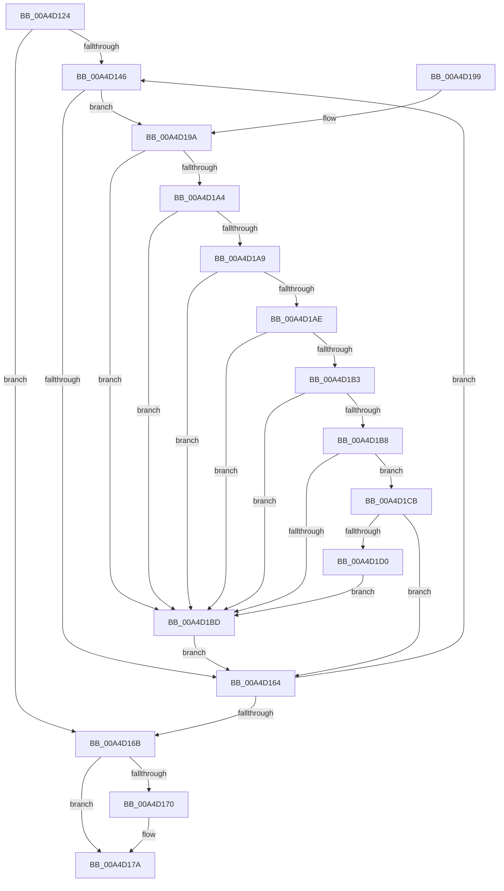

# SepFreeCapturedTokenSecurityAttributesInformation

- RVA: `0x00A4D124`–`0x00A4D1D2` (길이 `174` bytes)
- VA: `0x0000000140A4D124`
- 실행 섹션: `PAGE`
- PDB 이름 있음: `예`; PDB Function 태그: `아니요`
- unwind 정보 RVA: `0x000B0534`
- 디코드: `55`개 명령, `174/174` bytes 표시
- 미해석 바이트: `0` (있으면 어셈블리에 `.byte`로 보존)

> 이 문서는 커널 이미지의 기계어와 PDB 기호를 분석해 생성했습니다. 4번과 5번은 함수 원형과 자료형을 바이너리 사용 방식에서 추정한 C 해석이며 원본 소스 복구 결과는 아닙니다.

## 1. Dependencies

- 직접 호출 지점: **4**; 고유 호출 대상: **1**
- 직접 호출자로 확인된 함수: **3**
- RIP 상대 이미지 참조: **0**

### Outgoing calls
- `0x00A4D158` → [ExFreePoolWithTag](../../poolcode/B8/ExFreePoolWithTag_function_00B82870.md) (function, `0x00B82870`)
- `0x00A4D175` → [ExFreePoolWithTag](../../poolcode/B8/ExFreePoolWithTag_function_00B82870.md) (function, `0x00B82870`)
- `0x00A4D17F` → [ExFreePoolWithTag](../../poolcode/B8/ExFreePoolWithTag_function_00B82870.md) (function, `0x00B82870`)
- `0x00A4D1C4` → [ExFreePoolWithTag](../../poolcode/B8/ExFreePoolWithTag_function_00B82870.md) (function, `0x00B82870`)

### Direct callers
- [NtCreateTokenEx](../9C/NtCreateTokenEx_function_009C7C80.md) at `0x009C83FD`
- [NtCreateTokenEx](../9C/NtCreateTokenEx_function_009C7C80.md) at `0x009C840F`
- [NtCreateTokenEx](../9C/NtCreateTokenEx_function_009C7C80.md) at `0x009C869C`
- [NtCreateTokenEx](../9C/NtCreateTokenEx_function_009C7C80.md) at `0x009C86A6`
- [SepReleaseTokenSecurityAttributesAndOperationsInformation](SepReleaseTokenSecurityAttributesAndOperationsInformation_function_00A4D0E4.md) at `0x00A4D104`
- [sub_00B29154](../B2/Unknown_function_00B29154.md) at `0x00B2916A`

### Static image references
- 디코드된 RIP-relative 메모리 참조가 없습니다.

## 2. Other-region calls and transfers

- 다른 실행 섹션으로 향하는 call: **4**
  - `0x00A4D158` → [ExFreePoolWithTag](../../poolcode/B8/ExFreePoolWithTag_function_00B82870.md) (`PAGE` → `POOLCODE`)
  - `0x00A4D175` → [ExFreePoolWithTag](../../poolcode/B8/ExFreePoolWithTag_function_00B82870.md) (`PAGE` → `POOLCODE`)
  - `0x00A4D17F` → [ExFreePoolWithTag](../../poolcode/B8/ExFreePoolWithTag_function_00B82870.md) (`PAGE` → `POOLCODE`)
  - `0x00A4D1C4` → [ExFreePoolWithTag](../../poolcode/B8/ExFreePoolWithTag_function_00B82870.md) (`PAGE` → `POOLCODE`)
- 별도 외부 분기/꼬리 이동을 확인하지 못했습니다.

## 3. Assembly (complete function range)

```asm
00A4D124  48 89 5C 24 08                  mov qword ptr [rsp + 8], rbx
00A4D129  48 89 6C 24 10                  mov qword ptr [rsp + 0x10], rbp
00A4D12E  48 89 74 24 18                  mov qword ptr [rsp + 0x18], rsi
00A4D133  57                              push rdi
00A4D134  48 83 EC 20                     sub rsp, 0x20
00A4D138  48 8B 59 08                     mov rbx, qword ptr [rcx + 8]
00A4D13C  33 ED                           xor ebp, ebp
00A4D13E  48 8B F1                        mov rsi, rcx
00A4D141  39 69 04                        cmp dword ptr [rcx + 4], ebp
00A4D144  76 25                           jbe 0x140a4d16b
00A4D146  48 8D 3C AD 00 00 00 00         lea rdi, [rbp*4]
00A4D14E  33 D2                           xor edx, edx
00A4D150  48 03 FD                        add rdi, rbp
00A4D153  48 8B 4C FB 08                  mov rcx, qword ptr [rbx + rdi*8 + 8]
00A4D158  E8 13 57 13 00                  call 0x140b82870
00A4D15D  83 7C FB 18 00                  cmp dword ptr [rbx + rdi*8 + 0x18], 0
00A4D162  75 36                           jne 0x140a4d19a
00A4D164  FF C5                           inc ebp
00A4D166  3B 6E 04                        cmp ebp, dword ptr [rsi + 4]
00A4D169  72 DB                           jb 0x140a4d146
00A4D16B  48 85 DB                        test rbx, rbx
00A4D16E  74 0A                           je 0x140a4d17a
00A4D170  33 D2                           xor edx, edx
00A4D172  48 8B CB                        mov rcx, rbx
00A4D175  E8 F6 56 13 00                  call 0x140b82870
00A4D17A  33 D2                           xor edx, edx
00A4D17C  48 8B CE                        mov rcx, rsi
00A4D17F  E8 EC 56 13 00                  call 0x140b82870
00A4D184  48 8B 5C 24 30                  mov rbx, qword ptr [rsp + 0x30]
00A4D189  48 8B 6C 24 38                  mov rbp, qword ptr [rsp + 0x38]
00A4D18E  48 8B 74 24 40                  mov rsi, qword ptr [rsp + 0x40]
00A4D193  48 83 C4 20                     add rsp, 0x20
00A4D197  5F                              pop rdi
00A4D198  C3                              ret
00A4D199  CC                              int3
00A4D19A  0F B7 4C FB 10                  movzx ecx, word ptr [rbx + rdi*8 + 0x10]
00A4D19F  83 E9 01                        sub ecx, 1
00A4D1A2  74 19                           je 0x140a4d1bd
00A4D1A4  83 E9 01                        sub ecx, 1
00A4D1A7  74 14                           je 0x140a4d1bd
00A4D1A9  83 E9 01                        sub ecx, 1
00A4D1AC  74 0F                           je 0x140a4d1bd
00A4D1AE  83 E9 01                        sub ecx, 1
00A4D1B1  74 0A                           je 0x140a4d1bd
00A4D1B3  83 E9 01                        sub ecx, 1
00A4D1B6  74 05                           je 0x140a4d1bd
00A4D1B8  83 E9 01                        sub ecx, 1
00A4D1BB  75 0E                           jne 0x140a4d1cb
00A4D1BD  48 8B 4C FB 20                  mov rcx, qword ptr [rbx + rdi*8 + 0x20]
00A4D1C2  33 D2                           xor edx, edx
00A4D1C4  E8 A7 56 13 00                  call 0x140b82870
00A4D1C9  EB 99                           jmp 0x140a4d164
00A4D1CB  83 F9 0A                        cmp ecx, 0xa
00A4D1CE  75 94                           jne 0x140a4d164
00A4D1D0  EB EB                           jmp 0x140a4d1bd
```

## 4. C-style interpretation (structured pseudocode)

```c
__int64 __fastcall SepFreeCapturedTokenSecurityAttributesInformation(__int64 a1, int a2)
{
    __int64 result;
    __int64 v_rbp;
    __int64 v_rdi;
    __int64 v_rsp;
    unsigned __int64 v_stack_p10;
    unsigned __int64 v_stack_p18;
    unsigned __int64 v_stack_p8;

    v_stack_p8 = v_rbx;
    v_stack_p10 = v_rbp;
    v_stack_p18 = v_rsi;
    v_rsp = (v_rsp) - (32);
    v_rbp = 0;
    if ((*(unsigned int *)(a1 + 4)) <= 0) goto loc_00A4D16B;
loc_00A4D146:
    a2 = 0;
    v_rdi = (v_rbp * 4) + (0);
    result = ExFreePoolWithTag(*(unsigned __int64 *)(*(unsigned __int64 *)(a1 + 8) + v_rdi * 8 + 8), a2, a3, a4);
    if ((*(unsigned int *)(*(unsigned __int64 *)(a1 + 8) + v_rdi * 8 + 24)) != 0) goto loc_00A4D19A;
loc_00A4D164:
    v_rbp = (unsigned int)((v_rbp) + 1);
    if (((unsigned int)(v_rbp)) < (*(unsigned int *)(a1 + 4))) goto loc_00A4D146;
loc_00A4D16B:
    if (*(unsigned __int64 *)(a1 + 8) != 0) {
        a2 = 0;
        a1 = *(unsigned __int64 *)(a1 + 8);
        result = ExFreePoolWithTag(a1, a2, a3, a4);
    }
    a2 = 0;
    result = ExFreePoolWithTag(a1, a2, a3, a4);
    v_rsp = (v_rsp) + (32);
    return result;
loc_00A4D19A:
    a1 = (unsigned int)((*(unsigned __int16 *)(v_stack_p8 + v_rdi * 8 + 16)) - (1));
    if (condition_is_equal) goto loc_00A4D1BD;
    a1 = (unsigned int)((a1) - (1));
    if (condition_is_equal) goto loc_00A4D1BD;
    a1 = (unsigned int)((a1) - (1));
    if (condition_is_equal) goto loc_00A4D1BD;
    a1 = (unsigned int)((a1) - (1));
    if (condition_is_equal) goto loc_00A4D1BD;
    a1 = (unsigned int)((a1) - (1));
    if (condition_is_equal) goto loc_00A4D1BD;
    a1 = (unsigned int)((a1) - (1));
    if (condition_is_not_equal) goto loc_00A4D1CB;
loc_00A4D1BD:
    a2 = 0;
    result = ExFreePoolWithTag(*(unsigned __int64 *)(v_stack_p8 + v_rdi * 8 + 32), a2, a3, a4);
    goto loc_00A4D164;
loc_00A4D1CB:
    if (((unsigned int)(*(unsigned __int64 *)(v_stack_p8 + v_rdi * 8 + 32))) != 10) goto loc_00A4D164;
    goto loc_00A4D1BD;
}
```

## 5. (Beta) C Style

```c
int64_t SepFreeCapturedTokenSecurityAttributesInformation(void *Arg1, int32_t Arg2)
{
    uint8_t *arg1 = (uint8_t *)Arg1;

    int64_t result;
    int64_t local_rbp;
    int64_t local_rdi;
    int64_t local_rsp;
    uint64_t v_stack_p10;
    uint64_t v_stack_p18;
    uint64_t v_stack_p8;

    v_stack_p8 = local_rbx;
    v_stack_p10 = local_rbp;
    v_stack_p18 = local_rsi;
    local_rsp = (local_rsp) - (32);
    local_rbp = 0;
    if ((*(uint32_t *)(arg1 + 0x4)) <= 0) goto loc_00A4D16B;
loc_00A4D146:
    Arg2 = 0;
    local_rdi = (local_rbp * 4) + (0);
    result = ExFreePoolWithTag(*(uint64_t *)(*(uint64_t *)(arg1 + 0x8) + local_rdi * 8 + 0x8), Arg2, a3, a4);
    if ((*(uint32_t *)(*(uint64_t *)(arg1 + 0x8) + local_rdi * 8 + 0x18)) != 0) goto loc_00A4D19A;
loc_00A4D164:
    local_rbp = (uint32_t)((local_rbp) + 1);
    if (((uint32_t)(local_rbp)) < (*(uint32_t *)(arg1 + 0x4))) goto loc_00A4D146;
loc_00A4D16B:
    if (*(uint64_t *)(arg1 + 0x8) != 0) {
        Arg2 = 0;
        Arg1 = *(uint64_t *)(arg1 + 0x8);
        result = ExFreePoolWithTag(Arg1, Arg2, a3, a4);
    }
    Arg2 = 0;
    result = ExFreePoolWithTag(Arg1, Arg2, a3, a4);
    local_rsp = (local_rsp) + (32);
    return result;
loc_00A4D19A:
    Arg1 = (uint32_t)((*(uint16_t *)(v_stack_p8 + local_rdi * 8 + 0x10)) - (1));
    if (condition_is_equal) goto loc_00A4D1BD;
    Arg1 = (uint32_t)((Arg1) - (1));
    if (condition_is_equal) goto loc_00A4D1BD;
    Arg1 = (uint32_t)((Arg1) - (1));
    if (condition_is_equal) goto loc_00A4D1BD;
    Arg1 = (uint32_t)((Arg1) - (1));
    if (condition_is_equal) goto loc_00A4D1BD;
    Arg1 = (uint32_t)((Arg1) - (1));
    if (condition_is_equal) goto loc_00A4D1BD;
    Arg1 = (uint32_t)((Arg1) - (1));
    if (condition_is_not_equal) goto loc_00A4D1CB;
loc_00A4D1BD:
    Arg2 = 0;
    result = ExFreePoolWithTag(*(uint64_t *)(v_stack_p8 + local_rdi * 8 + 0x20), Arg2, a3, a4);
    goto loc_00A4D164;
loc_00A4D1CB:
    if (((uint32_t)(*(uint64_t *)(v_stack_p8 + local_rdi * 8 + 0x20))) != 10) goto loc_00A4D164;
    goto loc_00A4D1BD;
}
```

### 관측된 메모리 오프셋

구조체 형식이 확인되지 않은 접근은 인자 기준의 오프셋으로만 기록했습니다.

| 기준 인자 | 오프셋 표현 | 폭 (bit) | 접근 |
|---|---:|---:|---|
| `Arg1` | `+ 0x4` | `32` | `R` |
| `Arg1` | `+ 0x8` | `64` | `R` |

## 6. Execution-region graph

[열기: 2D/3D 그래프와 함수 탐색 컨트롤 패널](../../../control-panel.html?section=page&rva=0x00A4D124&view=graph)

- 2D 그래프는 위에서 아래로 흐르고, 3D 그래프는 빈 공간을 드래그해 회전합니다. Shift+드래그는 이동, 휠은 확대·축소, 함수 노드 선택은 대상 보고서 이동입니다.

### Static fallback


