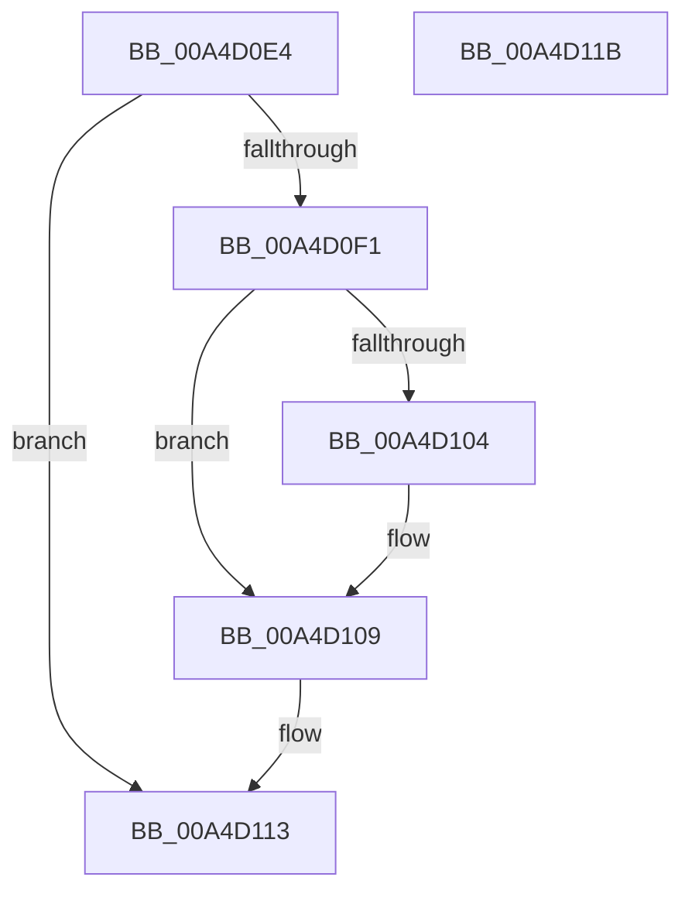

# SepReleaseTokenSecurityAttributesAndOperationsInformation

- RVA: `0x00A4D0E4`–`0x00A4D11C` (길이 `56` bytes)
- VA: `0x0000000140A4D0E4`
- 실행 섹션: `PAGE`
- PDB 이름 있음: `예`; PDB Function 태그: `아니요`
- unwind 정보 RVA: `0x0005CF00`
- 디코드: `20`개 명령, `56/56` bytes 표시
- 미해석 바이트: `0` (있으면 어셈블리에 `.byte`로 보존)

> 이 문서는 커널 이미지의 기계어와 PDB 기호를 분석해 생성했습니다. 4번과 5번은 함수 원형과 자료형을 바이너리 사용 방식에서 추정한 C 해석이며 원본 소스 복구 결과는 아닙니다.

## 1. Dependencies

- 직접 호출 지점: **3**; 고유 호출 대상: **2**
- 직접 호출자로 확인된 함수: **1**
- RIP 상대 이미지 참조: **0**

### Outgoing calls
- `0x00A4D0F7` → [ExFreePoolWithTag](../../poolcode/B8/ExFreePoolWithTag_function_00B82870.md) (function, `0x00B82870`)
- `0x00A4D104` → [SepFreeCapturedTokenSecurityAttributesInformation](SepFreeCapturedTokenSecurityAttributesInformation_function_00A4D124.md) (function, `0x00A4D124`)
- `0x00A4D10E` → [ExFreePoolWithTag](../../poolcode/B8/ExFreePoolWithTag_function_00B82870.md) (function, `0x00B82870`)

### Direct callers
- [NtSetInformationToken](../AF/NtSetInformationToken_function_00AF0530.md) at `0x00AF158E`
- [NtSetInformationToken](../AF/NtSetInformationToken_function_00AF0530.md) at `0x00AF1643`

### Static image references
- 디코드된 RIP-relative 메모리 참조가 없습니다.

## 2. Other-region calls and transfers

- 다른 실행 섹션으로 향하는 call: **2**
  - `0x00A4D0F7` → [ExFreePoolWithTag](../../poolcode/B8/ExFreePoolWithTag_function_00B82870.md) (`PAGE` → `POOLCODE`)
  - `0x00A4D10E` → [ExFreePoolWithTag](../../poolcode/B8/ExFreePoolWithTag_function_00B82870.md) (`PAGE` → `POOLCODE`)
- 별도 외부 분기/꼬리 이동을 확인하지 못했습니다.

## 3. Assembly (complete function range)

```asm
00A4D0E4  40 53                           push rbx
00A4D0E6  48 83 EC 20                     sub rsp, 0x20
00A4D0EA  48 8B D9                        mov rbx, rcx
00A4D0ED  84 D2                           test dl, dl
00A4D0EF  74 22                           je 0x140a4d113
00A4D0F1  48 8B 49 08                     mov rcx, qword ptr [rcx + 8]
00A4D0F5  33 D2                           xor edx, edx
00A4D0F7  E8 74 57 13 00                  call 0x140b82870
00A4D0FC  48 8B 0B                        mov rcx, qword ptr [rbx]
00A4D0FF  48 85 C9                        test rcx, rcx
00A4D102  74 05                           je 0x140a4d109
00A4D104  E8 1B 00 00 00                  call 0x140a4d124
00A4D109  33 D2                           xor edx, edx
00A4D10B  48 8B CB                        mov rcx, rbx
00A4D10E  E8 5D 57 13 00                  call 0x140b82870
00A4D113  33 C0                           xor eax, eax
00A4D115  48 83 C4 20                     add rsp, 0x20
00A4D119  5B                              pop rbx
00A4D11A  C3                              ret
00A4D11B  CC                              int3
```

## 4. C-style interpretation (structured pseudocode)

```c
__int64 __fastcall SepReleaseTokenSecurityAttributesAndOperationsInformation(__int64 a1, int a2)
{
    __int64 result;
    __int64 v_rsp;

    v_rsp = (v_rsp) - (32);
    if ((unsigned __int8)(a2) == 0) goto loc_00A4D113;
    a2 = 0;
    result = ExFreePoolWithTag(*(unsigned __int64 *)(a1 + 8), a2, a3, a4);
    if (*(unsigned __int64 *)(a1) != 0) {
        result = SepFreeCapturedTokenSecurityAttributesInformation(*(unsigned __int64 *)(a1), a2, a3, a4);
    }
    a2 = 0;
    result = ExFreePoolWithTag(a1, a2, a3, a4);
loc_00A4D113:
    result = 0;
    v_rsp = (v_rsp) + (32);
    return result;
}
```

## 5. (Beta) C Style

```c
int64_t SepReleaseTokenSecurityAttributesAndOperationsInformation(void *Arg1, int32_t Arg2)
{
    uint8_t *arg1 = (uint8_t *)Arg1;

    int64_t result;
    int64_t local_rsp;

    local_rsp = (local_rsp) - (32);
    if ((uint8_t)(Arg2) == 0) goto loc_00A4D113;
    Arg2 = 0;
    result = ExFreePoolWithTag(*(uint64_t *)(arg1 + 0x8), Arg2, a3, a4);
    if (*(uint64_t *)(arg1) != 0) {
        result = SepFreeCapturedTokenSecurityAttributesInformation(*(uint64_t *)(arg1), Arg2, a3, a4);
    }
    Arg2 = 0;
    result = ExFreePoolWithTag(Arg1, Arg2, a3, a4);
loc_00A4D113:
    result = 0;
    local_rsp = (local_rsp) + (32);
    return result;
}
```

### 관측된 메모리 오프셋

구조체 형식이 확인되지 않은 접근은 인자 기준의 오프셋으로만 기록했습니다.

| 기준 인자 | 오프셋 표현 | 폭 (bit) | 접근 |
|---|---:|---:|---|
| `Arg1` | `+ 0x0` | `64` | `R` |
| `Arg1` | `+ 0x8` | `64` | `R` |

## 6. Execution-region graph

[열기: 2D/3D 그래프와 함수 탐색 컨트롤 패널](../../../control-panel.html?section=page&rva=0x00A4D0E4&view=graph)

- 2D 그래프는 위에서 아래로 흐르고, 3D 그래프는 빈 공간을 드래그해 회전합니다. Shift+드래그는 이동, 휠은 확대·축소, 함수 노드 선택은 대상 보고서 이동입니다.

### Static fallback


